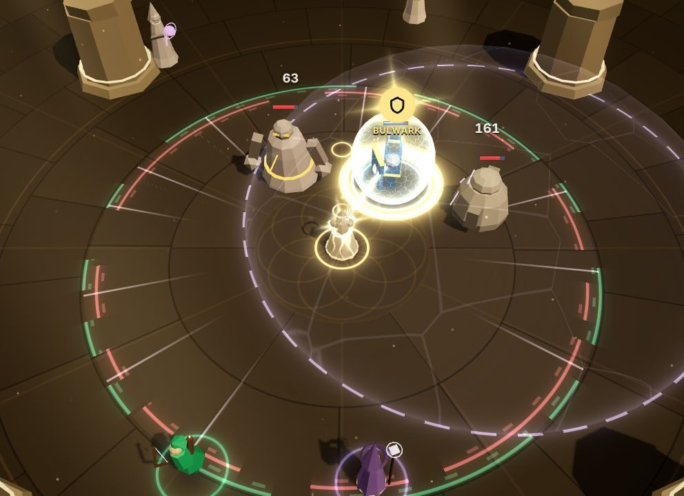

# Aetherweaver

A support-focused action roguelite: **you are the Weaver, and your party is the weapon.**

This repo is the remake of the original prototype, which is kept read-only in [`reference/original/`](reference/original/) and never imported. The design, the analysis of the original and the roadmap are in [`docs/plan/`](docs/plan/README.md).

**Status:** every phase up to the Expedition's Finale is built (the Prelude, the Loom, three Movements and the Finale, Echoes, This Week's Song, Dissonance), and Phase 7, polish and ship, is under way ([`docs/phase-7.md`](docs/phase-7.md)). There is also a **playtest demo** ([`docs/demo.md`](docs/demo.md)). What the game holds:

- **the Loom**, a hub of stations that light up as you play, each with a short first-contact intro: the **Astrolabe** (a passive tree), **Deeds**, the **Reliquary** (relics kept, crafted and carried), **Dissonance** (endgame difficulty), hero **Bonds**, **technique variants**, and the **Atelier**, where Starlight buys variants and keepsakes. Callings open their paths by **mastery**, and the Training Grounds hold a **Perfect-Ward trainer**;
- the **Prelude run**, then **Expeditions**: every Movement in turn, from the Spire to the Abyssal Rift and the Finale, where the Silent Conductor waits;
- three **Callings** (the Luminary, the Martyr and the Chronomancer), relics, events and a run economy;
- the signature features: heroes _call_ for your help (**Call and Response**), and the game shows the deaths you prevented and replays every fight **without you** (**proof of support**).

Each phase has its own doc: [`docs/phase-0.md`](docs/phase-0.md) through [`docs/phase-7.md`](docs/phase-7.md).



## Build, test and run

You need Node 22.12 or newer.

```bash
npm install
npm run dev          # the dev server, http://localhost:5173
npm run build        # the production build, in dist/ (with source maps)
npm run preview      # serve dist/ at http://localhost:4173
npm test             # the unit and determinism tests (Vitest)
npm run e2e          # the browser tests, against a fresh production build
npm run ci           # everything CI runs, in order
```

The browser tests need Chromium once: `npx playwright install chromium`. The dev server's page also opens the labs (`?lab=vfx`, `?lab=ui`, `?lab=audio`).

## Playing

From the title screen, **Enter the Loom**, then **the Gate** starts the Prelude. Build your songs in Prep (or pick a preset: new ones open as your Weaver Rank grows, or all at once with **Settings → Skip the unlocks**). Then travel the branching map through skirmishes, elites, shrines and respites to the **Bellwarden** and the **Hollow Cantor**. The **Training Grounds** are a sandbox with an enemy spawner and the Perfect-Ward trainer. Append `?seed=123` for a fixed seed.

| Input                              | Action                                                                     |
| ---------------------------------- | -------------------------------------------------------------------------- |
| WASD / arrows                      | Move the Weaver                                                            |
| 1–4, click a hero or a party frame | Attach the Thread to that hero                                             |
| Right mouse                        | Toggle the Thread: **Mend** (heal, revive) ⇄ **Empower** (more damage)     |
| Q                                  | **Ward** the hovered (else threaded) hero; just before a hit = **Perfect** |
| E                                  | **Chime** at the cursor (or hovered hero): cleanses marks and ailments     |
| F                                  | **Reel** the hovered (else threaded) hero to you, out of danger            |
| Space                              | **Glide** (dash with i-frames)                                             |
| T · Shift+1–4                      | **Cue** a charged hero's Solo (costs one Resonance segment)                |
| R                                  | **Crescendo** at full Resonance                                            |
| V                                  | **Plant** your Pedal Point field at the cursor                             |
| Hold C / hold middle mouse         | **Directive wheel**: Focus · Rally · Hold · Scatter                        |
| G / middle-click an enemy          | Focus: the whole party targets it                                          |
| Z · X                              | Directive shortcuts: Rally · Hold                                          |
| Mouse wheel · Esc · `` ` `` · F3   | Zoom · Pause · Dev panel · Perf HUD                                        |

Keys are bound by physical position (`KeyboardEvent.code`), so they work on AZERTY and QWERTZ layouts too. **Settings → Controls** lists every binding and rebinds the keys. This table is the short list; Settings has the rest.

Your **beam song** (Chord I) pours into whoever you Thread at double strength; everyone else near you hears an echo. Your **field song** (Chord II, from Rank 2) reaches everyone near you at full strength.

When a hero **calls** for help (a gold glyph over them), answer it before their move goes off: **Ward** Kael, **Empower** Lyra (Thread her, right mouse), **Chime** Vexis. Their move becomes a stronger _Flourish_.

## Scripts

| `npm run …`            | What it does                                                                                                                         |
| ---------------------- | ------------------------------------------------------------------------------------------------------------------------------------ |
| `dev`                  | Vite dev server (`?lab=vfx`, `?lab=ui`, `?lab=audio` open the workstream labs)                                                       |
| `build` · `preview`    | Production build · serve it                                                                                                          |
| `build:demo`           | The playtest demo's build (`dist-demo/`, relative paths): it offers testers a fresh start or a veteran profile                       |
| `typecheck`            | Three TS projects: **sim** (no DOM/Node types), **app**, **node** (tools, tests, e2e)                                                |
| `lint`                 | ESLint (including the architecture rules) and a Prettier check                                                                       |
| `test`                 | Vitest: combat mechanics, run logic, saves, bots, determinism goldens, replays, architecture                                         |
| `e2e`                  | Playwright against the production build                                                                                              |
| `e2e:fullrun`          | The full run: a whole Expedition played node by node through the real app (long; not in `e2e`, see Release)                          |
| `licenses`             | Checks the licence record in `assets/licenses/` against the build in `dist/` (`-- --write` rebuilds it)                              |
| `release-check`        | The release checklist, row by row: green, red, or not provable here, with the evidence (see Release)                                 |
| `harness`              | Balance harness: Idle / Novice / Skilled bots per encounter; `-- --run` plays whole Prelude runs; `-- --loadout beam` picks a preset |
| `loadouts`             | Loadout report: every Chord preset × every encounter × bot, flagging dead and dominant loadouts                                      |
| `sim:bench`            | Headless sim benchmark; `-- --check` enforces the 1.5 ms/tick budget                                                                 |
| `sim:replay -- <file>` | Re-simulate a replay file and verify its hash                                                                                        |
| `golden:update`        | Regenerate golden hashes (only for _intended_ sim changes; prints what changed)                                                      |
| `ci`                   | Everything CI runs, in order                                                                                                         |

## Architecture in one screen

```
   keyboard/mouse ─▶ src/input ──Commands──▶ ┌──────────────┐ ──Events──▶ src/render (VFX), src/audio, HUD callouts
   bots / replays / dev panel ─Commands────▶ │   src/sim    │
                                             │ pure TS,     │ ──read-only state──▶ src/render (three.js)
                                             │ 60 Hz ticks, │                      src/ui (15 Hz HUD snapshot)
                                             │ seeded RNG   │ ──hash()──▶ replays, goldens, harness
                                             └──────────────┘
   src/meta (pure run logic: map, drafts, grades, save) ◀──▶ src/app/runStore ◀──▶ src/ui screens
```

- **`src/sim`** is the deterministic combat simulation and the source of truth.
  - Contracts: [`commands.ts`](src/sim/commands.ts) (in), [`events.ts`](src/sim/events.ts) (out), [`state.ts`](src/sim/state.ts) (read-only view), [`api.ts`](src/sim/api.ts) (`createSim` and the system order), [`replay.ts`](src/sim/replay.ts).
  - `combat/` holds the damage / heal / shield / status pipeline, telegraphs (Perfect Wards, saves), threat and Resonance; `systems/` the Weaver, Thread, techniques, aura field, hero AI, Solos, enemy AI, bosses and the encounter director.
- **`src/content`** holds zod-validated data: the Weaver's kit, heroes, enemies and their attacks, auras, motifs, arenas and encounters. `CONTENT_VERSION` is a hash of the content.
- **`src/meta`** is the run layer: seeded map generation, drafts, respites, carry-over, grades, highlights and the versioned save.
- **`src/bots`** are Idle / Novice / Skilled players that read state and issue Commands, for the harness, tests and autoplay.
- **`src/render`** (three.js), **`src/audio`** (WebAudio synthesis) and **`src/ui`** (React + zustand) present the sim; **`src/app`** runs the frame loop and owns the run store and settings.
- **`tools/`** holds the harness, scenarios, bench, golden updater and replay verifier. Tests live in **`tests/`** and **`e2e/`**.

## Rules (for people and agents)

1. **The sim is pure.** No DOM, three.js, React or zustand in `src/sim` or `src/content`, and no `Math.random`, wall-clock reads or engine-dependent `Math` functions (`sin`, `atan2`, `pow`, `hypot`, …): use `sim/core/dmath`.
   - This is enforced three ways: `tsconfig.sim.json` has no DOM types, ESLint flags violations, and [`tests/architecture.test.ts`](tests/architecture.test.ts) scans the code.
2. **Commands in, events out.** Nothing outside the sim mutates sim state. Persistent visuals derive from state; transient feedback comes from events.
3. **Determinism is tested.** The same seed and commands give the same hash in Node and in Chromium.
   - If you change sim behaviour on purpose, run `npm run golden:update` and say why in the commit.
   - Bump `SIM_VERSION` when old replays should stop validating.
4. **Files marked `CONTRACT`** are shared interfaces other workstreams code against. Change them deliberately.
5. **No per-frame React.** The HUD reads 15 Hz snapshots and perf stats arrive at 4 Hz.
6. **Balance changes go through the harness.** Run `npm run harness` before and after, and keep the bands in [`docs/phase-1.md`](docs/phase-1.md#difficulty-contract).
7. **Definition of done** is in [docs/plan/06-roadmap.md §4](docs/plan/06-roadmap.md#4-definition-of-done-any-task).

## Release

`npm run build` writes a static site to `dist/`: serve it from any web server, with no server code, no account and no network request from the game. `npm run build:demo` writes the playtest demo to `dist-demo/` (relative paths, no source maps; [`docs/demo.md`](docs/demo.md)).

**Checking a build.** `npm run release-check` prints each row of the release checklist (docs/plan/06 §6, and the exit criteria in [`docs/phase-7.md`](docs/phase-7.md)) as green, red, "not provable here" (it needs a person, a real GPU or a real laptop) or "not run" (nobody gave it the evidence). On its own it runs only quick checks. The long runs are read from their logs:

```bash
npm run e2e:fullrun > fullrun.log          # a whole Finale-route Expedition, through the real app, with sound on
npm run release-check -- --suite full.log.json --e2e e2e.log --fullrun fullrun.log --run goldens,sim-bench
```

The full run is kept out of `npm run e2e` (it can take hours under software rendering): without `AW_FULLRUN` set, its file is skipped.

**Release notes.**

- **No offline mode.** There is no service worker and no manifest: the build is static, and a cached old build would read newer weekly replays as another version.
- **No desktop wrapper.** A Tauri build is not made. It would need a `src-tauri` crate pointing at `dist-demo`-style relative paths, module workers, IndexedDB and WebGL2 working in each platform's web view (WebView2, WKWebView, WebKitGTK), `localStorage` kept per app, and icons, signing and installers for each platform. None of that can be shown from here.
- **The demo's two starts stay out of the release.** The Fresh and Veteran choice exists only in `build:demo`.
- **The dev panel, the test hook and the labs are in the release build.** The dev panel opens on Backquote, the test hook installs with `?e2e=1` and the labs open with `?lab=`. They act only on the player's own device, the browser tests run against the production build, and the run verifier refuses a replay that holds a debug command.

## Third-party licences

[`assets/licenses/`](assets/licenses/README.md) is the licence record: every package that ships in the build (react, react-dom, scheduler, three, zod, zustand and the three self-hosted font families, with the two build tools whose generated code is in the build), its version, its licence and the licence text itself. There are no art or audio assets: models are procedural three.js primitives and all sound is synthesised with WebAudio. The fonts are Cinzel, Inter and JetBrains Mono, self-hosted via `@fontsource` under the SIL Open Font License.

`npm run licenses` rebuilds the shipped list from the build's source maps, its font files and the runtime dependencies, and fails if a shipped module has no record or the build holds a file that is not code, style or a font. CI runs it after the build.
