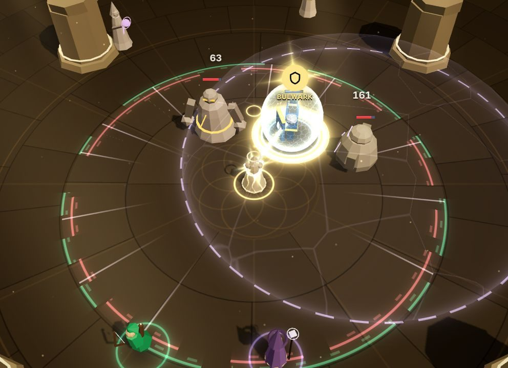

# Aetherweaver

A support-focused action roguelite: **you are the Weaver, and your party is the weapon.**

This repo is the remake of the original prototype, which is kept read-only in [`reference/original/`](reference/original/) and never imported. The design, the analysis of the original and the roadmap are in [`docs/plan/`](docs/plan/README.md).

**Status:** Phase 2 is built on top of Phase 1's playable **Prelude run**:

- the build layer: two Chords of auras plus ornaments, Fermata, and a loadout report;
- two signature features: heroes _call_ for your help (**Call and Response**), and the game shows the deaths you prevented and replays every fight **without you** (**proof of support**).

The automated checks pass; the human playtest is next. See [`docs/phase-2.md`](docs/phase-2.md), [`docs/phase-1.md`](docs/phase-1.md) and [`docs/phase-0.md`](docs/phase-0.md).



## Quick start

```bash
npm install
npm run dev          # http://localhost:5173
```

From the title screen, **New run** starts the Prelude: build your Chords (or pick a preset: Steady, Beam, Anchor, Wide Choir), then travel the branching map through skirmishes, elites, shrines and respites to the **Bellwarden** and the **Hollow Cantor**. **Training Grounds** is a sandbox with an enemy spawner. Append `?seed=123` for a fixed seed.

| Input                              | Action                                                                     |
| ---------------------------------- | -------------------------------------------------------------------------- |
| WASD / arrows                      | Move the Weaver                                                            |
| 1–4, click a hero or a party frame | Attach the Thread to that hero                                             |
| Right mouse                        | Toggle the Thread: **Mend** (heal, revive) ⇄ **Empower** (more damage)     |
| Q                                  | **Ward** the hovered (else threaded) hero; just before a hit = **Perfect** |
| E                                  | **Chime** at the cursor (or hovered hero): cleanses marks and ailments     |
| F                                  | **Reel** the hovered (else threaded) hero to you, out of danger            |
| Space                              | **Glide** (dash with i-frames)                                             |
| T · Shift+1–4                      | **Cue** a charged hero's Solo (costs one Resonance segment)                |
| R                                  | **Crescendo** at full Resonance                                            |
| V                                  | **Plant** your Pedal Point field at the cursor                             |
| Hold C / hold middle mouse         | **Directive wheel**: Focus · Rally · Hold · Scatter                        |
| G / middle-click an enemy          | Focus: the whole party targets it                                          |
| Z · X                              | Directive shortcuts: Rally · Hold                                          |
| Mouse wheel · Esc · `` ` `` · F3   | Zoom · Pause · Dev panel · Perf HUD                                        |

Keys are bound by physical position (`KeyboardEvent.code`), so they work on AZERTY and QWERTZ layouts too, and every key can be rebound in **Settings → Controls**.

When a hero **calls** for help (a gold glyph over them), answer it before their move goes off: **Ward** Kael, **Empower** Lyra (Thread her, right mouse), **Chime** Vexis. Their move becomes a stronger _Flourish_.

## Scripts

| `npm run …`            | What it does                                                                                                                         |
| ---------------------- | ------------------------------------------------------------------------------------------------------------------------------------ |
| `dev`                  | Vite dev server (`?lab=vfx`, `?lab=ui`, `?lab=audio` open the workstream labs)                                                       |
| `build` · `preview`    | Production build · serve it                                                                                                          |
| `typecheck`            | Three TS projects: **sim** (no DOM/Node types), **app**, **node** (tools, tests, e2e)                                                |
| `lint`                 | ESLint (including the architecture rules) and a Prettier check                                                                       |
| `test`                 | Vitest: combat mechanics, run logic, saves, bots, determinism goldens, replays, architecture                                         |
| `e2e`                  | Playwright against the production build                                                                                              |
| `harness`              | Balance harness: Idle / Novice / Skilled bots per encounter; `-- --run` plays whole Prelude runs; `-- --loadout beam` picks a preset |
| `loadouts`             | Loadout report: every Chord preset × every encounter × bot, flagging dead and dominant loadouts                                      |
| `sim:bench`            | Headless sim benchmark; `-- --check` enforces the 1.5 ms/tick budget                                                                 |
| `sim:replay -- <file>` | Re-simulate a replay file and verify its hash                                                                                        |
| `golden:update`        | Regenerate golden hashes (only for _intended_ sim changes; prints what changed)                                                      |
| `ci`                   | Everything CI runs, in order                                                                                                         |

## Architecture in one screen

```
   keyboard/mouse ─▶ src/input ──Commands──▶ ┌──────────────┐ ──Events──▶ src/render (VFX), src/audio, HUD callouts
   bots / replays / dev panel ─Commands────▶ │   src/sim    │
                                             │ pure TS,     │ ──read-only state──▶ src/render (three.js)
                                             │ 60 Hz ticks, │                      src/ui (15 Hz HUD snapshot)
                                             │ seeded RNG   │ ──hash()──▶ replays, goldens, harness
                                             └──────────────┘
   src/meta (pure run logic: map, drafts, grades, save) ◀──▶ src/app/runStore ◀──▶ src/ui screens
```

- **`src/sim`** is the deterministic combat simulation and the source of truth.
  - Contracts: [`commands.ts`](src/sim/commands.ts) (in), [`events.ts`](src/sim/events.ts) (out), [`state.ts`](src/sim/state.ts) (read-only view), [`api.ts`](src/sim/api.ts) (`createSim` and the system order), [`replay.ts`](src/sim/replay.ts).
  - `combat/` holds the damage / heal / shield / status pipeline, telegraphs (Perfect Wards, saves), threat and Resonance; `systems/` the Weaver, Thread, techniques, aura field, hero AI, Solos, enemy AI, bosses and the encounter director.
- **`src/content`** holds zod-validated data: the Weaver's kit, heroes, enemies and their attacks, auras, motifs, arenas and encounters. `CONTENT_VERSION` is a hash of the content.
- **`src/meta`** is the run layer: seeded map generation, drafts, respites, carry-over, grades, highlights and the versioned save.
- **`src/bots`** are Idle / Novice / Skilled players that read state and issue Commands, for the harness, tests and autoplay.
- **`src/render`** (three.js), **`src/audio`** (WebAudio synthesis) and **`src/ui`** (React + zustand) present the sim; **`src/app`** runs the frame loop and owns the run store and settings.
- **`tools/`** holds the harness, scenarios, bench, golden updater and replay verifier. Tests live in **`tests/`** and **`e2e/`**.

## Rules (for people and agents)

1. **The sim is pure.** No DOM, three.js, React or zustand in `src/sim` or `src/content`, and no `Math.random`, wall-clock reads or engine-dependent `Math` functions (`sin`, `atan2`, `pow`, `hypot`, …): use `sim/core/dmath`.
   - This is enforced three ways: `tsconfig.sim.json` has no DOM types, ESLint flags violations, and [`tests/architecture.test.ts`](tests/architecture.test.ts) scans the code.
2. **Commands in, events out.** Nothing outside the sim mutates sim state. Persistent visuals derive from state; transient feedback comes from events.
3. **Determinism is tested.** The same seed and commands give the same hash in Node and in Chromium.
   - If you change sim behaviour on purpose, run `npm run golden:update` and say why in the commit.
   - Bump `SIM_VERSION` when old replays should stop validating.
4. **Files marked `CONTRACT`** are shared interfaces other workstreams code against. Change them deliberately.
5. **No per-frame React.** The HUD reads 15 Hz snapshots and perf stats arrive at 4 Hz.
6. **Balance changes go through the harness.** Run `npm run harness` before and after, and keep the bands in [`docs/phase-1.md`](docs/phase-1.md#difficulty-contract).
7. **Definition of done** is in [docs/plan/06-roadmap.md §4](docs/plan/06-roadmap.md#4-definition-of-done-any-task).

## Third-party assets

There are no art or audio assets: models are procedural three.js primitives and all sound is synthesised with WebAudio. The fonts are Cinzel, Inter and JetBrains Mono, self-hosted via `@fontsource` under the SIL Open Font License.
