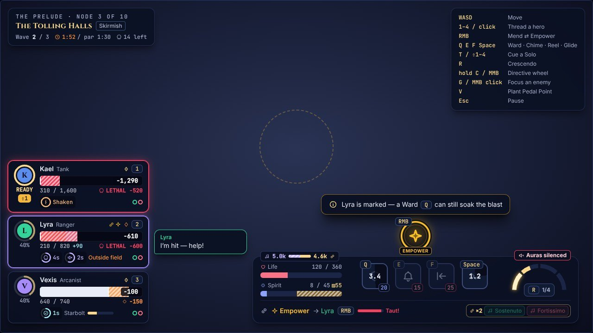
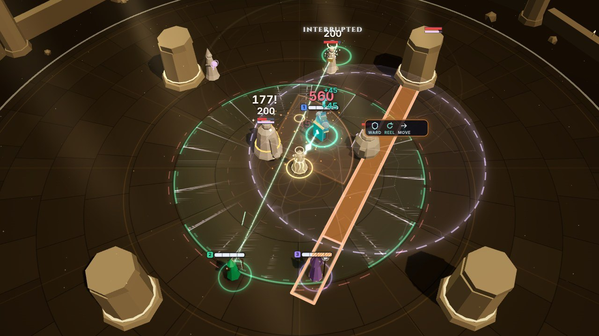
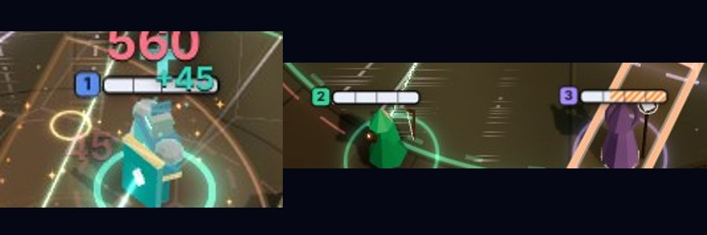
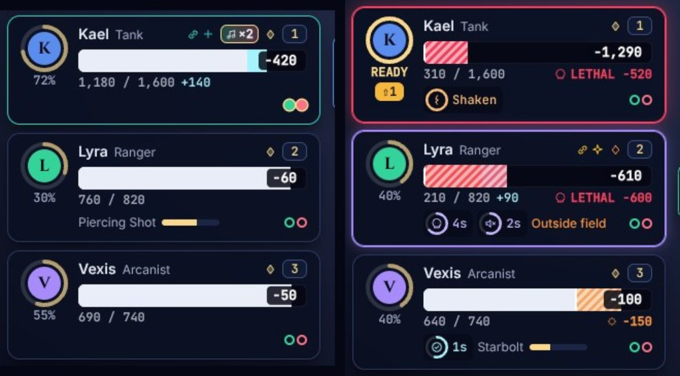
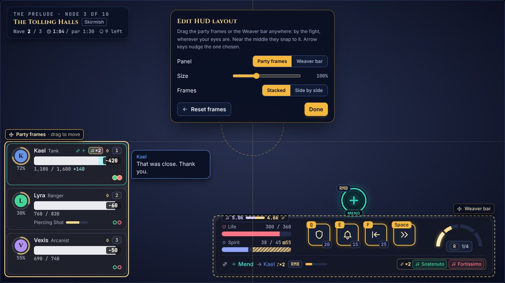
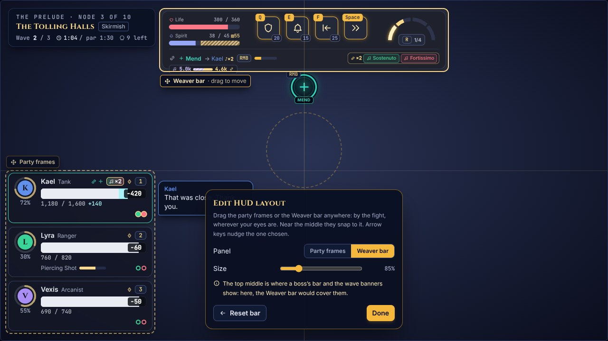
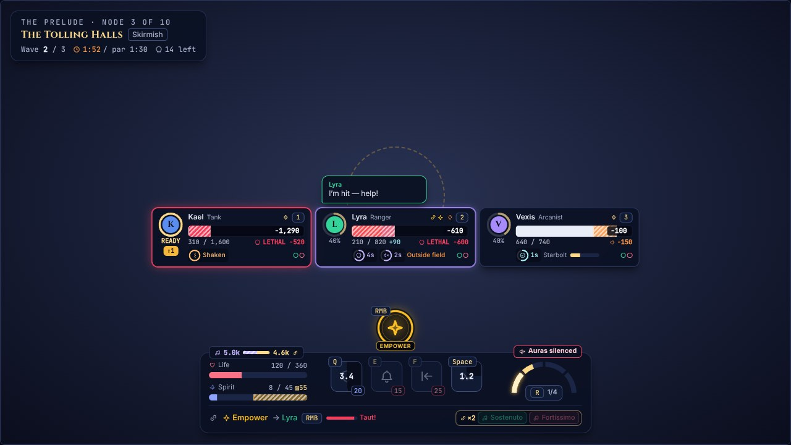

# Health at a glance

*2026-10-31 · plan: [04 §5.2](plan/04-presentation.md#52-layout-combat) · follows [the Thread dial](thread-dial.md)*

Asked for after playing: health was hard to see in a fight, and the party frames were hard to see or click where they sat. The user also asked that the frames move wherever the player wants, as in WoW, and then the Weaver bar too. This is what the best healer UIs do, and what changed here to match.

## What healer UIs share

We looked at the raid frames of top WoW raid healers, Overwatch's and Marvel Rivals' supports, and today's healer frame addons. A world-first raider's own UI write-up wasn't reachable from here: Method's guides were blocked by the session's network. What they share:

- **Frames near the middle of the screen,** not in a corner, often as a separate healer layout. They're moved there by the player: WoW's Edit Mode and the frame addons move them anywhere.
- **What's missing, not what's left.** The missing life is the number to read (as "−42k"), and low life is highlighted.
- **Prediction.** Incoming heals and shields show on the bar. Since this summer, one addon also shows which player an enemy's spell targets, on the frames. Our striped incoming-damage forecast already did that.
- **The whole frame speaks.** Dispellable debuffs colour its border, and out-of-range players fade.
- **Bars over allies' heads.** Supports in Overwatch and Marvel Rivals see them by default, with a flag on the critical.

Ours fell short on all but prediction:
- the bars over the heroes were 34 × 5 px, showed only once a hero was hurt, and wore the hero's colour, like an enemy's;
- the frames sat bottom left, their bars teal at any life (also Mend's colour), the numbers small and grey.

## The bars over the heroes

- **The whole party, always,** about twice the old size, in the overlay over the fight (`PartyBarsView`, src/render/partyBars.ts).
- **The colour of how much is left,** not the hero's: soft white, then the palette's threat under half, its lethal under a quarter, glowing and pulsing. The colour-vision palettes keep threat and lethal apart.
- **The last hit** shows as a white trail: it holds 0.4 s, then drains to the life left. Shields show as a band after the life. The damage telegraphed at them shows as stripes at its end, red when it would down them.
- **Quarter ticks** show how much at a glance.
- **The key that threads them** sits on a tag in their colour, so "Lyra is low" turns into a key without a look away.
- **Faded out of reach:** beyond the techniques' range (14 m), as WoW fades out-of-range frames.
- **Placement:** just over the head, under the Thread's mode glyph and a call's bubble.

The enemies' bars are unchanged, so heroes and enemies no longer look alike.

## The party frames

- **The same ramp as over their heads:** soft white, threat under half, lethal under a quarter. Hero colours stay on the portrait and the key.
- **The number a healer works from,** in big type on a dark tag: the life missing by default ("−420"; nothing at full life). Settings can switch it to the percent or the life left. The exact life stays under the bar, and the bar is taller (16 → 22 px).
- **The last hit** shows as a white trail, as over their heads. Stripes still show what's coming, LETHAL when it would down them.
- **The whole frame speaks:**
  - It glows red under a quarter of their life.
  - It glows violet when they have an ailment Chime would cleanse. Not under Blind Score, which names no answer.
  - It fades when they're out of the Weaver's reach.
- **The percent left out:** the portrait's ring already shows a percent, the Solo's charge, and two percents side by side read as one.

## Moving the frames and the Weaver bar: Edit HUD layout

Pause, then **Edit HUD layout**. The fight stays paused under it. Two panels move: the **party frames** and the **Weaver bar**.

- **Choose a panel** by clicking or dragging it, or with **Panel** in the toolbar. The chosen one has a solid outline.
- **Drag it anywhere.** Near the screen's middle it snaps to it. Arrow keys nudge it, Shift five times as far.
- **Size:** the frames 75–150%, the Weaver bar 75–125%.
- **The frames stacked or side by side.** A row centred under the fight is the layout many healers use.
- **Reset** puts the chosen panel back where it started, at its first size. **Done**, or Esc, closes the editor; Esc doesn't end the pause.

Each drag is saved as it ends. A panel is pinned by its corner nearest the screen's edges, or by its middle if centred, as a share of the screen (`placeFor`, src/ui/hud/framesLayout.ts). So it keeps its place at any resolution and grows away from the edge it's pinned to.

What hangs off a panel opens toward the middle of the screen:
- the frames' speech bubbles and tooltips: beside a column, above or below a row;
- the Weaver bar's crest (the Thread dial, the coach's hint and refused techniques), its tooltips and the badges on its edge: over it in the bottom half, under it in the top half.

The frames draw over the Weaver bar, and both over the boss's bar and the fight's banners, so wherever they're put they stay seen and clickable. Only the column top left (the fight's name, relics and chips) draws over them. The toolbar keeps out of their way: top middle, else the bottom, else the middle of the screen.

A boss's bar and the wave banners show at the top middle, and they aren't on screen while the editor is open. A panel put there would cover them, so the toolbar says so (`coversTopBand`).

## Alerts

- **A low-life sound:** two soft falling notes as a hero falls under a quarter of their life. It sounds once per fall (re-armed back over 40%), at most once every 1.5 s across the party. It plays under the heartbeat that was already there under 30%.
- **The off-screen arrow** of a hero under a quarter pulses red, as it does for a threat, its dot still in their colour.

## Settings

Settings → **Health and the HUD** (settings v4; older settings get these defaults):

| Setting | Default | Choices |
|---|---|---|
| Bars over the heroes | Always | Always · When hurt · Off |
| Party frames show | Life missing | Life missing · Percent · Life left |
| Low-life sound | On | On · Off |
| Party frame size | 100% | 75–150% |
| Party frames | Stacked | Stacked · Side by side |
| Weaver bar size | 100% | 75–125% |
| Reset positions | | Moves the frames and the Weaver bar back to their default places |

Moving them is Edit HUD layout's, from the pause menu. Settings saved before the Weaver bar could move get its default place and size.

## Checks

- **tests/healthUi.test.ts:**
  - The frames' places: corners, the middle, kept on screen, snapping.
  - The Weaver bar's place, by default and moved; its crest under it in the top half.
  - The side barks open on.
  - The editor's drafts, its toolbar keeping clear of the panels, the top-middle note, and the saved settings.
  - The frames' colours, numbers and states.
  - The bars over the heroes from a real sim: the whole party with keys and colours, the trail holding and draining, critical and glowing, faded out of reach, When hurt and Off.
- **tests/audioHealth.test.ts:** the low-life alert through the real director: once per fall, re-armed, rate-limited, silent when off.
- **tests/meta/migration.test.ts:** settings v3 → v4, and v4 saved before the Weaver bar could move.
- **e2e:** a bar over each hero in the Training Grounds. Edit HUD layout from the pause menu: the frames dragged to the right and turned side by side, the Weaver bar dragged into the top half with its dial under it, then both saved.
- **The UI lab:**
  - `?lab=ui&view=hud-layout-edit` opens the editor over a fight.
  - `hud-layout-edit-bar` opens it with the Weaver bar moved to the top.
  - `hud-frames-row` shows a centred row over a centred Weaver bar.
  - `hud-frames-right` shows a column on the right.
  - `hud-bar-top` shows the Weaver bar at the top, its crest under it.

## Known gaps

- **Only the party frames and the Weaver bar move.** Edit HUD layout is built so other panels can join it.
- **The rest of the HUD doesn't make way.** A panel can be put over the top middle's boss bar and banners (the editor warns), the centre's messages, or the Training Grounds' trainer.
- **No incoming-heal prediction** on the bars yet: the Thread's Mend over the next second.
- **No gamepad.** Fights don't take a gamepad yet ([docs/demo.md](demo.md)), so the editor is mouse and keyboard only.
