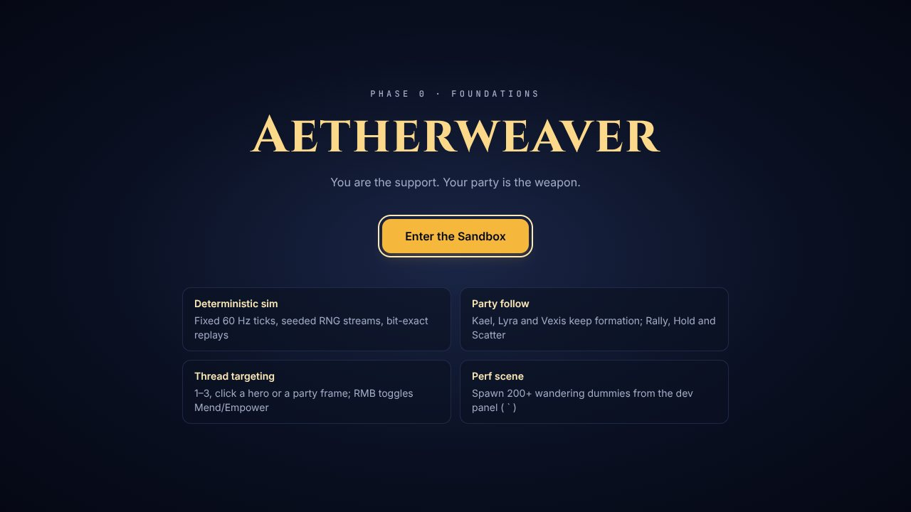
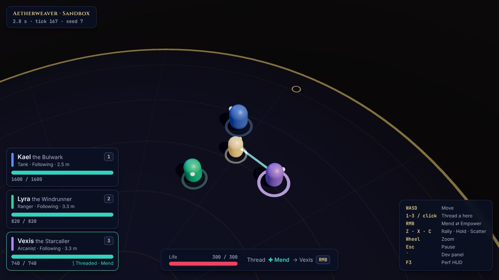
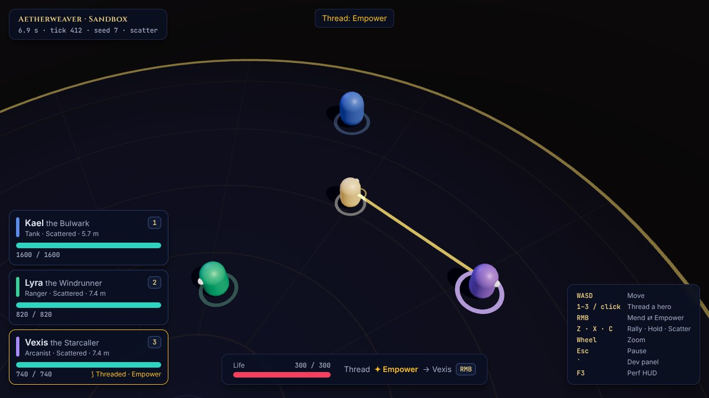
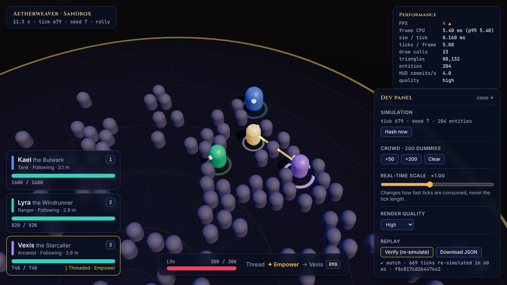

# Phase 0 — Foundations: exit report

*2026-10-24 · plan: [docs/plan/06-roadmap.md, Phase 0](plan/06-roadmap.md#phase-0--foundations-s)*

Phase 0 builds the skeleton every later phase hangs on:
- a **deterministic, headless simulation** with frozen contracts
- a three.js **render shell**
- **layout-independent input**
- a **React UI shell** that never re-renders per frame
- **debug tools**
- tests that prove the parts that matter: determinism, purity and budgets

There is no gameplay yet beyond moving the Weaver, a party that follows, Thread targeting and directives. That is by design: Phase 1 adds combat.

| Title | Sandbox: party in formation, Thread on Vexis |
|---|---|
|  |  |
| **Scatter + Empower** | **200 dummies, perf HUD, in-browser replay verify** |
|  |  |

## Exit criteria

| Criterion | Result | Evidence |
|---|---|---|
| A capsule party moves and follows the Weaver | ✅ | Formation error under 0.1 m while running, and Hold, Rally and Scatter verified, in [`tests/sim/party.test.ts`](../tests/sim/party.test.ts). The e2e test *"the party follows the Weaver, and Hold / Rally work"* drives real keyboard input |
| A recorded command log replays to an identical hash | ✅ | Golden hashes, JSON round-trip, tamper and malformed-file detection in [`tests/sim/determinism.test.ts`](../tests/sim/determinism.test.ts). In e2e *"a real browser session replays bit-exactly in Node"*, Chromium input is exported and re-simulated in Node to the same hash. The dev panel's Verify button re-simulated 669 ticks with 200 dummies in 60 ms |
| 200 dummy entities hold 60 FPS | ✅ CPU side · ⚠ GPU unverified | Headless (250 entities): **0.15 ms/tick** average, 0.24 ms p95, against a 1.5 ms budget. In the browser with 204 entities: **21–23 draw calls** (the crowd is one instanced draw), 88k triangles, **1.3–5.4 ms** main-thread CPU per frame, and **4 HUD commits/s**. This container renders with SwiftShader (software), which caps at about 4–6 FPS regardless of content, so real-GPU frame rate needs one manual check (below) |
| CI is green | ✅ locally | `npm run ci` (typecheck → lint → 94 tests → build → 5 e2e) and `npm run sim:bench -- --check` pass. [`.github/workflows/ci.yml`](../.github/workflows/ci.yml) runs the same steps, but has not run on GitHub yet because the repo has no remote |

## What was built

**Contracts.** These are frozen and coded against by later workstreams; each file is marked `CONTRACT`.
- [`src/sim/commands.ts`](../src/sim/commands.ts): the full Command union for the game, including Phase 1+ techniques, Cue, Crescendo and Directives, plus debug ops.
- [`src/sim/events.ts`](../src/sim/events.ts): the full event union. Phase 1+ events (damage, heals, telegraphs, Perfect Ward, Save…) are declared now so render, UI and audio can build against them.
- [`src/sim/state.ts`](../src/sim/state.ts) and [`src/sim/api.ts`](../src/sim/api.ts): the read-only world view and `createSim`.
- [`src/sim/replay.ts`](../src/sim/replay.ts): the replay format, with a zod schema type-checked against the Command contract.
- [`src/content/schema.ts`](../src/content/schema.ts) and [`src/content/effects.ts`](../src/content/effects.ts): content schemas and the effect vocabulary (stat buckets, triggers, effects).
- [`src/ui/store.ts`](../src/ui/store.ts): the HUD snapshot shape.
- `src/render/views.ts`: the `EntityView` interface. Phase 1 replaced it with the `WorldView` contract in [`src/render/types.ts`](../src/render/types.ts).

**Sim core.**
- Fixed 60 Hz stepper with a spiral-of-death guard.
- xoshiro128** with five independent named streams.
- Pooled entity store with generation-checked handles.
- Counting-sort spatial hash.
- Exact-bit 64-bit state hash.
- Deterministic `dsin`/`dcos`/`datan2`.
- Phase 0 systems: Weaver movement with smoothed heading, feed-forward formation following, Hold/Rally/Scatter with acknowledgement barks, Thread target and mode, debug wander-dummies, overlap resolution and arena bounds.

**Around it.**
- Render: three.js stage (ACES tone mapping, shadows, quality-tier stub), follow camera with cursor look-ahead and trauma shake, the arena floor, capsule views and an instanced crowd.
- Input: a `KeyboardEvent.code` action map with layout-aware key labels, mouseover hero picking and smart-cast.
- The runtime loop, with replay recording, pause and hidden-tab handling.
- UI: title and sandbox screens, HUD from a 15 Hz bridge, design tokens, self-hosted fonts.
- Debug: dev panel and perf HUD.
- A `window.__AW__` automation hook (dev builds or `?e2e`).

**Guardrails.**
- **Sim purity**, enforced three ways: a DOM-free TS project, ESLint rules and an architecture test.
- All three were checked by injecting a forbidden file: each one caught it.

**Tests.**
- **94 unit, determinism and architecture tests.**
- **5 Playwright e2e tests** against the production build.
- **A headless bench**, plus a golden-hash workflow (`npm run golden:update`).

## Decisions made in Phase 0

| Decision | Why |
|---|---|
| Vite 8, React 19.3, three 0.186.1, zod 4, zustand 5, Vitest 5 | current stable versions, checked against the npm registry |
| TypeScript **6.0.3**, not 7 | typescript-eslint 8 supports TypeScript < 6.1 |
| Playwright **1.63.0** | matches the browser pre-installed in this environment; CI installs its own |
| **Cross-engine determinism** | ECMAScript only guarantees exact `+ − × ÷` and `sqrt`; `sin`, `atan2`, `pow` and `hypot` may differ between engines. The sim uses `dmath` and hashes exact float bits, verified Chromium → Node in e2e |
| Feed-forward formation following | plain *arrive* steering lagged a moving slot by about 2 m; matching the Weaver's velocity plus a gap correction gives zero steady-state error |
| Move and aim commands are quantised and sent on change | compact, exact replays; there's no per-tick input spam in the log |
| Debug operations are Commands (gated by `SimConfig.debug`) | dev-panel actions like spawning dummies are recorded, so sessions that use them still replay |
| State drives views; events drive feedback | views can't desync after seeks or replays; feedback still never polls |
| Sandbox screen lazy-loaded | the title loads 71 kB gzipped; three.js (175 kB gzipped) arrives on entering the sandbox |
| Directive keys Z/X/C | temporary until the Directive wheel lands in Phase 2 |

## Open items

1. **Real-GPU frame-rate check.** On a mid-range laptop at 1080p, open the sandbox, press F3, then `` ` `` → +200 dummies, and confirm ≥ 55 FPS. Everything that runs on the CPU is measured and well under budget; GPU raster just can't be measured in this container.
2. **No git remote.** Nothing is committed or pushed yet. Pushing to GitHub will run the CI workflow for real.
3. Placeholders, by design: the Thread is a flat ribbon (Phase 1 brings the spline shader); Focus is accepted but inert until enemies exist; quality tiers are manual (auto-detection is Phase 7).

## Next: Phase 1, the combat slice

Per [docs/plan/06-roadmap.md §7](plan/06-roadmap.md#7-first-session-if-you-say-go), Phase 1 opens with the **Ward and Perfect Ward vertical**:
- one Bell Brute
- Kael
- the telegraph shader
- hit-stop and the strike sound

These get tuned until they feel right before anything else is built. The event contract (`telegraphStarted`, `perfectWard`, `save`…) is already in place for render, UI and audio to build against in parallel.
