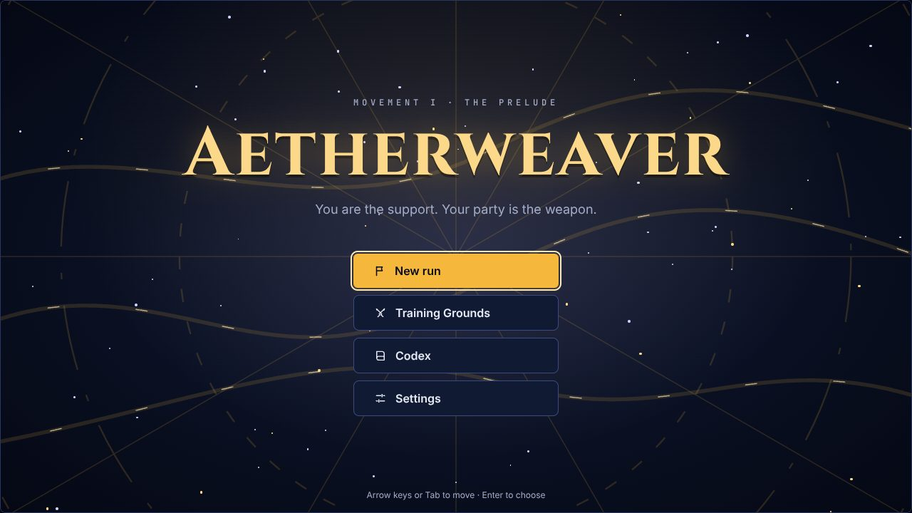
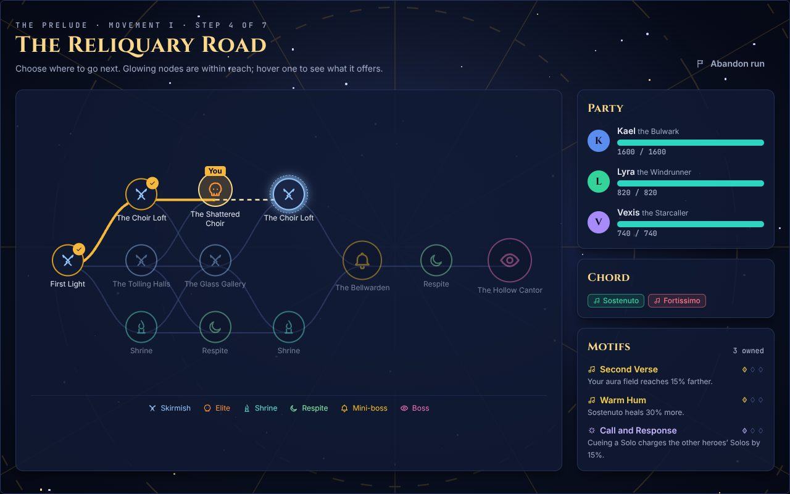
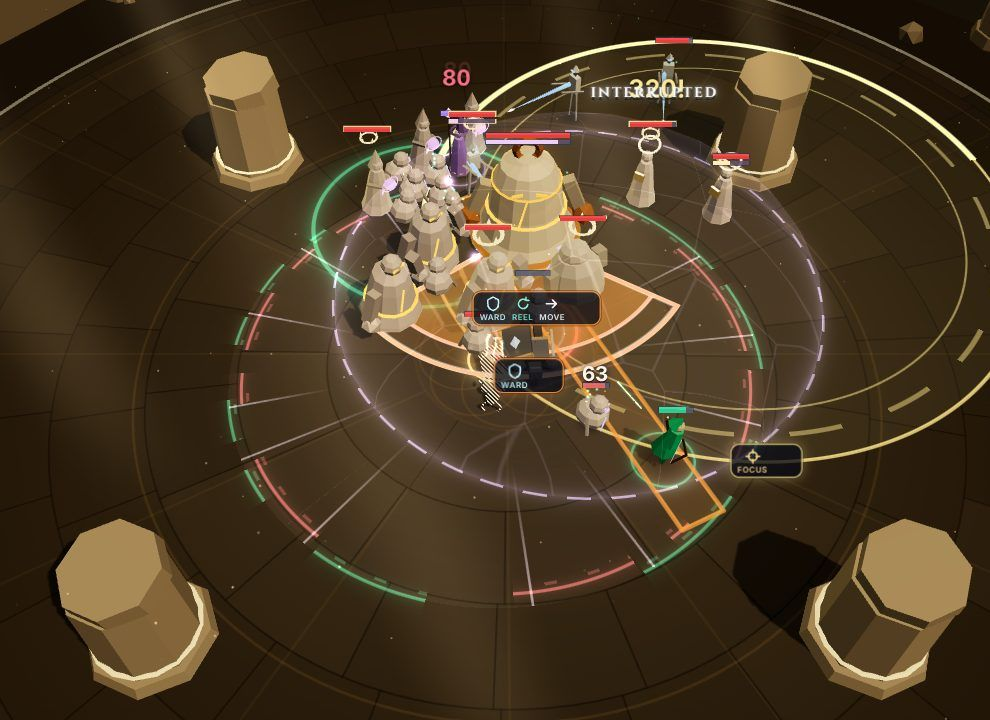
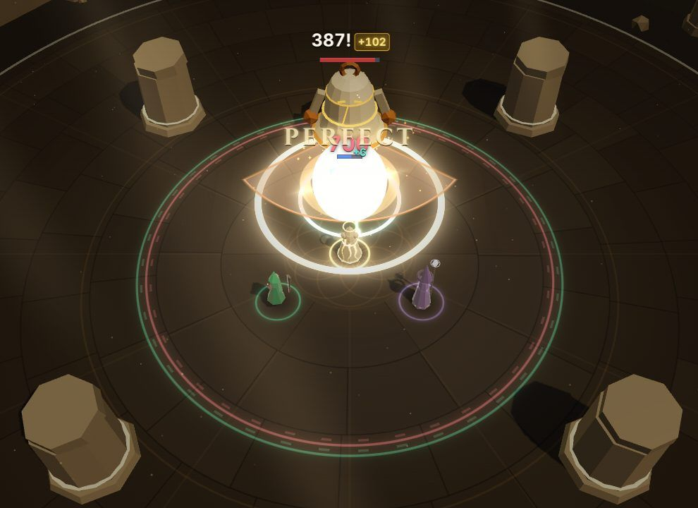
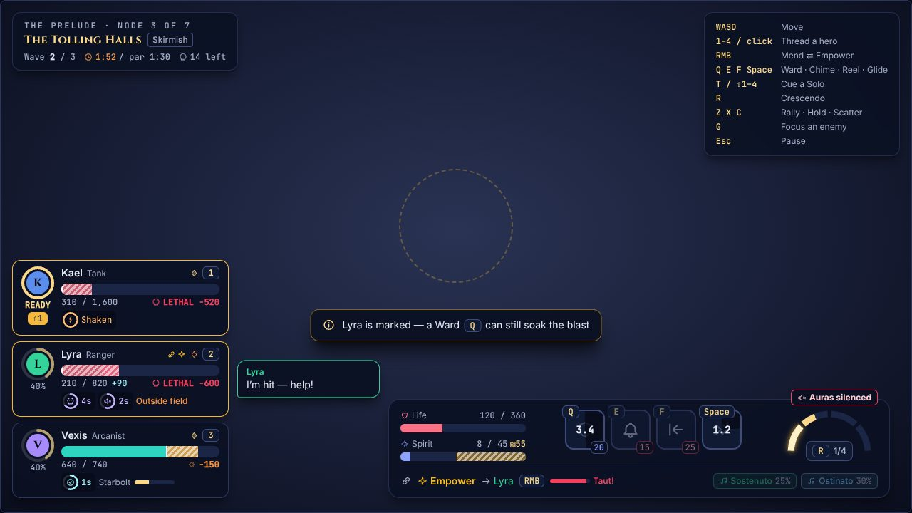
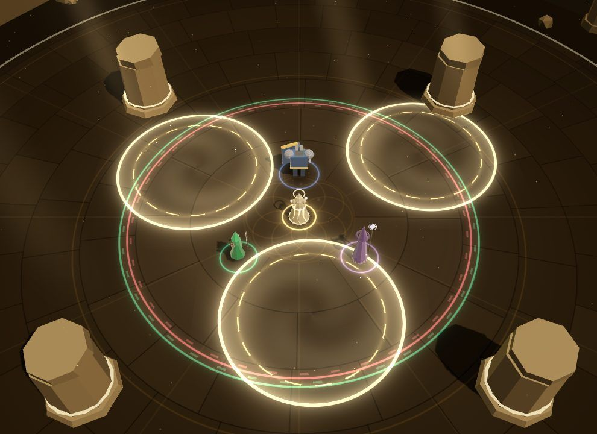
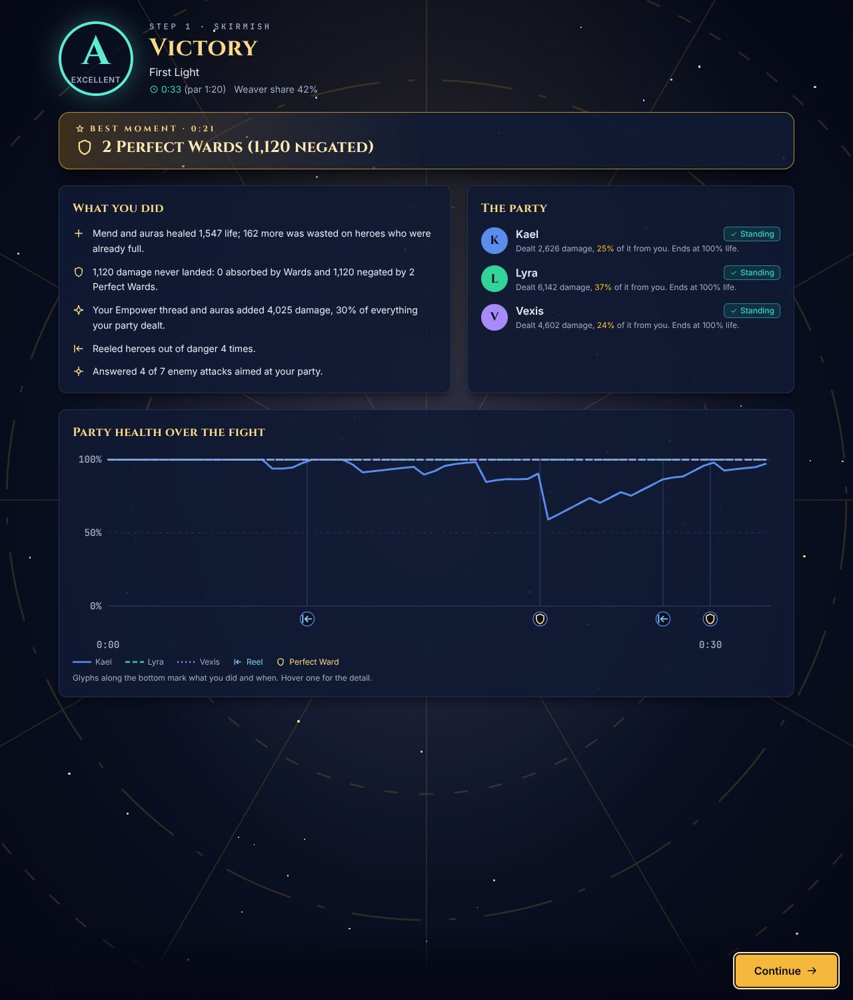
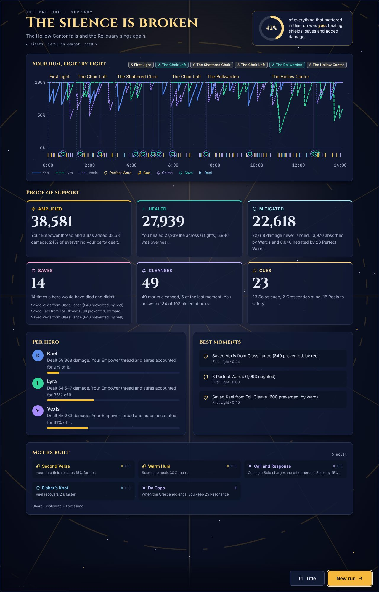

# Phase 1 — The Prelude: exit report

*2026-10-25 · plan: [docs/plan/06-roadmap.md, Phase 1](plan/06-roadmap.md#phase-1--the-thread-core-combat-slice-l--make-or-break)*

The original prototype was a single battle arena. Phase 1 was asked to *expand on that base and do more*, so instead of the roadmap's one-arena combat slice it delivers a complete, replayable **Prelude run**:

**Title → Prep (choose your Chord) → a branching map of 7 steps → skirmishes, elites, shrines and respites → the Bellwarden (mini-boss) → the Hollow Cantor (final boss) → a "proof of support" summary.**

It also pulls large parts of Phases 2 and 3 forward:
- auras and Chords;
- Resonance, Cues, Solos and the Crescendo;
- motif drafts;
- the map;
- grades and the run summary;
- the save;
- a full combat HUD, music and VFX.

The [go/no-go gate](#exit-criteria) is met on everything that can be measured here. The human playtest still has to happen.

| Title | The map (Prelude, step 4) |
|---|---|
|  |  |
| **A busy fight: telegraphs with answer glyphs, damage numbers with gold chips** | **Perfect Ward** |
|  |  |
| **The combat HUD in a crisis (lethal forecasts, a Dirge, Resonance)** | **The Hollow Cantor's Silent Verse: hymn circles** |
|  |  |
| **Result screen (a real run)** | **Run summary: "proof of support"** |
|  |  |

## Exit criteria

| Criterion (roadmap, Phase 1) | Result | Evidence |
|---|---|---|
| Idle loses during wave 2 | ✅ mostly · ⚠ two encounters | An idle Weaver (passive auras only) loses 55–100% of skirmishes, usually in wave 2–3, 100% of elites and bosses, and **100% of whole runs**. Two outliers win too often: *First Light* (the tutorial fight, 40%) and *Glass Gallery* (30%). [Harness table](#harness) |
| Novice wins ≥ 60% | ✅ per fight | 80–100% in regular skirmishes, 45–85% in elites, 50% vs the Bellwarden, 60% vs the Hollow Cantor. A whole Prelude run, where every fight must be won while carrying wounds, succeeds **30%** of the time |
| Skilled wins ≥ 90% | ✅ | 80–100% in skirmishes, 95–100% in elites, 95% vs both bosses, and **85% of whole runs** |
| Skilled bot's Weaver share ≥ 35% | ✅ | **38–46%** with the default Chord (Sostenuto + Fortissimo). A purely defensive Chord lands at 22–33%, which is expected |
| Playtest: 5 people × 10+ min | ⏳ **not run** | Needs humans. The build is ready for it: see the checklist [below](#for-the-playtest) |
| Perf budgets met | ✅ CPU · ⚠ GPU unverified | Sim **0.13 ms/tick** in a full fight and 0.21 ms with 250 entities (budget 1.5 ms). A busy fight in the browser (14 enemies, 120 dummies, autoplay): **30 draw calls, 43k triangles, 0.27 ms/tick sim, 9 ms average / 14 ms p95 CPU per frame** under SwiftShader. The VFX lab's worst case (25 enemies, 5 elites, the Bellwarden, 5 telegraphs) is 37 draw calls and about 20k triangles. Real-GPU frame rate needs one manual check |

## What was built

### Combat (the sim, `src/sim`)

| Area | What's in |
|---|---|
| **The Weaver** | Movement with a smoothed formation heading, 360 Life, re-forms 6 s after going down. **Spirit**: 100, minus what auras reserve; regenerates 12%/s of the unreserved part |
| **The Thread** | Mend (90 HP/s, revives the downed in 3 s) or Empower (+25% damage, +10% attack speed). Strength falls off from 10 m; it snaps at 14 m with a 1 s lockout |
| **Techniques** | **Ward** (barrier 30% + 120 for 3 s; Perfect inside the last 0.35 s of a telegraph negates the hit, refunds half the cost, staggers the attacker, +20 Resonance, hit-stop). **Chime** (bell lands after 0.25 s: cleanses, 1.5 s immunity, 8% heal; *clutch* in the last second). **Reel** (pulls a hero to you with i-frames; dodges count). **Glide** (6 m dash with i-frames) |
| **Chord** | Two of five auras: Sostenuto (regen), Ostinato (refilling barrier), Allegro (haste), Fortissimo (damage), Lullaby (slows enemies, *lengthens their wind-ups*). The aura field is a circle around the Weaver; Mutes and the Silent Verse suppress it |
| **Resonance** | Earned by Perfect Wards, saves, clutch Chimes, Reel dodges, cleanses, Empower. Partial segments decay when idle, full segments are kept. Spent on **Cues** (one segment fires a hero's Solo in its stronger cued form) and the **Crescendo** *Sunrise* (full bar: auras ×2 and ×1.5 radius for 6 s, party heal) |
| **Heroes** | Kael (tank: Shield Bash, Challenge; Solo *Aegis Wall*, cued = party dome; quirk *Glory Hound* charges new packs). Lyra (ranger: Piercing Shot, Volley; *Gale Barrage*; *Greedy Shot* won't leave danger mid-cast). Vexis (arcanist: Gravity Well, Starbolt; *Starfall*; *Spellbound* commits to casts and attracts divers). Utility AI: targeting with peel and focus, range keeping and kiting, ability use, dodge rolls, barks |
| **Enemies** | Hollow Chorister (swarm), Bell Brute (Toll Cleave tank-buster), Lamenter (*Dirge* mark: 50% max HP + silence), Glass Lancer (lance at the farthest hero), Mute (aura-suppressing dome), Cantor Acolyte (interruptible heal channel). Elites with **Shielded** (Discord barrier only Empower breaks quickly), **Volatile** (shatters after death), **Hastened** |
| **Bosses** | **The Bellwarden**: Bell Slam, Toll Outward (get out), Toll Inward (get in), Resound (link: scatter), summons. Phase 2 "cracked bell" chains Outward → Inward. **The Hollow Cantor**: Toll, Dirge, choir summons; phase 2 *Silent Verse* (auras only work in three drifting hymn circles); phase 3 *Requiem* (90% max HP to every hero every 26 s: answer with Kael's cued dome, Wards, the Crescendo). Enrage at 6:00 |
| **Telegraphs** | Circle, cone, line, donut, mark, link and raid shapes with live severity (lethal if it would down someone *as things stand*) and answer tags. A readability cap limits ordinary enemies to two big telegraphs at once |
| **Threat** | Per-enemy tables. Damage × hero multiplier, **healing draws aggro** onto the Weaver, taunts, focus |
| **Ledger** | Healing, overheal, shielded, negated, amplified (the Weaver's share of party damage), **counterfactual saves** (Ward, Reel, Chime, cued dome), death recaps listing techniques that were ready, a party-HP timeline with markers |
| **Director** | Waves with spawn portals; the next wave comes when the current one thins out. Victory and defeat, including a **last-ditch revive**: if every hero is down but the Weaver stands, the fight goes on |

Motifs (27, in five tag families) are resolved into modifiers per encounter ([`src/sim/mods.ts`](../src/sim/mods.ts)). Every motif has a test that checks it changes exactly one modifier, and the most important ones are also exercised in play.

### The run (`src/meta`, `src/app/runStore.ts`)

- **Map**: 7 rows, seeded per run: First Light → skirmish / shrine choices → elite / skirmish / respite → skirmish / shrine → the Bellwarden → respite → the Hollow Cantor. Four skirmishes and two elites rotate so no path repeats a fight; every node is reachable; rewards are previewed.
- **Drafts**: pick one of three motifs (rarity floor by node), filtered by your Chord and party; owned motifs come back as upgrades to level 3; one reroll; skip for a heal.
- **Carry-over**: heroes keep their HP between fights (+20% after a win); heroes who went down come back **Shaken** (−10% max HP) until rested. Boss fights start every hero at ≥ 75%.
- **Respite**: Rest (heal 40%, clear Shaken) or Meditate (upgrade a motif).
- **Grades** (S–D) and up to three **highlights** per fight; a run **summary** with totals and the Weaver's share.
- **Save v1**: zod-validated, versioned, backup kept before every overwrite, saved on `pagehide`; *Continue* on the title screen.

### Presentation

- **UI** ([details](phase-1/ui.md)): Combat HUD v2 (party frames with incoming-damage forecast stripes, status rings, Solo charge, downed/revive states; Weaver bar with Spirit reservation, cooldown sweeps, the Resonance arc and the Crescendo key; boss bar with cast + answer glyphs and decrees; callouts; 14 coach hints), a pausing How-to-play card for the first fight, the Pause menu, and every run screen plus Title, Training Grounds (spawn palette), Codex and Settings with accessibility assists.
- **Audio** ([details](phase-1/audio.md)): fully synthesised, in D dorian at 88 BPM. A four-stem music director that climbs with Resonance and combat intensity, and **every support action is a note**: Mend plucks rise with the target's HP, Perfect Wards strike the chord root, each hero has a leitmotif for Cues, and telegraph wind-ups are panned and coded by their answer.
- **VFX** ([details](phase-1/vfx.md)): procedural low-poly models with role silhouettes (porcelain enemies with glowing cracks, a giant bell, a haloed Cantor), themed arenas, and a **telegraph grammar** of seven shapes. Fills sweep exactly to impact, the Perfect window shows as a bright rim, severity is live (amber or crimson), and answer badges sit on each telegraph. Also:
  - the Thread ribbon (whips, tension shimmer, snapping into strands) and the aura field (cracks when silenced, blazes in the Crescendo, hymn circles);
  - shields as hex shells and domes;
  - the full juice stack for Perfect Ward, Save, Chime, Reel, Cue, Crescendo, kills and phase changes: flashes, shockwaves, trauma shake, push-ins, a spotlight dim;
  - aggregated floating numbers with the gold "amplified" chip, off-screen arrows, and three quality tiers;
  - a custom pooled particle system (the plan's "spike" decision), with no allocation after start.

### Independent review

An independent reviewer read the core (sim, content, run layer, bots, app shell, input, tests) and reproduced each finding with a script. All findings are fixed and covered by tests:

- **High:** the Bellwarden's phase-2 "cracked bell" never chained its tolls, because the post-cast hook only ran for non-damage casts.
- **Medium:**
  - A Reel landing while the hero was still mid-flight went uncredited.
  - Reeling a downed hero spent the cast for nothing; it now drags the body to safety.
  - Shaken cleared after one fight instead of at a rest.
  - A save naming content this build doesn't have would crash the next fight; saves are now checked against content and fall back to the backup.
  - The Reel counter double-counted.
- **Low:**
  - Chime reach was slightly short.
  - Cleansing Resound now breaks the link.
  - Commands now whitelist technique and directive names.
  - Lullaby now widens the Perfect window along with the wind-up.
  - Ward absorbs now grant Resonance.
  - Mini-bosses are now invulnerable during phase shifts.
  - Solo clocks run while a hero is stunned or Reeled.
  - Stale Reel bookkeeping was leaking.
  - Death recaps showed raw ids.
  - The backup was overwritten by identical saves.
- **Also added:** a guard so a fight that fails to start shows an error panel instead of a blank screen.

### Tools and tests

- **Bots** (`src/bots`): Idle, Novice and Skilled Weavers that read the same state a player sees and send the same Commands. They balance the game, run in CI, and can **autoplay in the browser** (`__AW__.autoplay('skilled')`).
- **Harness** (`npm run harness`): plays every encounter with each bot across seeds and prints win rates, durations, the Weaver's share, Perfects, saves and downs. `-- --run` plays whole Prelude runs.
- **Tests** (Vitest, **219 tests**):
  - **Combat mechanics** staged in the sandbox: Perfect and early Ward, rejections, clutch Chime, Dirge detonation and its singer's death, Reel dodges (including last-moment and downed-hero Reels), Thread snap and lockout, revive and bleed-out, Resonance decay floor, Cue and Crescendo, Discord shields, Focus.
  - **Boss scripts:** the cracked-bell chain, phase-shift invulnerability, Requiem cadence, enrage.
  - **Director edge cases:** next wave, boss kill with adds up, the last-ditch revive.
  - **Affixes and auras:** Volatile, Ostinato refills, Lullaby windows.
  - **Motifs in play.**
  - **The run layer:** map invariants and no repeated fights, a full run, drafts, Shaken, grades, save round-trip, backup and content compatibility.
  - **Also:** bots, input chords and smart-cast, audio no-op safety, and architecture purity.
  - **Determinism:** five golden scenarios, including three **bot-played fights** (First Light, the Bellwarden, the Hollow Cantor).
- **E2E** (Playwright, production build, 5 tests):
  - boot;
  - real keyboard and mouse input;
  - a **whole run flow** with an autoplayed fight, including a check that the first-fight primer pauses the sim;
  - a **browser-to-Node bit-exact replay of a real fight**;
  - a busy-fight perf check.

## Harness

20 seeds per row, default Chord (Sostenuto + Fortissimo), `npm run harness -- --seeds 20 --auras sostenuto,fortissimo`.

| Encounter | Bot | Win | Avg time | Wave at loss | Boss HP at loss | Weaver share | Perfects | Saves | Downs |
|---|---|---|---|---|---|---|---|---|---|
| first_light | idle | 40% | 45 s | 3.0 | - | 25% | 0.0 | 0.0 | 2.4 |
| first_light | novice | 100% | 39 s | - | - | 38% | 0.2 | 0.2 | 0.6 |
| first_light | skilled | 100% | 33 s | - | - | 41% | 1.9 | 0.0 | 0.1 |
| tolling_halls | idle | 15% | 46 s | 2.8 | - | 26% | 0.0 | 0.0 | 2.8 |
| tolling_halls | novice | 85% | 41 s | 2.0 | - | 36% | 0.2 | 0.7 | 1.4 |
| tolling_halls | skilled | 100% | 40 s | - | - | 40% | 1.8 | 0.0 | 0.1 |
| glass_gallery | idle | 30% | 41 s | 2.5 | - | 26% | 0.0 | 0.0 | 2.6 |
| glass_gallery | novice | 80% | 38 s | 2.0 | - | 37% | 0.4 | 0.5 | 0.9 |
| glass_gallery | skilled | 80% | 39 s | 2.3 | - | 42% | 0.8 | 0.5 | 1.4 |
| choir_loft | idle | 5% | 37 s | 2.6 | - | 26% | 0.0 | 0.0 | 3.0 |
| choir_loft | novice | 95% | 40 s | 2.0 | - | 37% | 0.1 | 0.3 | 0.8 |
| choir_loft | skilled | 100% | 34 s | - | - | 38% | 0.5 | 0.0 | 0.1 |
| mourning_steps | idle | 10% | 50 s | 3.0 | - | 27% | 0.0 | 0.0 | 2.9 |
| mourning_steps | novice | 100% | 44 s | - | - | 40% | 0.1 | 0.7 | 0.7 |
| mourning_steps | skilled | 100% | 37 s | - | - | 40% | 1.0 | 0.1 | 0.1 |
| muted_nave | idle | 0% | 40 s | 2.4 | - | 22% | 0.0 | 0.0 | 3.0 |
| muted_nave | novice | 45% | 61 s | 2.9 | - | 34% | 0.1 | 0.4 | 3.9 |
| muted_nave | skilled | 100% | 59 s | - | - | 46% | 3.3 | 0.4 | 0.7 |
| shattered_choir | idle | 0% | 26 s | 2.0 | - | 25% | 0.0 | 0.0 | 3.0 |
| shattered_choir | novice | 85% | 56 s | 2.0 | - | 35% | 0.4 | 0.9 | 2.1 |
| shattered_choir | skilled | 95% | 49 s | 2.0 | - | 42% | 2.3 | 0.3 | 0.5 |
| bellwarden | idle | 0% | 45 s | 1.0 | 59% | 29% | 0.0 | 0.0 | 3.0 |
| bellwarden | novice | 50% | 95 s | 1.0 | 17% | 38% | 0.7 | 0.3 | 3.5 |
| bellwarden | skilled | 95% | 71 s | 1.0 | 19% | 42% | 6.0 | 0.3 | 0.5 |
| hollow_cantor | idle | 0% | 41 s | 1.0 | 86% | 24% | 0.0 | 0.0 | 3.0 |
| hollow_cantor | novice | 60% | 184 s | 1.0 | 18% | 36% | 1.0 | 3.5 | 5.5 |
| hollow_cantor | skilled | 95% | 172 s | 1.0 | 20% | 38% | 2.1 | 4.4 | 3.2 |

**Whole Prelude runs** (`npm run harness -- --run --seeds 20 --auras sostenuto,fortissimo`): map choices, drafts (first option), respites (rest) and carry-over included.

| Bot | Win | Combat time | Where runs ended |
|---|---|---|---|
| idle | 0% | 1.2 min | first_light:8, tolling_halls:2, mourning_steps:3, glass_gallery:2, choir_loft:1, bellwarden:2, shattered_choir:2 |
| novice | 30% | 5.0 min | hollow_cantor:5, muted_nave:2, bellwarden:4, glass_gallery:2, first_light:1 |
| skilled | 85% | 5.3 min | bellwarden:2, glass_gallery:1 |

## Difficulty contract

These are the bands balance changes must keep. Run the harness before and after any tuning.

| Content | Idle | Novice | Skilled | Skilled Weaver share |
|---|---|---|---|---|
| First Light (tutorial) | ≤ 40%, losing in wave 3 | ≈ 100% | 100% | ≥ 35% |
| Skirmishes | ≤ 30% | ≥ 75% | ≥ 80% | ≥ 35% |
| Elites | 0% | 40–85% | ≥ 90% | ≥ 35% |
| The Bellwarden | 0% | 40–70% | ≥ 90% | ≥ 35% |
| The Hollow Cantor | 0% | 40–75% | ≥ 90% | ≥ 30% |
| Whole Prelude run | 0% | 25–45% | ≥ 80% | — |

## For the playtest

The playtest is the half of the gate that can't be automated. For each tester, record:

- Did a Perfect Ward and a Reel save feel *great*? (Goal: 4 of 5 say yes.)
- Can they name something they did that mattered? The run summary's highlights help here.
- Do the heroes feel like they "play themselves"? (Goal: nobody says so.)
- Where did they lose, and did the death recap explain why?

Use **Settings → Assists** for anyone who struggles (wider Perfect window, slower wind-ups, hero autonomy).

## Known gaps

- The playtest hasn't happened; tuning so far is by bots only.
- Real-GPU frame rate is unverified (this container renders with SwiftShader).
- Directives use Z/X/C keys; the radial Directive wheel is later. Technique buttons on the HUD are indicators, not clickable.
- Codex entries are always unlocked (no first-sighting gating yet). No gamepad support yet.
- Audio levels are tuned by measurement, not by ear; barks have no voice sounds.
- Combat state isn't saved mid-fight: resuming a run restarts the pending fight from its start.
