# Phase 1 — Combat presentation (render / VFX)

The Phase 0 placeholder view (capsules + a flat thread quad) is replaced by the real combat
view in `src/render/`. It is driven only by `WorldState` (persistent visuals, every frame) and
`SimEvent`s (transient feedback), through the unchanged `CreateWorldView` contract.

## Architecture

| File                          | Role                                                                                                                                                                                                                                                                                                                               |
| ----------------------------- | ---------------------------------------------------------------------------------------------------------------------------------------------------------------------------------------------------------------------------------------------------------------------------------------------------------------------------------- |
| `index.ts`                    | `createWorldView(ctx, state)` → `CombatView`                                                                                                                                                                                                                                                                                       |
| `combatView.ts`               | Orchestrates one frame: entities → field → telegraphs → thread → feedback → off-screen arrows → batches → overlay                                                                                                                                                                                                                  |
| `entities.ts`                 | Per-entity render state (interpolation, facing, walk bob, lunge, stagger, spawn rise, downed/dead, death dissolve), rim tints, rings, bars, shields, ailment smoke, Weaver ribbons, Resonance orbs, Glide afterimages                                                                                                              |
| `models/`                     | Procedural low-poly silhouettes (`library.ts`), merged into one geometry per model (`builder.ts`), drawn as one `InstancedMesh` per model (`batch.ts`) with one shared flat-shaded PBR material patched for per-instance hit flash, dissolve, desaturate, ghost and fresnel rim (`material.ts`)                                   |
| `telegraphs.ts`               | Telegraph grammar: circle / cone / line / donut SDFs, marks, links, raids, enemy cast circles, answer glyphs, impact flashes, "who is threatened"                                                                                                                                                                                  |
| `thread.ts`                   | Thread ribbon (Bezier spline, sag/taut, shimmer, pulses, whip, snap)                                                                                                                                                                                                                                                               |
| `field.ts`                    | Aura field ring-stack shader, suppression cracks, Crescendo blaze, hymn circles                                                                                                                                                                                                                                                    |
| `feedback.ts`                 | Every event → transient FX (pooled), aggregated numbers, screen juice, camera, light shifts                                                                                                                                                                                                                                       |
| `overlay.ts`                  | DOM overlay: floating numbers, answer badges (SVG icons), callouts, off-screen arrows, spotlight dim / flash / danger / slow-mo / chroma / raid layers                                                                                                                                                                             |
| `arena.ts`                    | Themed floor (canvas texture), apron, accent rim, pillars, perimeter dressing (tall pieces on the far side only so they never occlude), god rays, dust motes, lighting mood                                                                                                                                                       |
| `fx/`                         | Immediate-mode instanced batches: `rings`, `sprites`, `beams`, `shells`, `bars`, `telegraphBatch`, `ribbons`, `particles`; `kit.ts` bundles them with render orders and quality caps                                                                                                                                               |
| `camera.ts`, `stage.ts`       | Additive: `CameraRig.punch()` (zoom punch, scaled by the shake setting) and `panToward()`; `Stage.setMood()`, `Stage.lights`                                                                                                                                                                               |
| `lab/VfxLab.tsx`              | `?lab=vfx`                                                                                                                                                                                                                                                                                                                         |

Draw order (transparent layers, after opaque floor/characters): blob shadows → aura field →
ground rings → telegraphs → shells → beams → ribbons → smoke → particles → sprites →
dust/rays → overhead marks → bars. Telegraphs depth-test against characters (so a hero standing
in a cone stays visible) but draw over every other ground effect.

## Particle system decision (three.quarks vs custom)

**Custom.** `fx/particles.ts` is ~250 lines: structure-of-arrays typed buffers, a ring-buffer
pool with a hard cap per quality tier (oldest recycled when full), CPU integration with drag,
gravity and a floor bounce, five sprite styles (dot, spark, shard, smoke, note) in one shader,
drawn as a single `THREE.Points` call (plus a second, normal-blended one for smoke). No
dependency, zero allocation after construction, and it sits next to the other immediate-mode
batches. three.quarks would add a dependency and an editor-driven workflow we don't need.

| Tier   | Additive cap | Smoke cap | Spawn density | Shadows | Dust / god rays |
| ------ | ------------ | --------- | ------------- | ------- | --------------- |
| low    | 500          | 160       | 0.4×          | off     | off             |
| medium | 1400         | 360       | 0.7×          | on      | on              |
| high   | 2600         | 600       | 1×            | on      | on              |

## Performance

Measured with `renderer.info` in the lab (SwiftShader, so no meaningful FPS):

| Scene                                                                                              | Draw calls | Triangles |
| -------------------------------------------------------------------------------------------------- | ---------- | --------- |
| Busy fight: 25 enemies (12 swarm, brutes, casters, snipers, acolytes, a Mute, the Bellwarden, 5 elites) + party, ~5 telegraphs — high | 36–37      | ~19.8k    |
| same — medium                                                                                      | 38         | ~17.9k    |
| same — low (no shadow pass)                                                                        | 26–28      | ~12.7k    |
| Training Grounds, real game path, 8 enemies                                                        | 27         | ~9k       |
| Telegraph grammar sheet (8 telegraphs)                                                             | 28         | ~9k       |

Budget was ≤ 150 calls / 300k triangles. Draw calls scale with the number of _distinct_ models
(one instanced call per enemy type, plus its shadow pass for brutes/bosses/heroes), not with
the number of enemies; all FX are ~12 calls regardless of how much is going on. Hot paths reuse
scratch vectors/colours and pooled records; the remaining per-frame allocations are DOM
transform strings in the overlay. Recreating the view 12 times (theme switching in the lab)
leaves `renderer.info.memory` flat (24 → 25 geometries, the +1 being a newly spawned model).

## Juice table (docs/plan/04 §3)

| Event                 | Status       | What you see                                                                                                                                                                                         |
| --------------------- | ------------ | ---------------------------------------------------------------------------------------------------------------------------------------------------------------------------------------------------- |
| **Perfect Ward**      | done         | shell flare → white-gold + cyan shockwave rings, shard/gold bursts, the telegraph owner staggers (shake + recoil), trauma + push-in, 0.4 s spotlight dim, optional flash, "PERFECT" glyph. FX slow with the sim's hit-stop |
| **Save**              | done         | gold fresnel outline flash on the hero, gold rings + light column, "SAVED" glyph, push-in, spotlight, optional flash; slow-mo vignette from `state.timeScale`                                       |
| **Chime**             | done         | bell of light arcs to the landing point (from `state.chimes`) with a converging target ring; ring of light + light column on landing; ailment smoke rips off cleansed heroes; "CLUTCH" glyph        |
| **Reel**              | done         | hero arcs through the air (from `hero.reel`) leaving a thread-coloured ribbon trail. Camera "lead toward you": not done (the camera already follows the Weaver)                                       |
| Thread attach         | done         | spline whips, target rim flashes, ring pop                                                                                                                                                           |
| Thread taut / snap    | done         | thins + high-frequency shimmer / bursts into strands, small kick, "SNAPPED"                                                                                                                         |
| **Cue**               | done         | gold leitmotif sigil above the hero, gold ring burst, spotlight, focus pull (push-in); Cued Solo attacks tinted gold; cued Aegis Wall raises a big gold-cyan dome                                   |
| **Crescendo**         | done         | field blazes (pulses flowing outward, overshoot expansion), gold rings, light column, zoom-punch out, chromatic edge pulse, warm light swell ("sky responds")                                       |
| Enemy kill            | done         | white flash, dissolve with a glowing edge in the enemy's accent, porcelain shards; bosses: big rings, trauma, pan                                                                                   |
| Elite / boss phase    | done         | shatter (shards + flare shell), rings, key/hemi light shift toward the boss accent, brief pan to boss, spotlight                                                                                     |
| Hero downed           | done         | lies down, desaturates, crimson bleed-out arc, teal revive ring (from `health.revive`), red screen-edge pulse; dead heroes dissolve out                                                             |
| Loot / reward         | not done     | not part of the combat view                                                                                                                                                                         |
| Numbers               | done         | aggregated per target per 0.4 s, sized by significance (share of max HP for heroes, log scale for enemies), gold `+96` chip from `damageTaken.amplified`, teal heals, cyan `(absorbed)`, off with `damageNumbers` |

Also: Glide afterimages (ghost Weavers + streak), spawn portals (`spawnWarning`), shield shells
(Ward hex shell, Dome, Barrier film, Overshield, Discord bubble) with cracks as `amount/max`
drops and pop-in on apply, shatter on `shieldBroken`, interrupt burst + "INTERRUPTED",
directive acks, Resonance notes and orbiting segments, Solo-ready pulse, Mute cracked-glass
domes and suppressed (cracked, flickering) field, hymn circles.

## Telegraph grammar

- One instanced SDF shader for all ground shapes; the fill sweeps from the origin to the edge
  exactly at `impact` with a bright leading edge.
- Perfect window: a pulsing white-gold rim during `[perfectFrom, impact]`, wider if the window
  was widened (assist / mods).
- Severity is live and smoothed: amber → crimson, plus moving hazard stripes when lethal (never
  colour alone).
- Answer glyphs: SVG icon badges with labels on the near edge (stacked when they overlap);
  marks/links/raids show a countdown.
- Mark: countdown ring over the head (the bright arc is time remaining) + dashed ring at the
  feet. Link: dashed beam between the two heroes — thicker, pulsing crimson with radius rings
  when they stand too close. Raid: crimson screen-edge glow + banner with name and countdown +
  a mark on every hero.
- Non-damage casts (`healAllies`, `summon`, `suppress`) are runic cast circles in the caster's
  accent, never threat colours.
- Resolution: impact flash and threat sparks; cancelled telegraphs fade out quickly.

## The lab (`?lab=vfx`)

A Stage + CameraRig + `CombatView` over a real debug sim (`sandbox`, Sostenuto + Fortissimo)
with a FixedStepper loop. WASD moves, Space glides, the mouse aims and hovers. Panels: encounter
/ arena theme / quality; presets (telegraph gallery, busy fight of 25, Cantor, Bellwarden, kill
all, heal, hymn circles, **telegraph grammar sheet** — synthetic telegraphs of every shape and
severity); spawn any enemy (optionally elite); Weaver techniques (thread, mode, Ward, Chime,
Reel, Glide, Cue, Crescendo, Focus, directives); and synthetic event injection for one-off
review (Perfect Ward, Save, Clutch Chime, `412 +96`, hero hit, shatter, cue sigil + dome,
Crescendo FX, downed pulse, phase change, snap, portal). `window.__VFX__` exposes the same
controls for screenshot scripts.

## Screenshots

| | |
| --- | --- |
| 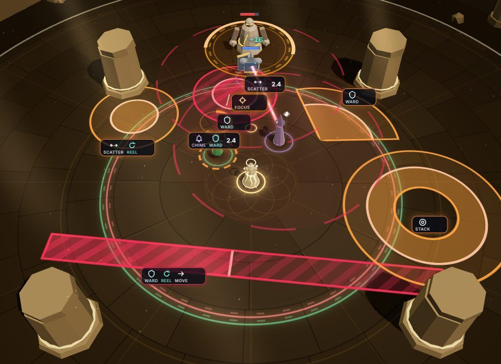 Grammar sheet: circle, lethal circle (stripes), cone, lethal lance, donut, mark, link, cast circle | 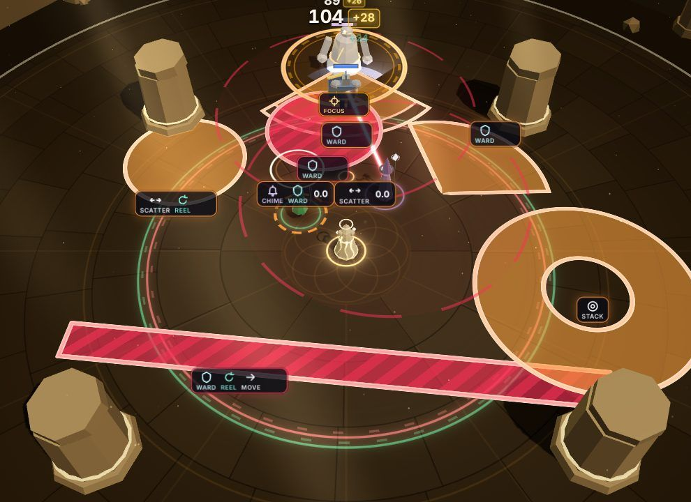 The same at the Perfect window (bright rims) |
|  Perfect Ward on Kael against the Bellwarden's slam | 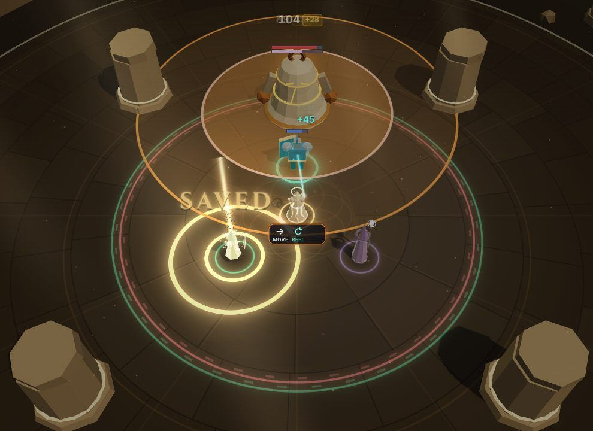 Save on Lyra |
| 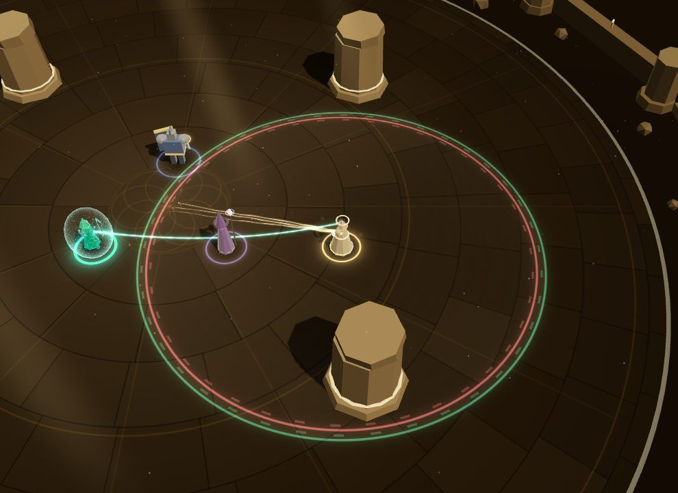 Mend thread, taut, Ward shell on Lyra | 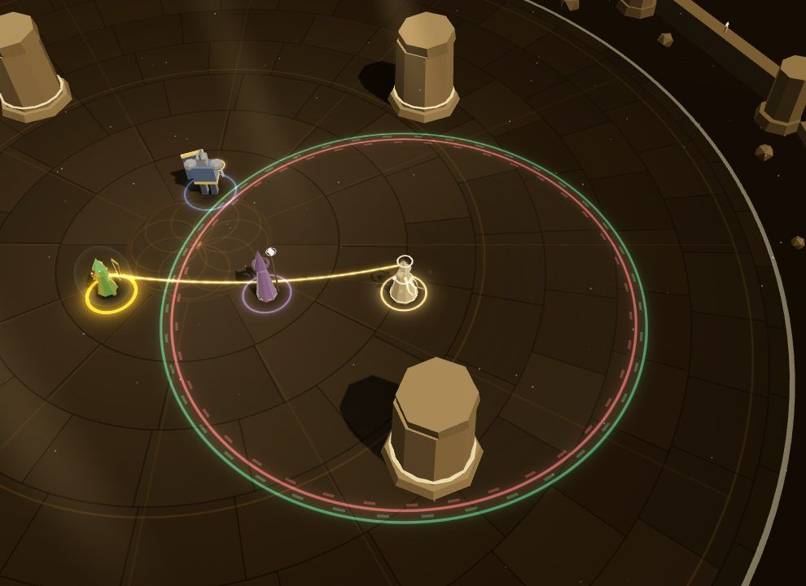 Empower thread |
|  Aura field + hymn circles | 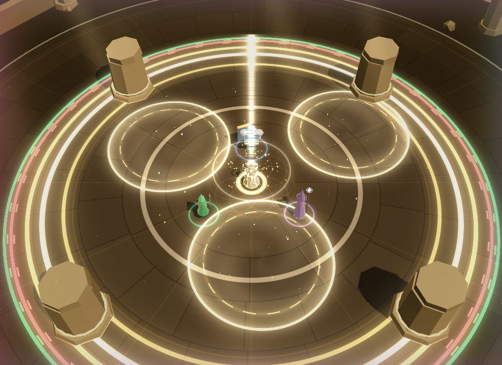 Crescendo |
| 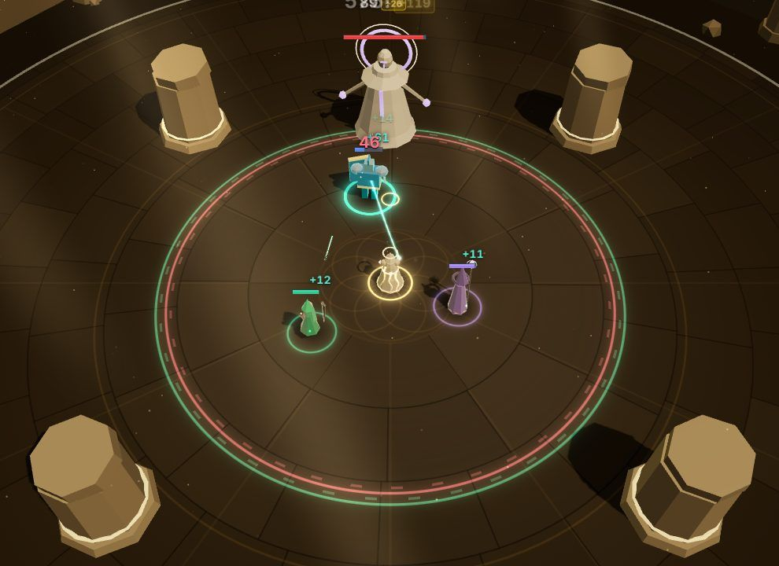 The Hollow Cantor | 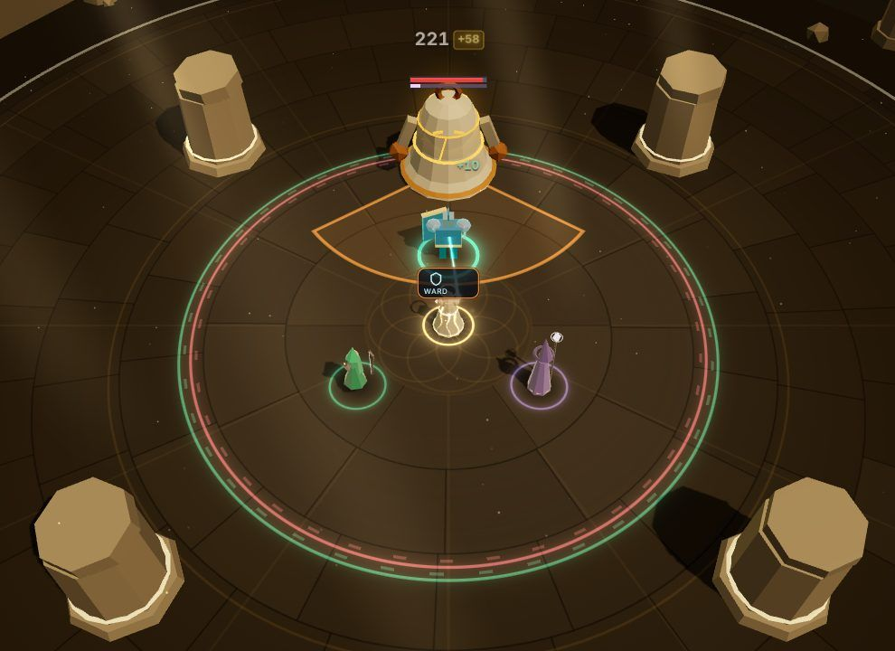 The Bellwarden's Bell Slam cone |
| 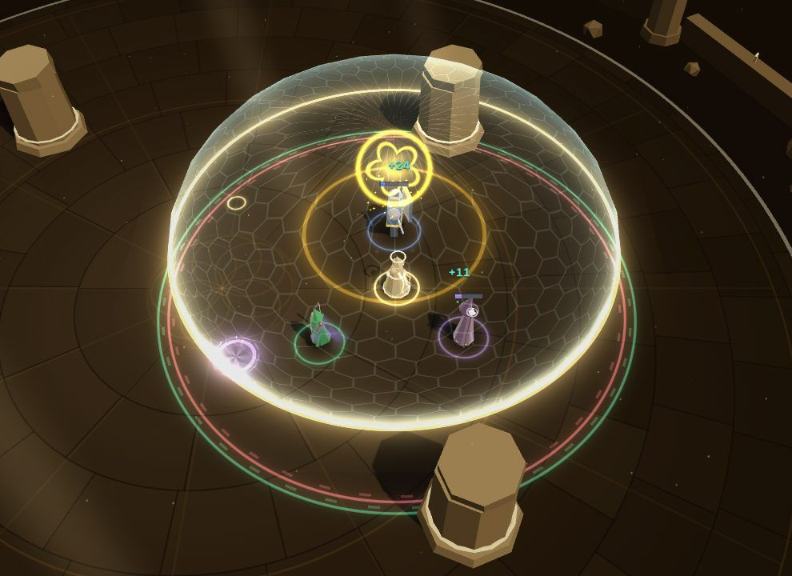 Cued Aegis Wall: sigil + dome | 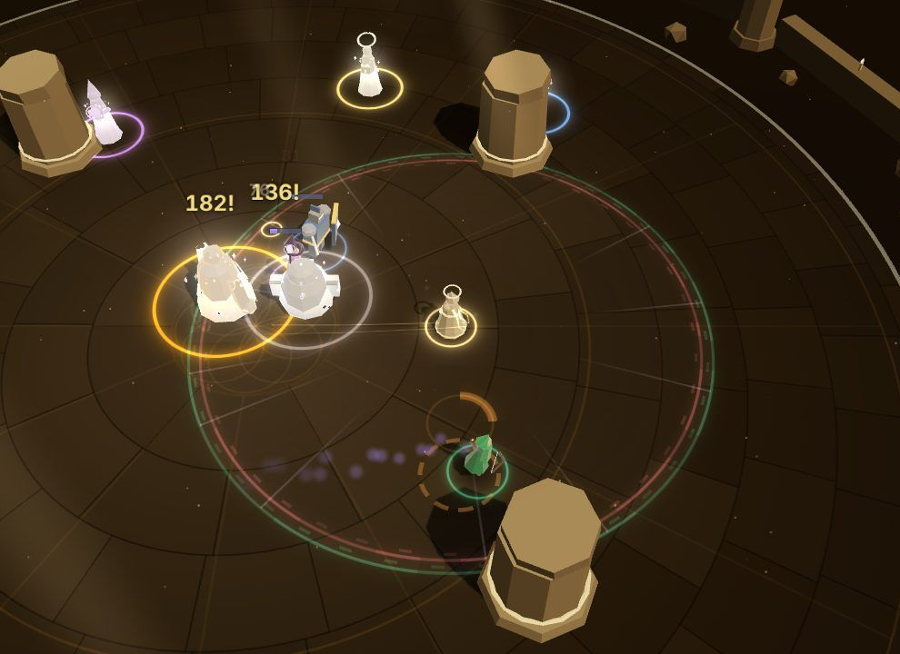 Kill dissolve |
| 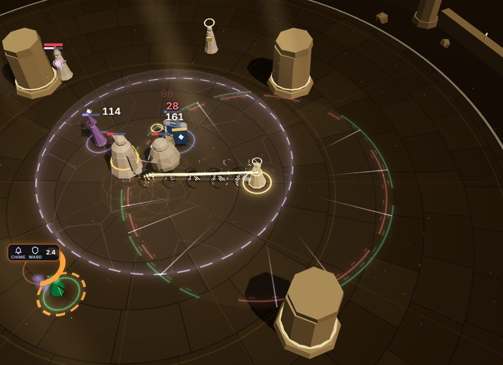 Glide afterimages, Dirge mark | 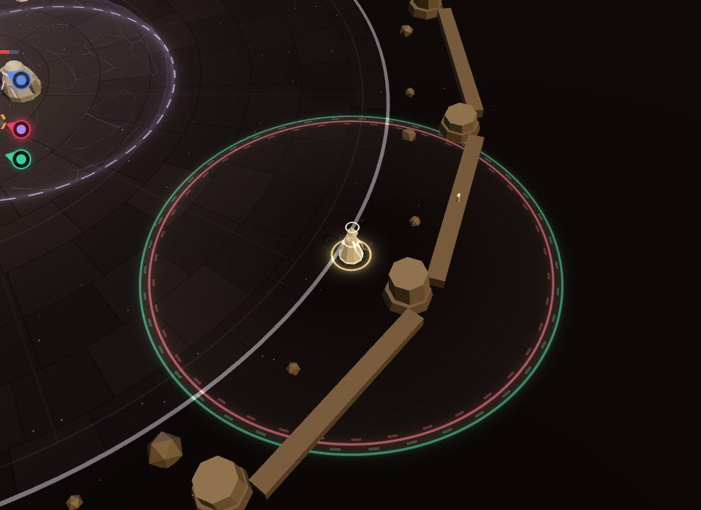 Off-screen hero arrows (red ring = threatened) |
| 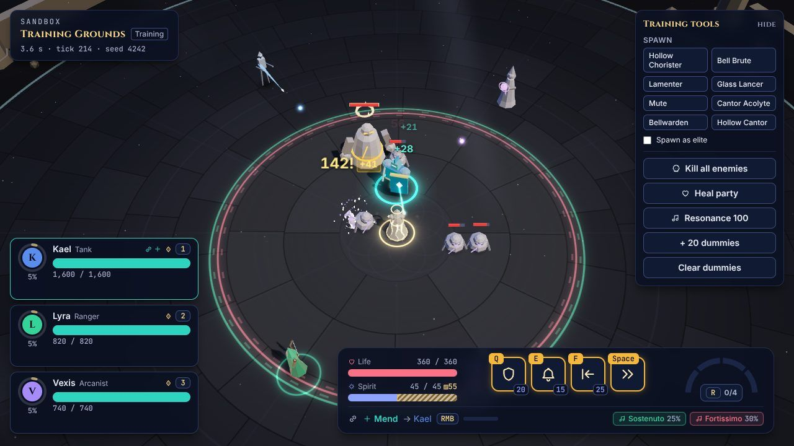 Real game path: Training Grounds with HUD |  Busy fight, Mute suppressing the field |

## Contract changes

None to `src/render/types.ts`, `src/sim/*` or `src/content/*`. Additive, render-owned only:
`CameraRig.punch()` / `panToward()`, `Stage.setMood()` / `lights`, and
`createWorldView` now returns a `CombatView` (still typed as `WorldView` for the runtime).

## Requests for the sim / lead

- `Telegraph` has no `effect`; render remembers it from `telegraphStarted`. A view created
  mid-encounter would show in-flight heal/summon casts as threats until they end. Adding
  `effect` to `Telegraph` would make it stateless.
- No debug op to charge a hero's Solo or to force a boss phase, so the real Cue / Silent Verse /
  Requiem paths can only be staged by waiting (the lab uses synthetic events and a hymn-circle
  override instead).
- `ShieldBroken` / `ShieldApplied` don't say who broke/applied it, and `AbilityUsed` has no
  direction (Volley/Gravity Well VFX use position + radius only).

## Known gaps

- Characters are rigid procedural models (bob, lean, lunge, stagger, lie-down) — no skinned
  animation yet; heroes are small at the default zoom.
- No post chain (SMAA, LUT, real chromatic aberration); the "chromatic pulse", vignettes,
  spotlight dim and flashes are DOM overlay layers.
- Floating numbers are pooled DOM elements, not one instanced draw call.
- Badges can still overlap entities in very dense fights (simple stacking only).
- Real FPS wasn't measurable here (SwiftShader ≈ 4–6 FPS regardless of content).
