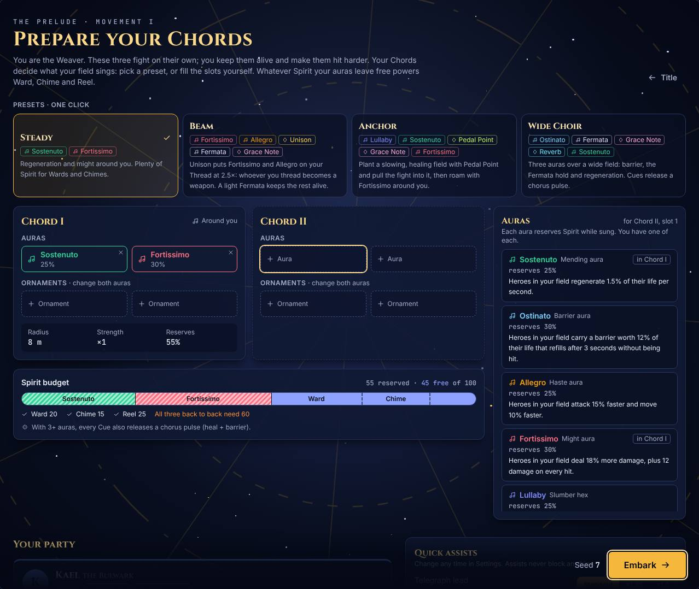
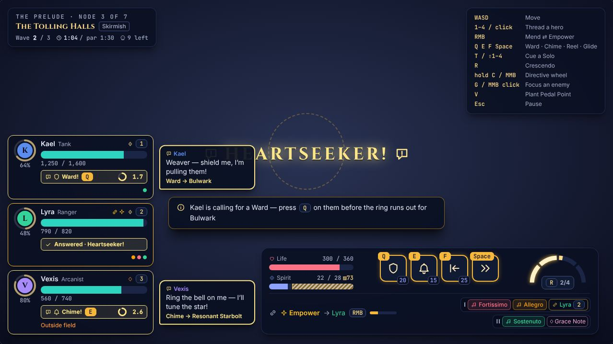
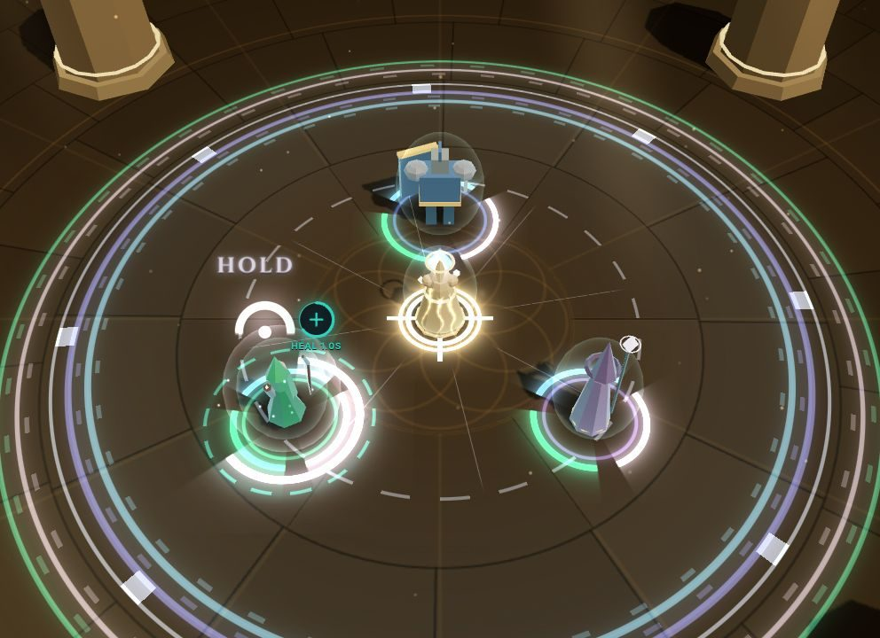
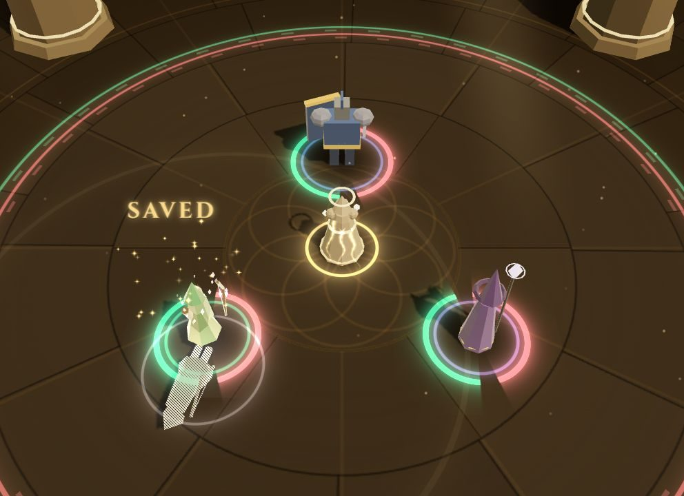
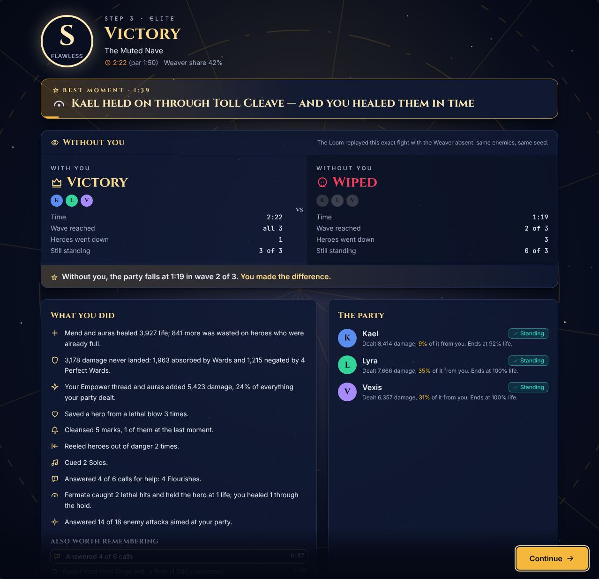

# Phase 2 — The Chord, and proof of support: exit report

*2026-10-25 · plan: [docs/plan/06-roadmap.md, Phase 2](plan/06-roadmap.md#phase-2--the-chord-build-layer-inside-combat-m)*

Phase 1 already pulled half of the roadmap's Phase 2 forward (auras, Resonance, Cues, the Crescendo, the combat HUD). This phase builds the rest of the **build layer** and adds the two features that give the game its own identity:

- **The build layer.** Two Chords of two auras each, four ornaments that change *both* auras in their Chord (Grace Note, Reverb, Unison, Pedal Point), the Fermata aura, the chorus pulse, a Chord builder with presets, Retune at respites and a loadout report in the harness.
- **Call and Response** *(signature)*. Heroes call for a specific kind of help just before their big move: Kael wants a **Ward**, Lyra **Empower**, Vexis a **Chime**. Answer before the move goes off and it becomes a stronger **Flourish**. Ignoring a call costs nothing.
- **Proof of support** *(signature)*. The game makes good support visible: when you save a hero, their **ghost** falls where they would have died; and every fight is **re-run without you** in the background, so the result screen can say *"Without you, the party falls at 0:41."*
- **Also:** the radial **Directive wheel**, key **remapping**, **colour-blind palettes** checked under simulated deficiencies, **UI scale** and **flash strength**.

| | |
|---|---|
|  **Prep**: four presets, two Chords, the live Spirit budget |  **Calls** on the HUD: who wants what, the key, the countdown |
|  **Answered**: Kael's glyph fills and names the Flourish |  **Fermata**: Lyra is held at 1 HP; heal her before the ring runs out |
|  **Save ghost**: where Lyra would have died |  **"Without you"** on the result screen |

## Exit criteria

| Criterion (roadmap, Phase 2) | Result | Evidence |
|---|---|---|
| Three distinct loadouts are each viable for the Skilled bot | ✅ four | Every preset clears every Skilled floor (skirmishes ≥ 80%, elites and bosses ≥ 90%) and wins 80–100% of whole runs; none dominates. [Loadout report](#loadouts) |
| Playtesters can describe how the loadouts *play* differently | ⏳ **not run** | Needs humans: see [For the playtest](#for-the-playtest) |
| The Phase 1 difficulty contract still holds | ✅ | [Harness](#harness) |

## What was built

### The build layer (`src/sim`)

| Area | What's in |
|---|---|
| **Chords** | Up to two Chords, each with two aura slots and two ornament slots. Each Chord has its own field (`field.chords`): around the Weaver, planted, or on the Thread. Every hero and enemy carries a mask of the auras covering it, so effects, rim lights and the HUD all agree. One shared module (`sim/chords.ts`) decides what is legal and what it costs, for the sim, the run and the Chord builder alike |
| **Ornaments** | One copy of each. **Grace Note**: reserve ×0.7, effect ×0.9. **Reverb**: radius ×1.4, effect ×0.9. **Pedal Point**: the field stays where you plant it (V at the cursor, 2 s cooldown), radius ×0.85. **Unison**: the Chord rides the Thread, affecting only the threaded hero at ×2.5 — and its hexes hit whatever attacks that hero. Unison can't share a Chord with Pedal Point or Reverb. Fields are capped at 14 m outside a Crescendo |
| **Spirit** | Auras reserve Spirit (ornaments change how much); what's left powers Ward, Chime and Reel. More auras means fewer techniques: the core build trade-off |
| **Fermata** | Heroes below 35% life take 30% less damage. Once per fight per hero, a lethal hit **holds** them at 1 HP for 1.5 s: heal them in time (Thread, Chime, Crescendo) and they live — logged as a Save — or they go down. Passive regeneration doesn't count |
| **Chorus pulse** | With three or more auras singing, every Cue also heals and shields everyone in a field, scaled by the number of auras |

### Call and Response

- A hero calls in the last seconds before their call ability comes off cooldown: Kael before **Challenge** (*Ward me*), Lyra before **Piercing Shot** (*Empower me*), Vexis before **Starbolt** (*Chime on me*). Casts can be answered mid-cast.
- They use the move exactly when they would have anyway, so an ignored call costs nothing. An early version made heroes *wait* for the answer instead; the harness showed that changed balance in odd ways (fewer rooted Starbolts made the Bellwarden easier), so it was dropped.
- Answered, the move becomes its **Flourish**:
  - **Bulwark**: Challenge reaches 1.5× as far, holds 2 s longer, and gives Kael a barrier per enemy caught.
  - **Heartseeker**: Piercing Shot always crits, hits 2.5× as hard, cuts a wider line and refunds 20% of Lyra's Solo.
  - **Resonant Starbolt**: 1.6× damage, 1.5× radius, and it stuns.
- Everything a Flourish adds counts as the Weaver's share. An answer also gives 10 Resonance.
- Pacing: the first call comes 6 s in; each hero waits 22 s between calls; calls are at least 6 s apart; and none is made while anything lethal is on the board.
- The bots answer: the Skilled bot when the answer isn't needed for something more urgent (it keeps its Ward for a Perfect if a big hit is coming), the Novice bot notices calls late but still answers most of them (62–77% in the loadout report), so its results are an upper bound for a player who ignores calls.

### Proof of support

- **Ghosts**: every `save` event — the sim's counterfactual says that hit would have downed the hero without you — shows the hero's ghost collapsing on the spot while the real hero fights on.
- **"Without you"**: `runWithoutYou(config)` (`sim/counterfactual.ts`) replays the encounter with the Weaver *absent*: no Chords, no calls, never targeted, nobody revived. It doesn't depend on the player's input, so the runtime starts it in a Web Worker as the fight begins (`app/withoutYou.ts`); in Node it takes 20–70 ms per fight once warm (about 230 ms for the first of a session). The result rides along with the fight's outcome to the result and summary screens. The e2e test checks the browser worker's result matches Node's bit for bit.
- Without the Weaver, the party lost all 90 fights tried (every encounter, 10 seeds each), after 15–47 s; the median by encounter runs from 21 s (Choir Loft, Shattered Choir) to 39 s (First Light).

### The run

- **Prep** builds Chords with a live Spirit budget, from scratch or from four **presets**: Steady (easy), Beam (hard), Anchor (medium), Wide Choir (easy).
- **Respites** gain a third choice, **Retune**: change your Chords instead of resting or meditating.
- **Save v2** migrates Phase 1 saves (auras become Chord I; the renamed motif follows). Settings v2 migrates the same way.
- The **Call and Response** motif from Phase 1 is renamed **Canon**, so the name belongs to the new mechanic.

### Presentation

- **UI** ([details](phase-2/ui.md)):
  - **Chord builder** in Prep and at Retune: two Chords, single-copy ornaments, presets, a live Spirit budget and the legality rules shown as plain sentences.
  - **"Without you"** panel on the result screen, and the run total on the summary ("Without you, the party would have fallen in 6 of 8 fights").
  - **HUD:** call strips with the requested answer, its key and a countdown; Fermata "Heal!" strips; aura pips; the Chords on the Weaver bar with the plant key.
  - **Directive wheel:** hold C or the middle mouse button; a quick middle-click still Focuses.
  - **Settings:** **Controls** remapping with conflict handling, colour vision, UI scale and flash strength.
  - Codex entries for Chords, ornaments, calls and "without you"; coach hints for calls, holds, planting and the wheel.
  - Training Grounds can switch loadouts and stage a call or a hold.
- **Audio** ([details](phase-2/audio.md)), still all synthesised in D dorian:
  - A **call** is the hero's leitmotif ending on an unresolved note; your **answer** resolves it to the tonic on the beat.
  - A **Fermata hold** is a literal held note: the music holds with it, then resolves (saved) or cuts off (down).
  - Chorus pulses voice bigger chords as auras stack; planted fields add a pedal drone; Unison harmonises the Thread's hum.
  - The ghost of a save gets a reverse swell. The "without you" reveal plays its own motif.
- **VFX** ([details](phase-2/vfx.md)):
  - Each Chord draws its own field at its real centre and radius, one band per aura. A planted field gets a stake of light; Unison puts a halo on the threaded hero and beads along the Thread. Each hero's foot ring splits into one arc per aura covering them, and hexed enemies drowse.
  - **Calls**: a gold glyph over the hero with the answer's icon and a countdown ring. Answered, it fills and names the Flourish; each Flourish has its own effect (Bulwark's tethers, Heartseeker's lance, Resonant Starbolt's bell and light column).
  - **Fermata**: the held hero freezes under a 𝄐 with a ring timer and a heal badge, and turns heal-coloured once you've healed them in time.
  - **Save ghosts**: a translucent copy of the saved hero buckles and falls where they would have died, while the real one fights on.
  - Colours follow the colour-vision setting live. Lethal telegraphs add moving hatching and a second rim, so colour is never the only cue. Flash strength scales every flash (0 turns them off).
  - Draw calls in the e2e busy-fight test are unchanged at 30; a busy fight with a planted field, Unison, a call and a hold draws 38.

## Harness

20 seeds per row, default Chord (Sostenuto + Fortissimo, the Steady preset), `npm run harness -- --seeds 20 --auras sostenuto,fortissimo`. Every row is inside the Phase 1 [difficulty contract](phase-1.md#difficulty-contract).

| Encounter | Bot | Win | Avg time | Wave at loss | Boss HP at loss | Weaver share | Perfects | Saves | Downs |
|---|---|---|---|---|---|---|---|---|---|
| first_light | idle | 40% | 45 s | 3.0 | - | 25% | 0.0 | 0.0 | 2.4 |
| first_light | novice | 100% | 37 s | - | - | 39% | 0.3 | 0.1 | 0.3 |
| first_light | skilled | 100% | 31 s | - | - | 43% | 1.4 | 0.0 | 0.0 |
| tolling_halls | idle | 15% | 46 s | 2.8 | - | 26% | 0.0 | 0.0 | 2.8 |
| tolling_halls | novice | 95% | 42 s | 2.0 | - | 40% | 0.3 | 0.8 | 1.0 |
| tolling_halls | skilled | 100% | 41 s | - | - | 41% | 1.7 | 0.0 | 0.1 |
| glass_gallery | idle | 30% | 41 s | 2.5 | - | 26% | 0.0 | 0.0 | 2.6 |
| glass_gallery | novice | 95% | 39 s | 2.0 | - | 40% | 0.2 | 0.5 | 0.8 |
| glass_gallery | skilled | 85% | 36 s | 2.3 | - | 45% | 0.8 | 0.2 | 1.1 |
| choir_loft | idle | 5% | 37 s | 2.6 | - | 26% | 0.0 | 0.0 | 3.0 |
| choir_loft | novice | 95% | 39 s | 3.0 | - | 39% | 0.1 | 0.3 | 0.6 |
| choir_loft | skilled | 100% | 31 s | - | - | 41% | 0.3 | 0.0 | 0.0 |
| mourning_steps | idle | 10% | 50 s | 3.0 | - | 27% | 0.0 | 0.0 | 2.9 |
| mourning_steps | novice | 95% | 40 s | 3.0 | - | 42% | 0.1 | 0.3 | 0.8 |
| mourning_steps | skilled | 100% | 36 s | - | - | 41% | 0.7 | 0.0 | 0.1 |
| muted_nave | idle | 0% | 40 s | 2.4 | - | 22% | 0.0 | 0.0 | 3.0 |
| muted_nave | novice | 70% | 59 s | 3.0 | - | 38% | 0.1 | 0.7 | 2.4 |
| muted_nave | skilled | 100% | 51 s | - | - | 47% | 2.6 | 0.1 | 0.2 |
| shattered_choir | idle | 0% | 26 s | 2.0 | - | 25% | 0.0 | 0.0 | 3.0 |
| shattered_choir | novice | 80% | 52 s | 2.0 | - | 40% | 0.3 | 1.0 | 2.3 |
| shattered_choir | skilled | 95% | 48 s | 2.0 | - | 45% | 2.0 | 0.4 | 0.4 |
| bellwarden | idle | 0% | 45 s | 1.0 | 59% | 29% | 0.0 | 0.0 | 3.0 |
| bellwarden | novice | 70% | 86 s | 1.0 | 18% | 40% | 0.5 | 0.3 | 2.5 |
| bellwarden | skilled | 95% | 65 s | 1.0 | 10% | 45% | 5.5 | 0.6 | 0.5 |
| hollow_cantor | idle | 0% | 41 s | 1.0 | 86% | 24% | 0.0 | 0.0 | 3.0 |
| hollow_cantor | novice | 55% | 169 s | 1.0 | 26% | 37% | 0.9 | 3.4 | 6.3 |
| hollow_cantor | skilled | 95% | 159 s | 1.0 | 16% | 39% | 2.6 | 4.7 | 1.9 |

**Whole Prelude runs** (`npm run harness -- --run --seeds 30 --auras sostenuto,fortissimo`):

| Bot | Win | Combat time | Where runs ended |
|---|---|---|---|
| idle | 0% | 1.1 min | first_light:15, tolling_halls:4, mourning_steps:3, glass_gallery:3, bellwarden:2, shattered_choir:2, choir_loft:1 |
| novice | 40% | 4.8 min | bellwarden:7, hollow_cantor:5, shattered_choir:2, muted_nave:1, first_light:1, tolling_halls:1, glass_gallery:1 |
| skilled | 93% | 5.2 min | glass_gallery:1, shattered_choir:1 |

Compared with Phase 1, answered calls make the Novice bot stronger on the Muted Nave (45% → 70%) and the Bellwarden (50% → 70%), and the Skilled bot's share rises by 1–3 points on every fight. The Novice Bellwarden now sits at the top of its 40–70% band, so watch it when Phase 3 tunes the bosses. Idle results are unchanged: the Weaver who does nothing gets nothing from calls.

## Loadouts

The four presets, 20 seeds per fight and 10 whole runs each: `npm run loadouts -- --seeds 20 --bots skilled,novice --runs 10 --md docs/phase-2/loadouts.md` ([report](phase-2/loadouts.md)). * elite, ** boss.

**Skilled**

| Loadout | First | Tolling | Glass | Loft | Steps | Nave* | Shatter* | Bell** | Cantor** | Share | Calls answered | Runs |
|---|---|---|---|---|---|---|---|---|---|---|---|---|
| Steady | 100% | 100% | 85% | 100% | 100% | 100% | 95% | 95% | 95% | 43% | 68% | 90% |
| Beam | 100% | 100% | 100% | 100% | 100% | 95% | 95% | 95% | 100% | 44% | 67% | 100% |
| Anchor | 100% | 100% | 85% | 100% | 100% | 100% | 95% | 100% | 90% | 43% | 75% | 90% |
| Wide Choir | 100% | 100% | 85% | 100% | 100% | 100% | 95% | 100% | 100% | 31% | 67% | 80% |

**Novice**

| Loadout | First | Tolling | Glass | Loft | Steps | Nave* | Shatter* | Bell** | Cantor** | Share | Calls answered | Runs |
|---|---|---|---|---|---|---|---|---|---|---|---|---|
| Steady | 100% | 95% | 95% | 95% | 95% | 70% | 80% | 70% | 55% | 39% | 73% | 50% |
| Beam | 100% | 75% | 70% | 80% | 100% | 75% | 90% | 40% | 65% | 33% | 62% | 0% |
| Anchor | 95% | 90% | 80% | 95% | 95% | 85% | 75% | 90% | 70% | 40% | 74% | 60% |
| Wide Choir | 95% | 100% | 95% | 100% | 100% | 80% | 100% | 85% | 90% | 32% | 77% | 50% |

- **Every preset clears every Skilled floor**: skirmishes ≥ 80% (the lowest is the Glass Gallery at 85%), elites and bosses ≥ 90% (the lowest is Anchor against the Cantor, 90%), and 80–100% of whole runs.
- **None dominates.** Beam is the strongest in Skilled hands (all 10 runs) and the weakest in Novice hands (none), which is why it is labelled *hard*. Wide Choir is the most forgiving for the Novice on the bosses (85% and 90%) but wins the fewest Skilled runs. Ten runs per loadout is a small sample: 80% against 90% is one run.
- **Wide Choir's lower share (31%) is honest.** It sings no Fortissimo, so the Weaver adds no damage: its help is barriers, regeneration and the Fermata. Fermata's damage reduction now counts toward the share too, but it only acts below 35% life, so it moves the number by less than a point.

## For the playtest

Phase 1's checklist still applies (Perfect Wards and Reels should feel great; nobody should say the heroes play themselves). Add:

- **Loadouts.** Have each tester play at least two presets (Steady and one of Beam, Anchor, Wide Choir). Afterwards, can they describe how the two *played* differently? That's the Phase 2 exit criterion.
- **Calls.** Did they notice the calls? Did answering one feel like a conversation with the hero, or like a chore? Did they ever feel punished for ignoring one (they shouldn't be)?
- **Fermata.** When a hero was held, did they understand they had to heal them, and in time?
- **Proof of support.** Did they see a ghost fall after a save? Did the "without you" panel make them feel their play mattered, or was it discouraging when the party would have won anyway?
- **Directive wheel.** Was holding C quicker or slower than the old Z/X/C keys?

Use **Settings → Assists** for anyone who struggles, and **Settings → Accessibility** for colour vision and UI scale.

## Known gaps

- The playtest hasn't happened; tuning is still by bots only.
- Every Phase 2 aura and ornament is available from the first run: unlocks belong to Phase 4's meta layer. The presets and the Chord builder's warnings carry new players for now.
- Beam is hard for a novice (the Novice bot wins none of its runs with it); it is labelled *hard* in the builder.
- Duets (cueing two heroes together) and the remaining six ornaments and four auras are later phases (docs/plan/03 §3–§4).
- Real-GPU frame rate is still unverified (this container renders with SwiftShader).
- **Calls**: if the hero can't use the move in time (Challenge needs two enemies to pull, say), an answered call ends as *cancelled*; the answer's Resonance is kept. Flourish effects are chosen by the hero's call ability, so a new hero's Flourish gets a generic gold burst until it has its own.
- **Proof of support**: browsers without Web Workers get no "without you" panel (the result screen leaves it out) rather than a re-run on the main thread. The ghost is the hero's model toppling, not a ragdoll.
- **Render contract requests**, not made yet: a start time on `HeroHold`, the Flourish name on `HeroCall`, and the ability (plus Bulwark's taunted enemies) on the `flourish` event. Without them, a combat view created mid-call or mid-hold times or labels that moment from when it first saw it.
- **Input and UI**: mouse buttons can't be rebound yet (keys can); Pause is fixed to Escape. UI scale above 1 is capped at what the window's width can fit (1.25 needs about 1600 px). Off-screen heroes who are calling or held get no special edge arrow.
