# Phase 2 UI: Chords, calls, Fermata, "Without you", the Directive wheel

*Owner: the UI + input workstream (`src/ui/**`, `src/input/**`). Builds on [Phase 1's UI](../phase-1/ui.md). Spec: [02 §4.5–4.7](../plan/02-game-design.md), [03 §3–4](../plan/03-content-bible.md), [04 §5, §8–9](../plan/04-presentation.md).*

Everything here can be reviewed without playing: open **`/?lab=ui`** (sidebar) or `/?lab=ui&view=<id>&nav=0`. New lab parameters preview presentation settings without touching the saved ones: `&vision=protanopia|deuteranopia|tritanopia`, `&scale=0.8…1.5`, and `&w=<px>` for the stage width.

## What's new, by screen

| Where | What | Files |
|---|---|---|
| Prep | **Chord builder**: two Chords × (2 aura + 2 ornament slots), presets, live Spirit budget, legality sentences, per-Chord radius / strength / reserve | `screens/ChordBuilder.tsx`, `screens/chordModel.ts`, `screens/PrepScreen.tsx` |
| Respite | A third choice, **Retune** (key 3), opens the same builder; confirm calls `retune(chords)` | `screens/RespiteScreen.tsx` |
| Result | **"Without you"** panel with a reveal beat; stat lines for calls answered and Fermata holds; `response` / `fermata` highlights stand out | `screens/WithoutYou.tsx`, `screens/withoutYouText.ts`, `screens/resultText.ts`, `screens/ResultScreen.tsx` |
| Summary | Run aggregate ("Without you, the party would have fallen in 6 of 8 fights"), fight-by-fight strip, Calls answered and Fermata holds tiles | `screens/SummaryScreen.tsx` |
| HUD | Call indicator, Fermata hold indicator, aura pips (party frames); Chords with ornament chips, Unison rider, Pedal Point key + cooldown (Weaver bar); `call` / `response` / `hold` callouts; four new coach hints | `hud/PartyFrames.tsx`, `hud/WeaverBar.tsx`, `hud/Callouts.tsx`, `hud/hints.ts` |
| HUD | **Directive wheel** (hold C or the middle mouse button) | `input/wheel.ts`, `input/InputController.ts`, `hud/DirectiveWheel.tsx` |
| Settings | **Controls**: every action, click to rebind, conflicts (swap / clear), reset per action and all. **Accessibility**: colour vision, interface size, flash strength | `screens/ControlsSettings.tsx`, `screens/SettingsScreen.tsx`, `input/bindings.ts`, `ui/presentation.ts` |
| Codex | New tabs **Chords & ornaments** (Chords, chorus pulse, Fermata hold, every ornament) and **Calls** (Call and Response, each hero's Flourish); Directives and "Without you" entries; each hero lists their call | `screens/CodexScreen.tsx` |

## Chord builder (Prep, Respite → Retune)

- **Presets** (`CHORD_PRESETS`): name, summary and the aura / ornament chips, one click. The preset matching the current draft is ticked.
- **Slots.** Click (or Enter on) a slot to select it; the palette on the right lists everything that fits, with its reservation *in this Chord* (after Grace Note), its description and, for ornaments, its multipliers. Picking an item fills the slot and moves on to the next empty one. Delete / Backspace on a filled slot empties it; so does the small × and "Empty this slot".
- **Single copies.** Every aura and ornament exists once: an item placed elsewhere is tagged "in Chord II", and choosing it moves it. Ornament pairs that can't share a Chord (Unison with Reverb or Pedal Point) carry a warning in the palette.
- **Legality comes from the sim.** `chordProblems` sentences are shown verbatim ("Reverb and Unison can't share a Chord.", "Your Chords reserve more Spirit than you have."). While the draft is illegal the run keeps its last legal Chords (`setChords` only ever receives legal loadouts) and **Embark** waits with "Fix your Chords to embark".
- **Spirit budget.** Reserved slices per aura (striped, in the aura's colour), then the free Spirit cut into what it buys back to back: Ward, Chime, Reel. ✓ / ✕ per technique, a red line when **Ward is unaffordable**, an over-budget overlay, and the **chorus** line (3+ auras: every Cue releases a heal + barrier pulse, with the numbers).
- **Per Chord** (`resolveChord`): anchor (Around you / Planted / On your Thread), radius (capped at 14 m; "any range" for Unison), strength (×0.81, ×2.25…), reservation. Unison and Pedal Point explain themselves ("Rides your Thread", "Plant it with `V`, every 2 s").

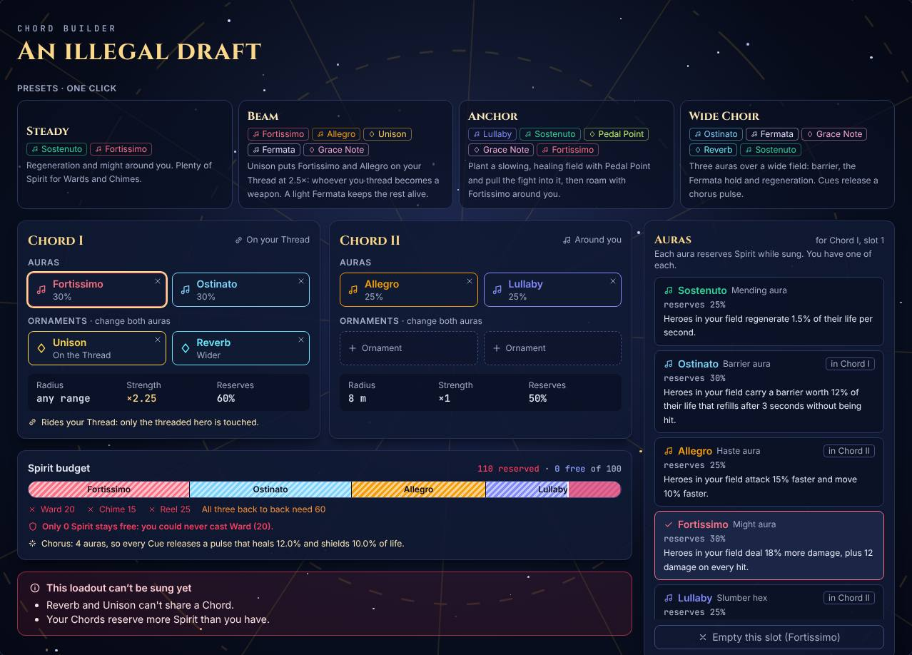

Respite gains a third card; Retune keeps the builder and asks for confirmation ("Retune and travel on", disabled while illegal or unchanged).

| Respite | Retune |
|---|---|
| 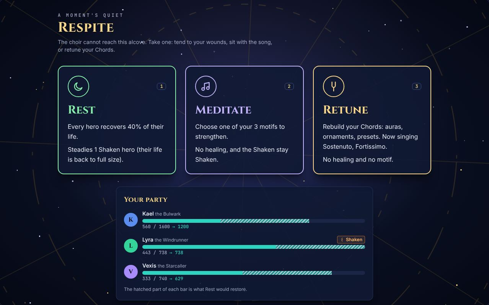 | 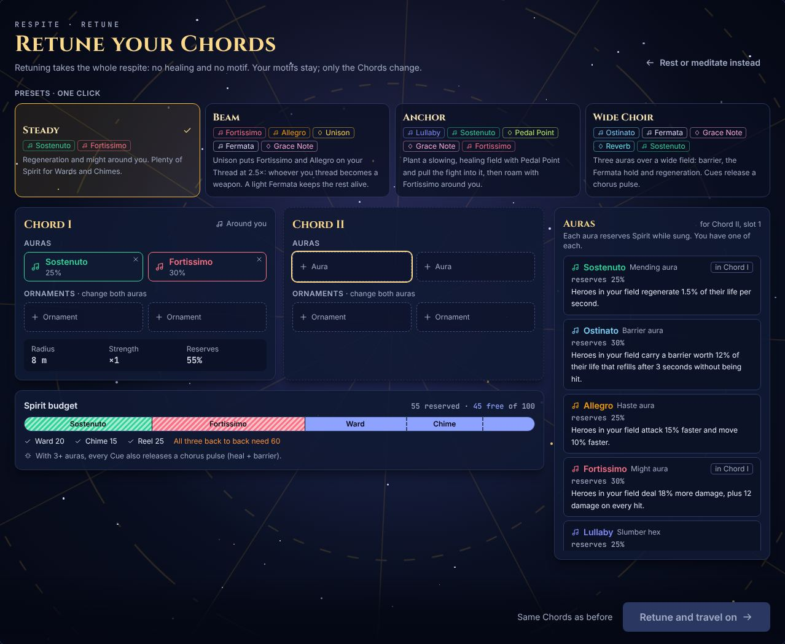 |

## "Without you" (Result, Summary)

- The panel sits right under the best-moment banner. "With you" shows at once; the other column reads *Replaying the fight without you…* for 1.1 s, then reveals with `playUi('reveal')` (immediately under `prefers-reduced-motion`).
- Side by side: outcome (Victory / Wiped / Stalled, each with a glyph), time, wave reached, downs, heroes still standing (portraits lit / greyed), boss life for boss fights.
- One sentence underneath, from `withoutYouLine`: "Without you, the party falls at 0:41 in wave 2 of 3." / "…they still win, but it takes 2:30 (0:55 longer), with 2 heroes going down along the way." / "…the fight is still going at 10:00…". When you won and they wouldn't have, it's gilded and adds **"You made the difference."**
- `withoutYou === null` hides the panel entirely (lab view `result-no-rerun`).

| They'd have won alone | Alone, it stalls (timeout) |
|---|---|
| 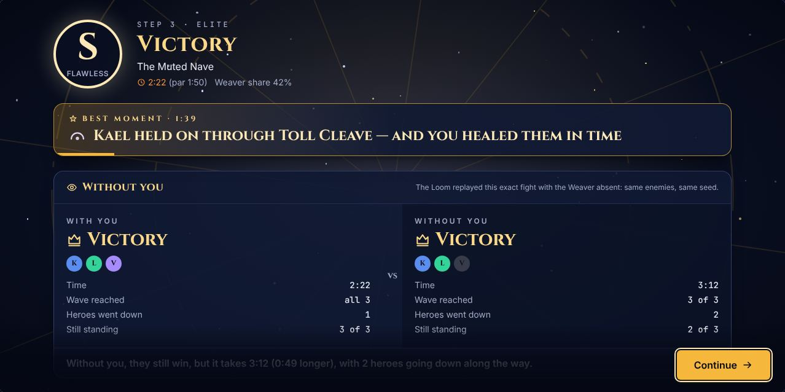 | 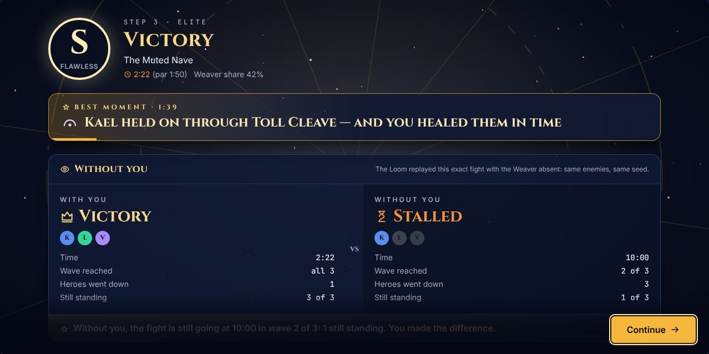 |

The result's stat lines add **calls** ("Answered 4 of 6 calls for help: 4 Flourishes.") and **Fermata** ("Fermata caught 2 lethal hits and held the hero at 1 life; you healed them through the hold."). Highlights of kind `response` and `fermata` get their own glyphs (speech bubble, fermata arc) and colours (call gold, Fermata lilac), in the banner and the list.

The Summary opens with the run aggregate (`withoutYouTally` / `tallyLine`) and a strip of every fight ("You: won · Alone: fell 0:41"), and adds **Calls answered** and **Fermata holds** tiles to "Proof of support".

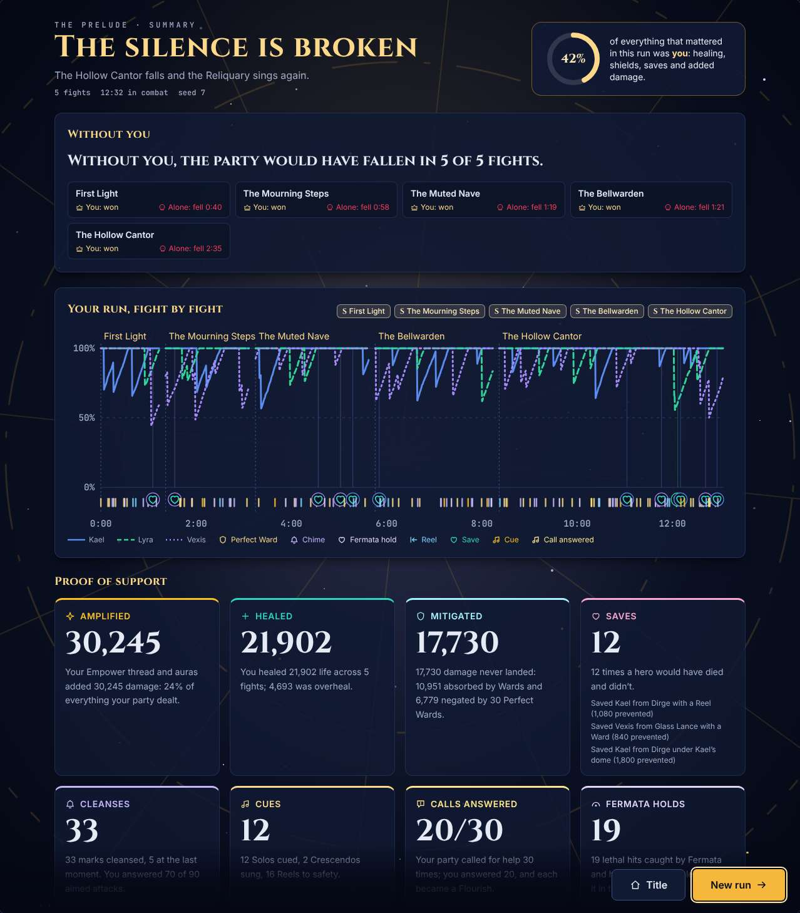

## HUD

| Calls (open, answered), Unison on the Thread | Fermata hold, Pedal Point, two Chords |
|---|---|
|  | 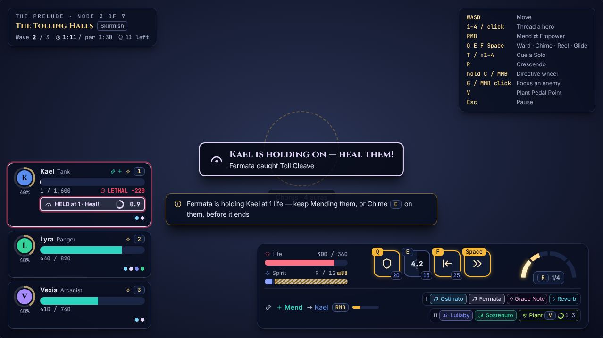 |

- **Call indicator** (party frame): a gold strip with the call glyph, the **requested answer's glyph and name** ("Ward!", "Empower!", "Chime!"), the **key** that answers it (Ward / Chime key; for Empower the hero's number and `RMB` until the Thread is on them in Empower), a countdown ring and seconds. The frame border turns call-gold. Answered: "✓ Answered · Bulwark!". The call line itself appears as a gold speech bubble beside the frame with "Ward → Bulwark".
- **Fermata hold**: a pulsing lilac strip "HELD at 1 · Heal!" with a ring countdown, the frame pulses; the `held` status badge is folded into it. A `hold` callout shows a centred alert ("Kael is holding on — heal them!").
- **Aura pips**: one dot per aura touching the hero (`hero.auras`), right of the status row; names on hover and in the accessible label.
- **Weaver bar**: one group per Chord (I, II) with aura chips and ornament chips. **Unison** shows which hero it rides (name + slot key) or "no Thread"; **Pedal Point** shows "Plant" with its key, lit when ready, and a cooldown ring + seconds (`weaver.plant`).
- **Callouts**: `response` is a big banner with the call glyph ("HEARTSEEKER!"); `hold` is a sentence-style alert banner (one at a time, it bumps the big banners to one); `call` is a speech bubble (or a toast if the speaker has no frame).
- Key labels everywhere follow the player's bindings (`bindingLabel` reads the live bindings; technique buttons use `TechniqueHud.key0`).

### New coach hints

| id | When | Text |
|---|---|---|
| `hold` (first) | a hero is held by Fermata | "Fermata is holding *Kael* at 1 life — Thread them `1` or Chime `E` on them before it ends" |
| `call` | an open, unanswered call | "*Kael* is calling for a Ward — press `Q` on them before the ring runs out for Bulwark" (Empower: "Thread them `2` in Empower `RMB`…") |
| `plant` | a Pedal Point Chord, plant ready, someone outside the field | "Your Pedal Point field stays where you plant it — press `V` to plant it under the fight" |
| `wheel` | 2+ heroes outside the field, or 45 s in with no Directive | "Your party is spread out — hold `C` and flick toward Rally…" / "Hold `C` (or the middle mouse button) for the Directive wheel…" |

## Directive wheel

| Rally under the pointer, Focus disabled (no enemy) | Focus on the enemy under the cursor |
|---|---|
| 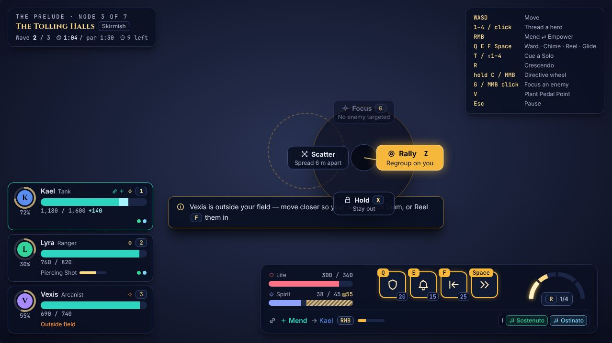 | 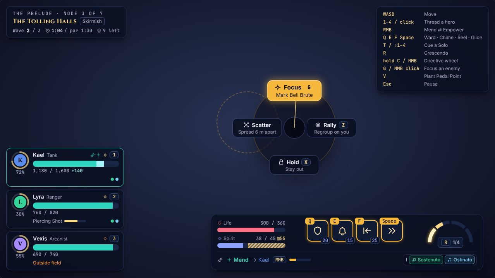 |

- **Open**: hold `directiveWheel` (C) — the wheel appears at once around the cursor — or hold the **middle mouse button** (it appears after 170 ms or as soon as you drag out of the dead zone). `wheelOpen` plays when it appears.
- **Pick**: move toward a spoke and release (or left-click). Focus (top) marks the enemy that was under the cursor *when the wheel opened*, and is disabled without one; Rally (right), Hold (bottom), Scatter (left). `wheelPick` plays; the command is the same `directive` command as the direct keys.
- **Cancel**: release in the centre dead zone (28 px), right-click, pause (Esc closes it with no pick), or alt-tab.
- **Quick middle-click** on an enemy still Focuses it (Phase 1 behaviour): a release before the wheel appears is a click.
- Held movement keys keep working; the wheel uses window-level pointer events while open, so the pointer can pass over HUD panels.
- Logic lives in the InputController; the geometry is pure (`wheelSpoke` / `wheelChoice`: each spoke owns the 90° sector centred on it, exact diagonals go clockwise) and the open wheel is published to a tiny store (`useWheel`) that only the wheel component subscribes to, so the HUD doesn't re-render on pointer moves.

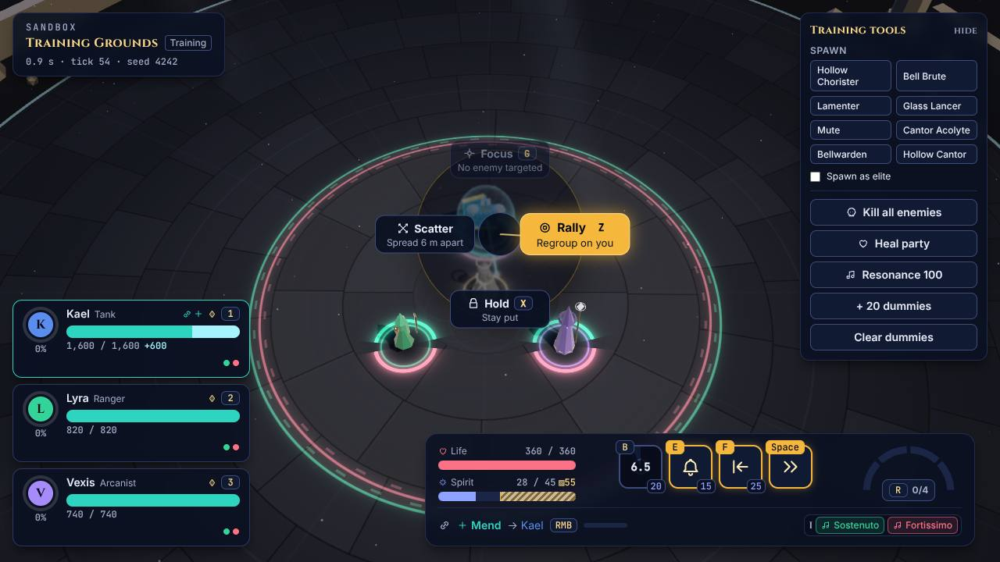

## Settings

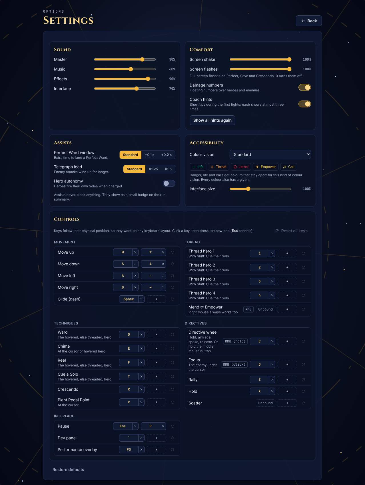

- **Controls**: every action, grouped (Movement, Thread, Techniques, Directives, Interface), two key slots each plus the fixed mouse buttons (RMB, MMB). Click a slot and press a key; **Esc cancels** (Esc can't be bound; Ctrl / Alt / Meta are refused). The capture listens in the window's capture phase, so the game and dialogs never see the key. A key already in use asks: **Swap** (the other action gets this slot's old key) or **Use it here, unbind it from …**, or Cancel. ↺ resets one action (taking its keys back from whoever had them); **Reset all keys** clears the overrides. Settings store only the differences from `DEFAULT_BINDINGS` (`overridesFor`).
- The **InputController follows the bindings live** (`DEFAULT_BINDINGS` merged with `settings.bindings`, re-indexed only when the bindings change), so rebinding from the pause menu applies at once. Held keys are released on a rebind.
- **Accessibility**: colour vision (Standard / Protanopia / Deuteranopia / Tritanopia, with a swatch preview of life, threat, lethal, Empower and call), applied with `applyVisionCss` on change and at startup; **Interface size** 80–150 % (root font size, so every rem-sized HUD and menu element scales; 100 % keeps text ≥ 12 px; the combat HUD at 125 % wants a screen about 1600 px wide, and a few pixel-sized glyphs such as the Resonance arc stay their size); **Screen flashes** is now a 0–100 % strength slider.

| Conflict prompt | Deuteranopia palette | Interface at 125 % (1600 × 900) |
|---|---|---|
| 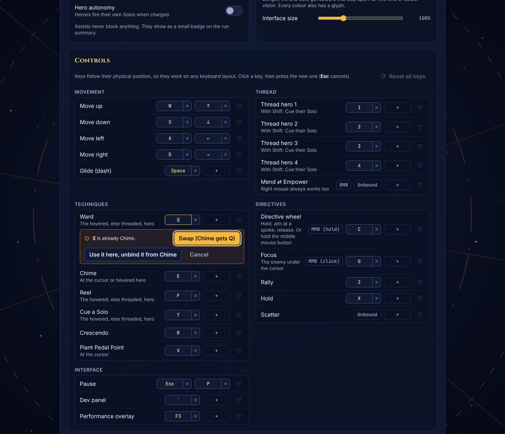 | 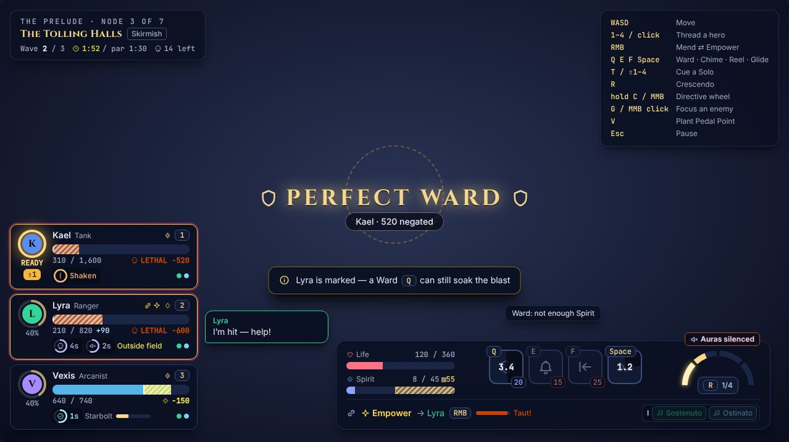 | 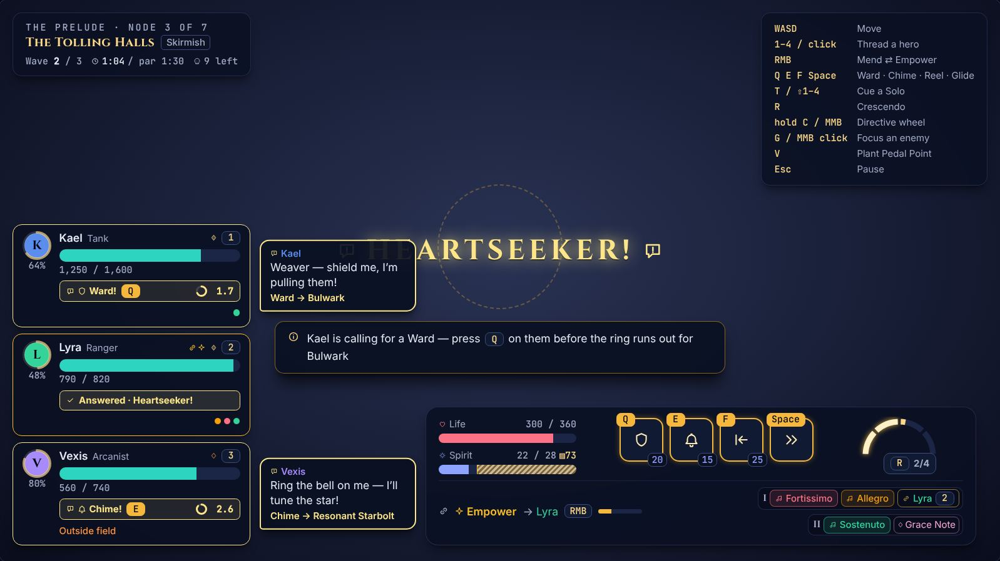 |

## Codex

| Chords & ornaments | Calls |
|---|---|
| 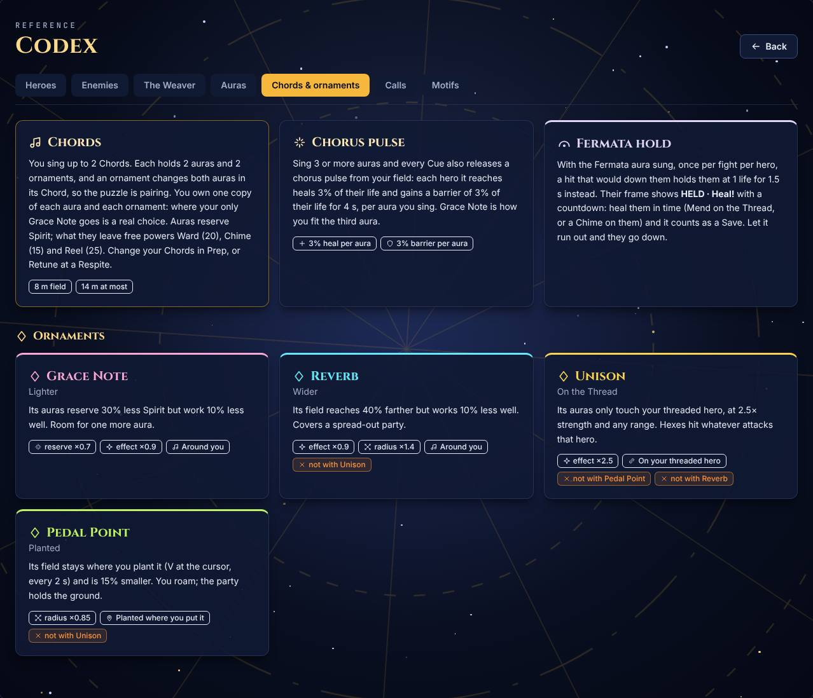 | 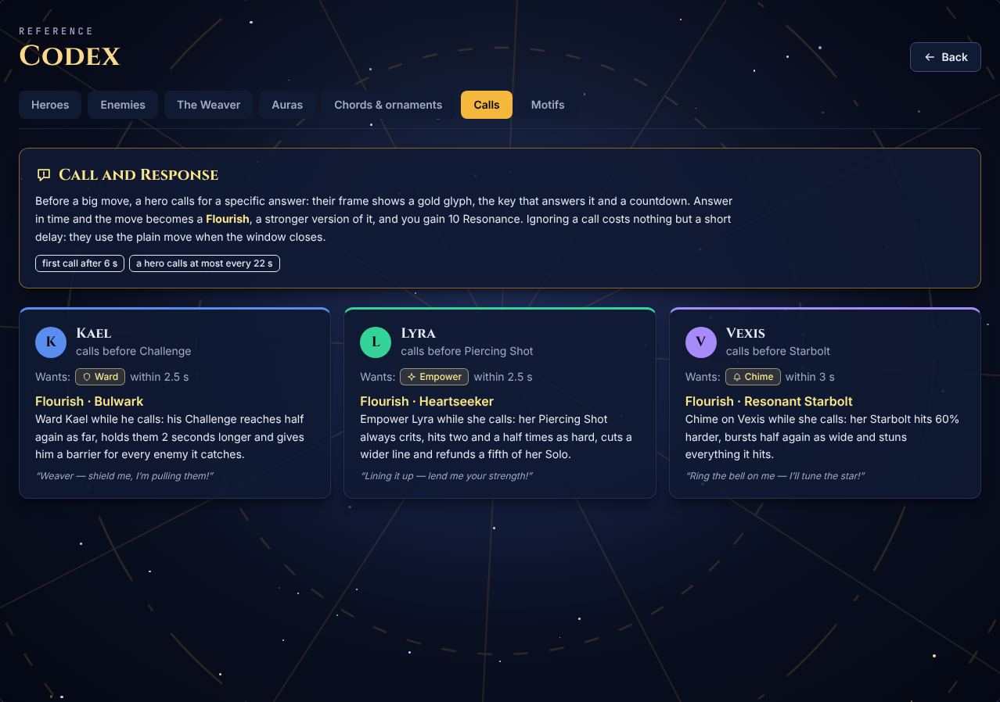 |

## Lab views added

`hud-calls`, `hud-fermata`, `hud-wheel`, `hud-wheel-focus`, `chords-illegal`, `respite-retune`, `result-alone-wins`, `result-stalled`, `result-no-rerun`, `codex-chords`, `codex-calls`. Updated: `prep`, `respite`, `result-win` (reveal + Phase 2 highlights), `summary-*` (aggregate), `settings`, `flow` (Retune works in the fake run).

## Tests

- `tests/inputController.test.ts`: live remapping (override, unbind, reset, held key released on rebind, unrelated settings ignored, explicit bindings win); the wheel by key and by middle button, dead-zone cancel, disabled Focus, Focus on the enemy under the cursor, LMB pick, quick middle-click Focus, movement keys untouched, pause closes it, rebound wheel key.
- `tests/uiWheel.test.ts`: spoke geometry (sectors, diagonals, dead zone, NaN, disabled spokes).
- `tests/colorVision.test.ts`: every palette complete (all roles, valid hex), labels, every `CRITICAL_PAIRS` pair ≥ 20 ΔE under `simulateVision` for each vision's own palette, `applyVisionCss`.
- `tests/uiBindings.test.ts`: merge, minimal overrides, swap / clear conflicts, own-slot moves, no key ever on two actions, reset, refused keys, every action listed in Settings.
- `tests/uiChords.test.ts`: slot placement, single copies, swaps, purity, presets legal and recognised, the sim's sentences, Spirit budget, Grace Note, per-Chord numbers.
- `tests/uiScreens.test.ts`: "Without you" sentences and run tally, made-the-difference, stat lines, the four new hints.

## Contract notes

- **No contract changes were needed.** `InputController`'s constructor gained an optional 5th `options` argument (`{ sound }`, for tests), and its 4th `bindings` argument is now optional: without it the controller follows the live settings (that's how `runtime.ts` already calls it).
- `src/app/App.tsx`: one effect, `installPresentation()` (colour vision + UI scale at startup and on change).
- `ui/kit/iconPaths.ts` now holds the glyph paths and `IconName` (re-exported by `Icon.tsx`), so `.ts` modules and Node tests can use icon names without JSX. New glyphs: `call`, `fermata`, `tune`, `wheel`, `pin`.
- Lead-side follow-ups worth considering: `TechniqueHud.key0` / `WeaverHud.plant.key0` are now filled from the live bindings by `hudBridge`; the render workstream may want `settings.flashes` as a strength (it is now a 0..1 slider, as the v2 schema says).
