# Phase 3 UI: the beam song and the field song, Weaver Rank

*Owner: the UI workstream (`src/ui/**`). Builds on [Phase 2's UI](../phase-2/ui.md). Spec: [docs/phase-3.md](../phase-3.md).*

Everything here can be reviewed without playing: open **`/?lab=ui`** (sidebar, new group **Weaver Rank**) or `/?lab=ui&view=<id>&nav=0`. The Phase 2 lab parameters still work (`&vision=…`, `&scale=…`, `&w=…`).

Every number on these screens is read from content or the contracts (`resolveChord`, `CONTENT.weaver.beamFocus/beamEcho`, `RANK_XP`, `UNLOCKS`, `CHORD_PRESETS`, `xpForFight`), so the lead's tuning flows through. The screenshots show Unison at ×2.5 and the presets as they were during this session.

## What changed, by screen

| Where | What | Files |
|---|---|---|
| Prep, Respite → Retune | **Song builder**: "Beam song" and "Field song" cards with a one-line explanation and their numbers; locks by Rank on songs, slots, auras, ornaments and presets; **New** marks and a "Newly unlocked" strip; `markIntroduced` once shown | `screens/ChordBuilder.tsx`, `screens/chordModel.ts`, `screens/PrepScreen.tsx`, `screens/RespiteScreen.tsx` |
| Title | **Weaver Rank** panel: Rank, XP bar, what the next Rank opens, runs and wins | `screens/Rank.tsx` (`RankPanelView`), `screens/rankText.ts`, `screens/TitleScreen.tsx` |
| Result | **+N Weaver XP** with its lines and the bar toward the next Rank; a **rank-up card** for pending rank-ups; "What you did" splits the auras from the Thread, with a three-part bar | `screens/ResultScreen.tsx`, `screens/Rank.tsx`, `screens/ContributionBar.tsx`, `screens/resultText.ts`, `ui/contribution.ts` |
| Summary | The run's XP, Rank progress and what it unlocked; a "Your songs and your Thread" panel; tiles split auras / Empower / beam; the rank-up card if one is pending | `screens/SummaryScreen.tsx` |
| HUD | **×2 badge** on the hero the beam pours into; aura pips by song (beam on them: solid with a gold ring; echo: hollow; field: solid); song groups in the Weaver bar ("×2" beam, "Field"); "→ Lyra ♪×2" on the Thread line; a **live readout** of auras vs Thread on the Weaver bar's edge; the `beam` coach hint | `hud/PartyFrames.tsx`, `hud/WeaverBar.tsx`, `hud/songs.ts`, `hud/hints.ts`, `hud/Hud.tsx` |
| Settings | **Progress**: Rank line, **Skip the unlocks** (`unlockAll`), **Reset progress…** with an inline confirm | `screens/SettingsScreen.tsx` |
| Codex | **Songs & ornaments** (the beam song, the field song, Unison from content; each ornament's beam strength, "beam song only", unlock Rank); new **Weaver Rank** tab (how XP is earned, what each Rank opens and its preset); auras show their unlock Rank; the Thread entry mentions the beam song | `screens/CodexScreen.tsx` |
| Training Grounds | Preset picker lists all six presets regardless of Rank, with the chosen one's songs underneath | `screens/TrainingScreen.tsx` |
| How to play | The Thread card adds "Your beam song pours into whoever you thread." | `hud/HowToPlay.tsx` |

## Song builder

| First run (Rank 1) | Rank 3: ornaments arrive |
|---|---|
| 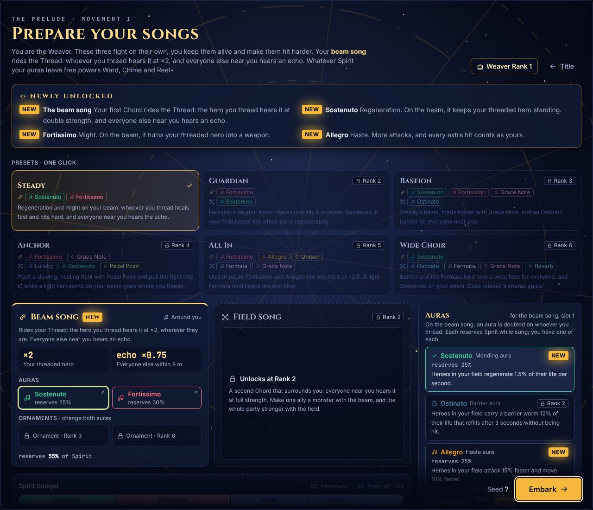 | 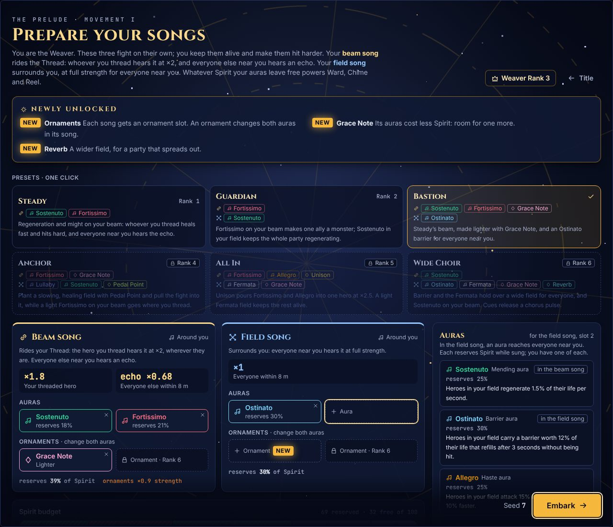 |

- **Two songs, named.** The heading carries the song's glyph and accent (beam: the Thread's gold and the thread glyph; field: blue and the spread glyph). Under it one line (`songInfo().blurb`) and the numbers that matter as big figures: beam **×2 · Your threaded hero** and **echo ×0.75 · Everyone else within 8 m**; field **×1 · Everyone within 8 m**; Unison **×2.5 · Your threaded hero** and **No echo**. Strengths include the ornaments' effect (Grace Note shows the beam at ×1.8), radius follows Reverb and Pedal Point ("within 6.8 m of where you plant it").
- **Locks** come from `useProfile().allowance()` semantics (Rank, or everything with Skip the unlocks): a locked song shows "Unlocks at Rank 2" and its unlock text in place of its slots; locked slots read "Ornament · Rank 6"; locked palette items are disabled with a **🔒 Rank N** tag; locked presets are dimmed with their Rank and can't be applied. `unlockRank` gives every number.
- **Items the Rank no longer allows** (remembered songs after Reset progress, or Skip the unlocks turned off) stay visible in their slot with "🔒 Rank 5: empty it"; the slot can still be selected and emptied.
- **Unison** in the field song's palette is disabled with "Beam song only"; the sim's sentence ("Unison only fits the beam song.") still shows if a draft has it there.
- **Sentences**: `loadoutProblems(chords, allowance)` = `chordProblems` then `lockedProblems`, verbatim. `useChordDraft(initial, allowance, onLegal)` only passes loadouts that are legal **and** allowed, so Embark / Retune wait with "Fix your songs to embark".
- **New**: `freshUnlocks(xp, introduced)` (reached, not introduced). Prep and Retune read it once on open (`useFreshUnlocks`), show a "Newly unlocked" strip with each unlock's `text` and **New** tags on the song heading, ornament slot and palette items, then call `markIntroduced` with those ids. The tags stay for that visit and are gone next time (checked in the real app: 8 tags on the first Prep, `introduced` saved, 0 after a reload).
- Presets are 3 × 2, each with its Rank, its auras and ornaments grouped by song (glyph per song) and its summary.

| Locked items in the draft (Rank 2) | Illegal draft: Unison in the field song, over budget |
|---|---|
| 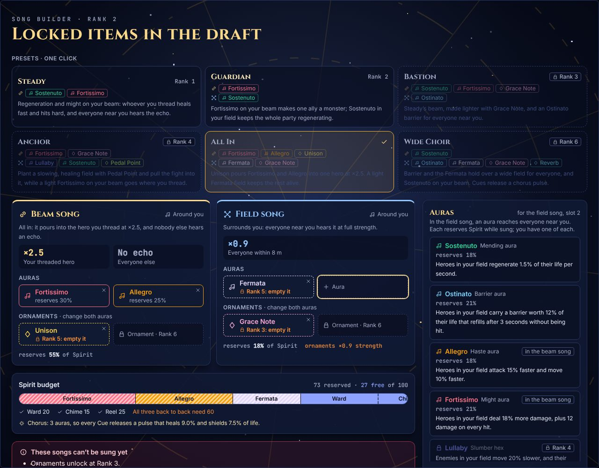 | 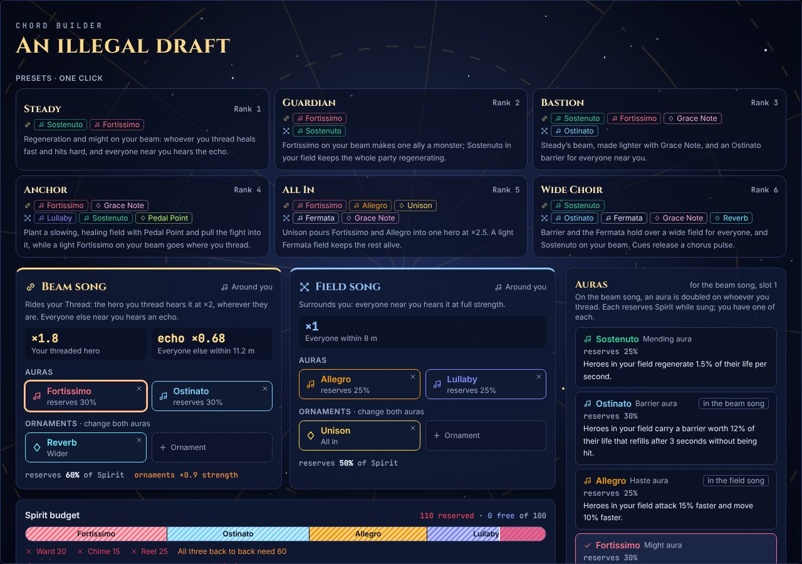 |

## Weaver Rank

| Title | Rank panel at Ranks 1, 3, 6 and with Skip the unlocks |
|---|---|
| 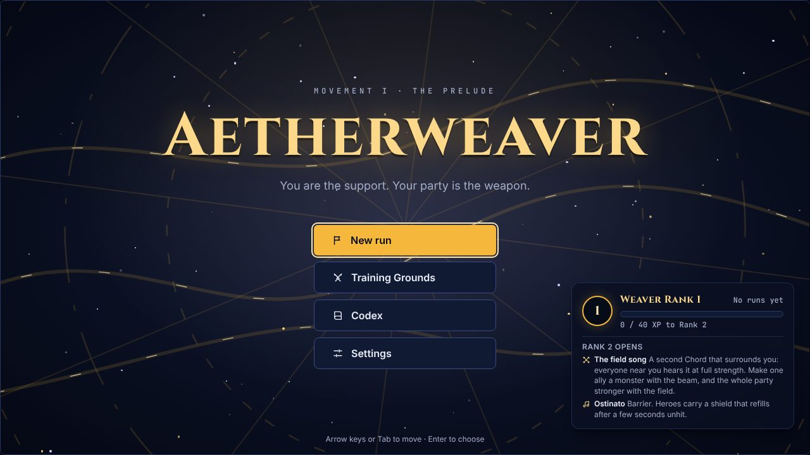 | 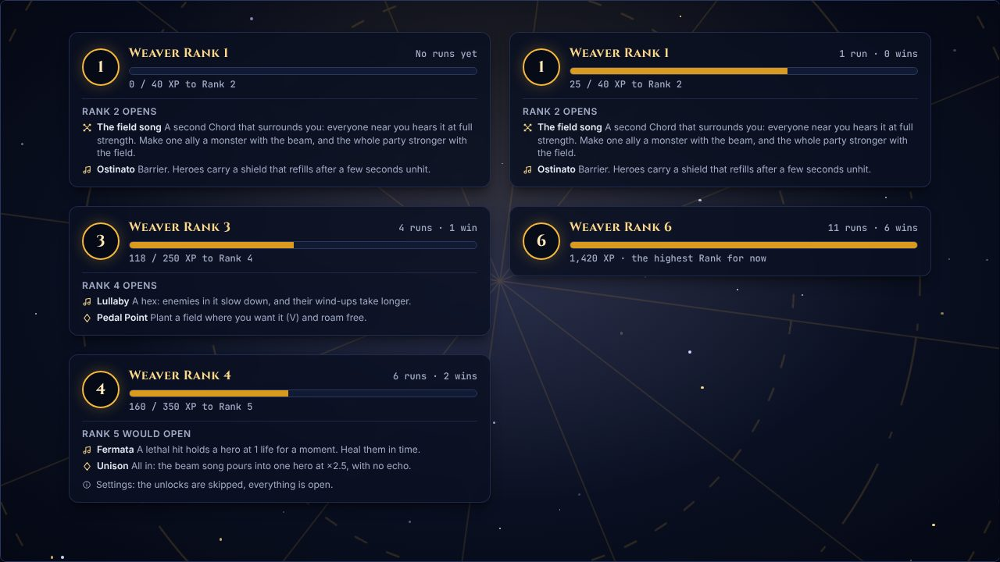 |

- Title: bottom-right on wide screens, under the menu on narrow ones. Rank disc, "Weaver Rank 3", runs · wins, the XP bar, "118 / 250 XP to Rank 4", and "Rank 4 opens" with each unlock's name and `text`. At the top Rank: "1,420 XP · the highest Rank for now". With Skip the unlocks: "Rank 5 would open" and a one-line note.

| Rank-up card (first ever) | Two Ranks at once |
|---|---|
| 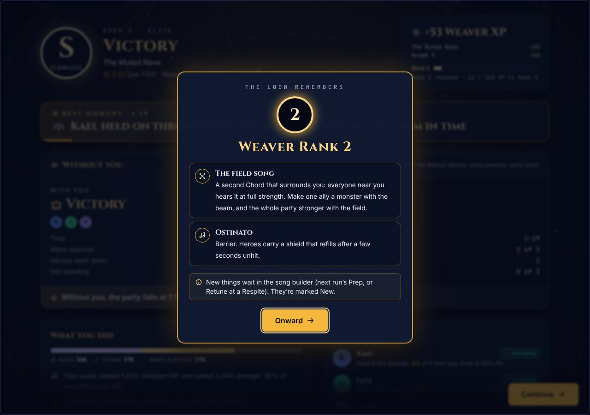 | 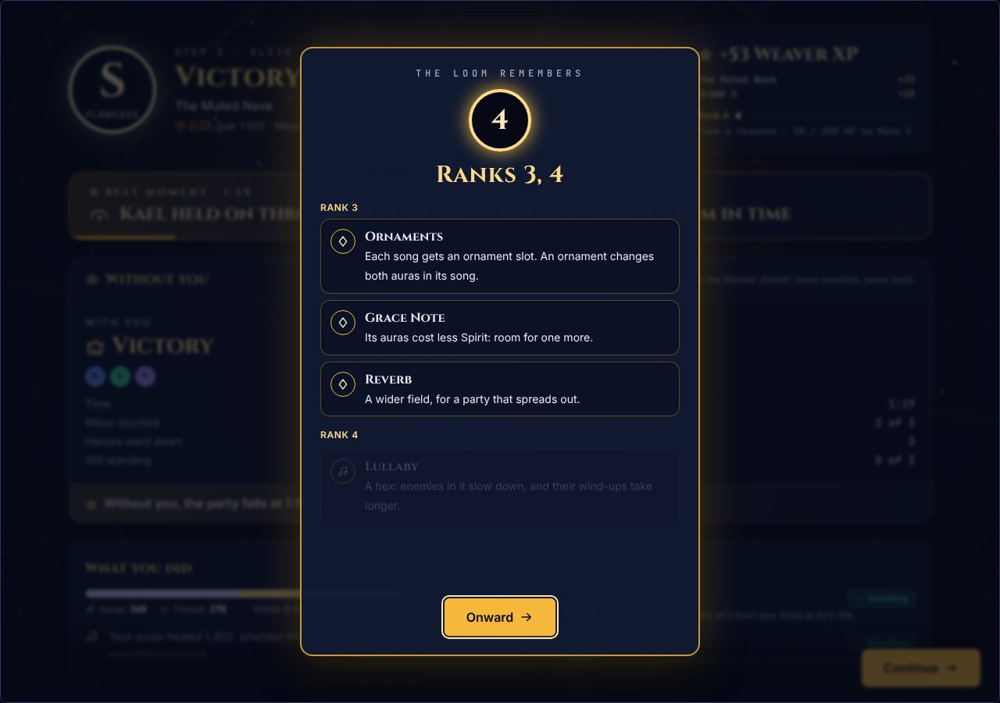 |

- **Rank-up card** over the Result (or Summary) for each pending `rankUps` entry: the Rank disc, "Weaver Rank 2", then each unlock's name and `text`, revealed one at a time. Sounds: `playUi('rankUp')` when the card appears, `playUi('unlock')` per unlock revealed (instant under `prefers-reduced-motion`). **Onward** (or Esc) calls `dismissRankUps`. A Rank with nothing scheduled says so.
- **First rank-up coach line**: the first time (and with coach hints on) the card adds "New things wait in the song builder (next run's Prep, or Retune at a Respite). They're marked New." It is counted with the other hints (`rank-up`, once), so "Show all hints again" resets it.
- Verified in the real app (Vite + the run store): profile at 30 XP, a won First Light → phase `result`, XP 60, the card shows, dismissing clears it, the hint is counted.

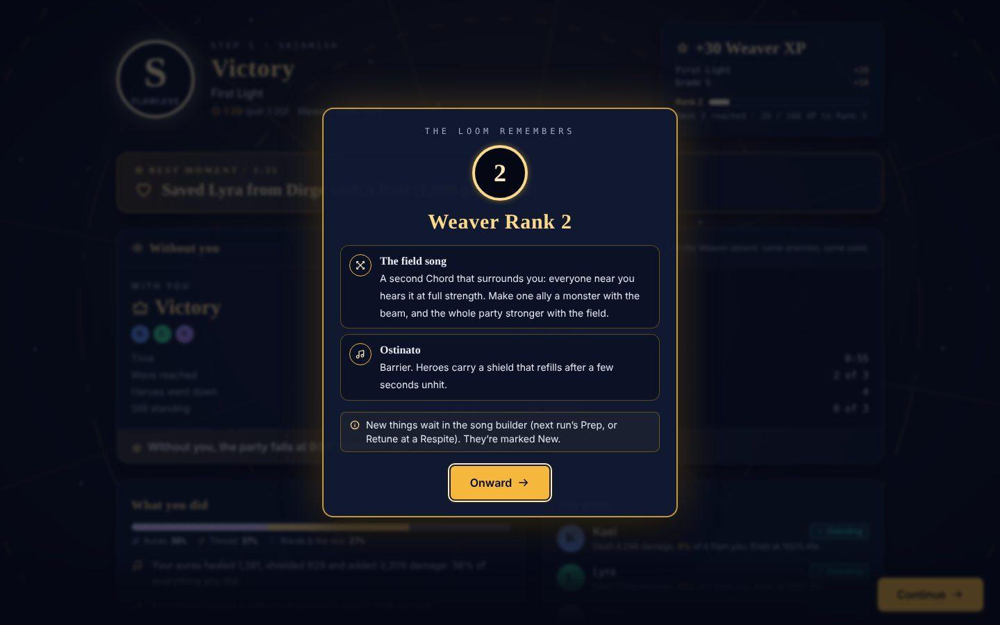

## Result and Summary

| Result | Summary |
|---|---|
| 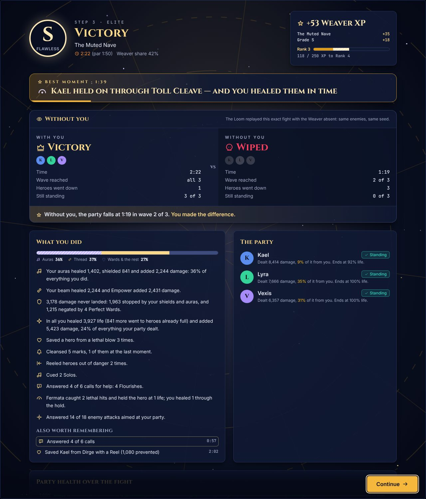 | 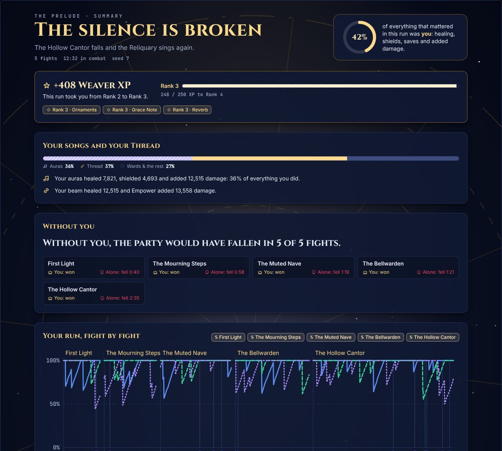 |

- **XP panel** (Result header): "+53 Weaver XP", the lines from `xpForFight` recomputed from `{kind, outcome, grade, name}` and whether it won the run (the boss), the bar (what you had, and the gain striped), "Rank 2 reached · 20 / 160 XP to Rank 3". The headline is the result's own `xp`.
- **What you did**: a three-part bar (Auras · Thread · Wards & the rest; auras striped), then:
  - "Your auras healed 1,402, shielded 841 and added 2,244 damage: 36% of everything you did." (zero parts left out; muted advice if the auras did nothing)
  - "Your beam healed 2,244 and Empower added 2,431 damage." (variants for only one, or neither)
  - the Ward / Perfect Ward line as before, then "In all you healed … (… more went to heroes already full) and added …, 24% of everything your party dealt.", then saves, cleanses, Reels, Cues, calls, Fermata, aimed attacks as before.
  - "Everything you did" = healing + shielded + negated + amplified (the same total as `HudSnapshot.contribution.total`).
- **Summary**: "+408 Weaver XP", "This run took you from Rank 2 to Rank 3." with the unlocks it reached as chips, the bar; "Your songs and your Thread" (bar + the two lines over the run); the Amplified / Healed tiles split auras, Empower and the beam; "Songs: Beam song: … · Field song: …" under the motifs.

## HUD

| The beam on Lyra (outside every field), readout, hint | Deuteranopia palette |
|---|---|
| 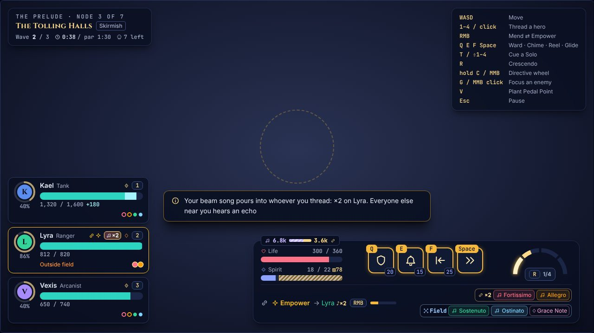 | 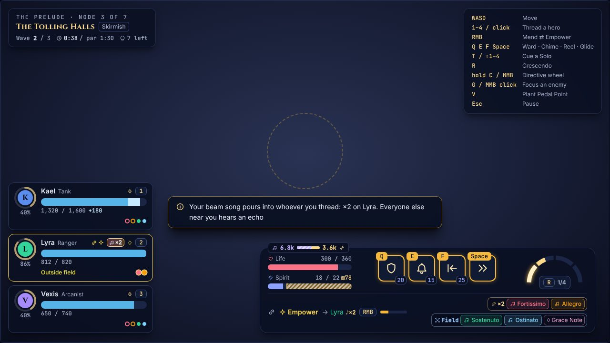 |

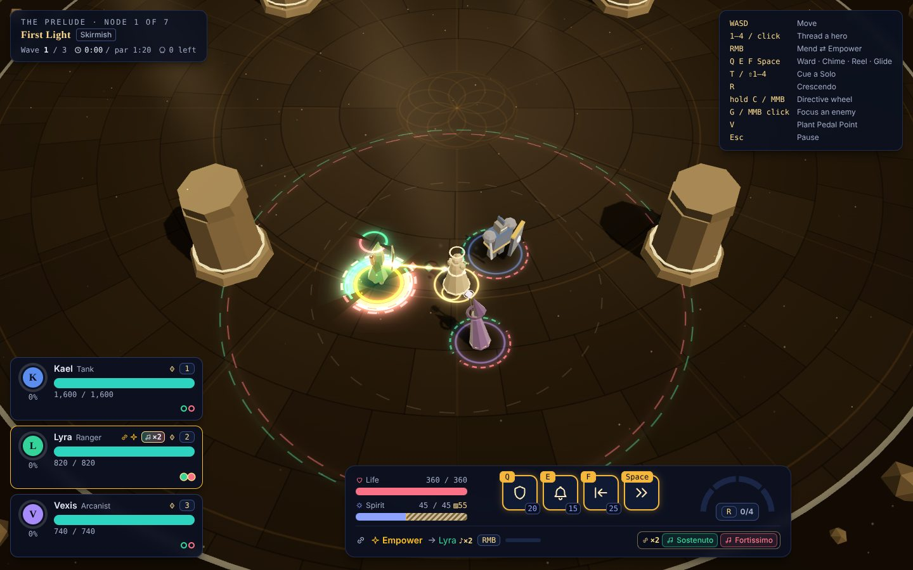

- **Party frames**: the hero the beam pours into (`HeroHud.beamFocus`) gets a **♪×2** badge (×2.5 with Unison, from the beam chord's `focus`) next to the Thread glyph, bordered gold over a gradient of the beam song's aura colours; its aria label says "Your beam song pours into them at ×2". It shows alongside **Outside field** when the threaded hero is past every field (the lead's honest `inField`): the beam still reaches them.
- **Aura pips by song** (`heroSongs`): beam auras on the focused hero are solid with a gold ring; beam auras heard as the **echo** are hollow rings in the aura's colour; field auras are solid. Hover / aria: "Fortissimo (beam ×2)", "Sostenuto (echo ×0.75)".
- **Weaver bar**: one group per song that sings something — beam "🔗 ×2" (tooltip: "Beam song (Fortissimo + Allegro): Lyra hears it at ×2. Everyone else within 8 m hears an echo at ×0.75.") and "Field" (tooltip with its radius); the Thread line reads "→ Lyra ♪×2" (or "no one (1–3): beam song idle"). Unison is now an ordinary ornament chip: the strength is on the group.
- **Live readout** (`HudSnapshot.contribution`): a small pill on the Weaver bar's top-left edge, "♪ 6.8k ▬▬ 3.6k 🔗": auras vs Thread this fight, with a split line (auras striped). Hidden until either has done something; numbers via `compact()`; tooltip with the healing / shield / damage breakdown. rem-sized, so it follows `uiScale`.
- **Coach hint `beam`**: "Your beam song pours into whoever you thread: ×2 on Lyra. Everyone else near you hears an echo" (Unison: "…, and nobody else"). When a beam song with auras pours into a living hero, 4 s into a fight, not silenced. Shown at most 3 times like the others.

## Settings

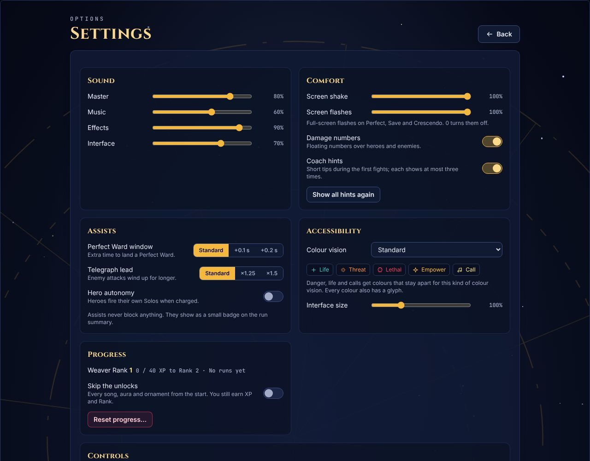

- **Progress**: "Weaver Rank 1 · 0 / 40 XP to Rank 2 · No runs yet"; **Skip the unlocks** ("Every song, aura and ornament from the start. You still earn XP and Rank."); **Reset progress…** → inline confirm ("Back to Rank 1? Your Weaver XP, runs and wins are cleared and everything locks again. Settings and a run in progress stay.") with **Keep my progress** / **Reset to Rank 1** → `useProfile().resetProgress()`. It also appears in the pause menu's settings.

## Codex

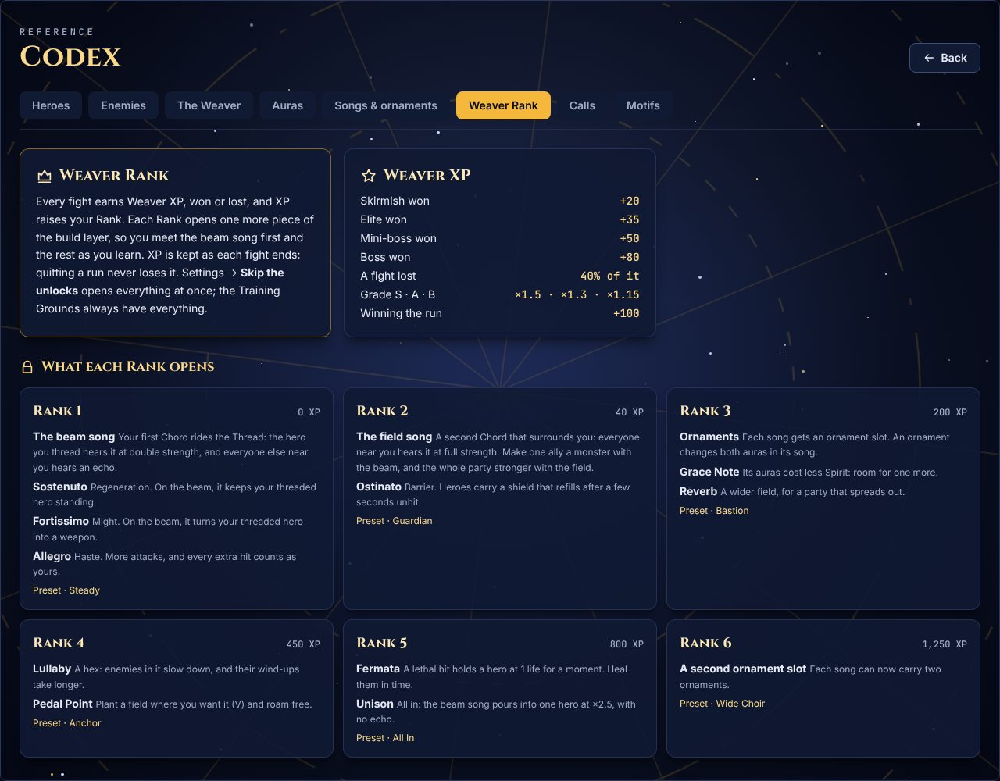

## Lab views

New: `hud-beam`, `rank-panels`, `rank-up`, `rank-up-multi`, `rank-up-bare`, `prep-rank1`, `prep-rank3`, `chords-locked`, `codex-rank`. Updated: `prep` (everything open, Guardian), `chords-illegal` (Unison in the field song), `result-*` and `summary-*` (XP and Rank panels; `LAB_XP` = 318), every HUD mock (the beam pours into the threaded hero, `withBeam` in `mock.ts`; Unison's strength from `resolveChord`), `codex-chords`.

## Tests

`tests/uiPhase3.test.ts` (21 tests, numbers read from content/contracts):

- songs: names, focus / echo / radius from content, Unison's strength and "No echo" from `resolveChord`, ornaments folded in, "Beam song only".
- locks: song / slot / item / preset locks match `unlockRank` and each preset's `rank`; `EVERYTHING` opens all; `loadoutProblems` = sim sentences then `lockedProblems`; New = reached and not introduced; every builder unlock id exists in `UNLOCKS`.
- Rank text: panel progress, next unlocks, record, top Rank; a fight's XP lines equal `xpForFight` and sum to the result's `xp`; the XP bar across a rank-up; the run's Rank line.
- contribution: the three-way split, compact numbers, the aura and beam sentences (exact text), the result keeps the older lines, a run's XP equals its fights'.
- HUD: who the beam pours into, who hears the echo, badge + outside-field together, at most one focused hero per mock (the threaded one), the `beam` hint and no hint without a beam song.

`tests/uiChords.test.ts` and `tests/uiScreens.test.ts` still pass unchanged.

`npm run typecheck`, `npm run lint` and `npx vitest run` pass.

## Known gaps

- The rank-up card isn't a full focus trap (Tab can reach the dimmed Continue button behind it); Esc and Onward dismiss it.
- `markIntroduced` also runs from Retune (the same builder), not only Prep, so unlocks first seen mid-run aren't "New" again in the next Prep.
- The HUD readout counts the ledger's aura and Thread totals only; the third part of the screens' bar ("Wards & the rest") is `total − auras − Thread`, so anything the ledger files elsewhere lands there.
- The `beam` hint fires on the first fight with a beam song, not on a sharper "the beam made a difference" moment (the snapshot has no per-hero beam numbers).
- Pressing **Reset progress** mid-run leaves the run's songs as they are; Prep/Retune then show them as locked until emptied.
- The real-game screenshots were taken from a snapshot copy of the repo on its own Vite server (the lead's edits were hot-reloading the main one); a whole bot-played fight under SwiftShader was too slow (~6 ticks/s), so the rank-up was driven through the real run store with a lab outcome.

## Contract notes

No contract changes were needed or made. Two additions UI-side only:

- `ui/contribution.ts` (pure split / `compact`) is shared by the HUD and the screens.
- `hud/hints.ts` stores a `rank-up` count with the other hints (same key, same reset).

Possible lead follow-ups: `HeroHud` could carry the beam's strength on that hero directly (today the HUD reads it from the beam chord's `focus`), and a per-hero "beam did X this fight" figure would let the `beam` hint fire when it matters rather than on first use.
