# Phase 3: Combat presentation (render / VFX)

The playtest said the auras felt unneeded: "most of my effect came from the beam". The sim now
splits the songs (CONTRACT v4). This workstream makes both fantasies visible:

- **Make one ally a monster.** The beam song pours into the threaded hero.
- **Make the whole party stronger just by being near you.** The field song covers everyone near
  the Weaver.

It also makes the auras show their work in the numbers. Everything still reads `WorldState` and
`SimEvent`s only. Strengths come from `chord.focus` / `chord.echo`, never hard-coded, so the
lead's tuning (Unison now ×2.5) shows up without render changes.

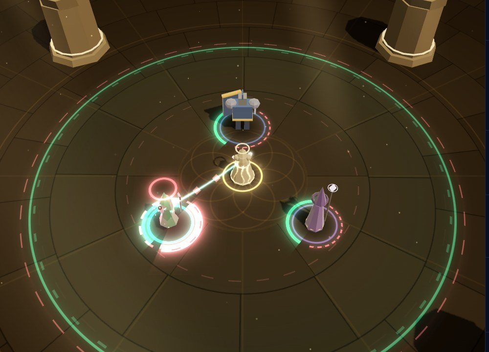

## What changed

| File                  | Phase 3 work |
| --------------------- | ------------ |
| `songs.ts` (new)      | Pure helpers, tested in Node. `fieldLook(chord)` (`song` / `echo` / `none`), `fieldLoudness` (an echo is drawn at ≤ 0.6 of a field song), `beamSong(state)` (Chord I with auras), `isAllIn`, `focusLevel(focus)` (0 at ×1, ⅔ at ×2, 1 at ×2.5), `focusLabel` ("×2.5"), `chordMask`, `REGEN_MASK`, `auraHearing(bit, beamMask, beamFocus)` (`focus` / `echo` / `full`), `splitAmplified(amplified, aura)` (gold chip = `amplified - aura`, song chip = `aura`, clamped), `chipText`, `SONG_GLYPH` (♪), `songHex(vision)` and `POUR_TRAVEL`. |
| `field.ts`            | **Echo vs field song** in the same instanced `FieldBatch` (still 1 draw call for up to 4 fields; one more per-instance attribute, `iRole`). The field song keeps the Phase 2 look: solid bands, glow, drifting ticks, inner tint. The beam song's **echo** is visibly quieter: thin dashed bands at `echo`-scaled loudness, no tint or ticks, and two faint dashed **echo ripples** running out from its centre. When an echo shares a field song's circle (Guardian, Bastion), it is drawn just outside it so both stay legible. Pedal Point works on either song: a planted echo keeps the stake and staff ring at reduced loudness. **Beam halo**, generalised from the Phase 2 Unison halo to every beam song and scaled by `chord.focus`: counter-rotating dashed aura rings at the feet, a crown over the head, a pool of the song's light, a body glow and rising notes. **All in** (Unison, no echo) adds a second crown, an outer solid ring, a stronger pool and flames. The halo is a per-hero fade: when the beam moves, the old hero's halo drains (~0.6 s) and the new one fills only once the pour arrives. With the Thread loose, the beam song waits as motes at the Weaver's hand. `centreOf()` keeps a Unison song on its hero. |
| `thread.ts`           | The beam song **rides the Thread for every beam song**, not only Unison: an aura-coloured sheath and beads of song flowing Weaver → hero, louder with the focus. All in adds a second, wider sheath and twice the beads. **The pour**: when the beam moves to a hero, a bright head runs along the new Thread (0.42 s), the sheath fills in behind it, then the song **splashes** on the hero (aura rings, a note and spark burst, a glow) and a callout names the strength ("♪ ×2", "♪ All in ×2.5") in the aura's colour. |
| `entities.ts`         | **The hero becomes the monster**: the threaded hero swells slightly (5% at ×2, 8% all in, breathing) and the beam song's colours breathe through the Thread rim. Both wait for the pour. **Per-aura foot arcs say how each aura is heard** (`auraHearing`): field song solid (Phase 2), beam song poured in a thick glowing arc plus an outer arc, beam echo thin and dashed. **Focused hexes**: an enemy with `beamFocus` whose hex is on the beam song gets a bigger triple swirl, a solid glowing foot ring, a spinning dashed outer ring and a ring that keeps **pressing down** from over its head to its feet. Ordinary hexes keep the Phase 2 dashed look. |
| `feedback.ts`         | **Damage numbers split the chip**: gold `+N` for Empower and Flourishes (`amplified - aura`), and a **♪ song chip** for the auras' part (`damageTaken.aura`, haste included). Both are aggregated in the existing per-target bucket, and the Weaver's-share sparks split the same way (gold sparks, song-coloured notes). **Aura heals** (`healApplied.via === 'aura'`) get their own bucket (never merged into Mend's) and their own look: a small, soft `♪+N` at chest height on the hero's left (Mend's numbers sit over the head, on the right), lighter, slower and lower-rising, plus a few notes in the healing aura's colour instead of Mend's heal motes. Everything respects `settings.damageNumbers`. Chorus skips an empty beam song. |
| `overlay.ts`          | Each pooled number has a second chip span. **Gold chip**: a squared tag. **Song chip**: a rounded pill led by ♪ (shape and glyph, never colour alone). Chip colours follow the live colour-vision palette (`setPalette()` restyles the 48 pooled numbers only when the vision changes; the old gold chip was hard-coded). Chip DOM writes are skipped when unchanged. `spawnNumber(..., soft)` gives the quieter aura-heal style. |
| `palette.ts`          | `C.song`: the live song colour (periwinkle `#a5b4fc`; `#93c5fd` under tritanopia). |
| `combatView.ts`       | Gives the Thread the overlay (for the pour callout). |
| `lab/VfxLab.tsx`      | Loadouts come straight from `CHORD_PRESETS` (so the lead's tuning shows up), plus lab-only ones. New **Phase 3 · Beam & field songs** group and `window.__VFX__` calls (below). Default loadout: Guardian. |
| `tests/render.test.ts`| Role → look mapping and loudness; focus scaling; chip split and text; the song chip stays ΔE ≥ 30 from the gold chip / Empower and ≥ 20 from the white and crit damage text and lethal, under each palette's own simulated vision; `C.song` switches live; mask helpers; and a **real-sim** check (Guardian = echo + field song with `beamFocus` on the threaded hero; All In = no disc, focus > 2, beam on the hero). |

### The song colour

The aura chip uses one "song" colour rather than per-aura colours. Allegro's amber is too
close to the gold chip and Fortissimo's rose to party-damage red, so per-aura chips would break
under some palettes. Periwinkle stays far from gold, white text, crit text and lethal under
every palette (tested). The chip is also a pill with ♪, so it never relies on colour alone. The
aura's own colour still shows in the world: halos, arcs, notes and the pour.

## Seeing each visual in the lab (`?lab=vfx`)

**Scene → Chords** lists the presets (Steady, Guardian, Bastion, Anchor, All In, Wide Choir)
and three lab-only loadouts: **Lullaby beam** (Lullaby + Fortissimo on the beam, Sostenuto in
the field, for focused hexes), **Planted echo** (Pedal Point on the beam song) and **Field song
only** (an empty beam song). Chord I is the beam song, Chord II the field song.

| Visual | How |
| --- | --- |
| Beam focus on each hero | **Phase 3 → Beam → Kael / Lyra / Vexis** (real `{t:'thread', slot}`) |
| Retargeting (the pour, the drain) | **Cycle beam** (real threads 1.5 s apart), or click another **Beam →** |
| Echo vs field song | **Guardian** or **Bastion** (echo around the field song), **Steady** (echo only), **Wide Choir** (echo inside a wider field song); **Scatter / Rally** to move heroes in and out |
| Planting either song | **Anchor** (planted field song) or **Planted echo**, then **Phase 2 · Chords → Plant ↗ / ↙ / at cursor** (real `{t:'plant'}`) |
| Unison, all in | **All In**, then thread a hero. Before the first thread, the motes wait at the hand. |
| Focused hexes | **Lullaby beam**, **Beam → Kael**, **Attackers on slot** (choristers on the target slot's hero) |
| Aura chips (real) | **Guardian**, thread Kael, **Real fight**; **Mode** to Empower to get both chips |
| Aura heals (real) | **Steady** or **Guardian** with a hurt party (**Real fight**, then **Kill all**) |
| Chips / heals (synthetic) | **Aura chips** (186 +22 ♪+64), **Aura chip only**, **Gold chip only**, **Aura heal + Mend** |
| Colour vision | Scene → **Colour vision**: chips, heal numbers |

`window.__VFX__` adds `loadouts()`, `thread(slot)`, `cycleBeam(every)`,
`auraHit(slot, amount, empower, aura)`, `auraHeal(slot, amount)` and `attackers(slot, n)`, next
to the Phase 2 calls (`setLoadout` now takes preset names, `manual(frames, ms)` for fixed-frame
shots).

## Verification against the real sim

Every screenshot is the real sim. Chords, `threadHero`, `focus`, `echo`, `radius`, `anchor`,
`beamFocus` and `auraMask` came from `{t:'thread'}` / `{t:'plant'}` and fights in the lab. The
exceptions are the three `numbers-*` close-ups, which inject the events listed. State read
during the shots:

- **Steady**, beam on Kael: one chord, `role:'beam'`, focus 2, echo 0.75, radius 8,
  `threadHero` = Kael. Kael `beamFocus:true`; Lyra and Vexis carry the same aura bits
  without focus, so their arcs are dashed (echo).
- **Guardian**, beam on Lyra: beam Fortissimo (radius 8, echo 0.75) plus field Sostenuto
  (radius 8, focus 1, echo 1). The echo is drawn just outside the field song. Only Lyra is
  `beamFocus`.
- **All In**, beam on Lyra: beam Fortissimo + Allegro, **focus 2.5** (the lead's new
  tuning), echo 0, **radius 0** (no disc). Lyra's mask has both beam auras plus Fermata; Kael
  and Vexis only Fermata from the field song.
- **Anchor** (current preset: beam Fortissimo [Grace Note], field Lullaby + Sostenuto
  [Pedal Point]): the planted field song is drawn in full with the stake; the beam's echo
  around the roaming Weaver is dashed. **Planted echo**: a planted, quieter echo next to a
  full Ostinato field song around the Weaver.
- **Focused hexes** (Lullaby beam, beam on Kael): the chorister attacking Kael has
  `beamFocus:true` (mask = Lullaby); the two on Vexis have `beamFocus:false`, with the same mask
  but the ordinary hex look. A headless probe also confirmed that a hex on the *field* song
  never sets `enemy.beamFocus`, and that an empty beam song never sets `hero.beamFocus`. Render
  still intersects with the beam song's bits.
- **Chips**: in the same fight Kael (×2) hit for `218 ♪+79` and Vexis (echo) for `107 ♪+22`.
  With Guardian and Empower on Kael: `631! +46 ♪+133` and `188 ♪+40`.
- **Aura heals**: in Steady after a brute fight, Kael (114 / 1600, hearing the echo) ticked
  `♪+18` to `♪+30` about once a second. In other fights Vexis showed `♪+8` to `♪+24`. None of
  these merged into Mend's numbers.
- Unit test: Guardian and All In through `createSim` → `fieldLook` / `beamSong` / `isAllIn`.

## Performance

Same tools as Phase 2: SwiftShader in headless Chromium, so frame times are noise, not FPS.
Another workstream's Chromium was saturating the CPU during these runs. "Before" is the
render at `05933c4`, the commit this work started from, with the lead's compile fixes; its lab
default had to be patched to a legal loadout because it crashed on the now-illegal Unison
Chord II. "After" is this work. Both are production builds; the e2e numbers use the same
script as `e2e/smoke.spec.ts`.

| Measure | Before | After |
| --- | --- | --- |
| e2e busy fight (137 entities, high), draw calls | 30–31 (2 runs) | **30** (3 runs) |
| e2e busy fight, frame ms mean / p95 | 4.4 / 4.4, 15.2 / 15.2 | 3.5 / 3.5, 9.0 / 10.9, 3.6 / 3.6 |
| Lab, Steady (before: same Chord as `classic`), threaded, idle / busy (25 + Bellwarden) | 22 / 36–37 | **22 / 37** |
| Lab, All In (before: `unison only`), idle / busy | 21 / 36 | 22 / 37 |
| Lab, Anchor (before: `pedal + weaver`), idle / busy | 24 / 37 | 23 / 37 |
| Lab, Guardian / Wide Choir, idle / busy | n/a | 22 / 37, 23 / 37 |
| Lab Phase 3 shots (pour, chips, hexes, heals) | n/a | 22–25 |

**No new draw calls.** The echo look is in the existing field batch: one more instanced
attribute, still one call for up to four fields. Halos, the pour, focused hexes and arcs ride
the ring, sprite, ribbon and particle batches that are already drawing whenever a hero is
threaded. All In's idle +1 is the existing field batch drawing All In's Fermata field song;
the old `unison only` loadout had no field at all. Chips are a second span in the pooled
number elements. Hot paths allocate nothing new: chip splits go into a reused object, masks are
cached per aura list, halo fades live in a map keyed by hero, and pour colours are copied into
owned `THREE.Color`s. As before, the only per-frame allocations are DOM strings (chip text when
a number changes, and the pour callout once per retarget).

## Screenshots

| | |
| --- | --- |
| 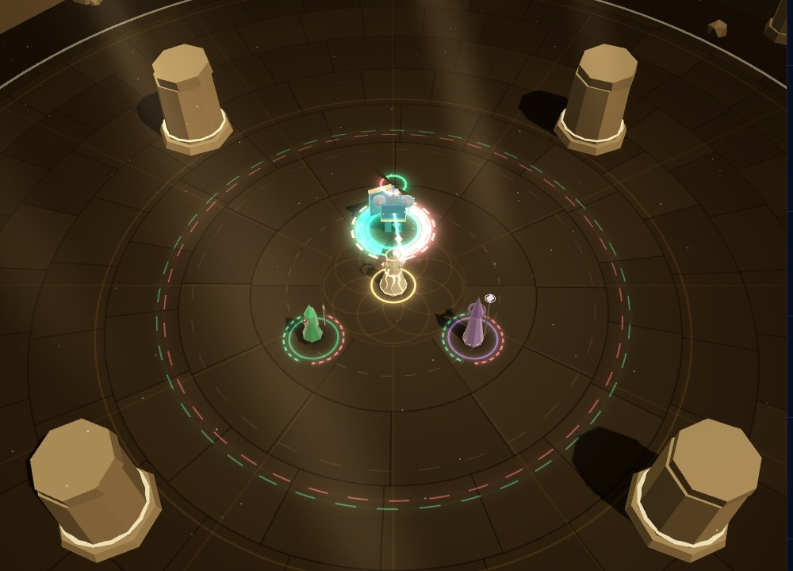 **Steady**: the beam pours into Kael (halo, sheath); everyone near the Weaver hears the dashed echo, and Lyra's and Vexis's arcs are dashed |  **Guardian**: Fortissimo on Lyra; its echo (dashed, pink) just outside the solid Sostenuto field song |
| 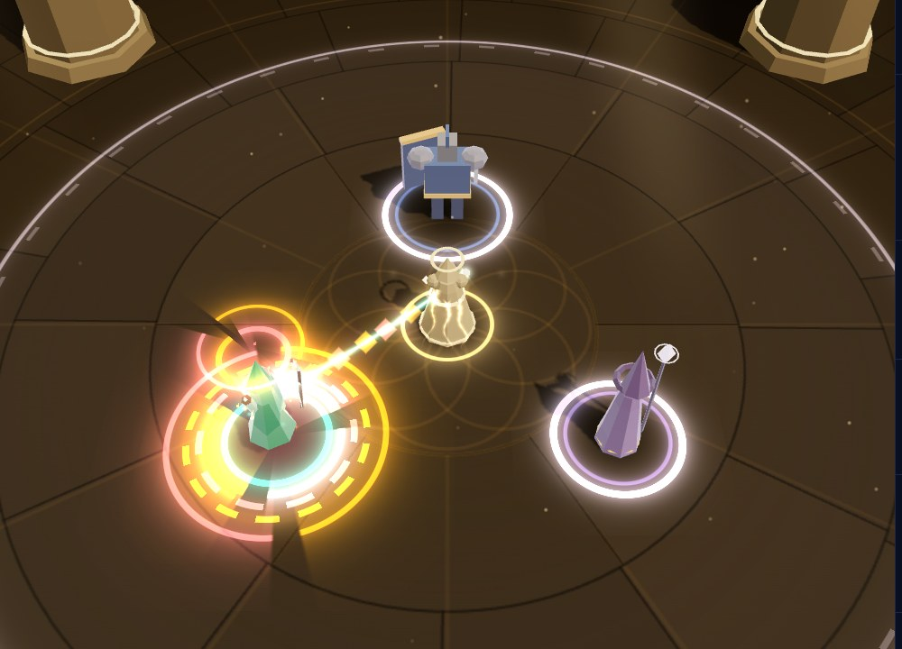 **All In** (×2.5): no disc, everything on Lyra: two crowns, outer ring, pool, flames, double sheath | 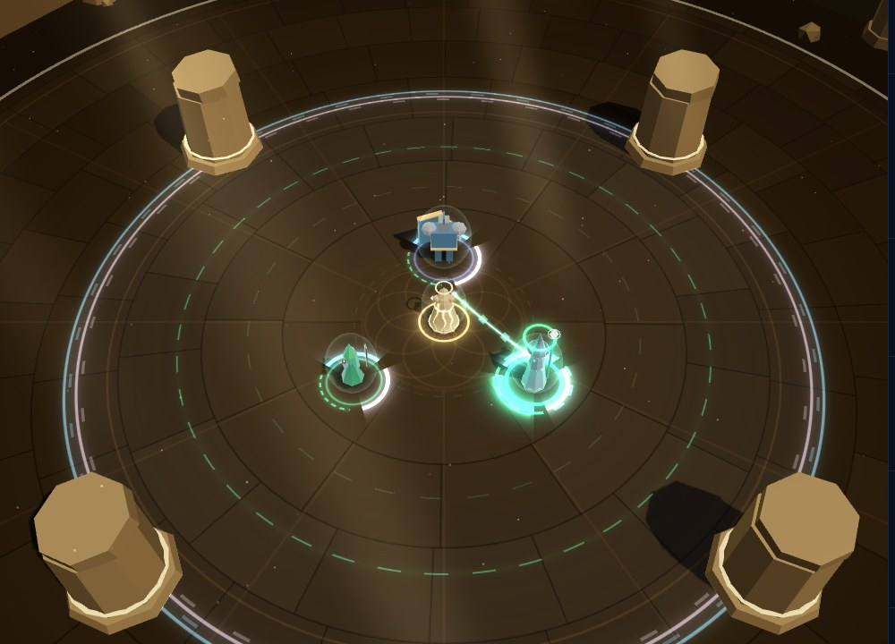 **Wide Choir**: Sostenuto echo inside the wide Ostinato + Fermata field song |
| 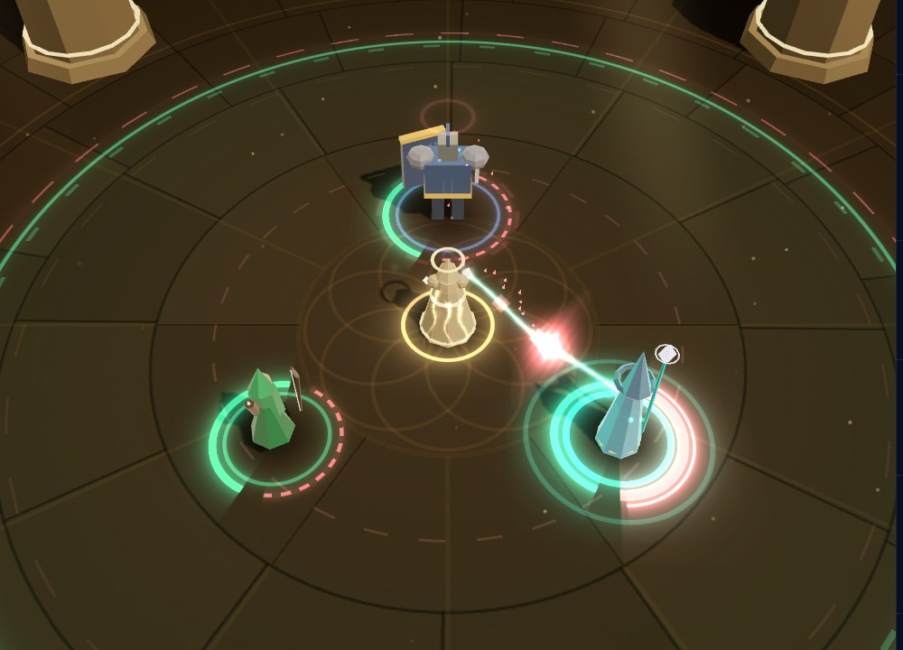 **The pour**: the beam moves Kael → Vexis; the song's head floods along the Thread while Kael's halo drains | 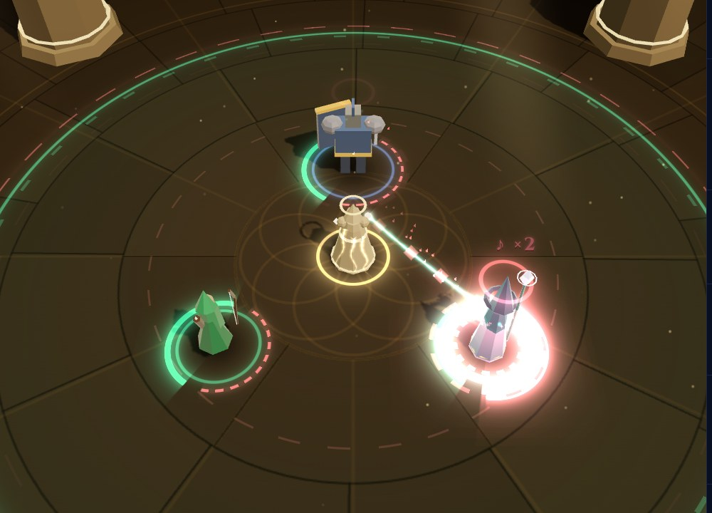 …and splashes on Vexis: "♪ ×2", rings, notes |
| 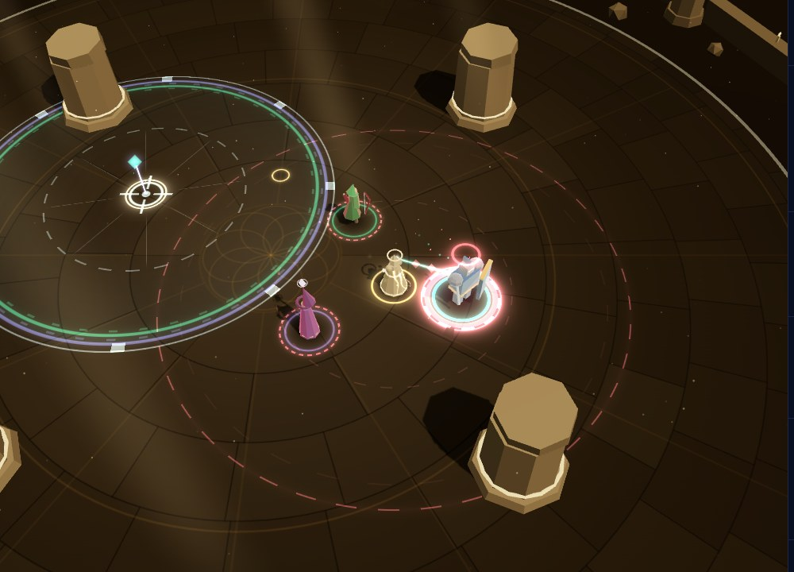 **Anchor**: the planted Lullaby + Sostenuto field song (full) and the beam's echo around the roaming Weaver (dashed) | 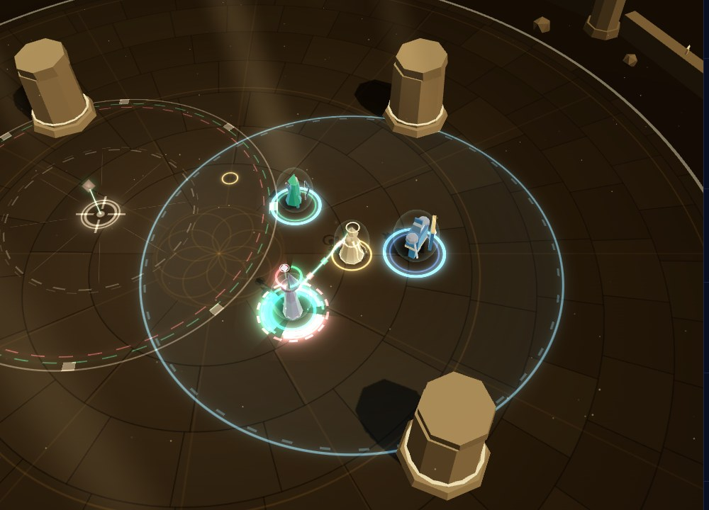 **Planted echo**: Pedal Point on the beam song; the planted echo is quieter than the Ostinato field song |
| 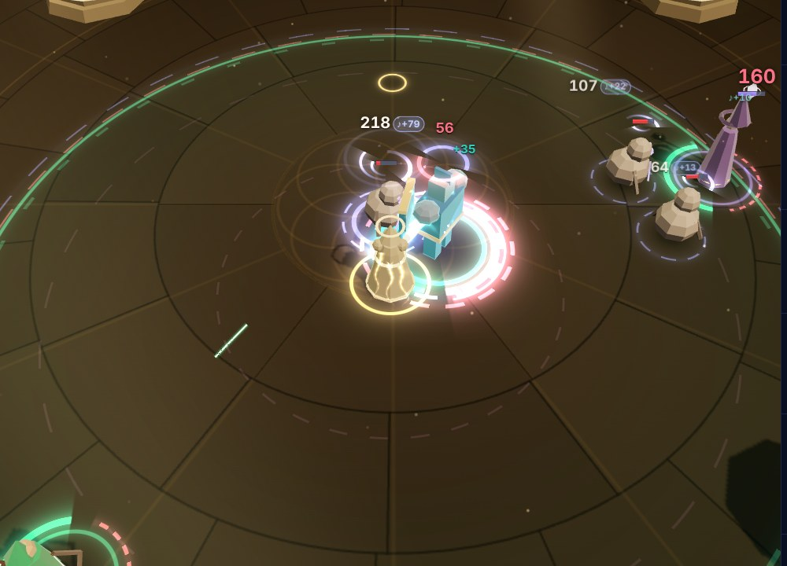 **Focused hex**: the chorister attacking Kael (Lullaby on the beam) has a solid ring, triple swirl and pressing ring; Vexis's attackers have the ordinary dashed hex. Chips: Kael `218 ♪+79`, Vexis `107 ♪+22` | 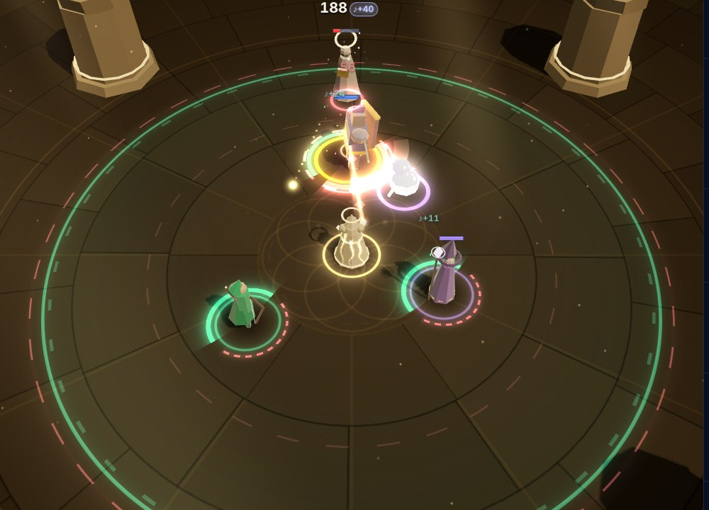 **Real-sim chips** (Guardian, Kael): `188 ♪+40` and a `♪+11` aura heal |
| 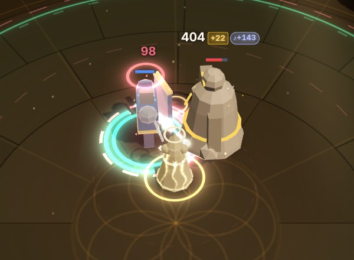 The two chips: gold `+22` (Empower) and the ♪ song chip | 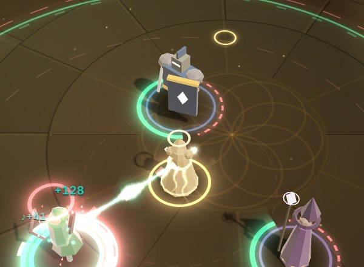 Aura heal `♪+41` (soft, left, chest height) beside Mend's `+128` |
| 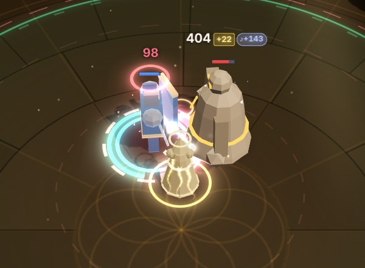 Deuteranopia | 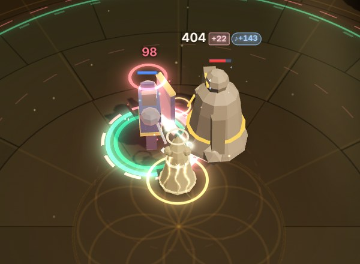 Tritanopia: the gold chip turns pink, the song chip sky blue |
| 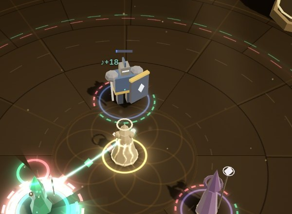 **Real-sim aura heal**: Kael at 114 / 1600 hearing the echo, `♪+18` a second | 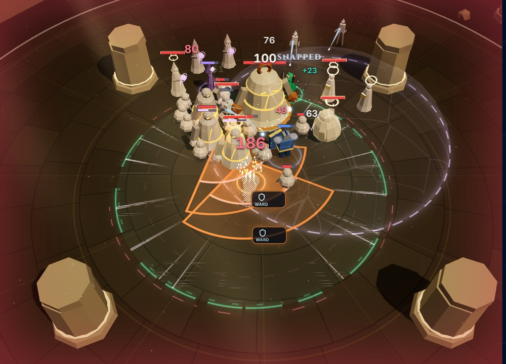 Busy fight (Guardian), 37 draw calls |

## Known gaps

- **The aura chip doesn't say which song did the work.** `damageTaken.aura` is one number, so
  a ×2 beam hit and an echo hit look the same apart from size (the contrast is still clear:
  `♪+79` vs `♪+22`).
- **Aura heals don't say which aura or song.** The notes take the hero's regen-aura colours
  (only Sostenuto heals today).
- **The pour plays on every attach**, including re-attaching after a snap, a bot retarget, or a
  view created mid-thread. A beam to a downed hero still pours visually; the halo stays dim
  because `beamFocus` is false.
- **The pour callout and halos use the aura's content colour**, which colour vision doesn't
  remap (as in Phase 2). The chips and heal numbers do follow colour vision.
- In crowded fights the Thread often snaps on tension, so a busy fight shows the beam song
  less than a calm one.
- **Zoomed in, heroes' shadow-map shadows show as dark wedges through the halo.** This is
  pre-existing: the Phase 2 build shows the same wedges under the old Unison halo.
- There is no "loose thread" command, so the lab shows the waiting motes only before the first
  thread.
- Real FPS still isn't measurable here (SwiftShader).

## Contract requests (for the lead)

- `DamageTaken.auraBeam` (the beam song's part of `aura`, focus or echo), so the chip can say
  "the beam did this" (for example a ×2 tag) as well as "the auras did this".
- `HealApplied.aura` (the aura id) or the song index for `via: 'aura'`, so aura heals can be
  coloured and attributed exactly.
- Optional: `ChordField.pouredAt` (sim time of the last retarget), so a view created mid-pour,
  or a replay seek, times the pour from state instead of noticing the change.
