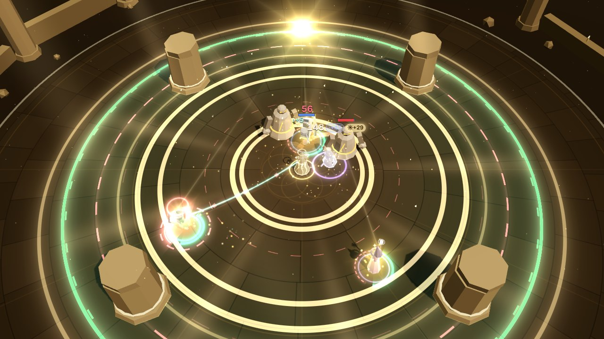

# Phase 3c: the Luminary in the fight (render / VFX)

The Weaver can now take a **Calling**, the Luminary (see [Phase 3c](../phase-3c.md)). This
workstream makes it visible in the 3D fight. Everything reads as **the Weaver's light on the
heroes**: the heroes strike, the Weaver makes them shine. Render reads `WorldState.calling`, the
heroes' `inField` / `auraMask`, the enemies' `inField`, `field.crescendo` and the
`damageTaken.radiance` / `dawnward` / `crescendoStart` events, and nothing else. The numbers
(`radiancePerAura`, `sunriseMult`, the option values) come from the state and content, so the
lead's tuning shows up without render changes. The auras themselves look exactly as before: the
Luminary's light is added on top of them.

## What changed

| File | Phase 3c work |
| --- | --- |
| `callingCues.ts` (new) | Pure helpers, tested in Node. `shineOf(state, hero)` is the sim's `radianceOf` rule from state alone (`radiancePerAura × auras heard`, × `sunriseMult` in Sunrise, while `inField`), tested equal to it. `shineLevel` maps it to a visual level (a square root: +4% shows, +12% is full, Sunrise is brighter, capped at 1.6). `radiantTier(radiance, total)` decides what a hit gets (0 nothing, 1 the number glows, 2 the ☀ chip and a spark, 3 a sunburst). `splitRadiant` splits `amplified` into the gold, ♪ and ☀ chips. `callingLook(state)` reads the path into flags (Haloed, Dawnward, Searing, Lantern, Sovereign in force, Eclipse and Eclipse in force). `eclipseMarks(state, enemy)` is the sim's Eclipse rule. `CALLING_HEX` holds the Luminary's colours. |
| `calling.ts` (new) | `CallingView`: the heroes' light (shaft, glow, pool, motes, glints, Sunrise rays), the kindle when a hero steps in, Haloed's halos, the sun over the Weaver in Sunrise and its light reaching the shining heroes, Eclipse's marks on enemies, Sovereign Symphony's circlet, and pooled moments for radiant sparks, Dawnward's bloom and the Sunrise burst (40 slots, no per-frame allocation). It draws through the existing ring, sprite, beam, shell and particle batches only. `fired`, `drawn` and `activeCount()` are for tests and the lab. `warmth` is Sunrise for the key light. |
| `entities.ts` | Each hero's record carries `shine` (the shine level, smoothed: up in ~0.15 s, down in ~0.5 s), `lit` (in the field, smoothed; the halo follows it) and `kindled` (time since stepping into the light). The shine goes to the hero's model as sunlight. |
| `models/material.ts`, `models/batch.ts` | One more per-instance attribute, `aShine` (shine, Sunrise): light falling from above on the head and shoulders and a small warm lift, more golden in Sunrise. Added on top of the rim, so the aura rim tint keeps its colour. Program key `aw-model-v2`. Every other push writes 0. |
| `field.ts` | Two more per-instance attributes on the field batch (still one draw call for up to four fields): `iC2` (a **third aura band**, for Third Voice: before, the shader drew only two) and `iLum` (Sunrise, Eclipse, Lantern, Sovereign). The shader adds the Luminary's Sunrise (brighter, more golden crescendo waves, a golden corona on the rim and slow sun rays across the floor), Eclipse's corona and bright inner edge, a stronger, warmer planted ring for Lantern Bearer and Sovereign Symphony's crown (a circlet with ten tines and jewels just outside the rim). FieldView draws Eclipse's **dark rim** under the field on the shadow batch (normal blending, so it darkens), and the **lantern** on a Lantern Bearer's stake. Only the outermost field around a centre carries the rim accents. `drawn` and `batchInstance(i)` are for tests. |
| `feedback.ts` | Damage numbers split three ways (`splitRadiant`): Radiance no longer inflates the gold chip (it used to be part of `amplified - aura`). The ☀ chip shows from tier 2; tier 1 only makes the number glow. The gold sparks on a hit no longer count Radiance. A `shieldApplied` overshield that came with a `dawnward` in the same batch skips the generic amber ring (`dawnwardIn`). `sunWarmth` holds the key light warm through the Luminary's Sunrise. |
| `overlay.ts` | A third chip on the pooled numbers: the ☀ chip, a filled warm pill with dark text (shape, fill and glyph set it apart from the outlined gold tag and ♪ pill). `setNumber(..., sun, glow)`: a stepped warm glow on the number itself, written only when it changes. |
| `combatView.ts` | Creates the `CallingView`, passes it events and frames, and passes its warmth to `Feedback`. |
| `fx/kit.ts` | The shadow batch holds 160 instead of 96 (Eclipse's rim rides it; the busy fight's blob shadows were near the old cap). |
| `lab/VfxLab.tsx` | **Phase 3c · Luminary** group: one scenario per visual (below), `window.__VFX__.lumScenarios() / lumScenario(name) / setCalling(path) / callingStats()`. The lab sim takes a Calling and a scenario's own Chords (changing the Chords picker drops them); the stats line shows the Calling. Relic scenarios run without a Calling. |
| `tests/renderLuminary.test.ts` (new) | Real sim → real `EntityLayer`, `FieldView` and `CallingView` over a real `FxKit` (below). |

## The visuals

| Visual | When (state / event) | What you see |
| --- | --- | --- |
| **Radiance: shining heroes** | Every frame: `calling` present, `hero.inField`, `hero.auraMask` (`shineOf`) | The hero is lit as if standing in sunlight: light falls on their head and shoulders and warms their rim (the model shader), a warm glow surrounds them, a pool of sunlight lies under them (inside their aura arcs), and warm motes rise off them with glints catching at their shoulders. How bright follows their Radiance: +4% for one aura already shows, +12% is full, Searing Hymns is brighter. **Stepping in** kindles them (a sunlit ring opening at their feet and a bloom, ~0.15 s to full); **stepping out** fades it over ~0.5 s. A threaded hero far from the Weaver hears the beam but doesn't shine (the sim's rule). |
| **Radiant hits** | `damageTaken.radiance > 0`, by `radiance / (amount + absorbed)` (the number's bucket for the chip) | Below 12% (the passive's +4% per aura, up to three auras): the damage number **glows warm**, nothing else. From 12% (Searing Hymns, Sunrise): a **☀ chip** (`☀+38`, a filled warm pill) next to the gold and ♪ chips, and a **warm spark** at the target (a small star and sparks). From 25% (Sunrise with Searing Hymns, Eclipse in Sunrise): a **sunburst** (bigger star, glow, a ring). One spark per target per 0.12 s, so multi-hits don't stack. Radiance is no longer counted in the gold chip. |
| **Dawnward** | `dawnward { hero, amount }` (its `shieldApplied` overshield is the same tick) | First light: a rose-gold **dawn sun rises** from the hero's feet to behind their head with turning rays, a **rose-gold veil** (a barrier shell) pops round them, light spreads across the ground to a dashed horizon ring, motes rise, and `☀ +54` (the barrier) appears over them. The generic amber overshield ring is skipped for that barrier; the shield itself then shows as the usual overshield. |
| **The Luminary's Sunrise** | `crescendoStart` / `field.crescendo` with `calling.id === 'luminary'` | On top of Sunrise as everyone knows it: a golden wave runs out to the field's edge with a burst of sparks and motes, and a **sun rises over the Weaver** and stays up while Sunrise lasts (a glow and two turning ray stars). Faint **light reaches each shining hero** from it. The field burns **brighter and more golden** (golden crescendo waves, a golden corona on the rim, slow sun rays across the floor) and the **key light warms**. Heroes burn brighter (Radiance ×3: their shine level goes up by √3) with rays turning behind their heads and more motes. When Sunrise ends the sun sets (sinks and fades in ~1 s). Without a Calling, Sunrise is unchanged. |
| **Eclipse** | `field.crescendo`, path has `eclipse`; enemies with `enemy.inField` | The sun over the Weaver is **eclipsed into a ring of fire**. The outermost field (its reach ×2) gets a **dark rim** just outside its edge with a **fiery corona** flickering outward past it and a thin bright edge inside (the "diamond ring"). Every enemy Eclipse makes vulnerable carries a small **ring of fire overhead**. Their hits from heroes carry Eclipse's bonus in `radiance`, so they spark (usually the sunburst). |
| **Haloed** | Path has `haloed`; `hero.inField` | A faint pale-gold **halo** over each hero in the field (above the beam song's crown), fading in and out with the light. |
| **Lantern Bearer** | Path has `lantern_bearer`; a chord with `anchor === 'planted'` | The Pedal Point stake becomes a **lantern on a stake**: a crossbar and hanger, a glowing glass body with a cap and finial and a flame inside, a flickering glow, a pool of its warm light on the ground and warm motes. The planted field's ring is drawn **stronger and warmer** (thicker bands, brighter staff ring), so "this field sings 30% stronger" reads. |
| **Sovereign Symphony** | `calling.sovereign` | The outermost field is **crowned**: a thin circlet just outside its rim with ten tines and a jewel on each tip. A **circlet of light** with five points turns over the Weaver's head. Both brighten in Sunrise. Sovereign on the path with fewer than four auras shows nothing (it isn't in force). |
| **Third Voice** | The field song holds three auras | The field disc now draws a **third band** in the third aura's colour (the shader drew two at most, so the third aura was invisible on the floor). Same look as the other bands. |

**Settings.**

- **Flashes.** Bright in-world flares (the kindle bloom, Sunrise rays behind the heroes, the
  sun over the Weaver, the spark stars and sunburst glow, Dawnward's sun, rays and veil pop)
  scale by `flareScale(flashes)` (35% at 0). The same visuals still draw (tested). The
  Luminary adds no full-screen flash; the warm key light is a gentle 22% lift.
- **Colour vision.** Barriers keep their semantic colours (the overshield that Dawnward gives
  is the live amber `C.amp` once its bloom has played). The Luminary's identity colours
  (`CALLING_HEX`: sunlight, hot gold, dawn rose, corona, halo) are light warm neutrals kept
  ΔE ≥ 20 from lethal and ≥ 15 from threat under every palette's simulated vision, the ☀
  chip's fill ≥ 20 from the gold chip, and dawn ≥ 20 from the barrier colour (tested). Each
  visual also has its own shape (shaft and motes, the star spark, the rising sun and veil,
  the halo ring, the lantern, the crown tines, the ring of fire) and the ☀ chip has a glyph
  and a filled pill, so none relies on colour.
- **Quality.** Motes, glints and bursts go through the particle system's density (0.4 / 0.7 /
  1 by tier) and caps. Nothing else changes with the tier.
- The auras' own look (field bands, foot arcs, rim tint, beam halo) is unchanged; the
  Luminary's light is added on top of it.

## Seeing each one in the lab (`?lab=vfx`)

**Phase 3c · Luminary** has one button per scenario. Each restarts the real sim with the
Luminary on a path and the scenario's Chords, and stages it with real commands and debug ops (no
injected events). The hover text says what it shows. **No Calling** restarts without one.
Sunrise is staged as the Weaver panel's Crescendo button does it: `{op:'setResonance', value:
100}`, then `{t:'crescendo'}`.

| Scenario | Path | Chords | Staging (all real sim) |
| --- | --- | --- | --- |
| Radiance | none (the passive) | Guardian | Thread Lyra, a brute and two choristers in front |
| Into the light | none | Guardian | `teleportWeaver` 15 m away: the heroes fade, then kindle as they walk back in |
| Searing Hymns | Wide Choir, Searing Hymns | Guardian | Thread Lyra, two brutes and two choristers (☀ chips, sparks) |
| Sunrise | none | Guardian | The same fight, Sunrise at 1.2 s |
| Sunrise · no Calling | (no Calling) | Guardian | The same, for comparison |
| Dawnward | Haloed, Dawnward | Guardian | `teleportWeaver` away: the heroes walk back into the field, one bloom each |
| Haloed | Haloed | Guardian | Thread Lyra |
| Lantern Bearer | Haloed, Dawnward, Lantern Bearer | Pedal Point on the field song | `{t:'plant'}` ahead-right |
| Pedal Point · no Lantern | Haloed, Dawnward | Pedal Point on the field song | The same, for comparison |
| Third Voice | Haloed, Dawnward, Third Voice | Sostenuto, Ostinato, Allegro + Grace Note in the field | Thread Lyra |
| Sovereign Symphony | Haloed, Dawnward, Lantern Bearer, Sovereign | Fortissimo + Sostenuto (Grace Note) / Ostinato + Allegro | Thread Lyra |
| Eclipse | Haloed, Dawnward, Lantern Bearer, Eclipse | Guardian | Thread Kael, two brutes and three choristers, Sunrise at 1.2 s (zoom out: the field reaches ×2) |
| Every option | the Sovereign path | four auras | A fight and Sunrise (the clutter check) |

`window.__VFX__.lumScenario(name)` runs one from a script, `setCalling(path | null)` restarts
with any path (with the Chords picker's loadout), and `callingStats()` returns `{ fired,
drawn, field, heroes: [{ shine, inField, auras }], sun, crescendo }`.

## Verification against the real sim

`tests/renderLuminary.test.ts` (18 tests) drives real sims with the configs of
`tests/sim/luminary.test.ts` and feeds state and events to the real `EntityLayer`, `FieldView`
and `CallingView` over a real `FxKit` (they all construct and run headless in Node):

- **The shine rule**: for every hero, in the field, out of it (`teleportWeaver` away), walking
  back in and in Sunrise, with and without Searing Hymns, `shineOf` equals the sim's own
  `radianceOf` to 1e-9. Out of the field it is 0 (a threaded hero far away still hears the beam).
  Without a Calling, 0.
- **Levels, split, tiers**: +4% shows (> 0.5), +12% is 1, Sunrise's ×3 is brighter, the cap
  holds. `splitRadiant` keeps Radiance out of the gold chip. The passive's +4% per aura (up to
  three auras) is tier 1 (glow only); Searing Hymns and Sunrise reach the chip; Searing Hymns
  with three auras in Sunrise reaches the sunburst. The ☀ glyph asks for text presentation.
- **Path flags**: every option reads from `calling.path`; Sovereign is only "in force" with
  `calling.sovereign` (four auras), not with Guardian's three.
- **Colours**: every `CALLING_HEX` colour is ΔE ≥ 20 from lethal and ≥ 15 from threat under
  each palette's simulated vision; the ☀ chip's fill ≥ 20 from the gold chip; dawn > 20 from
  the barrier colour.
- **Radiance in the fight**: the shine ramps up (the first frame is under half its target,
  ≥ 90% after 0.3 s), all three heroes draw their light, the shaft beams draw. Stepping away:
  the next frames still glow (fading, not a pop), Kael's light is fully out before he walks back,
  and walking back in kindles (once per hero whose light went out).
- **No Calling**: nothing shines, no sun, no halos, no warmth, even in Sunrise.
- **Sunrise**: one `sunrise` moment on `crescendoStart`; after a second the shine is √3 times
  what it was (×3 Radiance), the sun is up, warmth ≈ 1, light reaches all three heroes, and the
  field instances carry the Sunrise parameter. After Sunrise ends, the sun is gone.
- **Radiant hits** (two brutes, real hits): outside Sunrise every radiant hit is tier 1 (the
  `glow` count equals the radiant hits) and nothing sparks. In Sunrise some hits cross the chip
  threshold and spark, never more sparks than such hits. Two radiant hits on one target in the
  same frame make one spark.
- **Dawnward**: stepping away and back gives three `dawnward` events, three blooms, three
  `☀ +N` callouts (one with the first event's amount), and the bloom's veil draws shells. The
  overshield `shieldApplied` is the same tick as its `dawnward`, and `dawnwardIn` finds it (so
  the generic ring is skipped). Without Dawnward on the path: no events, no blooms.
- **Haloed**: three halos in the field; after stepping away the halos follow `lit` exactly (frame
  by frame) and drop below three, then come back. None without Haloed.
- **Lantern Bearer**: after `{t:'plant'}`, one lantern and the planted instance's lantern
  parameter is 1 (the echo round the Weaver: 0). Without the option: no lantern, parameter 0.
- **Sovereign Symphony**: four auras → circlet and one crowned field (the field song, not the
  echo inside it). Guardian on the same path → neither.
- **Eclipse** (Guardian, two brutes): before Sunrise, no marks, no rim. In Sunrise, for every
  enemy `eclipseMarks` equals `field.crescendo && enemy.inField` (the sim's rule), both brutes
  are marked (with the lead's new `inField`, any loadout), one dark rim on the outermost field
  only. Hits with `damageTaken.eclipse > 0` flicker a corona (rate-limited) and a hit with only
  Eclipse's part doesn't spark or glow. Without Eclipse on the path, Sunrise marks nobody.
- **Third Voice**: the field song's instance has three bands and the third colour is Allegro's.
- **Flashes 0 vs 1**: the same moments fire and the same instances draw.
- **Cost**: `CallingView.sync` with the Sovereign path, Sunrise and a fight, including
  `FxKit.begin/end`, stays under a generous 400 µs bound (measured numbers below).

In the browser, every lab scenario was run through `window.__VFX__` with fixed frames
(`manual`), polling `callingStats()` until the moment fired, then shot that many frames later.
The counters in the screenshot log match the sim (e.g. Dawnward: `dawn` 1, then 3; Searing
Hymns: `spark` ≥ 1 and `glow` 0; Radiance: `glow` 10, `spark` 0).

## Performance

Measured with Chromium headless (SwiftShader) against an isolated production build (other
agents were hot-reloading the dev server). Draw calls from `renderer.info`; SwiftShader frame
times are noise, not FPS.

| Measure | Draw calls |
| --- | --- |
| Lab, no Calling, Lyra threaded (Guardian), idle / busy (25 + Bellwarden) | 22 / 35 |
| Lab, Sovereign Symphony (four auras, crown, circlet, shining heroes), idle | 24 |
| Lab, Sovereign, busy + Sunrise (sun, rays, crown) | 36 |
| Lab, Eclipse, busy + Sunrise (dark rim, corona, marks) | 36 |
| Lab, Lantern Bearer (planted, lantern), idle | 24 |
| Lab scenario shots (Radiance, Searing, Sunrise, Dawnward, Eclipse, every option) | 23–28 |

**No new draw calls, batches or materials.** The heroes' sunlight is one more instanced
attribute on the existing model batches; the field's Luminary looks are two more instanced
attributes on the one field batch; everything else rides the ring, shadow, sprite, beam, shell
and particle batches. The idle +2 in the Sovereign and Lantern scenarios is the shell and
particle batches becoming visible (Ostinato's barriers, the lantern glass, the motes). CPU:
`CallingView.sync` measured in Node with three shining heroes, Sunrise, the circlet, halos and a
fight is about 15–60 µs a frame (noisy: two Chromium instances were running), well under the
test's 400 µs bound. Moments are pooled (40), colours are shared constants, the look flags live
in a reused object, and per-hero accumulators are typed arrays. The only per-event allocations
are the Dawnward callout string and the ☀ chip text (as for every number).

## Screenshots

All in `docs/phase-3c/vfx/` at 1280×720: `radiance-off-on.jpg` (the same moment without and
with the Luminary: the heroes lit, motes, their own colours kept), `radiance.jpg` (glowing
numbers), `into-light-fading.jpg` / `into-light-kindle.jpg`, `searing-hymns.jpg` (☀ chips,
spark), `sunrise-start.jpg`, `sunrise.jpg`, `sunrise-hits.jpg`, `sunrise-no-calling.jpg`,
`sunrise-flashes-off.jpg`, `sunrise-hits-tritanopia.jpg`, `dawnward.jpg`, `dawnward-2.jpg`,
`haloed.jpg`, `lantern-bearer.jpg`, `pedal-point-no-lantern.jpg`, `third-voice.jpg`,
`sovereign.jpg`, `eclipse.jpg`, `every-option.jpg`.

## Known gaps

- **The Dawnward barrier is the generic amber overshield after its bloom.** The sim's shield has
  no source, so render can't keep it dawn-coloured.
- **The sun over the Weaver** stands 10 m up so it clears the fight; at the default zoom it sits
  near the top edge, and zoomed far in it can leave the screen (the rays to the heroes remain).
- **Sunrise is bright.** The existing crescendo waves are made more golden, not thinner; with a
  busy fight the floor reads very warm for 6 s. Telegraphs stay on top (they draw after the
  field), but this is the place to tune if it hides too much.
- **Eclipse's dark rim** is thin at the field's ×2 reach and lies near the arena edge, where the
  floor is already dark; the corona carries most of the read. Eclipse marks only show on enemies
  the sim flags `inField` (now any enemy inside a field, per the lead's change).
- **Radiant tier thresholds** (12% chip, 25% sunburst) are render constants, not content.
- Real FPS still isn't measurable here (SwiftShader).
- The dev server on 5198 and the preview server were stopped by the session's background
  time limit before the last screenshot batch ended; a few shots may be from the build just
  before the last Eclipse-rim tweak.

## Contract requests (for the lead)

- **`Shield.source` (or `shieldApplied.reason: 'dawnward'`)**, so Dawnward's barrier can keep a
  dawn look for its whole life, not only its bloom.
- **`dawnward` events carry the auras heard** (or the count), so the bloom could show one ray per
  aura.
- **Content values for the radiant tiers** (or a `radiance` fraction on the event), if design
  wants to tune when the ☀ chip appears.
- Resolved during this work: `enemy.inField` now means any field (Eclipse marks any loadout),
  and `damageTaken.eclipse` splits Eclipse's part from Radiance's (render: the ☀ chip counts
  both, the number's glow and the spark only Radiance, and Eclipse's part flickers a corona).
