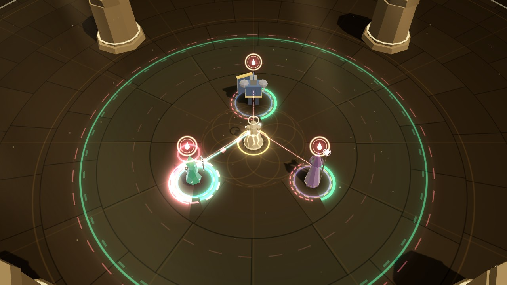

# Phase 3d: the Martyr in the fight (render / VFX)

The Weaver can now take the second **Calling**, the Martyr (see [Phase 3d](../phase-3d.md)): she
takes her heroes' wounds. This workstream makes it visible in the 3D fight. Everything reads as
**she bleeds so they don't**: crimson and old gold, sacrificial, never gory (no blood, no
wounds: glowing crimson light, embers and seals). Render reads `WorldState.calling` (`id:
'martyr'`, `path`, `crescendo: 'vow'`), the Weaver's `threadMode` / `lastMode` / `maxLife` /
`undying` / `health.invulnerable` / her shields, `field.vow`, and the `borne`, `undying`,
`save` (cause `'vow'`), `crescendoStart` / `crescendoEnd`, `techniqueCast` (Ward) and
`healApplied` (Mend) events, and nothing else. Thresholds come from content
(`low_life_vigil.below`, `blood_font.below`), so the lead's tuning shows up without render
changes. The auras' own looks (field bands, foot arcs, aura rim tints, beam halo) are unchanged:
the Martyr's touches are added beside them (the user asked to be consulted on aura changes).

## What changed

| File | Phase 3d work |
| --- | --- |
| `martyrCues.ts` (new) | Pure helpers, tested in Node. `MARTYR_HEX` (the Martyr's colours), `martyrLook(state)` reads the path into flags plus her state: `bearing` (the sim's `bearShareOf` condition), `vow`, `life` (hp / maxLife), `vigilOn` and `fontOn` (the sim's own rules, thresholds from content), `fontRegen` (in force and actually healing), `undyingReady`, `undyingGrace`. `crescendoKind(state)` says whether a `crescendoStart` is Sunrise or the Vow. `borneScale(amount, maxHp)` maps a borne amount to a pulse strength (√ of the share of her usable Life, 12% is 1, floor 0.25, cap 1.4). `vowSeals(state, hero)`. The rate limits (`BEAR_GAP`, `SHARED_GAP`, `VOW_GAP`, `FLINCH_GAP`) and `BORNE_TRAVEL`. |
| `martyr.ts` (new) | `MartyrView`: the Vow's seals and tethers, Vigil's heartbeat, Blood Font's embers, Scarred Hide's rim, Aegis's shell, Undying's ember and grace, and pooled moments for borne pulses, the Vow's start and end, Undying Devotion's burst and Mend wave, and the Aegis link (48 slots, no per-frame allocation). Draws through the existing ring, sprite, beam, shell and particle batches only. `fired`, `drawn`, `look`, `activeCount()`, `sealFlashOf()` are for tests and the lab. |
| `thread.ts` | **Bear mode**: the Thread turns crimson (`C.bear`), sags more (heavy even taut), its core is half again as thick with a warm-rose (not white) highlight, an **old-gold strand braids** round it, its flow **runs back toward the Weaver**, and small crimson and gold embers **drip** from it. The beam song's sheath rides it as before (see Known gaps). `backPulse(strength, kind)`: a pulse running hero → Weaver along the Thread (a swelling of the ribbon and a crimson head with a rose core), `kind` 1 is Sanguine Covenant's faint return. `drawn`, `bearLevel`, `backFired` for tests. |
| `entities.ts` | `EntityRec.flinch` (`entities.flinch(id, k)`: a deep-crimson rim flash and a small recoil on the Weaver, decays in ~0.3 s) and `rimHold` / `rimHoldColor` (a held rim tint MartyrView writes each frame: Vigil's heartbeat, Scarred Hide's bronze). The threaded hero's rim takes the Thread's mode colour (`threadColor(mode)`: crimson in Bear). |
| `palette.ts` | `C.bear` and `threadColor(mode)`. Bear needs no live colour-vision variant (it passes every palette, tested). |
| `fx/ribbons.ts` | `point(..., u, white = 0.35)`: how much a strip's core whitens, a third component of the existing UV attribute (every other ribbon passes the old 0.35). Bear's crimson strands whiten little, or the white core turned them pink. Same batch, same draw call. |
| `fx/sprites.ts` | One more sprite style, `SPRITE.seal` (a double ring round an upright drop), for the Vow's seals. Same batch, same draw call. |
| `feedback.ts` | `crescendoStart` with the Martyr plays **no Sunrise** (no gold rings, gold pillar, field blaze, chroma or gold light): instead a soft dim of the key light toward crimson, a small camera weight and a soft flash (`vowStart`). `crescendoEnd` with the Martyr skips Sunrise's gold ring (MartyrView draws the Vow's end). Thread mode rings, attach rings and Reel trails take Bear's crimson; switching to Bear adds a ring sinking in to her. |
| `combatView.ts` | Creates the `MartyrView` (with the Thread and the EntityLayer), passes it events and frames. |
| `lab/VfxLab.tsx` | **Phase 3d · Martyr** group: one scenario per visual (below), `window.__VFX__.martyrScenarios() / martyrScenario(name) / setMartyr(path) / martyrStats()`. `setCalling` takes the Calling's id. `manual(frames, ms, drawLast)` can skip rendering all but the last frame (quick fixed-frame shots under SwiftShader). |
| `tests/renderMartyr.test.ts` (new) | Real sim → real `EntityLayer`, `FieldView`, `ThreadView`, `CallingView` and `MartyrView` over a real `FxKit` (below). |

## The visuals

| Visual | When (state / event) | What you see |
| --- | --- | --- |
| **Bear: the Thread** | `weaver.threadMode === 'bear'` | The Thread is **crimson and heavy**: it hangs lower, its core is thicker and glows warm rose instead of white, an **old-gold strand braids** round it, its flow runs **back toward her**, and small embers drip from it. Mend (teal, smooth, flowing out) and Empower (gold, sparks) keep their looks; Bear differs by colour and by shape (braid, drips, weight, reversed flow). The threaded hero's rim turns crimson. Switching to Bear sends a ring **sinking in** to her (Mend and Empower's ring spreads out). |
| **Bear: a borne wound** | `borne { via: 'bear' }` | A **pulse runs from the hero along the Thread into her hand** (0.26 s): the ribbon swells as it passes, a crimson head with a rose core. When it arrives she **flinches**: a deep-crimson rim flash and a small recoil, a few crimson embers at her hand, a crimson ring drawing in at her feet. Size and brightness scale with `borneScale(amount, her usable Life)`. One pulse per hero per 0.1 s (a hit inside that swells the pulse already on its way); the flinch holds rather than strobes. |
| **Shared Wounds** | `borne { via: 'shared' }` | A **faint, thin pulse** from the other hero straight to her (not along the Thread), a faint flinch. One per hero per 0.35 s. |
| **Penitence** | Path has `penitence`; a borne pulse arrives | **Resonance motes** burst off her chest up into her Resonance orbit, and the orbit ring flickers (more for a bigger wound). |
| **Scarred Hide** | Path has `scarred_hide`, `bearing` | Her rim holds a **dull bronze**, hardened, and a scored (dashed) bronze ring lies at her feet, only while she Bears. |
| **Martyr's Vow: start** | `crescendoStart` with `calling.crescendo === 'vow'` | **Not Sunrise.** Crimson and old-gold rings **draw in** from the field's edge to her (she takes it on), then a crimson glow and a turning old-gold star at her, a burst of pale-gold sparks and crimson embers, and the **seals stamp on** the heroes (a pop and sparks over each). The key light dims slightly toward crimson. `field.crescendo` stays false, so the field, the heroes and the Luminary's views don't play Sunrise (tested). |
| **Martyr's Vow: the seals** | `field.vow`; each standing hero | Each hero carries a **seal over their head** (`SPRITE.seal`: pale gold, a double ring round an upright drop, over a crimson glow), a dashed old-gold ring at their feet, and a **tether** to her (a crimson glow line with rose dashes running toward her). A hero held at 1 life: the seal's heart burns and pulses. |
| **Martyr's Vow: a hit held** | `borne { via: 'vow' }` (and `save { cause: 'vow' }`) | The **seal flashes** (it swells, an old-gold ring bursts from it, pale-gold sparks), the tether flares, and the **overflow runs down the tether** to her (a crimson pulse), and she flinches when it lands. The Save itself shows as every Save does (gold SAVED); the sim now logs one Vow Save per hero per Vow. |
| **Martyr's Vow: end** | `crescendoEnd` with the Martyr (also when she goes down) | The seals **break into rising pale-gold motes**, a crimson ring breathes out from her, and the seals fade over ~0.5 s. |
| **Undying Devotion** | `undying {}` | A **burst at her**: a turning old-gold star over a crimson heart, a shock ring, a thin old-gold pillar, sparks and embers, `UNDYING` over her. Then the **Mend wave**: a heal-coloured ring out to the field's edge and a line of Mend to each standing hero (the sim's own Mend heals land on them as usual). While she is untouchable, an **old-gold shell breathes** round her. Before it is spent, a small **ember of old gold** floats over her head (Undying still unused). |
| **Low-Life Vigil** | Path has `low_life_vigil`, `hp < maxLife × below` | Her rim and her **field's edge pulse crimson like a heartbeat** (lub-dub, quicker the lower she is), with a crimson ring at her feet. The auras' own bands are unchanged: the beat is a thin ring at the field's outer edge. |
| **Blood Font** | Path has `blood_font`, `hp < maxLife × below` | A **slow ember glow** at her feet. While it actually heals her (below her usable Life), **embers rise** off her (crimson and old gold) and the glow deepens. A Guardian Martyr is always below half her Life, so at full health she shows only the faint glow. |
| **Martyr's Aegis** | `techniqueCast { ward }` with `martyrs_aegis`; a `ward` shield on her | The Ward **links to her**: a barrier-coloured line with an old-gold glow runs from the warded hero to her, old-gold shards at her. Her own Ward keeps the usual barrier shell (`C.shield`) and gains an **old-gold shell** just outside it and an old-gold ring at her feet, thinning as it is spent. |
| **Sanguine Covenant** | `healApplied { via: 'mend' }` on the threaded hero with `sanguine_covenant`, while she is below her usable Life | A **faint return along the Mend Thread**: a small rose-tinged teal pulse runs back to her (at most every 0.3 s). |

**Settings.**

- **Flashes.** Bright in-world flares (the glow at her when a wound lands, the Vow's star and
  glow, Undying's star, glow and pillar, the grace shell's pop) scale by `flareScale(flashes)`
  (35% at 0). The same visuals still draw (tested). The Vow's soft full-screen flash (0.12) goes
  through the overlay's flash scale, so it is off at 0; Sunrise's chroma and big flash never play
  for the Vow.
- **Colour vision.** `MARTYR_HEX.blood` (Bear, the tethers, the Vigil beat) is ΔE ≥ 20 from
  Mend, Empower and lethal under every palette's simulated vision; every Martyr colour is ≥ 20
  from lethal and ≥ 15 from threat (tested). Bear needs no live variant. Semantic colours stay
  semantic: Undying's Mend wave is `C.heal` / `C.mend`, the Aegis link and her Ward are
  `C.shield`. Every visual also has its own shape (the braided, dripping, back-flowing Thread;
  the seal glyph; the heartbeat ring; the rising embers; the old-gold shell), so none relies on
  colour.
- **Quality.** Drips, embers, motes and bursts go through the particle system's density (0.4 /
  0.7 / 1 by tier) and caps. Nothing else changes with the tier.

## Seeing each one in the lab (`?lab=vfx`)

**Phase 3d · Martyr** has one button per scenario. Each restarts the real sim with the Martyr on
a path and the scenario's Chords, and stages it with real commands and debug ops (no injected
events). The hover text says what it shows. Bear is `{t:'mode', mode:'bear'}` after threading;
the Vow is staged as the Weaver panel's Crescendo button does it (`setResonance 100`, then
`{t:'crescendo'}`). Fights put the Weaver a few steps back so Toll Cleave takes the hero, not
her (what she takes, she Bears).

| Scenario | Path | Chords | Staging (all real sim) |
| --- | --- | --- | --- |
| Bear | none (the passive) | Guardian | Thread Kael, Bear, two brutes and two choristers |
| Thread modes | none | Guardian | Thread Lyra: Mend, Empower at 1.4 s, Bear at 2.6 s |
| Shared Wounds | Penitence, Shared Wounds | Guardian | Bear on Kael, two brutes and three choristers |
| Penitence | Penitence | Guardian | As Bear |
| Scarred Hide | Scarred Hide | Guardian | Bear on Kael, a brute and two choristers |
| Martyr's Vow | none | Guardian | Thread Lyra, three elite brutes, the Weaver 5 m back, the Vow at 2.8 s |
| Vow · quiet | none | Guardian | Thread Lyra, the Vow at 1.4 s, no fight (start, seals, end) |
| Undying Devotion | Penitence, Blood Font, Undying | Fortissimo + Ostinato / Sostenuto (85% reserved) | An elite brute beside her |
| Low-Life Vigil | Penitence, Shared Wounds, Vigil | 85% reserved (she lives below 35%) | Thread Lyra |
| Blood Font | Penitence, Blood Font | Guardian (45% of her Life) | Bear in a fight (she's hurt, the Font heals her) |
| Martyr's Aegis | Penitence, Blood Font, Undying, Aegis | Guardian | Ward Kael at 0.4 s, Lyra at 2.4 s |
| Sanguine Covenant | Penitence, Blood Font, Undying, Covenant | Guardian | Bear in a fight until 2.6 s, then back to Mend |
| Every option | Penitence, Shared Wounds, Vigil, Aegis | 85% reserved | Bear, a fight, a Ward, the Vow at 2.2 s (the clutter check) |

`window.__VFX__.martyrScenario(name)` runs one from a script, `setMartyr(path | null)` restarts
with any path, and `martyrStats()` returns `{ fired, drawn, look, threadBear, backPulses, vow,
crescendo, weaver: { hp, maxHp, maxLife, mode }, borne }`.

## Verification against the real sim

`tests/renderMartyr.test.ts` (19 tests) drives real sims with the configs of
`tests/sim/martyr.test.ts` and feeds state and events to the real `EntityLayer`, `FieldView`,
`ThreadView`, `CallingView` and `MartyrView` over a real `FxKit` (they all run headless in Node):

- **Cues**: the path flags, `bearing` (only in Bear with a hero threaded), `crescendoKind`
  (`vow` for the Martyr, `sunrise` for the Luminary or no Calling), the thresholds equal
  content's, `borneScale`'s floor, scale and cap.
- **Colours**: `MARTYR_HEX.blood` is ΔE ≥ 20 from Mend, Empower and lethal, and every Martyr
  colour ≥ 20 from lethal and ≥ 15 from threat, under each palette's simulated vision; switching
  palettes never changes Bear, and `threadColor` returns the live Mend / Empower colours.
- **Bear** (Kael threaded, two brutes and a chorister): the Thread's Bear level reaches 1; every
  `borne` is `via: 'bear'`; one pulse per wound (never more, fewer only inside the rate limit),
  each one run back along the Thread (`backFired` equals the pulses); she flinches. Toggling Bear
  off lifts the weight. Bear braids an extra strand (more ribbon vertices than Mend).
- **Timing**: the flinch lands `BORNE_TRAVEL` after the wound, not before (no new flinch on the
  frames in between, one on arrival).
- **Rate limit**: two wounds on one hero in one frame make one pulse.
- **Mend and Empower bear nothing**: in a fight, no `borne`, no pulses, no weight.
- **Shared Wounds and Penitence**: `borne { via: 'shared' }` only for heroes other than the
  threaded one; shared pulses ≤ shared events and never along the Thread; Penitence lifts motes
  for every landed pulse, and the sim's `resonanceGained { reason: 'penitence' }` is there.
- **Scarred Hide**: the bronze rim and ring only while Bearing (off in Mend, off again after).
- **Martyr's Vow**: `field.vow` on, `field.crescendo` off, one `vowStart`, no Sunrise moment, no
  sun, the field's Sunrise parameter stays 0; three seals and three tethers; it ends on time
  (`vowEnd`) and the seals fade. Without a Calling the same command is Sunrise and the Martyr's
  view stays quiet.
- **A hit held** (three elite brutes, the Vow at 2.8 s): `borne { via: 'vow' }` and
  `save { cause: 'vow' }` come; the held hero's seal flashes (> 0.5) the same frame; the
  overflow reaches her and she flinches.
- **Undying Devotion** (85% reserved, an elite brute beside her): the Undying ember before it,
  one `undying`, she stays up, one burst and one Mend wave, `UNDYING` called out, the sim's Mend
  heals land, her grace shell while she is untouchable, gone after.
- **Low-Life Vigil**: render's rule equals the sim's at 20/30/34/36/40% of her Life (the sim's
  `scratch.auraMult` is boosted exactly when `vigilOn`); at 85% reserved it beats (her rim swings
  by > 0.6 over 1.5 s); a Guardian Martyr (45%) shows none.
- **Blood Font**: in force for a Guardian Martyr (45%) but no embers at full health; hurt, the
  embers rise and the sim heals her meanwhile; nothing without the option.
- **Martyr's Aegis**: a Ward links to her and her own Ward shell is drawn (the sim gives her a
  `ward`); without the option neither.
- **Sanguine Covenant**: Mend on a hurt Kael returns along the Thread (≥ 2 in a second, each a
  back pulse); none when she is at full health, none without the option.
- **Flashes 0 vs 1**: the same moments fire and the same rings, beams, sprites and shells draw.
- **Cost**: `ThreadView.sync` + `MartyrView.sync` with every option, Bear, the Vow and a fight,
  including `FxKit.begin/end`, stays under a generous 400 µs bound.

In the browser, every lab scenario was run through `window.__VFX__` with fixed frames
(`manual(1, 16.67, true)`), polling `martyrStats()` until the moment fired, then shot that many
frames later. The counters in the shot log match the sim (e.g. Bear: `bear` 2, `flinch` 1 at the
first shot; the Vow: `vowStart` 1, `vowHit` 1, `seals` 3; Undying: `undying` 1, `mendWave` 1,
`grace` 1; Vigil: `vigil` 1 at 108 / 108 of a 720 Life).

## Performance

Measured with Chromium headless (SwiftShader) against the dev server. Draw calls from
`renderer.info`; SwiftShader frame times are noise, not FPS.

| Measure | Draw calls |
| --- | --- |
| Lab idle, no Calling / the Martyr with no path | 21 / 21 |
| Thread modes (Lyra threaded, Bear on) | 22 |
| Bear in a fight (two brutes, two choristers, pulses, flinch) | 26 |
| The Vow, quiet (seals, tethers) / in a fight with three elite brutes | 23 / 28 |
| Undying Devotion (burst, Mend wave, grace) | 29 |

**No new draw calls, batches or materials.** Bear is more ribbon in the existing ribbon batch
(one braid strip, its per-strip whitening is a third component of the existing UV attribute);
the seal is one more style of the existing sprite shader; everything else rides the ring,
sprite, beam, shell and particle batches, and the Weaver's flinch and held rim are the existing
per-instance rim tint. The scene-to-scene differences are which existing batches are visible
(shells, beams, particles), as before. CPU, measured in Node (median / p95 over 300 frames of a
fight with every option, Bear and the Vow): `MartyrView.sync` ≈ 15–20 µs / 50–60 µs; Bear adds
≈ 15–25 µs to `ThreadView.sync` (the braid strip and drips; 52 µs Mend vs 67–76 µs Bear, noisy:
a Chromium was rendering meanwhile), well under the test's 400 µs bound. Moments are pooled (48),
colours are shared constants, the look lives in a reused object, the seal flashes and the Thread's
back pulses are typed arrays. The only per-event allocations are the rate-limit map entries (one
per hero) and the `UNDYING` callout.

## Screenshots

All in `docs/phase-3d/vfx/` at 1280×720, from the lab scenarios above (shot log counters in
brackets):

- `thread-modes.jpg`: the same Thread on Lyra in Mend, Empower and Bear, under Standard,
  Deuteranopia and Tritanopia vision (crops). Bear is the wide crimson glow with the braid.
- `bear.jpg` (`bear` 2, `flinch` 1): a wound running back from Kael along the Bear Thread;
  `bear-flinch.jpg` (`flinch` 2): her crimson rim and the ring drawing in at her feet.
- `shared-wounds.jpg` (`shared` 1): a Shared Wounds share of Lyra's hit on its way to her (a
  small one: 10% softened by half, so its pulse is at the floor strength, faint by design).
- `penitence.jpg` (`penitence` 2): motes lifting off her into the Resonance orbit.
- `scarred-hide.jpg`: the bronze rim and scored ring while she Bears.
- `vow-start.jpg` (`vowStart` 1): the field drawn in to her; `vow-flashes-off.jpg`: the same
  moment with Flashes at 0; `vow-seals.jpg` (`seals` 3, `tethers` 3); `vow.jpg` (`vowHit` 1): a
  Toll Cleave on Kael held (SAVED), the overflow on its way; `vow-end.jpg` (`vowEnd` 1): the
  seals breaking.
- `undying.jpg` (`undying` 1, `mendWave` 1): the burst, `UNDYING`, the Mend wave;
  `undying-grace.jpg`: her grace shell and the Mend lines to the heroes.
- `vigil.jpg` (`vigil` 1): her field's edge and her rim beating crimson (85% reserved).
- `blood-font.jpg` (`embers` 1): the ember glow at her feet while the Font heals her.
- `aegis.jpg` (`aegis` 1): the Ward on Kael linking to her; `aegis-shell.jpg`: her own Ward
  with the old-gold shell and ring.
- `covenant.jpg` (`covenant` 1): back in Mend, a return pulse on the Thread.
- `every-option.jpg`: Low Life, Bear, a fight, a Ward and the Vow at once (the clutter check).

## Known gaps

- **Bear's crimson is light, not paint.** The ribbon batch is additive, so the Thread can glow
  crimson but can't be darker than what's under it; over a bright field (a Luminary Sunrise, a
  busy aura floor) it reads more rose. The braid, the drips, the weight and the backward flow
  carry Bear by shape.
- **Fortissimo is in the same family.** Guardian's beam song (Fortissimo, rose) rides the Thread
  as a sheath, and the two reds sit close. (This workstream drew the sheath at half strength in
  Bear so the crimson leads; the lead took that out until the user decides, since it changes how
  an aura looks. The braid, drips and weight still set Bear apart.) Under tritanopia Empower is pink (`#ff6f91`): Bear is ΔE 30 away and twice as wide with
  a gold braid, but the hues are near.
- **Two beats on her.** The sim's `damageTaken` on her (the white hit flash and her number)
  shows at once; the crimson flinch lands when the pulse arrives (0.26 s later). Cause → effect
  reads, but it is two beats, not one.
- **Blood Font and Sanguine Covenant read the state.** Blood Font's glow and embers are drawn
  from the state (the sim's rule) and Covenant's return from the Mend heals on the threaded hero
  while she is hurt. *Since resolved by the lead:* the sim now reports her healing of herself as
  one `healApplied { via: 'self' }` a second, and `feedback.ts` shows it as a small, soft rose
  "+N" beside her (no burst, so the embers and the return pulse stay the read).
- **Low-Life Vigil and Blood Font repeat the sim's rule** (`hp < maxLife × below`) in render;
  it is tested equal to the sim, but it is a copy.
- **Seals stack with other overhead marks.** The seal sits 0.72 m over the head; a hero calling
  for support, held by Fermata or cued shows those marks near it.
- **The tethers are thin at the default zoom** (by design: five seconds of three lines across the
  field). The seal flash and the pulse down the tether are the read for a held hit.
- **Shared Wounds' pulses are straight lines** to her (there is no Thread to the other heroes).
- Real FPS still isn't measurable here (SwiftShader).

## Contract requests (for the lead)

- ~~**`healApplied { via: 'self' }` for Blood Font and Sanguine Covenant**~~ Done by the lead
  (once a second, `WeaverComponent.selfHealAcc`; `SIM_VERSION` 8), with her soft "+N" in
  `feedback.ts`.
- **`calling.vigil` / `calling.font` in force** (like `calling.sovereign`), so render reads the
  sim's own flags instead of repeating `hp < maxLife × below`.
- **`borne.source`** (the attacker) or the hit's `attack`, so the pulse could start at the blow
  (and Shared Wounds' faint pulses could name their hero's attacker).
- Resolved during this work (a7564f3): `borne` comes after her `damageTaken` with what she
  actually took (the pulse strength now matches her life lost), none while she is untouchable,
  the Vow ends when she goes down (render plays the Vow's end), one Vow Save per hero per Vow
  (render dropped its own rate limit on Vow Saves), and her Aegis Ward is a `ward` with
  `fromWeaver: false` (render reads `kind === 'ward'` on her, unchanged).
