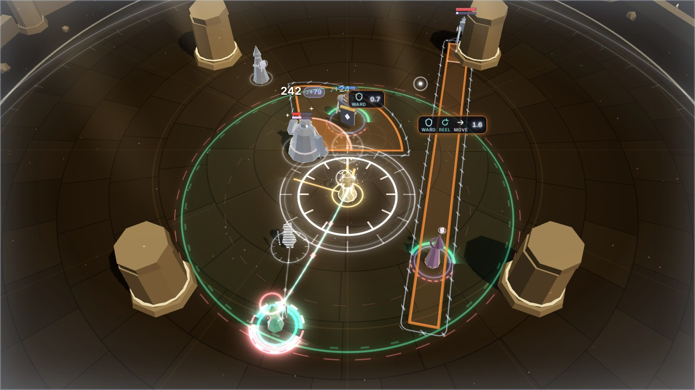

# Phase 3e: the Chronomancer in the fight (render / VFX)

The Weaver can now take the third **Calling**, the Chronomancer (see [Phase 3e](../phase-3e.md)).
This workstream makes it visible in the 3D fight. Everything reads as **the one who was ready**:
moonlit silver with brass clockwork, clock faces and hands, afterimages and dashed "not yet"
outlines, never Sunrise's gold. Render reads `WorldState.calling` (`id: 'chronomancer'`, `path`,
`crescendo: 'stasis'`, `rewind`, `timers`, `foresight`), `field.stasis`, the heroes' `past` /
`pastAt`, the enemies' `foreseen`, the shields' `echo` / `stasis`, the Weaver's Rewind cooldown
and Spirit, and the `rewound`, `foreseen`, `echoWard`, `temporalMastery`, `paradox`,
`healApplied { via: 'rewind' }`, `revived`, `save { cause: 'rewind' }`, `perfectWard`,
`resonanceGained`, `crescendoStart` / `crescendoEnd`, `telegraphStarted` / `telegraphResolved` and
`attackFired` events, and nothing else. Shapes and numbers come from content (the attacks'
shapes, the passive's values, Reel's cost) and the sim's own `rewindCanRevive`, so the lead's
tuning shows up without render changes. The auras' own looks (field bands, foot arcs, rim tints,
the beam song's sheath, hexes) are unchanged: the Chronomancer's touches are added beside them.

## What changed

| File | Phase 3e work |
| --- | --- |
| `chronoCues.ts` (new) | Pure helpers, tested in Node. `CHRONO_HEX` (silver, glass, brass, frost). `chronoLook(state)` reads the passive and the path into flags, plus `rewindReady` (the sim's checks: off cooldown or Stasis, the Weaver up, Spirit for `rewindCost`, which Stasis halves from content). `rewindSample` (where Rewind would send a hero: `past[pastAt]`), `rewindable` (a downed hero only if they fell within its reach and `rewindCanRevive`), `reviveWindow` (how long a downed hero can still be stood up: the remembered moments from before the fall), `rewindPreviewHero`. `timerLabel(remain)`: whole seconds from 2 s, one decimal under, truncated, from strings built once. `foreseenShape(state, enemy)`: the shape a foreseen attack will take, built from content with the enemy's and target's live positions as `beginAttack` builds it (cone, line, circle, donut, mark, link, raid, a cast circle for heals and summons). `shapeOf` (a telegraph's shape in the same terms), `areaContains` and `paradoxAimed` (the sim's rules for what Paradox cancels and what passes a hero by), `stasisWave` (how far the stillness has spread), `slowDanced`, `stasisSeconds`, `masteryWord`. |
| `chrono.ts` (new) | `ChronoView`: Rewind's preview trail and clock, the snap and its clock, a revive, the `↺+N` number, Foresight's outlines and target rings and their hand-off, Stasis's clock face and hanging glints and its start and end, Echo Ward's re-forming and echo shell, Temporal Mastery's flick, Paradox's unravelling and its bubble, Borrowed Time's Solo flow, Eternal Moment's clock and the bezel on Stasis-cast Wards. Moments are pooled (48), Foresight's records (32) and Paradox's bubbles (8) too; no per-frame allocation. Draws through the existing ring, sprite, beam, shell, telegraph, ribbon and particle batches only. `fired`, `drawn`, `look`, `cool`, `activeCount()`, `foreseenCount()`, `sparedCount()` are for tests and the lab. |
| `entities.ts` | **Stasis**: an enemy-side animation clock that stops while Stasis holds (a stagger's shake, a stun's wobble, a boss's breath, an elite's crown, a cast's glow); a frozen enemy keeps its pose mid-motion (no turning, a lunge held mid-swing). `EntityRec.frost` rises as the wave of stillness from the Weaver reaches each enemy (`stasisWave`), and goes to the model as frost; frozen enemies' rims turn silver. `EntityRec.slow` (Slow Dance: a light frost, its lunge 15% slower). `EntityRec.chronoFlash` (a silver rim flash). **Rewind**: `rewindGhost`, a silver model ghost of the threaded hero where Rewind would send them (cut in still scan lines, hidden while they stand where they stood, stronger when they are down); `rewindEchoes` (afterimages along the streak); `unfall` (a downed hero's fall played backwards). **The Ward's pop** is timed from when render first saw that Ward (`wardRef` / `wardSeen`), not `appliedAt`, which Stasis holds: a Ward cast in Stasis pops and settles like any other. |
| `models/material.ts`, `models/batch.ts` | The per-instance `aShine` attribute gains a third component, `frost`: the model drains to a cold silver-blue and dims, its accents stop pulsing and fade toward silver, a glassy silver-blue edge catches the light, and a frosted ghost glows silver (not gold) and is cut in horizontal scan lines (Glide's and the Save's ghosts keep their diagonal cut). Program key `aw-model-v3`. Every other push writes 0. |
| `telegraphs.ts` | **Timers** (`calling.timers`): every telegraph's badge shows `timerLabel(impact − time)` (circles, cones, lines, donuts, casts; marks and links keep their timer in the same style). Read from the state every frame, so they hold during Stasis by themselves. While Stasis holds them: the timer turns cold (`BADGE_TONE.frozen`) and each telegraph wears a **bezel** (a thin silver line just outside it, ticked like a clock). `geometry(id)` (a telegraph's last drawn shape, for Paradox), `drawn` and `frost` for tests. |
| `fx/telegraphBatch.ts` | The spare `iShape.z` carries the Chronomancer's styles, drawn in the colour passed in: 1 **Foresight's ghost** (a dashed outline marching slowly, no fill, a faint glow just inside the edge; also the overhead mark ring, the cast circle and the target ring), 2 **Stasis's bezel**. Same batch, same draw call. |
| `fx/rings.ts` | Two ring styles: `RING.clock` (a rim with tick marks, its lit arc a countdown; ticks at most 0.55 m long) and `RING.hands` (a clock's long and short hands and hub). Same batch. |
| `fx/sprites.ts` | `SPRITE.clock`: a billboard clock face whose long hand is at `param`. Same batch. |
| `fx/kit.ts` | `enemyTime`: the telegraph and mark batches' shader clock (their hatching, throb, Perfect pulse, Foresight's dashes) is the enemies' clock, which the combat view holds during Stasis. Their capacity is 96 and 24 (Foresight's ghosts and Stasis's bezels beside the real telegraphs). |
| `overlay.ts` | Badge label tones (`BADGE_TONE`: plain, timer, frozen), written on change only. `setStasis(v)`: a cool, still frame round the screen while Stasis holds (steady, faint). `coolFlash`: time stopping and resuming (through the Flashes scale; Sunrise's warm flash is untouched). `setNumber(…, glowHex)`: a number's glow colour (Rewind's is silver). |
| `feedback.ts` | `crescendoStart` with Stasis plays **no Sunrise** (no gold rings, pillar, field blaze, chroma or warm light): a cool flash and a small push of the camera, no shake. `crescendoEnd` with Stasis skips Sunrise's gold ring. Rewind's `healApplied` is drawn by ChronoView (no teal number). A Rewind Save plays at the hero's new place, without the falling "death that didn't happen" (it did happen, and is undone) and without the gold pillar; a Rewind revive skips the generic `REVIVED`. **Enemy projectiles hang in the air** while Stasis holds them: their clock moves forward with time as the sim's pending hit does, they are drawn still (dimmed toward silver, a cold ring and glint), and when time resumes they fly the rest of the way from where they hung (`heldProjectiles` for tests). `stasisCool`: the light cools a little and dims while Stasis holds. |
| `martyrCues.ts` | `crescendoKind` also answers `'stasis'`. |
| `combatView.ts` | Creates the `ChronoView` (with the entity and telegraph layers and the overlay), passes it events and frames, keeps the enemies' clock for the telegraph shaders, and feeds `cool` to the overlay's frame and the light. |
| `lab/VfxLab.tsx` | **Phase 3e · Chronomancer** group: one scenario per visual (below), `window.__VFX__.chronoScenarios() / chronoScenario(name) / setChrono(path) / chronoStats()`. |
| `tests/renderChronomancer.test.ts` (new) | Real sim → real `EntityLayer`, `TelegraphLayer`, `FieldView`, `ThreadView`, `Feedback` and `ChronoView` over a real `FxKit` (below). |

## The visuals

| Visual | When (state / event) | What you see |
| --- | --- | --- |
| **Rewind: ready** | `calling.rewind`, Rewind ready (`rewindReady`), a hero threaded | A **faint trail** on the ground of the threaded hero's last 3 s (their remembered moments, oldest to now, ticked every half second like a clock's seconds), running to a **silver ghost** of them where Rewind would send them: the hero's own model, cut in still scan lines, with a small clock face at its feet. While they stand where they stood the ghost hides (it would sit inside them). On cooldown, nothing. |
| **Rewind: a downed hero** | The threaded hero is down, fell within Rewind's reach, `rewindCanRevive` (once a run) | The ghost stands stronger where they last stood, and a **brass arc and hand** on its clock count down the seconds Rewind can still stand them up. Once a run's revive is spent, no ghost. |
| **Rewind: the snap** | `rewound` | The hero snaps back along a **streak** (a silver glow with a glass head running from where they were to where they go, a brass thread under it running backwards), leaving **afterimages** of themselves along it (silver ghosts, scan-lined, dissolving), glints left hanging on the way. Where they land, a **clock face with its hand winding back** a turn (it stays where they landed; they may walk on), a ring drawing in at their feet, a silver rim flash. |
| **Rewind: the life it gave back** | `healApplied { via: 'rewind' }` (`rewound.restored`) | `↺+N` in Rewind's glass-silver with a silver glow, beside the hero at chest height as they land, apart from the damage and heal numbers over heads (not the teal Mend number). |
| **Rewind: stands back up** | `rewound { revived: true }` (with `revived`, `save { cause: 'rewind' }`) | Bigger. Their **fall plays backwards**: the body rises from where it lay and runs back along a brighter streak to where they stood, merging into them; a **large clock spins back three turns** and stops where they stood up, a brass gear ring turns round it, a ring rises from their feet to their head, a silver shell flares, glints and silver motes rise, and a bigger `↺+N` (under the Save's callout). The Save shows as every Save does (gold `SAVED`), where they stand back up. |
| **Telegraph timers** | `calling.timers` (the passive) | Every telegraph's answer badge carries its **seconds to impact**: whole seconds from 2 s (`3`, `2`), one decimal under (`1.9` … `0.0`), never more time than is left; legible white-silver, tabular figures. Marks, links and raids keep their timer, in the same format. |
| **Foresight** | `calling.foresight`, `enemy.foreseen` (every frame, live positions) | A **dashed silver outline** of the attack an enemy is about to use, its own shape (Toll Cleave's cone toward its target, Glass Lance's line, a burst's circle, a toll's donut, a Dirge's ring over its target's head, a link's dashed line between its pair), marching slowly, **no fill**, faint at first and firming up as its moment nears, and a **dashed silver ring at the feet of its target**. Visibly not yet real. When the telegraph begins, the outline **snaps onto the real telegraph** (a bright glass outline closing onto its shape) and goes (0.2 s) as the real one fades in; a foresight that lapses fades out. |
| **Stasis: time stops** | `crescendoStart` with `calling.crescendo === 'stasis'` | **Not Sunrise.** A cold **wave of stillness** runs out from the Weaver to the arena's edge with a ring of clock ticks riding inside it; every enemy freezes as it passes. A clock face flashes at her feet, its brass hands spun round and stopped dead at twelve, and a small clock over her; shards of glass burst out and **stop dead in the air**. A cool flash, the camera held (no shake). `field.crescendo` stays false, so the field and the Luminary's views don't play Sunrise (tested). |
| **Stasis: held** | `field.stasis` | Every enemy **frozen silver-blue**: drained of colour, dimmed, a glassy cold edge, its accents still, its pose held mid-motion, glints **hanging still** round it and a thin ring at its feet. **Projectiles hang in the air** (cold, ringed). **Telegraph fills and timers hold**; each telegraph wears a ticked **bezel**, its timer turns cold, and its shader stops (hatching, throb, Perfect pulse). A **clock face at the Weaver's feet** counts the held seconds down (its lit rim and its brass long hand running back toward twelve); heroes walk through it as normal. The light cools a little and a faint still frame sits round the screen. |
| **Stasis: time resumes** | `crescendoEnd` with Stasis | The frost **breaks off every enemy in falling shards** (it fades in ~0.3 s), the clock's hands spin forward, a silver ring runs out, a small cool flash. Held projectiles fly on from where they hung. |
| **Echo Ward** | `echoWard`; a `ward` shield with `echo` | The Ward **re-forms as an echo**: its shards come back to the hero from all round, a silver ring closes on them, a silver shell flares and settles (the Ward itself stays the usual `C.shield` shell). While the echo lasts: a fainter silver shell just outside the Ward, **rippling out** now and then like an echo, and a dashed silver ring at their feet. |
| **Temporal Mastery** | `temporalMastery { technique }` | On the Glide, a **clock over the Weaver flicks its hand back** a full turn, a brass ring and glow, and, once the hand has flicked back, `↺ CHIME` (or `WARD`, `REWIND`) names what came back. |
| **Slow Dance** | `slow_dance` on the path, `enemy.inField` | **No new marks.** Enemies in your field are cooled a little (a light frost on the model) and their lunges play 15% slower; their longer wind-ups show on the timers. |
| **Paradox: cancelled** | `paradox` with this tick's `telegraphResolved { outcome: 'cancelled' }` | Each cancelled attack **unravels back into its caster**: its outline shrinks and slides back to them, threads of it pulled in; a Dirge's ring lifts off the hero's head and flies back to the lamenter; a tick of a clock over the caster when it's gone. |
| **Paradox: passed by** | `paradox`; an area attack that held the hero where Rewind took them (`areaContains`, not `paradoxAimed`) | A silver **time bubble** round the hero (a shell and a clock ring at their feet) until it lands; when it lands (`telegraphResolved { outcome: 'dodged' }` for them) the bubble swells and pops round them, untouched amid the blast. |
| **Borrowed Time** | `rewound` with `borrowed_time`, the hero's Solo rose (the sim fills it only when Rewind gave life back) | **Brass motes arc** from the Weaver's hand into the hero (high and bowed, apart from the Thread), and a brass ring rises up them as far as the Solo filled. |
| **Eternal Moment** | Longer Stasis (the state); a `ward` with `stasis`; `perfectWard` with `resonanceGained { reason: 'eternal moment' }` | A Ward cast in Stasis counts from the frozen moment: a **clock bezel** at the hero's feet, outside the Ward's shell, its **brass hands stopped at twelve**, and a small stopped brass clock riding at the Ward's shoulder (a ground ring sits under a telegraph's fill, and a hero with a Ward up is usually in one). When it turns out Perfect, after the Perfect Ward's own flash: **a clock strikes** round the hero (a silver face whose rim lights round as its brass hand sweeps a full turn, then a brass chime ring) and **motes of Resonance** rise to the Weaver. Silver and brass, apart from the Perfect's gold. |
| **Quickened** | (the path) | Nothing in the world (the HUD shows the cooldowns). |

**Settings.**

- **Flashes.** Bright in-world flares (the streak's head, the arrival glow, a revive's shell, the
  Stasis start's glow, the Mastery glow, the bubble's pop, Echo Ward's flare) scale by
  `flareScale(flashes)` (35% at 0), and Stasis's clock face at her feet (the brightest thing in
  it) comes up gentler and a quarter dimmer. The same visuals still draw (tested). Time stopping
  and resuming flash through the overlay's cool flash, which the Flashes scale takes to 0; the
  still frame round the screen during Stasis is a steady state, not a flash, and stays faint.
  Stasis plays none of Sunrise's chroma or big flash. See `flashes.jpg`.
- **Colour vision.** `CHRONO_HEX.silver` (the trail, the ghosts, Foresight's outlines, the
  clocks, the frost) is ΔE ≥ 20 from Mend, Empower, Bear, the Luminary's sun, sun-hot and dawn,
  lethal and threat under every palette's simulated vision; brass is ≥ 20 from Sunrise's gold,
  gold-hot, the Luminary's hot sun and Empower; every Chronomancer colour is ≥ 20 from lethal and
  ≥ 15 from threat (tested). Under protanopia and deuteranopia Mend is sky blue, so the silver is
  kept pale (ΔE 25 and 31 from it). None needs a live variant. Semantic colours stay semantic:
  an Echo Ward is the barrier `C.shield`, the Save is gold. Every visual also has its own shape
  (clock faces and hands, scan-lined ghosts, dashed outlines, the streak, the bezel, the bubble),
  so none relies on colour.
- **Quality.** Glints, shards, motes and bursts go through the particle system's density (0.4 /
  0.7 / 1 by tier) and caps. Nothing else changes with the tier.

## Seeing each one in the lab (`?lab=vfx`)

**Phase 3e · Chronomancer** has one button per scenario. Each restarts the real sim with the
Chronomancer on a path (Guardian Chords) and stages it with real commands and debug ops (no
injected events). The hover text says what it shows. Rewind is `{t:'tech', id:'reel'}` (with a
`slot` to point at a hero); Stasis is staged as the Weaver panel's Crescendo button does it
(`setResonance 100`, then `{t:'crescendo'}`). Fights put the Weaver a few steps back so a Toll
Cleave takes the hero, not her (a downed Weaver can't Rewind).

| Scenario | Path | Staging (all real sim) |
| --- | --- | --- |
| Rewind · ready | none | Thread Kael and walk a loop: the trail and the ghost |
| Rewind | none | Kael threaded in Empower tanks two brutes; at 2 s you step back and Rally; Rewind at 3.2 s |
| Rewind · revive | none | You walk; a Fermata hold on Lyra (debug op) runs out and she goes down; thread her (the revive window), Rewind her 1.3 s later |
| Telegraph timers | none | A brute's cone, a lancer's line, a lamenter's mark |
| Timers · Stasis | none | The same, Stasis 0.6 s after the first Toll Cleave starts |
| Foresight | Foresight | The same fight: outlines and target rings, then the hand-offs |
| Stasis | none | Two brutes, two choristers, a lamenter, a lancer and an acolyte; Stasis at 2.4 s |
| Stasis · quiet | none | Two choristers far off; Stasis at 1.2 s (start, held, end) |
| Echo Ward | Quickened, Echo Ward | A Perfect Ward on Kael against a Toll Cleave; the echo 1 s later |
| Temporal Mastery | Quickened, Echo Ward, Temporal Mastery | A Chime, then a Glide |
| Slow Dance | Quickened, Echo Ward, Slow Dance | Two brutes and three choristers in the field |
| Paradox · mark | Foresight, Echo Ward, Temporal Mastery, Paradox | An elite lamenter's Dirge (a brute keeps the party busy); Rewind its target 1.2 s later |
| Paradox · area | the same | The Bellwarden tolls round itself (you stand clear); Rewind Kael inside it 0.7 s later |
| Borrowed Time | Quickened, Borrowed Time | Lyra threaded; Kael hurt in a fight, Rewound (`slot: 0`) at 3.2 s |
| Eternal Moment | Quickened, Echo Ward, Temporal Mastery, Eternal Moment | The Bellwarden beside Kael (it lives through Stasis); Stasis inside its Bell Slam's Perfect window, a Ward on Kael 3 s into it; Perfect when time resumes |
| Every option | Foresight, Echo Ward, Slow Dance, Paradox | The timers fight, a walk, Rewind at 2.2 s and Stasis at 3.2 s (the clutter check) |

`window.__VFX__.chronoScenario(name)` runs one from a script, `setChrono(path | null)` restarts
with any path, and `chronoStats()` returns `{ fired, drawn, look, telegraphs: { timers, frost },
ghost: { hero, alpha, revive, window, drawn }, stasis, frozen, heroFrost, weaver: { resonance,
spirit, rewind }, heroes }`.

## Verification against the real sim

`tests/renderChronomancer.test.ts` (22 tests) drives real sims with the configs of
`tests/sim/chronomancer.test.ts` and feeds state and events to the real `EntityLayer`,
`FieldView`, `TelegraphLayer`, `ThreadView`, `Feedback` and `ChronoView` over a real `FxKit`
(they all run headless in Node; the overlay is a recorder):

- **Cues**: the passive and every path flag; `rewindReady`; `crescendoKind` (`stasis` for the
  Chronomancer, `vow` for the Martyr, `sunrise` otherwise); `rewindCost` is Reel's, halved in
  Stasis by content; `stasisWave`; `timerLabel` (`5.99 → 5`, `2 → 2`, `1.99 → 1.9`, `0.05 →
  0.0`, capped at 99, and the same string object every time).
- **Colours**: as under Settings, under each palette's simulated vision; switching palettes never
  changes them.
- **Foresight's shapes are the sim's**: 40 s of a brute, a lancer, a lamenter and the Bellwarden
  with Foresight; whenever a telegraph begins, the outline drawn the tick before for that enemy
  has the same kind, centre (within a step), size, heading and half-angle or width, and the
  same target (a mark) or pair (a link). Cones, lines and marks are all compared. When the sim
  switched to the other ready attack at the last moment (the boss, as the contract says), the
  hand-off snaps onto the real one; the test allows it at most once in three (in six minutes of
  fights it was 1 of the Bellwarden's 40 telegraphs, and never for the others).
- **Rewind's preview**: Kael threaded and walking: the ghost stands where `past[pastAt]` is
  (within 0.35 m after smoothing), the trail has every remembered moment plus now; standing still
  3 s, the ghost hides and the trail collapses; on cooldown, no preview.
- **Rewind**: hurt and walked: one `rewind` moment, four afterimages, no `↺` until it lands, then
  `↺+N` with `N = round(restored)` in the glass colour, the silver flash; it ends.
- **A revive**: Lyra down, then threaded: the ghost shows `revive`, a window between 1 s and 3 s;
  Rewind: one `revive`, the fall played back, `SAVED` and no `REVIVED`, then `↺+N`.
- **Timers**: for every frame of a 12 s fight, the badges' labels are exactly `timerLabel(impact −
  time)` of the live telegraphs, in the timer tone. Without a Calling, cones and lines carry no
  timer and marks keep their old one (`0.0` format).
- **Timers and fills in Stasis**: for a second of Stasis, every badge label is unchanged, every
  tone frozen, the Toll Cleave's fill unchanged to 1e-6, the bezels drawn; the telegraph and mark
  batches' shader clock is the enemies' clock (it holds); after Stasis the bezels go.
- **Stasis look on and off**: not Sunrise (no field blaze, chroma or warm flash; a cool flash);
  the near enemy freezes before the far one (the wave); then every enemy's frost > 0.95, the heroes'
  and the Weaver's 0; the clock is drawn, the light cool; a frozen enemy neither moves nor turns
  for a second; after it ends, the frost and the light are back within a second. Without the
  Chronomancer the same command is Sunrise and nothing freezes.
- **Held projectiles**: a lancer's bolt in flight when time stops is held (two seconds of Stasis
  with no enemy hit landing), and none is held once time resumes.
- **A Ward cast in Stasis pops like any other**: its `appliedAt` waits, render's age doesn't.
- **Foresight in the fight**: outlines (telegraph instances) drawn for over 20 frames before the
  Toll Cleave begins, the hand-off fires and ends, the brute's `foreseen` is cleared, target
  rings are drawn; without Foresight on the path, nothing.
- **Paradox**: a Dirge cancelled by Rewinding its target unravels (one `unravel`, gone in a
  second); a burst holding Kael: one bubble while it lives, `dodged` for him when it lands and the
  bubble pops.
- **Echo Ward**: a Perfect Ward against a Toll Cleave, then `echoWard`: one `echo`, the echo shell
  drawn, the shield is an echo, the silver flash.
- **Temporal Mastery**: Chime then Glide: one `mastery`, `↺ CHIME` once the hand has flicked back.
- **Slow Dance**: a chorister in the field: `slow` → 1, no frost, counted; without the option, 0.
- **Borrowed Time**: a Rewind that gives life back: one `borrowed`.
- **Eternal Moment**: Stasis inside a Toll Cleave's Perfect window, a Ward late in it: the bezel
  (`stasisWards`); when it lands Perfect, the sim's `eternal moment` Resonance and one `eternal`.
- **Flashes 0 vs 1**: the same moments fire and the same rings, beams, sprites, shells and
  telegraph instances draw.
- **Cost**: `ChronoView.sync` with every option, Stasis, Foresight and a fight, including
  `FxKit.begin/end`, stays under a generous 400 µs bound.

In the browser, every lab scenario was run through `window.__VFX__` with fixed frames
(`manual(n, 16.67, true)`), polling `chronoStats()` until the moment fired, then shot that many
frames later. The counters in the shot log match the sim (e.g. Rewind: `rewind` 1, then `number`
1; the revive: `revive` 1, the window 2.3 s before it; Stasis: `stasisStart` 1, `frozen` 5;
Paradox · area: `spared` 1, then `sparedPop` 1; Eternal Moment: `stasisWards` 1, then `eternal`
1).

## Performance

Measured with Chromium headless (SwiftShader) against the dev server. Draw calls from
`renderer.info`; SwiftShader frame times are noise, not FPS.

| Measure | Draw calls |
| --- | --- |
| Lab idle, no Calling / the Chronomancer with no path | 21 / 21 |
| The Chronomancer with every option, Lyra threaded and walking (the trail and the ghost) | 22 |
| The `busy` preset (a fight), no Calling / the Chronomancer with every option (outlines, timers) | 35–36 / 35–37 |
| The same fight in Sunrise (no Calling) / in Stasis (24 enemies frozen) | 36 / 36–37 |
| The lab scenarios above, at the moment each shows | 22–31 |

**No new draw calls, batches or materials.** The clock faces and hands are two more styles of
the ring shader, the billboard clock one more style of the sprite shader, Foresight's ghosts and
Stasis's bezels a value of the telegraph shader's spare `iShape.z`, the trail a strip in the
ribbon batch, the frost a third component of the models' existing `aShine` attribute; the
streaks, the bubble and the shells use the beam and shell batches, the glints and shards the
particle system. The enemies' clock is a uniform the telegraph and mark materials already share.
The differences of one or two between scenes are which existing batches are visible, as before;
Stasis costs what Sunrise does.

CPU, measured in Node with the machine otherwise idle (median / p95 µs per frame; five runs of
the same fight with a brute, a lancer, a lamenter and two choristers, the Weaver walking, then
Stasis or Sunrise; `FxKit.begin/end` 13–17 / 26–31 either way):

| | No Calling | The Chronomancer, every option |
| --- | --- | --- |
| `ChronoView.sync` | — | 17 / 33 (the fight), 16 / 47 (Stasis) |
| `EntityLayer.sync` (frost, the ghost, the enemies' clock) | 42 / 94 (fight), 40 / 101 (Sunrise) | 44 / 92 (fight), 40 / 92 (Stasis) |
| `TelegraphLayer.sync` (timers, bezels) | 4 / 15 | 3 / 8 |

The test's bound for `ChronoView.sync` with `FxKit.begin/end` is a generous 400 µs. Moments are
pooled (48), Foresight's records (32) and Paradox's bubbles (8) too; the timers' strings are built
once (`timerLabel` returns the same string object); the trail reads the hero's `past` in place;
colours are shared constants and the look lives in a reused object. The only allocations are per
event: the `↺+N` and `↺ WORD` strings and a map entry for each newly foreseen enemy.

## Screenshots

All in `docs/phase-3e/vfx/` at 1280×720, from the lab scenarios above (shot-log counters in
brackets):

- `rewind-ready.jpg` (`trail` 1, 32 points, `ghost` 1): Kael threaded and walking: the trail of
  his last 3 s running back to his scan-lined ghost and its clock.
- `rewind.jpg` (`rewind` 1): the snap: his afterimages along the streak (he is threaded, so the
  Thread runs over it); `rewind-number.jpg` (`number` 1): landed, the clock at his feet and
  `↺+264` beside him, apart from the brutes' damage numbers.
- `revive-window.jpg` (`revive` drawn, window 2.3 s): Lyra down and threaded: her ghost where
  she stood, the brass arc counting the window; `revive.jpg` (`revive` 1): her fall played back
  along the streak, `SAVED`; `revive-stand.jpg`: the big clock spun back where she stood up,
  `↺+820` (she runs back to the party).
- `timers.jpg` (`timers` 2): a Toll Cleave and a Glass Lance with their seconds (`0.7`, `1.6`).
- `foresight.jpg` (`foresight` 2, `targets` 2): the dashed cone and line before they are real;
  `foresight-handoff.jpg` (`handoff` 1): the cone now real, the line still foreseen.
- `stasis-start.jpg` (`stasisStart` 1): the wave and its ticks, the clock at her feet, the brutes
  freezing; `stasis.jpg` (`frozen` 5): held; `stasis-timers.jpg` (`frost` 2): both telegraphs,
  their fills and timers held in their bezels; `stasis-end.jpg` (`stasisEnd` 1): the frost
  breaking off.
- `flashes.jpg`: Stasis starting and a revive at Flashes 1 and 0 (crops).
- `echo-ward.jpg` (`echo` 1): Kael's Ward re-forming as an echo after a Perfect Ward;
  `temporal-mastery.jpg` (`mastery` 1): the clock over her flicking back after the Glide;
  `slow-dance.jpg` (`slowed` 5): two brutes and three choristers in the field, cooled a little.
- `paradox-mark.jpg` (`unravel` 1): the Dirge's ring flying back to the lamenter (the real mark
  fading on Lyra); `paradox-area.jpg` (`spared` 1): Kael's bubble inside Toll Outward, `↺+508`;
  `paradox-pop.jpg` (`sparedPop` 1): it lands and he stands in it untouched.
- `borrowed-time.jpg` (`borrowed` 1): brass motes arcing from her into Kael, `↺+264` (Lyra
  holds the Thread).
- `eternal-ward.jpg` (`stasisWards` 1): a Ward cast in Stasis on Kael inside the frozen
  Bellwarden's Bell Slam: the small stopped clock at the Ward's shoulder (the bezel is under the
  fill); `eternal-moment.jpg` (`eternal` 1): Perfect as time resumes, the clock striking round
  him, motes rising to her.
- `every-option.jpg` (`frozen` 3, `foresight` 1, `slowed` 2): Foresight, timers, a Rewind and
  Stasis at once (the clutter check).
- `vision.jpg`: the trail and ghost, Foresight's outlines and Stasis under Standard,
  Deuteranopia and Tritanopia (each shot with that palette, then simulated with the Machado
  matrices `src/app/colorVision.ts` uses). Everything of the Chronomancer's stays silver-white
  and shaped; only the brass hand shifts (pink under tritanopia).

## Known gaps

- **Foresight can switch at the last moment.** With two attacks ready together the sim may
  begin the other one; the outline then hands off onto a different shape, a snap rather than a
  morph. Rare: 1 of the Bellwarden's 40 telegraphs in six minutes of fights, never for the
  brute, the lancer or the lamenter.
- **Paradox's targets are inferred.** `paradox` names the hero only. Render takes the tick's
  `telegraphResolved { outcome: 'cancelled' }` for what unravels (with the shape it last drew),
  and for the bubble, the area attacks that held the hero where Rewind took them (`fromX/fromZ`)
  and weren't aimed at them: the sim's rules, copied in `chronoCues.ts` and tested on the case
  the sim's own Paradox test builds.
- **A spared hero's outcome is `'dodged'`**, as for a sidestep; only the bubble tells them apart.
- **Projectiles aren't in the state.** Render mirrors the sim's clock shift for bolts in flight
  (from `attackFired`); tested with a lancer's bolt.
- **Borrowed Time's gain is read off the Solo meter** (its rise on the Rewind's tick); anything
  else filling Solo on that tick would be counted with it.
- **A refused revive has no in-world cue** (`techniqueRejected { technique: 'rewind', reason:
  'locked' }` is the HUD's to show); the preview just stops offering one once the run's revive
  is spent.
- **The preview is for the threaded hero only** (Rewind with no slot goes to them); pointing it at
  another hero shows no ghost first.
- **A telegraph caught fading in when time stops stays half-faded** until time resumes (its fade
  runs on the enemies' clock); its bezel and cold timer still say it's held.
- **Slow Dance is quiet by design** (a light frost and slower lunges, no marks); the longer
  wind-ups show best on the timers.
- **Brass reads warm** beside the Perfect Ward's gold and on the Reliquary's sandstone; the clock
  shapes carry it, and Eternal Moment's strike uses a silver face for that reason.
- **The landing clock stays put while the hero runs on** (a revived hero runs back to the party
  at full speed), and so does `↺+N`: it marks the moment, but the eye follows the hero.
- **A Rewind Save is still the Save**: the gold `SAVED` and its rings (semantic), without the
  pillar and the falling ghost.
- **No aura's look changed.** Where the Chronomancer's touches meet an aura (the clock at the
  Weaver's feet over her foot arcs and the field's bands, the bubble and bezels round heroes in
  the field), they are drawn beside it, not instead of it.
- Real FPS still isn't measurable here (SwiftShader).

## Contract requests (for the lead)

- **`paradox { cancelled: TelegraphId[], spared: TelegraphId[] }`**: the telegraphs it cancelled
  and the area attacks it will let pass, so render stops inferring them from the tick's events
  and its own copy of the rules.
- **A distinct outcome for a hero Paradox spared** (`telegraphResolved { outcome: 'spared' }`), or
  the `spared` list above.
- **`rewound { solo }`**: the Solo Borrowed Time poured in (render reads the meter's jump now).
- **Projectiles in the state** (or their landing time somewhere render can read), so Stasis's
  hold isn't mirrored in render.
- **An event, or `foreseen.switched`, when Foresight changes its mind**, so the outline could
  morph to the new attack instead of snapping at the hand-off.
- Resolved during this work (the lead's contract changes): Rewind's revive is once a run (the
  preview offers it only while `rewindCanRevive`); Borrowed Time fills Solo only when Rewind gave
  life back (render follows the Solo it filled); `foreseen` can be set while the enemy is busy and
  can switch (the outline is rebuilt from the state every frame); past samples follow sim time
  (`PAST_SAMPLE_SECONDS`), so the trail's ticks are every 0.5 s of sim time.
