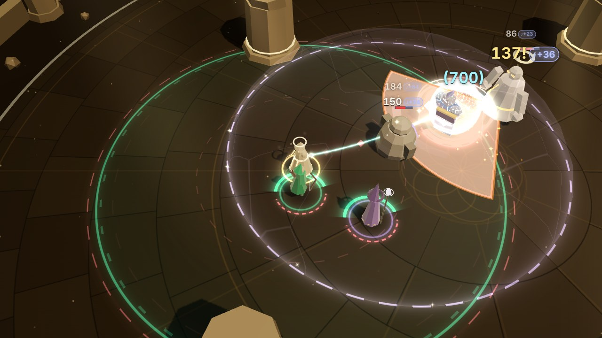

# Phase 4: the Astrolabe in the fight (render / VFX)

The Weaver now carries a passive tree between runs, the **Astrolabe** (see [Phase 4](../phase-4.md)).
Most of its 65 nodes change numbers only; this workstream makes visible what the keystones and
great notables do in a fight, where they act: a hero's overflowing Mend, a Ward that won't break,
Life paid for a technique, a Weaver held at half her Life, a field a Mute can't crack, Empower
lingering, a revived hero untouchable. Render reads `WorldState.astrolabe` (`nodes`,
`techniquesCostLife`, `lifeCapPct`), the shields' `amount` / `max` / `appliedAt` / `expiresAt`
(and `grace` when the sim marks one), the heroes' `afterglowUntil`, `auraMask` and
`health.invulnerable`, `field.suppressed` and `field.chords`, the Mutes' dome radius, and the
`graceShield`, `damageTaken` (`absorbed`), `shieldBroken`, `techniqueCast`, `techniqueRejected
{ reason: 'life' }`, `revived` and `rewound` events, and nothing else. Every number comes from
content (`astrolabeNode(id).values`: Grace's cap and seconds, the Halo's cap, Afterglow's
linger, Second Wind's seconds) or from the state and the sim's own `techniqueCost` / `canPay`,
so the lead's retuning shows up without render changes. **The auras' looks (field bands, foot
arcs, hero aura tints, the beam song's sheath, hexes) are unchanged**: the tree's touches are
added beside them (see *The auras* below).

## What changed

| File | Phase 4 work |
| --- | --- |
| `astrolabeCues.ts` (new) | Pure helpers, no three.js, tested in Node. `ASTRO_HEX` (the tree's own colours: Grace's brim light, the Halo's ring, Conduit's blood-violet and its pale core, Second Wind's air, Unbroken's shimmer) and `ASTRO_EFFECTS` (the node effects render shows, the sim's names). `astroLook(state, out)`: a flag per effect and every number from the nodes' content values, rebuilt only when `astrolabe.nodes` changes; `conduit` and `lifeCap` straight from the state. `shieldOn`, `graceMarked` / `graceShieldOn` (the sim's `grace: true` mark, found by its mark, not its kind), `stillOn` (a shield by identity), `graceCandidate` (the Weaver's own overshield, never an aura's or a hero's own), `graceFill`, `atLifeCap` (the sim's ceiling `maxHp × lifeCapPct`), `afterglowLeft`, `wardLife` (from `expiresAt`, timed from when render first saw the Ward, as Stasis holds `appliedAt`), `haloHeld` (a Ward lost its cap to a hit it absorbed whole), `costedTechnique` / `lifeCostOf` (the sim's `techniqueCost`), `domeMeets` (the arcs where a dome and a field cross). |
| `astrolabe.ts` (new) | `AstrolabeView`: Grace's shell, its rising surface, its brim and its forming; the Halo's circlet, its ring and the falling half; Conduit's flicker and fizzle; Unbroken's shimmer; Afterglow's haze, ring and sparks; Second Wind's shell, countdown and gust. Moments are pooled (32); per-hero state lives in typed arrays; nothing allocates per frame. Draws through the existing shell, ring, sprite, top-sprite, beam, ribbon and particle batches only. `fired`, `drawn`, `look`, `activeCount()`, `graceFillOf()`, `haloOf()`, `afterglowOf()`, `windOf()` are for tests and the lab. |
| `entities.ts` | `EntityRec.graceRef`: the overshield Grace formed or feeds, which the plain overshield shell skips (so does any shield the sim marks `grace`); AstrolabeView draws it. `conduitFlash(id, k)` and `EntityRec.conduit`: a blood-violet rim flicker on the Weaver (~0.3 s; steady at Flashes 0). `EntityRec.prism`: Prism Covenant's edge on her model, rising while she stands at the cap. |
| `models/material.ts`, `models/batch.ts` | The per-instance `aShine` attribute gains a fourth component, `prism`: a thin spectral edge on the silhouette, each facet catching its own hue, drifting slowly. Program key `aw-model-v4`. Every other push writes 0. `prismOf(i)` and `tintOf(i, out)` for tests. |
| `fx/shells.ts` | Two shell styles: `SHELL.grace` (light filling a soft shell from below: how full rides in `crack`; a pool of light under a gently rippling surface, brightest just under it, barely there above it) and `SHELL.wind` (streaks of air flowing round and up). `styleCount(style)` and `crackOf(style)` for tests. Same batch, same draw call. |
| `field.ts` | `suppressedLevel` (how cracked and flickering the fields are drawn) for tests. No change in look. |
| `chronoCues.ts` | **Fix**: `rewindReady` asks the sim's `canPay(state, 'reel')`, so the Rewind preview knows the tree's Economy and Eldritch Conduit's Life as well as Stasis's discount (it compared Spirit with Reel's cost, halved in Stasis, and nothing else). |
| `combatView.ts` | Creates the `AstrolabeView` (with the entity layer), passes it events and frames. |
| `lab/VfxLab.tsx` | **Phase 4 · Astrolabe** group: one scenario per visual (below), `window.__VFX__.astroScenarios() / astroScenario(name) / setAstrolabe(nodes) / astroStats()`; every lab sim takes `astrolabe` (other groups reset it). |
| `tests/renderAstrolabe.test.ts` (new) | Real sim → real `EntityLayer`, `FieldView`, `ThreadView` and `AstrolabeView` over a real `FxKit` (below). |

## The visuals

| Visual | When (state / event) | What you see |
| --- | --- | --- |
| **Overflowing Grace: forms** | `graceShield` | A small overflow at the hero's chest: a soft Mend-coloured bloom and a white star, a **ring of light spilling over** from the chest and running down round them into the shell, a faint pool on the ground, motes thrown up and over, falling round them. |
| **Overflowing Grace: filling** | The overshield Grace formed (or the sim marks `grace`) | A **soft shell of light** in Mend's colour, apart from the Ward's hex shell and the plain amber overshield, **filled from below**: the light glows under a gently rippling surface, brightest just under it, and drifts upward; above the surface the shell is barely there. The level is the shield's `amount` over its cap (`maxHp × cap`, content). A bright rim and a faint lid of light mark the surface; **while Mend tops it up** the surface brightens and motes arrive on it, so it visibly rises. It pops in when formed and fades over its last 0.6 s. |
| **Overflowing Grace: brimming** | Filled to its cap | Light wells up at the crown and **spills over**: five streams of light running down the near side of the shell, drops thrown up and falling off it. |
| **Shatterproof Halo: the circlet** | A `ward` shield, with the keystone | A **circlet round the Ward's shell** in the Ward's own colour, whitened. Its **lit arc is the barrier left** (centred on the near side; a worn circlet's two ends catch the light), and its **height is the Ward's life left**: it sinks from the shoulders to the ankles as the shorter life runs out (from the state's `expiresAt`, so a Ward cast in Stasis reads right). The Ward's own shell is unchanged. |
| **Shatterproof Halo: rings and holds** | The Ward lost its cap (`max × cap`) to one hit it absorbed whole (`damageTaken.absorbed` beyond what it lost) | The circlet **trembles like a struck bell** and one ring of its sound rolls out; the Ward's shell flares warm white and settles; sparks burst off the circlet and a star flashes on it. The lit arc drops to what's left, visibly halved, and **the half it lost falls away** below it, widening and fading, with glints off the broken ends. Small hits don't ring. |
| **Shatterproof Halo: gives out** | `shieldBroken { shield: 'ward' }` (a second big hit, or a worn Ward) | What was left of the circlet falls away. |
| **Eldritch Conduit: paid in Life** | `techniqueCast` (Ward, Chime, Reel, Rewind) with `techniquesCostLife` | A **blood-violet flicker** from her: her rim flickers blood-violet (~0.3 s), her Life is drawn as blood-violet motes from her body **into her casting hand**, which glows, and a thin ring draws in at her feet. Stronger the more of her Life it took (the sim's `techniqueCost` over her `maxHp`). Glide is free and shows nothing. |
| **Eldritch Conduit: refused** | `techniqueRejected { reason: 'life' }` | A dim blood-violet sputter at her hand, a few sparks; nothing paid. At most every 0.4 s, however long the key is held. |
| **Prism Covenant** | `lifeCapPct < 1` and her Life at `maxHp × lifeCapPct` | A **thin spectral edge on the Weaver's model**: facets near her silhouette catch their own hues, drifting slowly. It comes up over about a second while she stands at the cap, fades in about half a second when she drops below it (hurt, or paying Life under Eldritch Conduit), and returns when she is healed back to it. Not an aura, nothing on the ground. |
| **Unbroken Chorus** | `field.suppressed` (false under the keystone); a Mute's dome meeting one of her fields | Her **fields' cracks and flicker follow `field.suppressed` only**, which the sim keeps false: a Mute's dome over her leaves her fields whole (the Hollow Cantor's Silent Verse still silences her, and then they crack as before). Where a dome meets her field (her own round her, and each planted chord), a **faint warm-white shimmer on the dome's rim** inside the field with a few glints rising off it, and a few glints along the field's edge inside the dome: her song holding the glass back. Drawn beside the field, never on it. |
| **Afterglow** | `hero.afterglowUntil` (set when the Empowering Thread leaves a hero) | On the hero the Thread left, the Empower glow **lingers and fades** until `afterglowUntil` (the linger from content): a soft gold haze over them, the Thread's gold ring at their feet thinning, gold sparks still rising off them. Their rim is left alone: their aura tint shows as always (tested). Mend leaves nothing behind. |
| **Second Wind** | `revived` by Mend (the threaded hero in Mend; not Rewind's), while `invulnerable` lasts | A **gust rises** up the hero as they stand (rings rising, two spirals of air, airy motes), then a **shell of moving air** just outside a Ward's (warm white streaks flowing round and up, breathing gently) and a thin **countdown ring** at their feet, outside the aura arcs, for the untouchable seconds left (content's seconds). It fades over the last third of a second and is gone when `invulnerable` ends. |

Travel nodes and notables that change numbers only (the songs' strength, costs, Mend and revive
speed, stagger, Close Ranks, and so on) show through the existing visuals: a stronger aura, a
quicker revive, a bigger number. Sanguine Font has no cue of its own: its Mend share heals her
through the usual heal feedback, and its Life reserve is the HUD's.

**Settings.**

- **Flashes.** Bright in-world flares (Grace's forming bloom, star and pop, the Halo's shell
  flare and star, Conduit's hot core, Second Wind's pop) scale by `flareScale(flashes)` (35% at
  0). The same visuals still draw at 0 (tested). Conduit's rim flickers for ~0.3 s, like the
  existing rim flashes, and at Flashes 0 it is a steady tint fading out instead. No full-screen
  flash.
- **Colour vision.** Every `ASTRO_HEX` colour is ΔE ≥ 20 from lethal and ≥ 15 from threat under
  every palette's simulated vision (the closest: Conduit's pale core 26 from threat under
  tritanopia, its blood-violet 54 from lethal); Conduit's blood-violet is ≥ 20 from the ailment
  colour (27, deuteranopia) and the Martyr's Bear (29, tritanopia). Grace glows in the live Mend
  colour (`C.heal`), ≥ 20 from the Ward's `C.shield` (27, protanopia) and far from the plain
  overshield's amber (72); Second Wind's air is ≥ 20 from the Ward's colour (21, protanopia), and
  its streaks and countdown shape it apart. None needs a live variant (tested). Every visual also
  has its own shape (a level that rises, a sinking circlet, a hand drawing in motes, a spectral
  edge, glints on a rim, a moving-air shell), so none relies on colour.
- **Quality.** Motes, sparks, drops and glints go through the particle system's density (0.4 /
  0.7 / 1 by tier) and caps. Nothing else changes with the tier.

## Seeing each one in the lab (`?lab=vfx`)

**Phase 4 · Astrolabe** has one button per scenario and a **No tree** button. Each restarts the
real sim with an Astrolabe tree (`SimConfig.astrolabe`; keystones work on their own in the sim)
and Guardian Chords (unless the scenario says otherwise), and stages it with real commands and debug ops (no injected events). The
hover text says what it shows.

| Scenario | Tree | Staging (all real sim) |
| --- | --- | --- |
| Overflowing Grace | Overflowing Grace | Thread Kael at full life: Mend's overflow forms the shell, fills it, brims |
| Grace · in a fight | Overflowing Grace | Kael threaded; at 3 s a brute's Toll Cleave takes the shield down and Mend fills it again |
| Grace · beside the others | Overflowing Grace (with the Silver Thimble relic, and Ostinato as the field song) | Lyra's Thimble shield (in Empower, not Mended over), Kael's Grace filling, a Ward on Vexis at 2.4 s, Ostinato's barriers on everyone |
| Shatterproof Halo | Shatterproof Halo | An elite brute's Toll Cleave on Kael, Warded 0.75 s into its wind-up (absorbed, not Perfect): it rings and holds, halved |
| Halo · its life | Shatterproof Halo | A Ward on Kael, no fight: the circlet sinks as its shorter life runs out |
| Eldritch Conduit | Eldritch Conduit | A Ward (0.4 s), a Chime (1.4 s) and a Reel (2.4 s), each paid in Life |
| Prism Covenant | Prism Covenant | You fight at the cap: the spectral edge |
| Unbroken Chorus | Unbroken Chorus | A Mute beside you: your field stays whole; the shimmer where its dome meets it |
| Mute · no tree | none | The same Mute without the keystone, for comparison: it silences you and cracks your field |
| Afterglow | Afterglow | Kael Empowered in a fight; at 1.6 s you thread Lyra: the glow lingers on Kael and fades |
| Second Wind | Second Wind | A Fermata hold on Kael runs out (debug op) and he goes down; you thread him and Mend stands him up |
| Every keystone | Overflowing Grace, Shatterproof Halo, Eldritch Conduit, Prism Covenant, Unbroken Chorus, Afterglow, Second Wind | Grace on Kael, a Halo Ward paid in Life ringing under a Toll Cleave, a Mute's dome, Prism's edge until she pays (the clutter check) |

`window.__VFX__.astroScenario(name)` runs one from a script, `setAstrolabe(nodes | null)`
restarts with any tree, and `astroStats()` returns `{ nodes, fired, drawn, look, weaver: { hp,
maxHp, cap, prism, conduit }, heroes: [{ hp, maxHp, shields, grace, afterglow, invulnerable,
wind, halo: { arc, life } }], suppressed, fieldCracks }`.

## Verification against the real sim

`tests/renderAstrolabe.test.ts` (18 tests) drives real sims with an Astrolabe tree (configs as
in `tests/sim/astrolabe.test.ts`) and feeds state and events to the real `EntityLayer`,
`FieldView`, `ThreadView` and `AstrolabeView` over a real `FxKit` (all headless in Node):

- **Cues**: a flag per keystone's effect, every number from content; travel nodes and notables
  show nothing; `graceFill`, `haloHeld` (a capped hit absorbed whole rings; two smaller hits that
  add up to the cap don't), `wardLife`, `domeMeets` (across, inside, apart).
- **Colours**: as under Settings, under each palette's simulated vision.
- **Grace forms and fills**: Kael threaded at full life: one `graceShield`, one moment, the
  shell drawn in its own style and never the plain overshield's; it fills as Mend tops it up,
  the shell's level is the drawn fill, it brims at its cap; topped up, never re-formed; in
  Empower it lasts its seconds and goes, and the moments end.
- **Grace follows the sim's mark**: a shield marked `grace: true` is drawn as Grace's with no
  event.
- **Grace keeps apart**: a Ward keeps its hexes, Lyra's Thimble shield (in Empower) the plain
  overshield, Ostinato its barrier, while Kael wears Grace's shell; a hero's own overshield (Kael's
  Aegis Wall) is never taken for Grace's. Mend's overflow on a Thimble shield: if the sim tops it
  up (as now), it takes Grace's look from then; if the sim leaves it alone and keeps Grace's own
  shield (docs/phase-4.md), it keeps the Thimble's look and Grace's is drawn beside it. This test
  and the whole file were also run against two scratch copies of the sim with that rule (Grace
  waiting for the other shield to go, or standing beside it): all 18 pass on all three.
- **Shatterproof Halo**: an elite Toll Cleave on a Ward cast as it starts: the Ward's life is the
  content's duration made shorter by the keystone; the circlet sinks with it; the hit is absorbed,
  the Ward keeps `max × (1 − cap)`, one ring and one fall, the drawn arc is the barrier left; the
  circlet goes with the Ward and the moments end. Small hits don't ring; a second big one breaks
  it and what was left falls; without the keystone a big hit breaks the Ward and nothing rings.
- **Eldritch Conduit**: a Ward paid in Life (the sim's `techniqueCost`, pool `life`): one
  moment, her flicker up and gone within half a second; at 2 Life a Chime is refused (`life`)
  and fizzles once for two presses; without it a Ward is paid in Spirit and nothing flickers.
- **Prism Covenant**: at the cap her edge rises above 0.9 on her model's instance and no hero's;
  hurt below the cap it fades, healed back it returns; without it, always 0.
- **Unbroken Chorus**: the same Mute beside her: without the keystone the sim silences her and
  the fields are drawn cracked (`suppressedLevel` > 0.95); with it the sim doesn't, the fields
  are drawn whole (0), her heroes keep their auras, and the shimmer is drawn; no Mute, no shimmer.
- **Afterglow**: Kael Empowered, then the Thread moves to Lyra: drawn at once (> 0.9), half way
  through the linger about half, gone at `afterglowUntil`; **Kael's rim is exactly the same as in
  the same fight without the node** (his aura tint, colour and strength) throughout; Mend leaves
  nothing; without the node nothing lingers.
- **Second Wind**: Mend's revive: one gust, the shell drawn while `invulnerable` (content's
  seconds) lasts and gone when it ends; without it, nothing.
- **Rewind's preview pays as the sim does** (the Chronomancer): under Eldritch Conduit with no
  Spirit, Rewind is ready (paid in Life), and not at 1 Life; with every Economy node, it is ready
  with less Spirit than Reel's base cost.
- **Flashes 0 vs 1**: the same moments fire and the same rings, shells and top sprites draw.
- **No draw calls**: the same fight with and without every keystone (Grace, the Halo and the
  shimmer drawn) has the same FX and model batches and the same materials.
- **No per-frame allocation**: with every cue at once (Grace, the Halo, the shimmer, moments
  running), 600 frames under V8's sampling heap profiler: everything `astrolabe(Cues).ts`
  allocates is the doubles V8 boxes to pass to the batches' `push()`; nothing bigger (an object,
  array, closure or string) is made per frame: no larger size comes up 150 times (V8 tiering up
  makes at most ~20 of any one size), nor 600 in all. A planted `{}` per frame fails it (600).
- **Cost**: `AstrolabeView.sync` with every keystone in a fight, including `FxKit.begin/end`,
  stays under a generous 400 µs bound.

In the browser, every lab scenario was run through `window.__VFX__` with fixed frames
(`manual(n, 16.67, true)`), polling `astroStats()` until the moment fired, then shot that many
frames later. The counters in the shot log match the sim (below, in brackets).

## Performance

Measured with Chromium headless (SwiftShader) against the dev server. Draw calls from
`renderer.info`; SwiftShader frame times are noise, not FPS.

| Measure | Draw calls |
| --- | --- |
| Lab idle, no tree / every keystone (Prism's edge on her) | 21 / 21 |
| The `busy` preset (a fight, 25 enemies), no tree / every keystone, once a second for 6 s | 35–37 / 35–36 |
| The same Mute beside her, no tree (the field cracked) / Unbroken Chorus (the shimmer) | 27 / 26 |
| The lab scenarios above, at the moment each shows (Every keystone: 30) | 22–30 |

**No new draw calls, batches or materials.** Grace's and Second Wind's shells are two more
styles of the shell shader, the circlet, its ring and the countdown are rings, the spills are
beams, the gust's spirals are ribbon strips, the glints and stars are sprites, the motes, sparks
and drops go through the particle system, and Prism's edge is a fourth component of the models'
existing `aShine` attribute. The differences of a few between scenes are which existing batches
have anything in them that frame, as before.

CPU, measured in Node (median / p95 µs per frame, the range over five warm runs of each; the
machine was shared with other workstreams, load average about 10 on 4 cores, so p95 is noisy):

| | No tree | Every keystone |
| --- | --- | --- |
| `AstrolabeView.handle + sync`, a 50 s fight: a Mute beside her, an elite brute on Kael, a Ward on him every 8 s (paid in Life), Mend, then Empower and the Thread moved (Grace drawn in 23% of the frames, the circlet 14%, the shimmer in all, Afterglow 12%) | 1.0–1.6 / 2.0–3.0 | 3.1–4.0 / 8–16 |
| `AstrolabeView.sync`, every cue held at once (Grace, a Halo Ward, a dome's shimmer, moments running), two sessions | — | 1.9–3.7 / 2.2–4.6 |
| `EntityLayer.sync` in the same fight (Grace's shell skipped, Conduit's flicker, Prism's edge) | 16–24 / 31–47 | 16–22 / 32–52 |

The test's bound for `AstrolabeView.sync` with `FxKit.begin/end` is a generous 400 µs. Moments
are pooled (32); per-hero state lives in typed arrays; the look lives in a reused object rebuilt
only when the tree changes; colours are shared constants; arcs and the hand position are reused
objects. Nothing is allocated per frame (tested); per event, only the sim's `techniqueCost`
result for a technique paid in Life.

## Screenshots

All in `docs/phase-4/vfx/`, from the lab scenarios above (shot-log counters in brackets). Full
frames are 1280×720; the close-ups were shot at twice the pixel density and set side by side.

- `every-keystone.jpg` (`graceForm` 2, `haloRing` 1, `conduit` 1; Grace, the circlet and the
  shimmer drawn): the clutter check. Kael's Halo Ward (360: Grace makes it 40% smaller), paid in
  her Life (165 of her 360, below Prism's 180, so her edge has faded), ringing under an elite Toll
  Cleave (700 absorbed, the Ward down to 180) over his Grace (31% full); the Mute's dome over her
  field, which holds.
- `grace.jpg` (close-ups): Grace forming (`graceForm` 1, 3% full), filling (45%: its surface at his
  waist, rising as Mend tops it up) and brimming (at its cap, 480 of his 1600: spilling over).
- `grace-others.jpg` (Grace 55%): Kael's Grace beside Lyra's Silver Thimble shield (the plain
  amber overshield), Vexis's Ward (hexes) and Ostinato's faint barriers on all three.
- `halo.jpg` (close-ups; `haloRing` 1, `haloFall` 1, the Ward at 300 of 600): an elite Toll Cleave
  (700) absorbed whole: the circlet rings, its sound rolling out, and the Ward flares; 16 frames
  later it holds at half, the near half of the circlet lit, the lost half falling away; 18 more
  and the circlet has sunk with the Ward's life (0.57 → 0.26), still holding.
- `halo-life.jpg` (close-ups): a Ward with the keystone and no fight: the circlet at 86%, 44% and
  7% of its 1.8 s.
- `conduit.jpg` (close-up; `conduit` 1, her Life 360 → 340): a Ward on Kael paid in Life: her rim
  flickering blood-violet, the Life drawn into her hand, the ring drawing in at her feet.
- `prism.jpg` (close-ups): the Weaver without the tree, and at Prism Covenant's cap (her Life 180
  of 360, the edge 0.99).
- `unbroken.jpg`: the same Mute beside her, without the tree (`suppressed`, the field drawn
  cracked, her heroes' auras gone) and with Unbroken Chorus (`resist` 1: whole, the shimmer on the
  dome's rim inside it).
- `afterglow.jpg` (close-ups; 0.95 and 0.44 of the linger left): Kael after the Thread moved on to
  Lyra: the gold haze, the ring at his feet and the sparks, fading; his rim is his own.
- `second-wind.jpg` (close-ups; `wind` 1): Kael stood up by Mend: the gust rising up him (with the
  revive's own teal ring and `REVIVED`), then the shell of moving air and the countdown at his
  feet.

## Known gaps

- **Grace's shield is known by its event and the sim's mark.** The sim doesn't mark it yet
  (`grace: true` is in the contract, docs/phase-4.md): render tags the overshield `graceShield`
  formed, and adopts a Weaver's overshield that Mend's overflow grows in place (the sim tops up
  a Thimble's, a Lantern's or Dawnward's today). When the sim marks Grace's own shield, render
  follows the mark and finds it by its mark even beside another overshield (tested against
  scratch copies of both rules).
- **The Halo's ring is inferred** from the Ward's barrier before and after a tick and what the
  tick's hits absorbed: it rings when the Ward lost its cap and absorbed more than it lost (the
  cap held the rest back). A hit worth exactly the cap doesn't ring (nothing was held back), and
  two big hits in one tick ring once.
- **The circlet's lit arc is centred on the near side** (the camera looks from +z); a Ward
  struck from behind halves the same way.
- **A Halo Ward cast early in a wind-up has little life left when the hit lands**: the circlet is
  already low and the held half reads for well under a second (1.8 s Wards). That's the keystone's
  price, and the circlet shows it.
- **Second Wind is told apart from other revives by who is threaded**: `revived` doesn't say how;
  render takes the threaded hero in Mend (Rewind's revive has its own `rewound`, and the debug
  heal doesn't show it).
- **Eldritch Conduit's flicker strength is the sim's cost**, recomputed from `techniqueCost` on
  the event (the event doesn't carry what was paid).
- **The shimmer is drawn where a dome's circle meets a field's circle**, including a dome wholly
  inside a field (the whole rim) or a field wholly inside a dome (glints round the whole field).
- **Afterglow doesn't keep the Thread's gold rim on the hero** (see *The auras*).
- Real FPS still isn't measurable here (SwiftShader).

## The auras

**No aura's look changed.** The field bands, foot arcs (r × 1.78, and the beam song's at
r × 2.08), hero aura tints, the beam song's sheath and the hexes are drawn exactly as before.
Where the tree's touches meet them:

- **Afterglow** lingers through a soft additive gold haze over the hero (it lightens them a
  little while it lasts), the Thread's gold ring at their feet (the ring under every hero,
  r × 1.45, inside the aura arcs) and sparks. It deliberately **leaves the rim alone**, so the
  hero's aura tint is drawn throughout (tested: the rim is identical to the same fight without
  the node). An earlier draft lingered the Thread's gold rim instead, which covered the aura tint
  for the linger; it was taken out under the user's rule. *For the user:* that gold rim lingering
  for Afterglow's 3 s reads more strongly as "still Empowered", but it hides the hero's aura tint
  while it lasts. Not done: it is yours to decide.
- **Unbroken Chorus**'s shimmer sits on the Mute's dome rim and as glints at the field's edge;
  the field's bands, cracks and flicker are the field's (they follow `field.suppressed`).
- **Second Wind**'s countdown ring is outside the aura arcs (r × 2.32); its shell is outside the
  Ward's.
- **Grace**'s shell and the **Halo**'s circlet are round the hero's body, not on the ground; the
  rim flashes (Conduit's, ~0.3 s) are moments, like the existing Save flash.
- **Ostinato's barrier** (an aura's shield) keeps its own faint shell and is never taken for
  Grace's (tested).

## Contract notes

- **Grace's own shield, marked `grace: true`.** docs/phase-4.md (and its code review) say Grace
  keeps to its own shield and marks it; the sim in this tree still tops up any of the Weaver's
  overshields (a Thimble's, a Lantern's, Dawnward's) and marks none. Render reads the mark when it
  comes, and until then knows the shield by the `graceShield` event and by Mend growing it. If
  Grace's shield may stand beside another overshield on the same hero, render finds it by its
  mark; nothing else is needed (tested against scratch copies of both rules).
- **`shieldHeld { target, hit, lost }`** (or `damageTaken.capped`) when Shatterproof Halo holds a
  hit back, so render stops inferring the ring from the Ward's barrier and the tick's absorbed
  total.
- **`techniqueCast { paid, pool }`**: what was paid and from which pool, so Conduit's flicker
  needn't recompute `techniqueCost` after the fact.
- **`revived { via: 'mend' | 'rewind' | 'debug' }`**, so Second Wind's gust isn't told apart by
  who is threaded.
- Resolved during this work: the HUD's Rewind readiness asks `canPay` too (the UI workstream's
  `hudBridge.ts`), so the HUD and the in-world preview agree.
- three.js's `addUpdateRange` allocates a small object per batch per frame in `FxKit.end` (not
  the Astrolabe's; noted while proving it allocates nothing).
