# Phase 4b UI: Deeds

*Owner: the UI workstream (`src/ui/**`). Builds on [Phase 4's UI](../phase-4/ui.md). Spec: [docs/phase-4b.md](../phase-4b.md).*

Everything here can be reviewed without playing: open **`/?lab=ui`** (new sidebar group **Deeds**) or `/?lab=ui&view=<id>&nav=0`.

Every name, number and condition on these screens comes from content (`deedText`, each Deed's `values`), the profile (`deeds`, `deedBest`, `deedNotices`) or meta (`deedPoints`, `astrolabePoints`, `unlockRank`, `DEED_POINTS_MAX`). Nothing is hard-coded, so the content's later wording changes ("Make 3 Clutch Chimes", "Answer at least 5 calls in one fight, and miss none") came through on their own. The tests read their numbers from content too.

The user chose **a Codex page and toasts**. Every Deed is listed from the start with its condition and your best run; a toast marks each one as it's earned, the Summary lists the run's, and the Astrolabe shows how many of its points came from Deeds.

## What changed, by screen

| Where | What | Files |
|---|---|---|
| **Codex: Deeds** (new tab, after The Astrolabe) | All 20 Deeds in content order, in two groups: **★ The ladder** ("an Astrolabe point each, easiest first", numbered 1–10) and **Badges** ("for the record"). Each card has its glyph in a disc, its name, its condition (`deedText`) and, on the ladder, "★ +1 Astrolabe point". **Earned** ones are lit (a glowing disc and border, "✓ Earned"); the rest are dim but fully readable. A **counting Deed** (`runCount`, `grades`, `saveWays`) shows its best run: a small bar and "best 7 of 10", or just the record ("best 18") once earned. A **Calling's Deed** whose Calling isn't open says "The Martyr opens at Rank 8." (its `unlockRank`, as the Callings tab does). **Bent Rules** says "The Astrolabe opens at Rank 4." while it's closed. **The tally**: "7 of 20 earned · 4 of 10 Astrolabe points from Deeds", a bar, a diamond for each point, and "Your 2 points wait for the Astrolabe: it opens at Rank 4." when they do | `screens/DeedsParts.tsx`, `screens/deedsModel.ts`, `screens/CodexScreen.tsx` |
| **Toasts** (new, over every screen) | One per Deed in `deedNotices`, one after another, bottom left: "Deed earned", the name, the condition, and "★ +1 Astrolabe point" for a point Deed. `deedStar` or `deed` plays as each appears. Each stays 4.6 s with a line draining along its foot; then `dismissDeeds(ids)` with the ids shown. **They wait while a rank-up card is up** (it plays its own sounds and wants a click) **and during a fight** (a run's combat or the Training Grounds). A toast put away midway comes back after | `screens/DeedToasts.tsx`, `screens/DeedsParts.tsx` (`DeedToastCard`), `app/App.tsx` |
| Summary | **Deeds earned this run** from `run.deeds`, after the Rank panel: each with its glyph, its name (a point Deed starred: "Bright Finale ★") and its condition. Nothing when the run earned none | `screens/SummaryScreen.tsx`, `screens/DeedsParts.tsx` |
| Astrolabe | Under the points meter: "**11 from Ranks · 4 from Deeds**" (`pointSources`: the store's total, split). "4 from Deeds" opens the Codex's Deeds **in place**, so its Back returns to the Astrolabe and the Astrolabe's own Back still knows Prep from Title. The over-budget warning says "your Rank and Deeds give 11" | `screens/AstrolabeScreen.tsx`, `screens/astrolabeModel.ts` |
| Codex: The Astrolabe | "Deeds add up to 10 more, a point for each on their ladder: 29 in all." ("Deeds" switches to that tab.) "Skip the unlocks gives all 29 points" (it said 19) | `screens/CodexScreen.tsx` |
| **Rank-ups, Rank panel, Codex: Weaver Rank** (review fix) | Their Astrolabe totals count the player's Deed points: `rankAstrolabeLine(rank, deedPoints)`. Five point Deeds before Rank 4 make its card say "It opens with 8 points to spend", and a later Rank "+1 Astrolabe point (N in all)" with the store's N | `screens/astrolabeModel.ts`, `screens/Rank.tsx`, `screens/rankText.ts`, `screens/ResultScreen.tsx`, `screens/SummaryScreen.tsx`, `screens/CodexScreen.tsx` |
| Settings | Reset progress warns that Deeds and the Astrolabe are cleared too | `screens/SettingsScreen.tsx` |
| Test hook | `winFight(tally)` (calls, responses, missed calls, Perfect Wards… claimed by a won fight) and `deeds()` (earned, waiting, the run's) | `app/testHook.ts`, `app/testHookTypes.ts` |

## The Codex's Deeds

| A new profile (Rank 1): every Deed visible, the Callings' and the keystone's locks | Early (Rank 3): two points waiting for the Astrolabe |
|---|---|
| 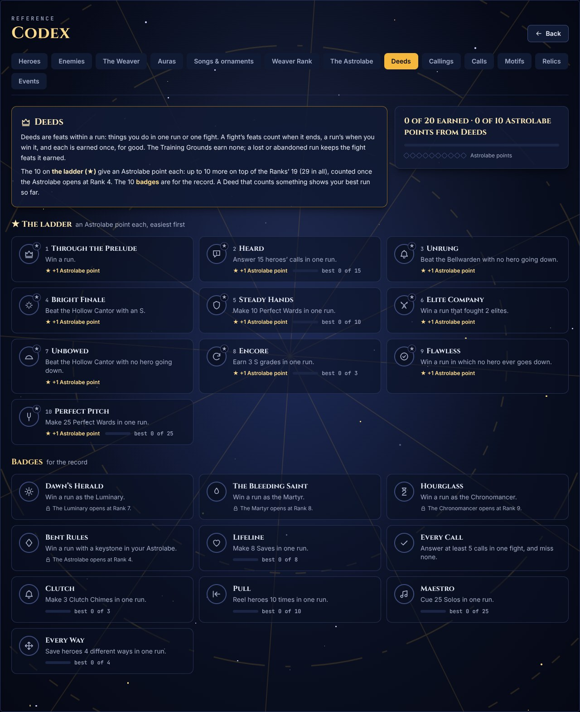 | 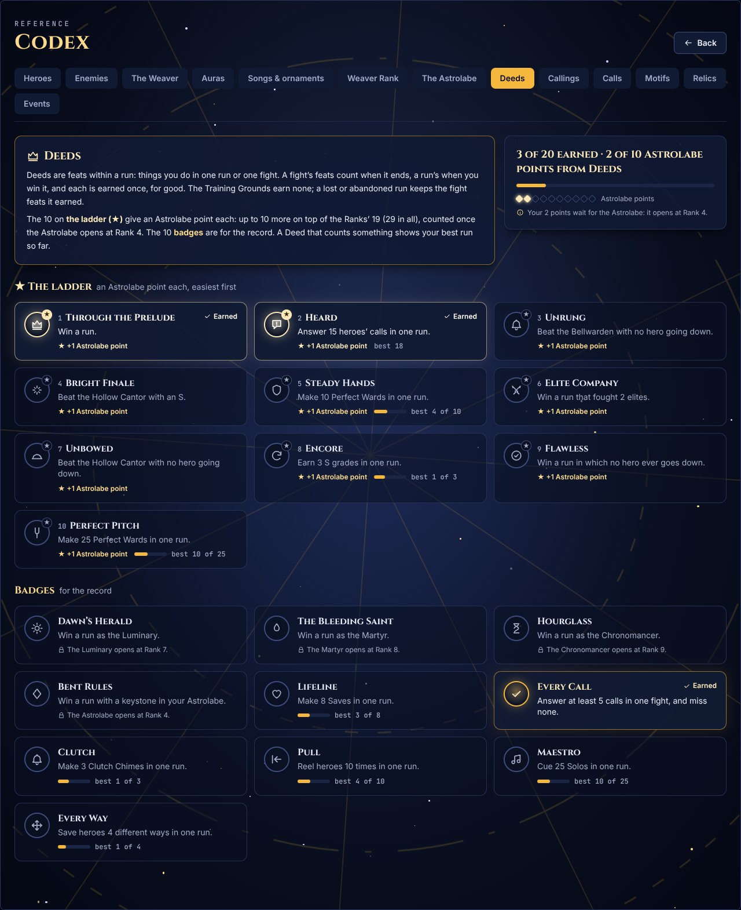 |

| Partway (Rank 8): seven earned, best runs, the Chronomancer's lock | Every Deed: a Calling's badge in its own colour |
|---|---|
|  | 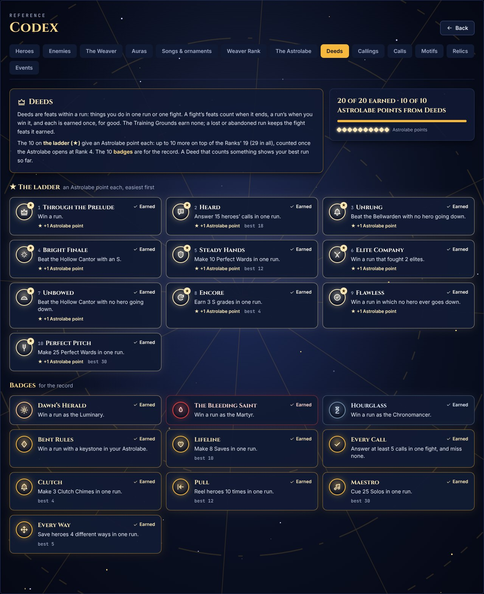 |

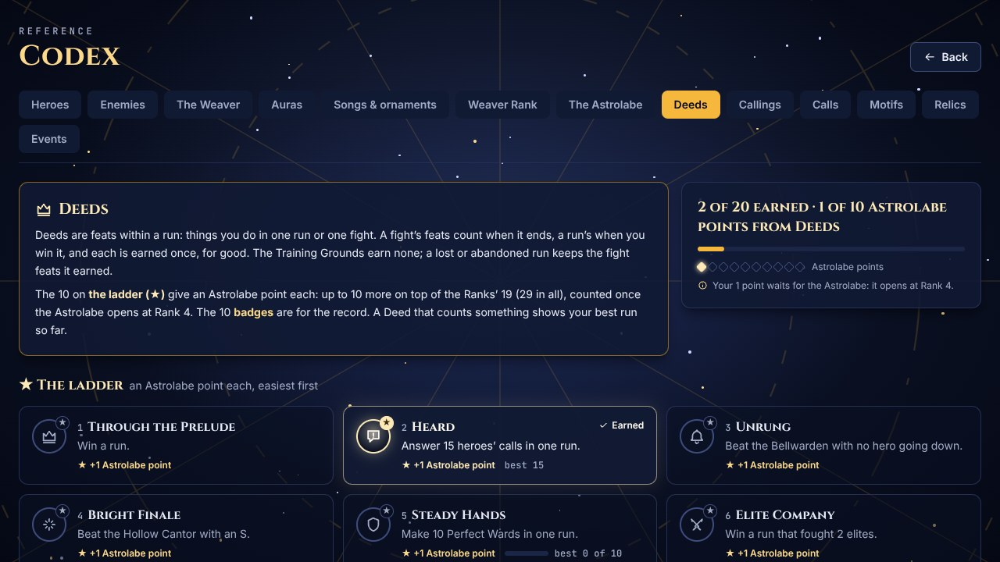

- **Each Deed has its own glyph** from the kit (`deedGlyph`), from its rule: the stat's own for a counting Deed (the call, the Ward, the heart…), the Calling's for a Calling's Deed, a diamond for the keystone, a crown for the win. Four read better by name: Unrung's bell, Encore's repeat, Perfect Pitch's tuning fork, Hourglass's hourglass. The test checks all 20 are kit icons and all different.
- **How it's lit**: the ladder in the Astrolabe's starlight, a badge in gold, a Calling's badge in its Calling's colour (the Luminary's peach, the Martyr's red, the Chronomancer's steel). A ladder disc wears a small ★. Unearned: an ink-grey disc and a darker card, the name in plain text, the condition in muted text (still well over 4.5:1).
- **The layout** is the Codex's grid (`minmax(22rem, 1fr)`), three across at 1280.
- **The intro** says what a Deed is, when it counts, that the Training Grounds earn none, and what the ladder gives: "up to 10 more on top of the Ranks' 19 (29 in all), counted once the Astrolabe opens at Rank 4."

## The toasts

| The rank-up card comes first; no toast while it's up | Then the toasts: a point Deed… | …and a badge |
|---|---|---|
| 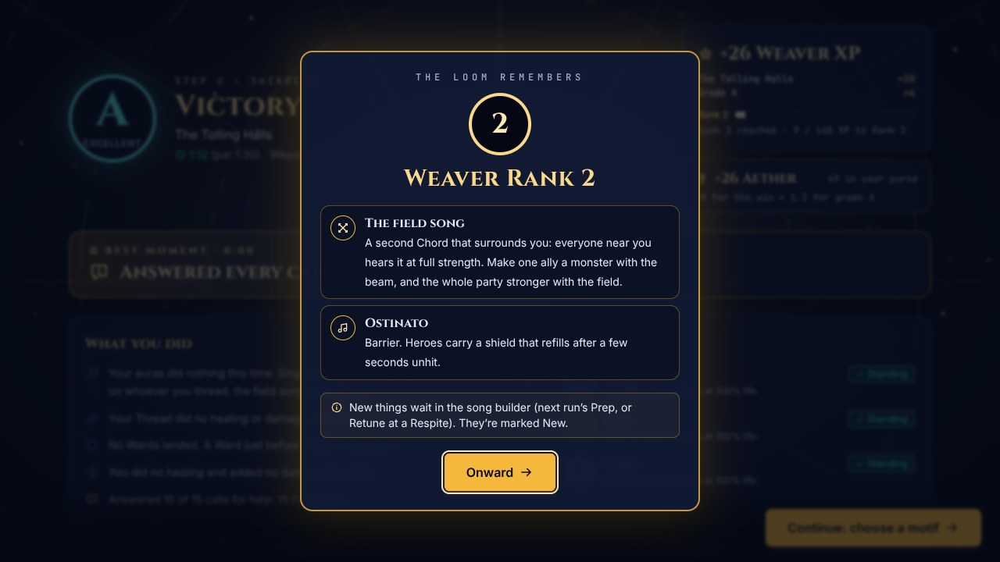 | 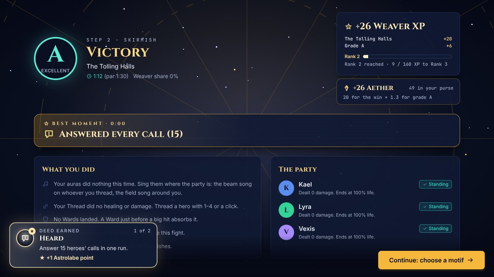 | 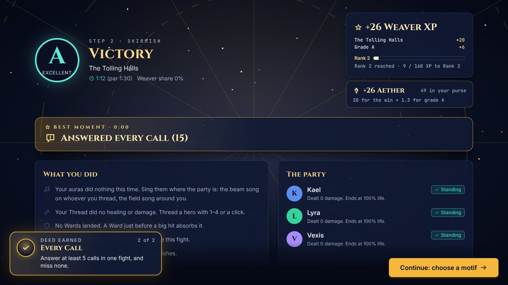 |

| A point Deed (2×) | A badge (2×) | A Calling's badge, 2 of 2 (2×) |
|---|---|---|
| 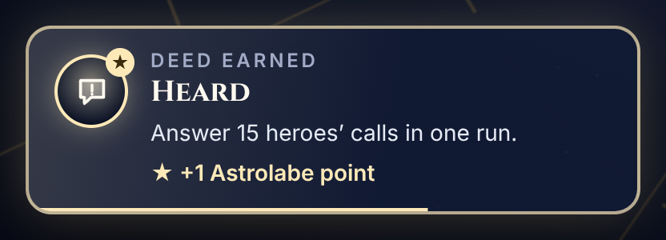 | 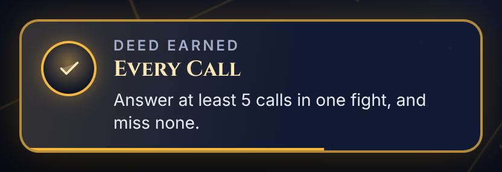 | 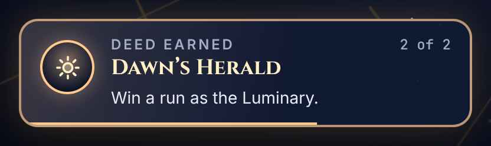 |

- **One layer for every screen.** `DeedToasts` sits beside the screen in `App.tsx`, so a toast that starts on the Result carries on to the draft, the map, the Summary or the Title if the player moves on. The real-app shots above are its own.
- **Never the same moment as a rank-up card or a fight** (`toastsBlocked`). The card is a modal with its own `rankUp` and `unlock` sounds and a button, and it comes first: the toasts start 650 ms after it's dismissed, so the sounds never overlap. During a fight the layer stays empty, and a toast put away midway comes back after.
- **Their own pace.** 650 ms after the screen arrives (its own sounds first, such as the Result's `aether`), then 4.6 s each with 350 ms between. Each plays its sound as it appears, so two Deeds are about 5 s apart and the audio's shared Deed gate never drops one.
- **Nothing lost.** The layer remembers the ids it has shown and calls `dismissDeeds(ids)` with exactly those (`toastStep`). A Deed that arrives while a toast is up gets its own toast after. An id content no longer knows is skipped and dismissed.
- **Where.** Bottom left: every screen puts its buttons bottom right. It's `pointer-events: none`, so it never takes a click. A counter ("1 of 2") shows when more are queued.
- **Read out.** The layer is a polite live region, and the name reads "Deed earned · Heard" (the dot is screen-reader text; on screen, "Deed earned" is an eyebrow over the name). The draining line hides with reduced motion.

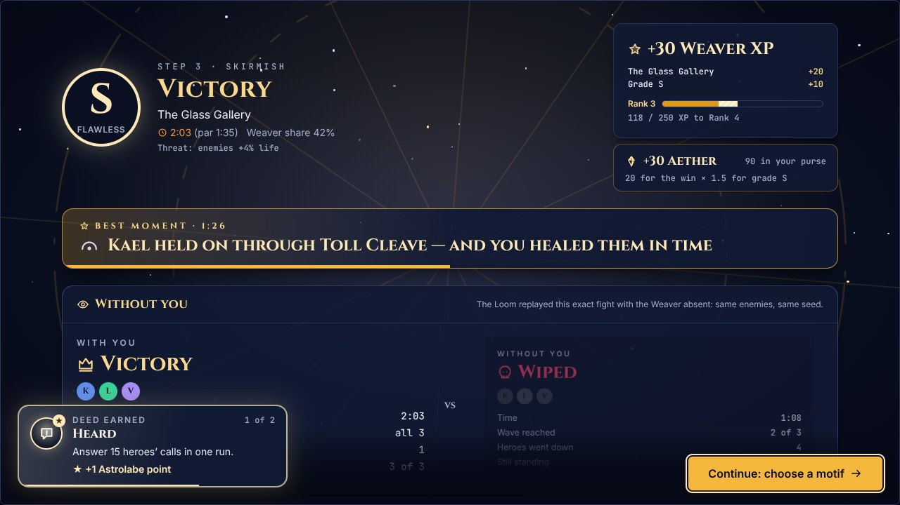

## The Summary

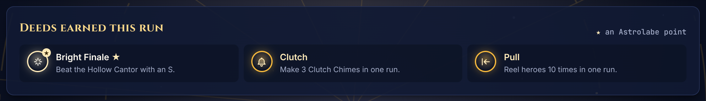

| The lab: a won run that earned three new Deeds | The real app: the boss won, its three toasts carry over |
|---|---|
| 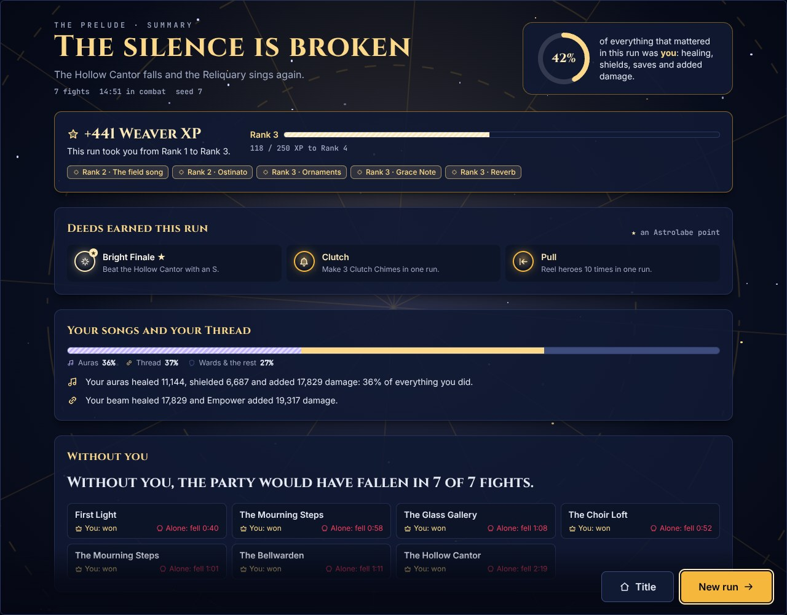 | 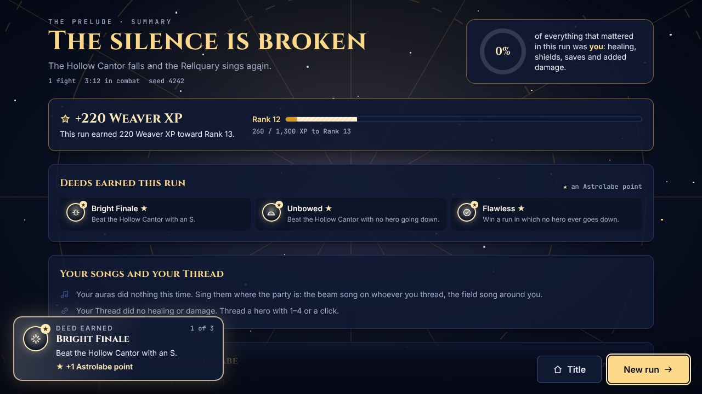 |

The panel lists `run.deeds` in the order earned, so only this run's (a Deed earned before isn't repeated, and Reset progress lets a run earn it again). The lab's run is judged by `deedsEarned` against a profile that already had some, so it shows what such a run really earns.

## The Astrolabe

| Rank 12 with four points from Deeds | The points meter (2×) |
|---|---|
| 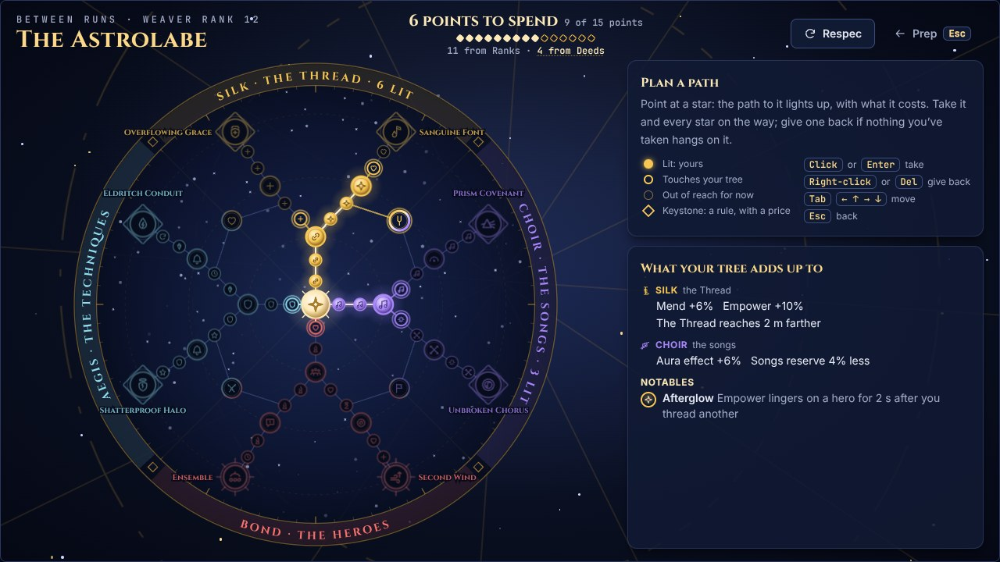 | 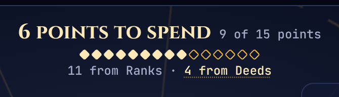 |

| The real app: 11 from Ranks · 7 from Deeds (a toast carried over from the Summary) | "7 from Deeds" opens the Codex's Deeds in place |
|---|---|
| 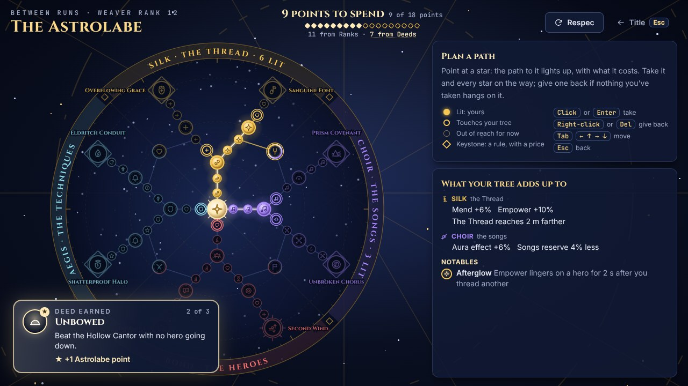 | 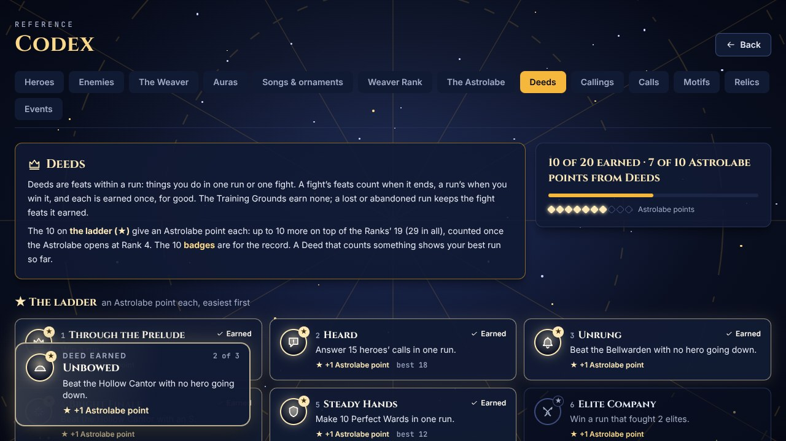 |

- **The split is the store's total.** `pointSources(rank, unlockAll, earned)` takes `astrolabePoints(rank, unlockAll, deedPoints(earned))` and splits off the Rank's part (`astrolabePoints(rank)`). With Skip the unlocks it reads "19 from Ranks · 10 from Deeds", and below Rank 4 there's nothing yet.
- **The link opens the Codex in place** rather than as a screen, because the UI store keeps one `previous`: going Astrolabe → Codex → back would have lost Prep. In the real app, Back returns to the Astrolabe, its Back still reads "Title" (or "Prep"), and Esc goes there.

## Rank-ups count the Deeds' points

| Rank 4 with six points from Deeds earned before it | The Codex's Astrolabe tab |
|---|---|
| 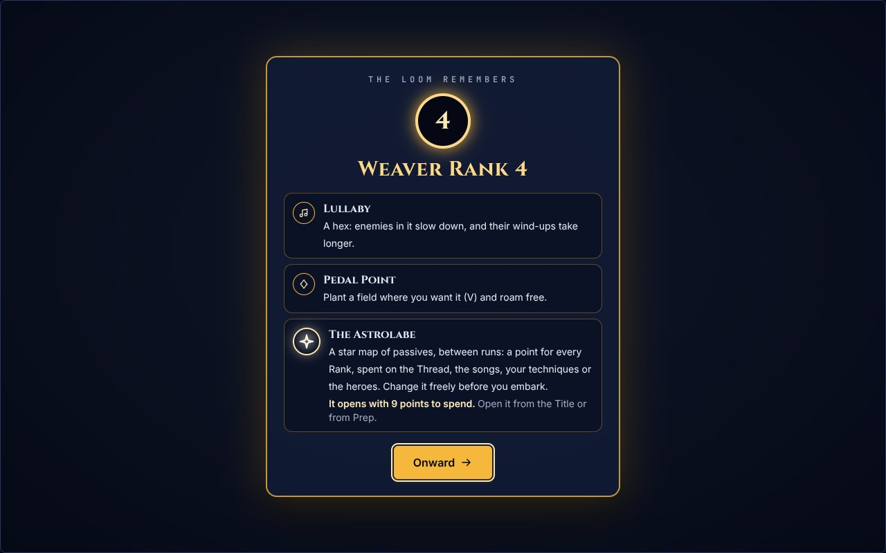 | 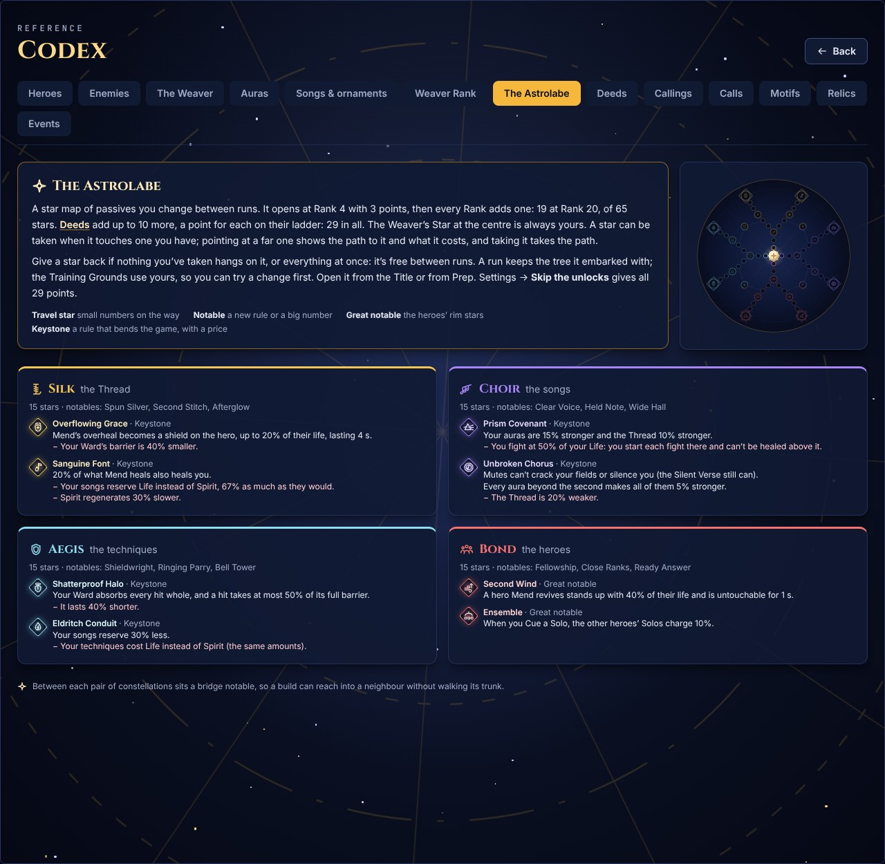 |

The review found the rank-up card, the Rank panel's next line and the Codex's Rank list counting only the Rank's points. `rankAstrolabeLine(rank, deedPoints)` now takes the player's Deed points, from `useRankUps` (the card, through `ResultView` and `SummaryView`), the profile (`rankPanel`) and the Codex's profile. Without Deeds it reads as before, so Phase 4's tests still pass.

## Lab views

The new **Deeds** group:

- **The Codex**: `codex-deeds-none` (a new profile, Rank 1), `codex-deeds-early` (Rank 3, points waiting), `codex-deeds-some` (Rank 8) and `codex-deeds-all`.
- **The toasts**: `toast-deed-star`, `toast-deed`, `toast-deed-calling`, and `result-deed-toast` (where it sits on the Result). **`toast-queue` is live**: the app's layer fed from the profile store, with the sounds; "Earn three Deeds", or "Three, with a rank-up" to see the toasts wait for the card.
- **The Summary, the Astrolabe, a rank-up**: `summary-deeds`, `astrolabe-deeds` (interactive; "4 from Deeds" opens the Codex) and `rank-up-4-deeds`.

New mock data in `lab/mock.ts`: `mockDeeds(earned, share)` (a profile's Deeds with best runs from each Deed's number), `EARLY_DEEDS`, `SOME_DEEDS`, `ALL_DEEDS` and `deedsSummaryRun()`. The mock ledger gains `missedCalls`.

## Tests and checks

`tests/uiPhase4b.test.ts` has 17 tests:

- **The page**: all 20 in content order, the ladder (★, "★ +1 Astrolabe point", rungs 1–10) then the badges; each name and condition is `deedText`'s, with no placeholder left. Lit exactly when earned.
- **The header** for five profiles, from none to all: earned of `CONTENT.deeds.length`, `deedPoints` of `DEED_POINTS_MAX`.
- **Best runs** for every counting Deed: "best 0 of n", "best n−1 of n", "best n+2" once earned; none for the others.
- **Locks** at every Rank: a Calling's Deed until its `unlockRank`, Bent Rules until Rank 4, none with Skip the unlocks or once earned. The points that wait ("1 point waits", "2 points wait").
- **Glyphs**: all kit icons, all different.
- **The toasts**: each Deed's title, condition, point line and sound (`deedStar` for a point). The steps: in order, wait while blocked or empty, a notice not yet shown comes next, unknown ids skipped and dismissed, done dismisses exactly those shown. A Deed arriving while a toast is up gets its own and is never dismissed unseen; the store keeps what wasn't shown. `toastsBlocked`: shown after a fight, at the Summary, the Title or in the Codex; waiting for a rank-up card, a run's fight or the Training Grounds.
- **Through the stores**: a fight won with every call answered (through the run store) earns the ladder's call Deed and Every Call. After the rank-up, each gets its toast and sound in order, then they're dismissed and stay earned.
- **The Summary**: the run lists what it earned, not what the profile had before; the same feat twice earns it once; a plain win earns none; unknown ids are left out.
- **The Astrolabe's points**: for every Rank, four Deed sets and Skip the unlocks on and off, `pointSources` totals the store's `astrolabePoints()`, the Rank's part is `astrolabePoints(rank)` (or all 19), the line reads "N from Ranks · M from Deeds". **Rank 4 after Deeds**: five point Deeds at Rank 3, then Rank 4 through `award`: the card's line says it opens with 3 + N, the store's points, and every later Rank's "in all" is the store's. The over-budget warning.

`e2e/smoke.spec.ts` gains "**Phase 4b: Deeds — a fight earns two, their toasts follow the rank-up card, lit in the Codex**":

1. `newRun`, Embark, First Light won plainly through the hook: no Deed.
2. Continue, take a motif, `warp('skirmish')`, and win it with every call answered (`winFight({ calls, responses })`, the count from content: the larger of the two Deeds' numbers). The profile, the run and the notices hold both Deeds, in content order.
3. Two wins cross Rank 2 (checked from the XP), so its card comes first: 1.5 s later there's still no toast. Onward.
4. The point Deed's toast: its name, condition, "★ +1 Astrolabe point", `data-sound="deedStar"`. Then Every Call's: no point line, `deed`. Then none, and nothing waiting.
5. Reload, Codex → Deeds: the header's counts, each card lit exactly when earned, and the call Deed's "best 15".

Per the brief, I didn't run the Playwright suite. It type-checks and lints. I ran the same steps by script (plain Playwright, Chromium with SwiftShader) against the dev server on port 5196, and every step passed with no console errors. That run is where the e2e got its second fight: one skirmish's XP (20 × the grade) never reaches Rank 2's 40, so a single fight never brought the rank-up card.

- `npm run typecheck` (all three configs) passes.
- `npx eslint src/ui src/app tests e2e --max-warnings 0` and `npx prettier --check` on every file I touched pass.
- The full `npx vitest run` passes: 50 files, 1034 tests, including the coordinator's concurrent changes.
- `npx vite build --outDir /tmp/claude-ui4b-build` succeeds.

## Screenshots

All are under `ui/`, taken with Playwright at 1280 wide. Lab views use `nav=0&fit=0`; the PNGs are 2× crops. The `real-*.jpg` shots are the real app on the dev server, driven through the run hook: a new profile's two fights, then a Rank 12 profile (seeded into storage) winning the boss. I looked at every one. The fixes this led to:

- **A long name wrapped** beside "Deed earned" ("Dawn's / Herald"). "Deed earned" is an eyebrow now, the name on its own line, the counter in the corner.
- **"Your 1 point wait for the Astrolabe"**: now "waits".
- **"on top of your Rank's 19"** read as if every Rank gave 19, and the Codex said Skip the unlocks gives 19. Both say 29 now.
- **The rank-up card's "opens with 3 points"** ignored Deeds earned before Rank 4 (the coordinator's review). It counts them now (shown with six).
- **The Codex pages were cut off** at the last badge. The views are taller.
- **The e2e never saw a rank-up card** with one fight (see above). It plays two.
- **Rank-up shots caught the card mid-reveal.** They wait for it.

## Known gaps

- **Toasts take their time.** Each stays 4.6 s, so a boss win that earns three takes about 15 s. They never block a click, but there's no way to skip one, and it covers the bottom left of whatever's beneath.
- **With Skip the unlocks**, a rank-up card and the Rank panel still count the Rank's and the Deeds' points, not the 29 the store gives. Phase 4 did the same with the Rank's alone.
- **The ★ is text.** None of the app's fonts has it, so it comes from the system's (DejaVu here). The disc's small star is the same character.
- **`winFight(tally)` claims counts without the fight's markers.** The Result says "Answered every call (15)" over a fight with no damage. It's test-only.
- **Real-app screenshots under SwiftShader are slow**: the rank-up card's backdrop blur takes about 20–30 s to capture. With CSS animations disabled the rest take one to two seconds. The e2e takes no screenshots.

## Outside my area

I made no changes to `src/sim`, `src/meta`, `src/content` or `src/audio`. Outside `src/ui` I changed only `src/app/App.tsx` (the toast layer), `src/app/testHook*.ts`, `e2e/smoke.spec.ts` and `tests/uiPhase4b.test.ts`. The coordinator's changes in this phase were folded in: `dismissDeeds(ids)` (the layer passes the ids it showed), the shared Deed sound gate (one sound per toast, about 5 s apart), unknown ids dropped on load (the UI skips them anyway) and `missedCalls` (the mock ledger has it; Every Call's text is `deedText`'s). What would help:

- **The Astrolabe's unlock text** (`UNLOCKS` in `meta/profile.ts`: "a point for every Rank, spent on…") doesn't mention Deeds.
- **docs/phase-4b.md's Presentation section** can link here.
- **Deed glyphs in content.** Four Deeds take their glyph by id (`OWN_GLYPH` in `deedsModel.ts`). An `icon` field would replace that.
- **Auras**: nothing about them changed.
