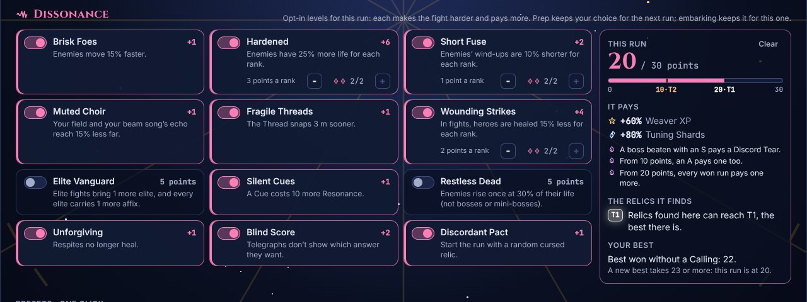
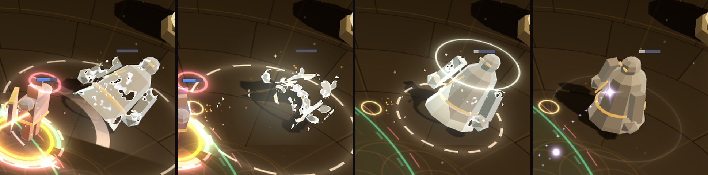

# Phase 4d — Dissonance

*2026-10-30 · plan: [docs/plan/02-game-design.md §10](plan/02-game-design.md#10-endgame-and-mastery), [03 §11](plan/03-content-bible.md#11-dissonance-difficulty-levels-after-the-first-finale-clear) · follows [Phase 4c](phase-4c.md)*

**Dissonance** is the endgame's difficulty: opt-in levels, each worth points, chosen before a run. A run's total raises its rewards. The relics it finds remember it, which unlocks the Reliquary's top tiers. The Astrolabe and the Reliquary finally have something to push against. The user chose how it works:

| Question | Choice |
|---|---|
| How much now? | **Twelve levels now**: the ten that work on existing systems, plus Restless Dead (enemies rise again) and Blind Score (telegraphs hide their answer). **Tyrant, Mimicry and True Dissonance** wait for Phase 5's bosses and affixes. |
| When does it open? | **After your first win at Rank 15 or above.** You have the Astrolabe and a Reliquary to bring, and Rank 20 is still ahead to chase at higher difficulty. |
| How does it unlock T2 and T1? | **Relics remember.** Like item level in PoE: a relic enshrined from a run at 10 points or more can Ascend to T2, and at 20 or more to T1. Its Inscribes roll higher there too, so a mirror-tier relic means winning hard runs. |

## How it works

- **Opening.** The first win at Rank 15 or above opens Dissonance, with a card at the Summary. "Skip the unlocks" opens it too.
- **Choosing.** In Prep, turn levels on (some have ranks). Their points add up to the run's **Dissonance**. Prep remembers your last choice, and embarking freezes it for the run. A Discordant Pact with nothing to give (you carry every cursed relic) isn't played and adds no point.
- **Rewards**, for a run at *n* points:
  - Weaver XP is +3% a point.
  - Tuning Shards are +4% a point.
  - From 10 points, a boss beaten with an A (not only an S) pays a Discord Tear. From 20, every win pays one more.
- **Grades stay fair.** A fight's par grows with the life Dissonance adds (Hardened, and Restless Dead outside boss and mini-boss fights), so a fight that takes longer because its enemies have more life doesn't grade lower.
- **Relics remember.** A relic enshrined from a run keeps that run's points as its **depth**. Depth sets how far crafting can take it (see *The Reliquary's tiers*). Relics enshrined before Dissonance have depth 0.
- **Records.** The profile keeps the highest Dissonance you've won at, for each Calling and for none. The Codex and Prep show them, and clearing a new total is marked at the Summary.
- **What it changes.** Most levels are numbers in the fight. Restless Dead and Elite Vanguard change who you fight. Unforgiving and Discordant Pact change the run. Blind Score changes only what you see.

## The levels

Points follow each level's measured difficulty (see *Harness*): a point is worth about 8% more enemy life to a Rank-20 build.

| | Level | Effect | Ranks | Points |
|---|---|---|---|---|
| 1 | **Brisk Foes** | enemies move 15% faster | 1 | 1 |
| 2 | **Hardened** | enemies have 25% more life | 2 | 3 each |
| 3 | **Short Fuse** | enemies' wind-ups are 10% shorter | 2 | 1 each |
| 4 | **Muted Choir** | your field and your beam song's echo reach 15% less far (past the field's cap and in Sunrise too) | 1 | 1 |
| 5 | **Fragile Threads** | the Thread snaps 3 m sooner | 1 | 1 |
| 6 | **Wounding Strikes** | in fights, heroes are healed 15% less | 2 | 2 each |
| 7 | **Elite Vanguard** | elite fights bring one more elite, and every elite an extra affix | 1 | 5 |
| 8 | **Silent Cues** | a Cue costs 10 more Resonance | 1 | 1 |
| 9 | **Restless Dead** | enemies rise once at 30% life (not bosses or mini-bosses); nothing touches them while they stand up | 1 | 5 |
| 10 | **Unforgiving** | Respites no longer heal (resting, or meditating and skipping the draft) | 1 | 1 |
| 11 | **Blind Score** | telegraphs don't show which answer they want | 1 | 2 |
| 12 | **Discordant Pact** | start the run with a random cursed relic, one you don't carry; it can't be enshrined | 1 | 1 |

At most **30** points. Tyrant (bosses gain a mechanic per phase), Mimicry (a Mimicking affix) and True Dissonance (the Finale's fourth phase) come with Phase 5.

## The Reliquary's tiers

A relic's **depth** (the Dissonance of the run that found it) sets its band:

| Depth | Ascend reaches | Inscribe rolls T5 / T4 / T3 / T2 / T1 | A Cursed Dissonate raises to |
|---|---|---|---|
| 0–9 | T3 | 60 / 30 / 10 / 0 / 0 | T2 |
| 10–19 | **T2** | 45 / 30 / 17 / 8 / 0 | **T1** |
| 20+ | **T1** | 35 / 30 / 20 / 10 / 5 | T1 |

Ascend's odds are unchanged (T3→T2 35%, T2→T1 20%), and so are its costs and Instability. Reaching T1 is still a gamble.

## Contracts (v12)

**Content** (`CONTENT_VERSION` bump):
- `dissonance`: the levels, `{ id, name, text, ranks, points, values }`. `values` holds each level's numbers (`pct`, `metres`, `resonance`…), and the text is built from them.
- `dissonanceRules`: the Rank that opens it (15), the reward per point (XP, shards) and the Tear thresholds.
- `reliquary.bands`: the depth bands above, replacing `tierCap` and Inscribe's `tierOdds`, which become band 0.

**Sim** (`SIM_VERSION` 16):
- `SimConfig.dissonance?: { id, rank }[]` folds into the mods:
  - enemies' speed and life;
  - the wind-up multiplier, alongside the assist (an enemy healer's hymn pulses closer with it, so it heals as many times);
  - the field's and echo's radius (`dissonanceRadiusMult`, after the cap and Sunrise), and the Thread's reach;
  - healing received by heroes;
  - the Cue's cost;
  - Restless Dead's single rise at 30%: untouchable while it stands up (`rising(e)`: hits and statuses pass, heroes target something else);
  - Elite Vanguard's extra elite (its spawn point drawn as any spawn's) and affixes, rolled on their own stream from the fight's seed, the wave and the group.
- `WorldState.dissonance: { levels, blindScore, cueCost }` for the views. An absent Weaver's re-run keeps the enemies' levels: the "without you" party faces the same fight.
- `WeaverComponent.threadRange`: the Thread's reach this fight (the tree, relics and Fragile Threads move it), for the views and the bots.

**Meta** (`meta/dissonance.ts`, pure):
- `fitLevels(levels)`, `dissonancePoints(levels)`, `maxDissonance()` and `opensAt(rank)`;
- `xpMult(points)`, `shardsMult(points)` and `tearsFor(run, tearGrade)`;
- `parMult(levels, kind)`: how much longer a fight's par is.

`band(depth)` and `nextBandDepth(depth)` are the Reliquary's (`meta/reliquary.ts`).

**Profile v5:**
- `dissonance: { open, levels, best }`: whether it's open, the last choice, and the best won total per Calling (`none` for no Calling).
- `ReliquaryRelic.depth` (0 for relics enshrined before).

**Run:**
- `RunState.dissonance: { id, rank }[]`: chosen in Prep, frozen at embark. Old saves have none.
- `playedDissonance(run)`: the levels a run in Prep will play (a Pact with nothing to give dropped); embark freezes it.
- The XP and shards of its fights and its end scale with its points; each fight's par with `parMult`.
- Unforgiving: `restHeal(run)` and `skipHeal(run)` are 0 at Respites, and embark rewrites the map's Respites to say so.
- Discordant Pact's relic is marked `OwnedRelic.pact` and left out of `enshrineOptions`.

**Stores:**
- The profile store gains `setDissonance(levels)` and records the best on a win, opening Dissonance on the first win at Rank 15+.
- The run store takes the choice into a new run and freezes it at embark. A won run replaced at its Result (a new run before its Summary) records its Dissonance as the Summary would.

## Presentation

**Screens** (the UI workstream: [phase-4d/ui.md](phase-4d/ui.md), with every view in the lab under *Dissonance*):
- **Prep**: a Dissonance panel after the Calling picker. Every number on it comes from content and the meta's functions, so it follows any retuning.
  - Each level is a switch with its points and text. Levels with ranks get a stepper.
  - The total is shown out of 30, on a bar marked at each band (10 · T2, 20 · T1).
  - It shows what the total pays (XP, shards, and the Tear rules on or locked), how deep its relics will be, and the best for the chosen Calling with what a new best takes.
  - A Pact with nothing to give says so and adds no point.
  - While Dissonance is closed, the panel says how it opens.
- **Summary**:
  - a *Dissonance opens* card;
  - the run's points, levels and pay, with a mark for a new best;
  - the Enshrine panel shows the relic's depth and what it reaches ("Won at 12 Dissonance: its Inscriptions can reach T2").
- **In a fight**:
  - A chip shows the points (an eye for Blind Score) and lists the levels on hover or focus.
  - The Cue arc, its label and the hints use the fight's Cue cost.
  - Par times follow `parMult`.
  - Under Blind Score, every hint, boss-bar answer, status tooltip and decree line that would name an answer is hidden.
- **The Reliquary**:
  - depth marks on the shelf, and a depth chip and line on the chosen relic;
  - Ascend's and Cursed's reach follow the relic's band;
  - a lock names the depth it waits for.
- **Codex**: a Dissonance page, locked until it opens. It holds every level, the rewards, the bands and the bests, and names Tyrant, Mimicry and True Dissonance as still to come.
- **Elsewhere**: the Rank 15 unlock, Respites and drafts under Unforgiving, and the Result's XP line ("Dissonance 10 · +30%").

**In the world** (the VFX and audio workstream: [phase-4d/vfx-audio.md](phase-4d/vfx-audio.md), with lab scenarios under *Phase 4d · Dissonance*):
- **Restless Dead**:
  - The fallen enemy topples into ash, the ash is drawn back in, and it stands up as a grave-light ring climbs it. Its bar refills in ash to 30%.
  - A risen enemy stays ash-pale, with an ash bar, so you can see it won't rise again.
  - The rise has a hollow, wrong sound: a tritone scooping up, gated to two voices.
- **Blind Score**:
  - Answer badges show a neutral **?**, keeping their place, danger, timers and the Perfect window.
  - Wind-ups no longer give the answer away by ear: they all sound like the same swell.
- **Elite Vanguard**: an elite's rim cycles through its affixes' colours, with a gem for each. Before, only the first affix showed.
- **Silent Cues**: the Resonance orbit marks the Cue's cost. Cantor's Hymnal says it's ready only when the Resonance it gives pays the Cue.
- **The other levels** are numbers the views already read from the state: the field's ring, the Thread's reach, wind-ups. Each is now tested against the real sim.

**Sound** (`src/audio/ui.ts`):
- `dissonanceToggle`: tension rises with the total, and eases as it falls;
- `dissonanceOpen`: a dark, grand sting;
- `dissonanceBest`: a clash that resolves, its top note higher with the total.

**From the workstreams**, fixed in the core:
- Prep's total, the Respite and the draft use `playedDissonance`, `restHeal` and `skipHeal`.
- Every decree is written as what's coming, then its answer, and a test holds every one of them to it: Blind Score keeps the first sentence.

## Harness

`npx tsx tools/dissonance.ts`: whole Prelude runs with a Rank-20 build (Guardian, a full 29-point tree through Overflowing Grace and the notables, and a typical carried set of three legendaries).

**Each level's cost.** The Skilled bot with this build wins 98% of runs, and still about three in four against enemies with 90% more life: it wins by surviving, so extra enemy life barely registers. The Novice bot with the same build is sensitive (85% normally, 61% against 25% more life), so each level was measured with it, 300 runs each. The cost is read as the extra enemy life that costs as much, on a logistic scale between those two baselines (one rank of Hardened = 25%), and a point is set at about 8% of enemy life.

| Level | Novice wins | Costs like | Points (first guess → now) |
|---|---|---|---|
| none | 85.3% | | |
| Hardened | 61.0% | 25% (the scale) | 3 → 3 |
| Hardened ×2 | 40.0% | 41% | 6 → 6 |
| Restless Dead | 39.0% | 42% | 3 → **5** |
| Elite Vanguard | 47.7% | 35% | 3 → **5** |
| Wounding Strikes | 69.0% | 18% | 2 → 2 |
| Wounding Strikes ×2 | 52.3% | 32% | 4 → 4 |
| Short Fuse | 80.0% | 7% | 3 → **1** |
| Short Fuse ×2 | 68.3% | 19% | 6 → **2** |
| Fragile Threads | 81.3% | 5% | 1 → 1 |
| Brisk Foes | 83.0% | 3% | 2 → **1** |
| Silent Cues | 84.0% | 2% | 1 → 1 |
| Unforgiving | 84.0% | 2% | 2 → **1** |
| Muted Choir | 87.3% | ~0 | 2 → **1** |
| Discordant Pact | 87.3% | ~0 | 1 → 1 |
| Blind Score | 85.3% | none (no effect on a bot) | 2 → 2 |

Restless Dead, Elite Vanguard, Short Fuse and Muted Choir were measured again after the review's fixes (see *Code review*): rising enemies are untouchable, the extra affixes are seeded, a healer's hymn keeps its pulses, and Muted Choir works past the field's cap. Their points held.

At these sample sizes a cost within about ±6% of zero can't be told from none. Every level is worth at least a point. Muted Choir, Discordant Pact and Blind Score cost a bot little: it doesn't place itself by the field, rarely Glides, and doesn't read answer glyphs. The Novice bot also asks for the Thread without checking its reach, so Fragile Threads' cost includes its refused attaches, as it would for a new player. A player does all three, so they keep a point or two by judgment.

**Totals** (150 runs each, the same build):

| Dissonance | Skilled wins | Novice wins |
|---|---|---|
| 0 | 98% | 85% |
| 10 (Hardened ×2, Wounding Strikes ×2) | 75% | 10% |
| 20 (and Restless Dead, Elite Vanguard) | 35% | 0% |
| 30 (everything) | 11% | |

The ladder holds. Ten points is a skilled player's comfortable challenge, so T2 is in reach. Twenty is a real one, won about a third of the time, so T1 relics are the chase. Thirty is mastery.

## Code review

An independent review read the core (9450fc0 and 29278e2 against 3e4c182) and ran scratch tests against it. It found no high-severity bug: no wrong results without Dissonance, no lost saves, no crashes. Each finding below is fixed, with a test that fails without the fix.

| Finding | Fix |
|---|---|
| **Muted Choir** was applied before the field's 14 m cap, so a field at the cap didn't shrink. Sunrise's ×1.5 also came after it. | Its own multiplier, applied after the cap and Sunrise: every song reaches 15% less. |
| **A won run replaced at its Result** (a new run before its Summary) counted as a win and paid the Reliquary, but never opened Dissonance or recorded a best. | The new run records it as the Summary would. |
| **Unforgiving**: meditating at a Respite and skipping the draft still healed 10%. | Skipping a Respite's draft heals nothing under Unforgiving, and the map's Respites say they won't heal. |
| **Discordant Pact** could cost nothing. Carrying every cursed relic (one attuned, the rest dormant) left it nothing to give, but its point still raised XP, shards and relic depth. Its relic was also offered to enshrine. | With nothing to give, it isn't played: Prep and embark leave its point out. Its relic is marked and can't be enshrined. |
| **Short Fuse** made enemy healers heal less. The Mending Hymn pulses once a second, so a shorter channel pulsed fewer times (3 → 2). | The pulses come closer as the channel shortens, so the hymn heals as many times. |
| **Restless Dead**: a rising enemy could still be hit while it stood up (a Bell Brute lost 101 of its 720 life), and a killing blow's stun landed again after the rise. | It's untouchable while it rises: hits and statuses pass, and heroes target something else. |
| **The Skilled bot** threaded anyone within the base 14 m, whatever the Thread's real reach. | The Weaver's state carries `threadRange`, and the bot reads it. |
| **Saves**: one malformed level reset the profile's whole Dissonance (open, bests). A relic whose depth wasn't a number was dropped on load. | Each field is kept or reset on its own. Such a relic loads at depth 0. |
| **Elite Vanguard's** extra affix came from a formula on the wave, so it was the same every run. Its comment was also wrong. | It's rolled on its own stream from the fight's seed, the wave and the group. |
| **Par times** ignored Hardened and Restless Dead, so harder runs graded lower. That cost S grades, Tears and grade XP. | A fight's par grows with the life Dissonance adds (`parMult`). |
| **Wounding Strikes'** text read wider than the rule, which only applies in fights. | It now says "In fights". |
| **The doc's names** differed from the code (`dissonanceOpen`, `tearsFor`). | Corrected above. |

**Checked and sound:**
- Determinism with no levels: the golden scenarios' events, ledger and entities are identical, and so is the 96-run fingerprint. The hashes moved only with `SIM_VERSION` 16 and the new `threadRange` field.
- Replays round-trip the levels.
- Every level in the fight, at its ranks.
- Opening and records: wins below Rank 15, losses and abandons; Skip the unlocks before embarking, mid-run and at the Summary; bests per Calling; a reset.
- Rewards: scaled once and rounded once; Tears at 10 and 20 points.
- The depth bands, with no path past a relic's band.
- Old v4 profiles, runs and relics.

## Known gaps

- **Some points are by judgment.** The bots read answers from the state, so they can't measure Blind Score. They also cost little under Muted Choir and Discordant Pact, which a player would feel more.
- **Discordant Pact is mild today.** There are two cursed relics: Heavy Score's curse is only "can't Glide", and a Forge can cleanse either one. It should bite when Phase 5 adds more.
- **Tyrant, Mimicry and True Dissonance** wait for Phase 5's bosses and affixes.
- **Enemy healers and longer wind-ups.** This predates Dissonance. A Mending Hymn pulses once a second, so anything that lengthens its channel heals more: the timing assist's lead and Lullaby. A Hastened healer heals less. Short Fuse is fixed (see *Code review*). The rest touches an aura, so it waits for the user's call.
- **A won run replaced before its Summary** opens Dissonance without a card: there is no Summary to show it. The next Prep shows the panel open.
- **Blind Score and decrees.** A decree is cut after its first sentence. A test holds every decree to that form; content has no separate field for its answer.
- **Display:**
  - the HUD's relic bar doesn't mark the Pact's relic (the run's relic strip and the Summary do);
  - the Result's Threat line shows the node's Threat, not Hardened's life on top;
  - an idle Pact shows "+0";
  - the Summary's sounds play again if it's reloaded.
- **The Training Grounds** play without Dissonance.
- **The rise** is the same topple-and-stand for every enemy model.
