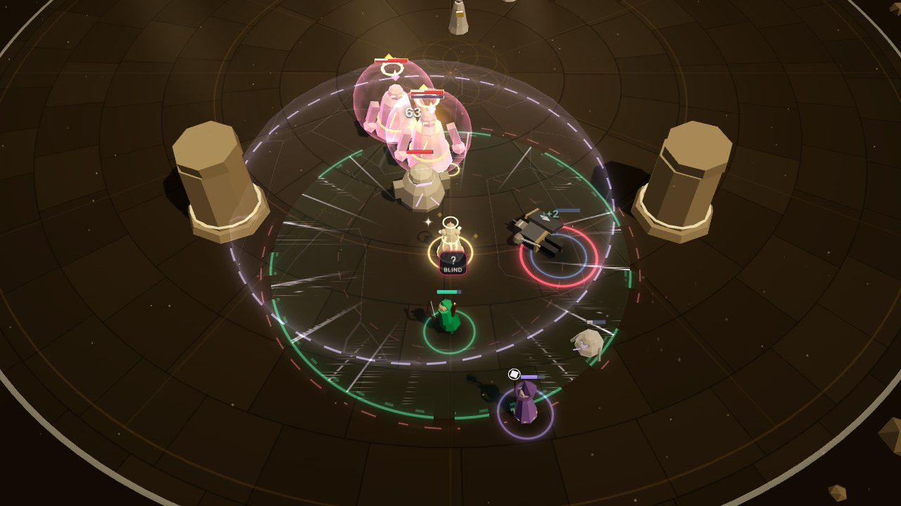

# Phase 4d: Dissonance in the fight (VFX and audio)

Dissonance (see [Phase 4d](../phase-4d.md)) is opt-in difficulty. Most of its levels are numbers,
and render already draws those from the state. This workstream shows the levels that change
what you see or who you fight:

- **Restless Dead**: an enemy rises again, once, and is marked as risen.
- **Blind Score**: telegraphs hide their answers.
- **Elite Vanguard**: an elite's second affix.
- **Silent Cues**: the Cue's cost on the Weaver's orbit.

It also adds the sound of a rise and three UI sounds for Dissonance.

**What it reads.** Render and audio read `WorldState.dissonance` (`levels`, `blindScore`,
`cueCost`), `enemy.risen`, `enemy.state`, `enemy.stateTime`, `enemy.affixes`, and the `enemyRose`
event. Every number comes from the state or the content: the rise's share of life, the Cue's
cost, the most points a run can have, and each level's effect. Nothing is in `src/sim`.

**What it leaves alone.** The auras (field bands, foot arcs, hero tints, the beam song's sheath,
hexes) look and sound as before. No new draw calls, batches or materials.

## What changed

| File | Phase 4d work |
| --- | --- |
| `dissonanceCues.ts` (new) | Pure helpers, no three.js, tested in Node. `DISSONANCE_HEX` (ash, grave-light, the blind glyph's bone white). `dissonanceLook(state)` returns Blind Score, Restless Dead and its share, Elite Vanguard, the Cue's cost, and the segment. It is rebuilt only when the levels change. A state without `dissonance` reads as none. `riseShape(t)` gives a risen enemy's pose. `RISE_SECONDS` matches the sim's `SPAWN_TIME` (tested). Also `RISEN_DESAT`, `cueTicks`, `cueReady`, `BLIND_ANSWERS`. |
| `dissonance.ts` (new) | `DissonanceView`, the rise moment on `enemyRose`. Pooled (24), it draws through the existing ring, shadow, sprite and particle batches. Exposes `fired`, `drawn`, `activeCount()`. |
| `entities.ts` | The rise's pose. The risen mark: drained colour, ash rim, ash life bar, drifting ash. A risen enemy that dies stays ashen. Elite Vanguard: `EntityRec.affixColors`; the rim takes each affix's colour in turn, with a gem per affix on the crown. The Resonance orbit reads `segment` and `max` from content (no hard-coded 25), and under Silent Cues gold ticks mark the Cue's cost. `drawnDis` counters are for tests and the lab. |
| `telegraphs.ts`, `overlay.ts` | Blind Score: a neutral **?** glyph (label *Blind*) in place of the answers. `drawn.blind` counts them. |
| `relics.ts` | Cantor's Hymnal says *CUE READY* only when the Hymnal's Resonance pays this fight's cost. |
| `combatView.ts` | Creates the `DissonanceView` and passes it events and frames. |
| `field.ts`, `fx/bars.ts`, `models/batch.ts` | Test read-backs: a field's drawn radius, a bar's values, a model instance's effects. |
| `lab/VfxLab.tsx` | **Phase 4d · Dissonance** group (below) and the `window.__VFX__` hooks. |
| `audio/sfx.ts` | The `enemyRose` sound. Under Blind Score, windups no longer name their answer. |
| `audio/ui.ts`, `audio/types.ts`, `audio/director.ts` | `dissonanceToggle`, `dissonanceOpen`, `dissonanceBest`; `DISSONANCE_LIMITS`; and `UiSoundDetail`, passed as `playUi(sound, calling?, detail?)`. |
| `audio/lab/*` | Buttons in the World and UI groups. `FakeWorld.addRisen` and `setBlindScore`. `__audioLab.auditIds` and `pitchIds`. |
| `tests/renderDissonance.test.ts` (new), `tests/audioPhase4.test.ts` | Tests (below). |

## The visuals

| Visual | When | What you see |
| --- | --- | --- |
| **The rise** | `enemyRose`; the enemy stands in `spawning` with `risen` (0.8 s) | **Struck down**, it topples onto its back and crumbles: holes eat into it, their edges a cold grave-light. A puff of dull ash shards bursts out (fewer and greyer than a death's), with an ash stain under it. **The ash gathers back**: shards drawn in from all round into its core, and a broken ring of ash closing in to its feet. **It stands up out of the ash**, re-forming as a ring of grave-light climbs its body and its life bar fills back, in ash, to what it rose with. **Back**: a thin ring runs out from its feet. No portal, no violet, nothing rising from the floor: it is a spawn's opposite. Driven by the sim's `stateTime`, so Stasis holds it mid-rise. |
| **Risen (won't rise again)** | `enemy.risen` and standing | **Drained to ash**: the model at 62% desaturation, its accents dimmed. A pale ash rim, unless an affix's colour wins it. Its **life bar is ash, not red**, and starts at the share it rose with (30%, content). **Ash drifts up off it** (about three motes a second, by quality). Struck down again it dies for good, crumbling in ash. |
| **Blind Score** | `dissonance.blindScore` | Every telegraph badge that has answers shows one neutral **?** glyph, labelled *Blind*, instead of its answers. This covers floor shapes, marks, links, the raid's badge at the Weaver and enemy cast circles. Kept: the badge's place, its **border** (threat amber, lethal red, a cast's accent), its **countdown** (marks and links), the Chronomancer's **timers**, and its **pulse in the Perfect window**. The floor shapes are drawn exactly as before. |
| **Elite Vanguard** | An elite with more than one affix | Its rim takes **each affix's colour in turn**, one per pulse of the rim (about 2 s each), crossing over at the pulse's dimmest. Its crown wears **a gem per affix**, each in the affix's colour, circling with it. A one-affix elite is unchanged: one colour, no gems. |
| **Silent Cues** | `dissonance.cueCost` isn't a whole number of segments | The orbit's four stars stay segments: lit when full and never decaying, the sim's rule. **Gold diamond ticks** on the orbit mark where each Cue's cost falls (35 and 70 at +10), dim until paid for, bright once it is. At the content's cost there are no ticks, so the orbit looks as it always has. |

Elite Vanguard checked: an elite's existing tells are its affix rim, its Shielded discord shell
and its Volatile burst. Before this, only the first affix's colour showed, so a Shielded and
Hastened brute read as Shielded alone.

**The other levels are numbers, read from the state** (each tested against the real sim):

- **Muted Choir**: the field and the echo are drawn at the chords' radius. The drawn field is the content's 15% smaller.
- **Fragile Threads**: the Thread is drawn from the sim's `threadTension` and lets go on the sim's snap, 3 m sooner. Nothing in render used the snap range.
- **Short Fuse**: telegraphs use the state's `start` and `impact`.
- **Hardened, Brisk Foes, Wounding Strikes**: life bars, motion and heal numbers come from the state and events.
- **Silent Cues**: also the Hymnal's *CUE READY*.

**Blind Score: a "?" rather than no badge.** The badge carries more than the answer: where the
threat is, its danger (the border), its countdown on marks and links, the Chronomancer's timers,
and the pulse that says "now" in the Perfect window. With no badge, all of that goes. With the
glyph, the player still knows there is something to answer, how dangerous it is and when, but
not what. The *Blind* label says the hiding is the level, not missing data.

**Settings.**

- **Flashes**: the rise's core glow and its last ring scale by `flareScale` (35% at 0). The same
  moments still draw (tested).
- **Colour vision**: ash, grave-light and the blind glyph are ΔE ≥ 20 from lethal and ≥ 15 from
  threat under every palette's simulated vision (the closest is ash at 36 from threat under
  tritanopia). The ash life bar is ≥ 20 from a living enemy's red (29 under protanopia).
  Grave-light is ≥ 15 from heal. All tested. Each also has its own shape:
  - the risen mark is drained colour, which works in any vision;
  - the rise is a pose;
  - the blind badge is a glyph;
  - the elite gems are counted shapes.
- **Quality**: shards and motes go through the particle density and caps.

## Seeing each one in the lab (`?lab=vfx`)

**Phase 4d · Dissonance** has one button per scenario and a **No Dissonance** button. Each
restarts the real sim at the scenario's levels (`SimConfig.dissonance`, found by effect), in its
encounter (the sandbox unless named), with Guardian chords. It stages the scene with real
commands and debug ops.

| Scenario | Levels | Staging |
| --- | --- | --- |
| Restless Dead · the rise | Restless Dead | Two choristers in front of Kael, Empowered |
| Restless Dead · a pack | Restless Dead | Six choristers round the party (clutter) |
| Restless Dead · risen and not | Restless Dead | Five choristers: risen beside fresh |
| Restless Dead · a brute | Restless Dead | A Bell Brute on Kael (you step back out of its cleave) |
| Blind Score · the grammar | Blind Score | Every shape, both severities, a cast circle |
| Blind Score · a fight | Blind Score | A brute's Toll Cleave, a Lamenter, a Glass Lancer |
| Blind Score · with timers | Blind Score, the Chronomancer | The grammar with timers |
| Grammar · no Dissonance | none | The grammar, for comparison |
| Elite Vanguard | Elite Vanguard (Muted Nave) | Wave 1 cleared (debug); two elite brutes, Shielded and Hastened |
| Elite · no Dissonance | none (Muted Nave) | The same wave: one Shielded brute |
| Muted Choir | Muted Choir | Lyra threaded |
| Fragile Threads · with, without | Fragile Threads; none | Kael threaded, the Weaver held 10.5 m away |
| Silent Cues | Silent Cues | Resonance 30, then 40 at 2 s |
| Every level | All twelve at top rank (Muted Nave) | Kael Empowered, Resonance 40 |

`window.__VFX__` offers:

- `dissonanceScenarios()` and `dissonanceScenario(name)`;
- `setDissonance(levels | null)`;
- `dissonanceStats()`: the levels, `blindScore`, `cueCost`, `fired`, `drawn` (`rising`, `risen`, `gems`, `cueTicks`, `blind`), each enemy (its place, def, tier, affixes, life, state, `risen`, `rising`), the Weaver's place, the field radius, the Thread's tension and Resonance;
- `screenOf(x, y, z)`, for screenshot crops.

## Verification against the real sim

`tests/renderDissonance.test.ts` (24 tests) drives real sims with Dissonance levels. It feeds the
real `EntityLayer`, `FieldView`, `TelegraphLayer`, `ThreadView`, `Feedback` and `DissonanceView`
over a real `FxKit` (headless, in Node), with a recording overlay.

- **Cues.**
  - The look follows the levels; a state without `dissonance` reads as none.
  - The rise's pose goes down and comes back, its bar filling monotonically. It is done (standing, whole, ashen, full) at `RISE_SECONDS`, which matches the sim's own rise.
  - Ticks fall at multiples of the cost, and there are none at the content's cost.
  - `cueReady` follows Silent Cues.
  - The colours, as under *Settings*.
- **The rise.**
  - Struck down, there is one `enemyRose`, one moment and no kill.
  - A third of the way in, it lies crumbling, rim and dissolve edge in grave-light, its ash bar under its share.
  - Once up: drained, an ash rim, an ash bar at its life, ash drifting; a fresh one beside it is untouched, with a red bar.
  - Struck again, it dies ashen and doesn't rise.
  - A debug clear mid-rise ends the moment, and it crumbles where it lay.
  - A wave's portal spawn has no rise and no ash.
  - Without the level, death; bosses never rise.
  - Eight struck at once all rise and are all drawn, within the particle caps.
  - At Flashes 0 the same moments draw.
- **Blind Score.**
  - The Toll Cleave's badge shows `unknown` with the same border, scale and label as without it, and the same floor shapes.
  - In a seven-shape grammar every badge is blind, the countdowns stay, and the Chronomancer's seven timers stay.
- **Elite Vanguard.** In the real Muted Nave, a two-affix brute's rim shows both colours over a few seconds, with two gems each. Without the level: one colour every frame and no gems.
- **Numbers.**
  - Muted Choir's drawn radius is the sim's, and the content's share smaller.
  - Fragile Threads lets the Thread go where the sim snaps it, and is tauter inside the shorter reach.
  - Silent Cues adds orbit ticks.
  - Short Fuse's telegraph is drawn over the sim's shorter wind-up.
- **No new draw calls.** The same fight with every level at its top rank has the same FX and model batches.

In the browser every lab scenario was run through `window.__VFX__` with fixed frames
(`manual(n, 16.67, true)`), polling `dissonanceStats()` (the counters below are from it).

## Performance

- **Draw calls.** No new draw calls, batches or materials:
  - the rise uses rings, shadows, sprites and particles;
  - the gems and ticks are sprites;
  - the risen mark is the model's existing desaturation and rim attributes, and the bar's colour.
- **CPU.** Measured in Node, warm, 600 frames: 16 choristers, four struck down a second, rising and falling. The machine was shared (load about 4–6), so p95 is noisy.

| Measure | No Dissonance | Every level |
| --- | --- | --- |
| `EntityLayer.sync`, median | 26–30 µs | 25–47 µs |
| `DissonanceView.sync`, median / p95 | under 1 µs | 0.6–2 / 9–17 µs |

- **Allocation.** Moments are pooled, and the pose, look and tick buffers are reused, so nothing is allocated per frame by construction. This was not profiled.

## Audio

All synthesised, in D dorian, in `src/audio`.

### The rise (`enemyRose`, `sfx.ts`)

A hollow, wrong-sounding rise, about 0.9 s, on the sfx bus in group `rose` (2 voices, gate
0.12 s). It doesn't duck anything and isn't `big`.

1. **Its shatter drawn back in.** A breath of grit swells backwards into the moment it was struck, with a glass A5 played in reverse.
2. **A hollow breath rising**, like wind across a bone flute: a narrow band of air on D, then on the A a fifth above.
3. **A bare tritone.** F and B, D dorian's own, in hollow triangles swell up out of nothing, then scoop up a tritone onto B and F. Each note has a twin 16 cents out of tune beating against it. It is cut off as the enemy stands.
4. **A dull knock** as it finds its feet. The knock is softer the less life it comes back with, read from the state.

**Size.** A brute, caster, controller or elite is an octave down (F2 and B2) and fuller. A swarm's
rise is lighter, since every enemy rises once. It is panned to the enemy.

**Gating.** A burst of rises from one blow is one sound. A dozen over a second gives four to ten.

**Blind Score's windups.** Windups were glass for a Chime answer and brass for a Ward or Dome.
Under Blind Score that would name the answer, so only a mark (its shape) keeps the glass, and
every other telegraph winds up as the swell.

### UI sounds (`ui.ts`)

On the UI bus, each in group `ui:<name>` with its own gate and cap (`DISSONANCE_LIMITS`).

| Id | Gate (s) / cap | What it is | How it's built |
| --- | --- | --- | --- |
| `dissonanceToggle` | 0.05 / 3 | A level turned on (or off) in Prep; its tension rises with the run's total | About 0.7 s, a string drawn tighter. A dark knock on D2. A plucked note climbs D dorian with the total (D4 at nothing, D6 at the most), with the step above it struck too, rubbing, louder the higher the total. Under them a bowed D2 swells longer and darker. From two thirds of the most, a high glass rub joins. **Taken off** (`total < from`): the rub first, falling onto the note, softer, no knock. |
| `dissonanceOpen` | 0.6 / 1 | Dissonance opened, at a Summary | About 3.5 s, dark and grand. A great brass bell on D2 (hum on D1) over a deep knock and a bowed D. A dark choir swells on D3 F3 B3 D4 (the B against the F). A breath rises out of the dark. Late and high, a glass E6 and F6 rub. |
| `dissonanceBest` | 0.6 / 1 | A new best total won | About 2.3 s, the dissonance mastered. Glass E5 against F5, then resolved: brass bells on D5 and A5 over a low knock, an open fifth sung under them (D4 A4 D5, no third), and a glass star that rings higher the higher the total (D6, up to A6 at the most). |

**The API.** `playUi(sound, calling?, detail?)`, where `UiSoundDetail` is `{ total?, from? }`.
Pass `null` as `calling`. Other sounds ignore `detail`. Without it, a toggle plays at about a
third of the tension and a best at half. The most points is the content's (every level at every
rank), so it follows the lead's retuning.

### Mix notes

Offline renders, isolated, after the limiter at default volumes, with the mixer settled first
(peak / RMS in dB):

| Sound | Peak / RMS | Compare |
| --- | --- | --- |
| The rise: a chorister; a brute; a burst of eight | −22.4 / −46.0; −19.2 / −40.9; −22.5 / −41.0 | swarm kill −21.4 / −59.3; brute kill −13.2 / −41.8; caster kill −20.9 / −47.2 |
| Blind Score: a tank-buster's windup (the swell) | −22.8 / −39.0 | the same with its brass −15.2 / −34.8; the swell (move) −19.9 / −33.9 |
| `dissonanceToggle`: total 2; half; the most; taken off; a climb | −21.0 / −45.4; −18.9 / −41.6; −16.5 / −37.8; −26.4 / −48.8; −16.3 / −34.1 | `click` −22.1 / −51.9; `pick` −22.0 / −48.6; `confirm` −20.8 / −46.5 |
| `dissonanceOpen` | −12.3 / −30.7 | `relicPick` −12.5 / −35.8; `callingPick` −12.2 / −31.8; `starKeystone` −13.2 / −32.0; `rankUp` −13.3 / −30.9 |
| `dissonanceBest`; at the most | −14.8 / −35.5; −14.7 / −35.5 | `empowered` −16.6 / −34.5; `deed` −18.7 / −40.7 |

How they sit:

- **The rise.** A chorister's peaks with a swarm's kill tick but lasts longer. A brute's is 6 dB under its kill.
- **The toggle.** It starts at `click` and `pick`'s level and grows 4.5 dB to the most. Taken off, it sits 5 to 7 dB under a level turned on.
- **Opening Dissonance** weighs what the heaviest picks do.
- **A new best** sits between `empowered` and `rankUp`.

**Key** (the lab's pitch report):

- The toggle is 94–96% in D dorian, a toggle taken off 98%, the opening 95.5% and the best 98%. The rest is glass's inharmonic partials.
- The rise is 89% (chorister) and 92% (brute). It is mostly F and B. The rest is the reversed glass, the scoops and the beating twins: the "wrong" in it.
- Every oscillator's pitch is in D dorian (tested).

**Soak.** Real fights at Restless Dead: the six skirmish and elite fights, two seeds, the skilled
bot then the novice. The fake context's sources end on time.

- 24 fights, 1,054 s, 283 rises.
- 233 rise sounds: the rest were merged by the gate.
- `rose` never above two voices, no audio warning, sources at most 141.

### Hearing it in the lab (`?lab=audio`)

- **World group:**
  - `rise-swarm`, `rise-brute`;
  - `rise-then-kill`: it rises, then dies for good 1.5 s later;
  - `rise-burst`: eight from one blow, four more over a second;
  - `tele-blind`: a tank-buster under Blind Score.
- **UI group:**
  - the three `ui-dissonance*` buttons;
  - `dis-toggle-low`, `-mid`, `-max`, `-off`;
  - `dis-toggle-climb`: level after level up to the most;
  - `dis-best-max`.

`__audioLab.auditIds(ids)` and `pitchIds(ids)` measure a few buttons (the tables above).

### Tests (`tests/audioPhase4.test.ts`, the Phase 4d blocks)

- **UI sounds.**
  - Agreed names, each with its own gate and cap.
  - Each on the UI bus in its own group, with or without a detail.
  - Distinct from each other and from 17 neighbours (`click`, `pick`, `confirm`, `back`, `unlock`, `cantAfford`, `rankUp`, `deed`, `relicPick`, `callingPick`, `enshrine`, `dissonate`, `dissonant`, `cursedRelic`, `empowered`, `reveal`, `starKeystone`). A toggle on and one off differ.
  - The toggle's note and rub follow the ladder at five totals, louder and darker as it builds, with the glass rub from two thirds.
  - Taken off: softer and fewer sources, the rub before the note.
  - The opening's notes (D1 D2, D3 F3 B3 D4, E6 F6), ringing over 3 s, heavier than a toggle.
  - The best's rub before its fifth, its star D6 or A6 by the total.
  - Every pitch in D dorian (glass partials aside), at four totals each way.
  - Mashing stays within the caps.
  - A safe no-op without an AudioContext.
- **The rise.**
  - Its own group on the sfx bus.
  - F and B for a chorister, F2 and B2 for a brute, every note on the scale to the cent, no major third.
  - Distinct from every kill, and under a brute's.
  - The gate's burst and dozen.
  - A real 40 s fight at Restless Dead: heard, within its cap.
- **Blind Score.** A Ward's and a Chime's windups become the swell, a mark stays glass, and without the level they are brass and glass.
- **The lab.** Every Phase 4d button exists and makes its sound. The climb and the burst stay within their caps.

## Screenshots

All in `docs/phase-4d/vfx/`, from the lab scenarios above (1280×720 frames, close-ups pushed in
and enlarged; Chromium headless with SwiftShader).

- `rise.jpg`: a Bell Brute's rise in four close-ups.
  - 0.07 s: struck down, toppling and crumbling, the ash ring out wide.
  - 0.27 s: lying in the ash, the stain under it, the ring closing in.
  - 0.55 s: standing up, the grave-light ring at its shoulders, its bar filling.
  - 1.0 s: risen and ashen, its ash bar at 30%.
- `pack.jpg`: six choristers. One rising, one risen with its ash bar, the rest fresh with red bars.
- `risen.jpg`: two risen choristers (grey, ash bars) beside three fresh ones.
- `blind-score.jpg`: the telegraph grammar with its answers (left) and under Blind Score (right). The same borders, countdowns and shapes.
- `blind-timers.jpg`: the grammar under Blind Score with the Chronomancer's timers.
- `blind-fight.jpg`: a real Toll Cleave on Kael (threat border) and a Glass Lancer's lance (lethal border), answers hidden.
- `vanguard.jpg`: a one-affix elite brute (Shielded: pink rim, no gems), then an Elite Vanguard brute (Shielded and Hastened) in its pink and its yellow turn, two gems on its crown.
- `muted-choir.jpg`: the field without (radius 8) and with Muted Choir (6.8).
- `fragile-threads.jpg`: Kael threaded 10.5 m away, without the level (tension 0.13, slack) and with it (0.88, taut and shimmering).
- `silent-cues.jpg`: the orbit at Resonance 30 (one star, the two ticks dim) and 40 (the first tick lit).
- `every-level.jpg`: every level at its top rank in the Muted Nave, the clutter check.
  - two Elite Vanguard brutes, gems on their crowns;
  - a Mute's dome over a cracked field;
  - a risen chorister;
  - a blind badge;
  - Kael down.

## For the UI workstream

- **Dissonance sounds.** `getAudio().playUi(sound, null, detail)`. Your `src/ui/kit/sound.ts` already takes `playUi(sound, detail)`.
  - `'dissonanceToggle'` with `{ total, from }`: the run's points after and before the click. On and off are the same name; a lower `total` than `from` eases.
  - `'dissonanceOpen'`: at the Summary card that opens Dissonance.
  - `'dissonanceBest'` with `{ total }`: the new best.
- **Blind Score in the HUD.** The HUD still shows answers:
  - `src/ui/hud/BossBar.tsx`: the boss cast's answers;
  - `src/ui/hud/hints.ts` (around line 291): the answer hint;
  - `src/ui/hudBridge.ts` (around line 278): passes the telegraph's answers through.

  Under `state.dissonance.blindScore` they should hide the answers. Render's glyph and colour are `GlyphIcon 'unknown'` and `DISSONANCE_HEX.blind`.
- **The Resonance arc** in `WeaverBar.tsx` ticks segments (`resonance.segment`). Under Silent Cues a Cue costs `state.dissonance.cueCost`, so its cost could be marked there, as the in-world orbit now does.

## Known gaps

- **The rise's pose is a topple and a stand**, the same for every enemy; there is no per-model animation. Huge or wide models (none rise: bosses and mini-bosses don't) would clip the floor a little while lying.
- **Gems show the count and colours, not the affixes' names.** The HUD names no affixes, and Shielded's shell and Volatile's burst are still the only shape tells. Two pairs of the content's affix colours are close: Volatile and Hastened under deuteranopia (ΔE 19), and Shielded and Volatile under tritanopia (12). The gem count still reads, and Shielded has its shell.
- **The Cue ticks are small**, as the orbit is. The HUD's arc is the main place to read Resonance.
- **A rise is heard for most enemies**, about one every 4.5 s in the soak. It is lighter for swarms, but at Restless Dead each enemy now makes two sounds: its rise and its death.
- **Blind Score's windups lose their brass**: a tank-buster's windup is 7.6 dB quieter as the swell. Danger stays visible (the border, the floor, the danger pulse), but the ear loses "this one's big".
- Real FPS still isn't measurable here (SwiftShader).
