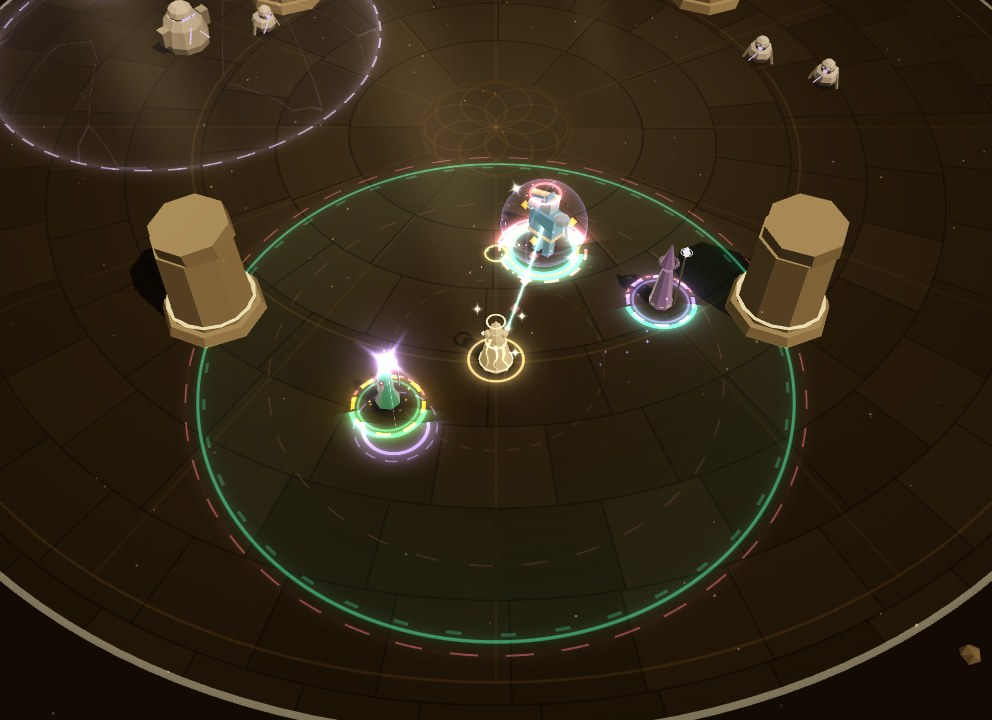

# Phase 4e: Bonds in the fight (VFX and audio)

Bonds (see [Phase 4e](../phase-4e.md)) give each hero talents and an alternate Solo. Most talents
change numbers, and render already draws those from the state. This workstream shows and sounds
the ones that **act**, each in its hero's colour and voice:

- **Kael**: Steady Vanguard, Vanguard's Roar, Riposte Bash, Unbreakable, Shieldbearer.
- **Lyra**: Wind Step.
- **Vexis**: Starthread, Event Horizon, Supernova, Constellation, Arcane Ward.
- **The alternate Solos**, while they last: Oathkeeper (Kael), Hawk's Vigil (Lyra), Celestial
  Sphere (Vexis).

It also adds five UI sounds for the Bonds screens, each voiced for its hero.

**What it reads.** Render and audio read these events:

- `talentFired` (`talent`, `hero`, `x`, `z`, `target`): a talent or alternate Solo visibly acted;
- `soloStarted` (`solo`, `hero`, `cued`);
- `abilityUsed`: Gravity Well's point, for Event Horizon;
- `attackFired`: a Constellation star's bolts (`fromX`, `fromZ`).

And these parts of the state: `hero.soloId`, `soloActive`, `soloCued`, `sphereHits`,
`sphereUntil`, `talents` and `hold`; `health.invulnerable`; `enemy.markedUntil`.

Every number comes from the content (`CONTENT.talents`, `CONTENT.altSolos`, `CONTENT.bondRules`):
reaches, seconds, hits, ranks. It was retuned twice while this was built, with no change here.
Two sim constants aren't in the content and are copied: Hawk's Vigil's extra reach (2 m) and the
nova's delay (0.3 s). A test reads each from the sim's source. Nothing is in `src/sim`.

**What it leaves alone.** The auras (field bands, foot arcs, hero tints, the beam song's sheath,
hexes) look and sound as before. No new draw calls, batches or materials: one new style in the
existing shell shader.

**Talents with no moment.** Bulwark of Faith, Hawk Eye, Ricochet, Hunter's Mark, Storm Queen, Last
Light and Overchannel change numbers or add attacks. They show through what is already drawn
(heals, arrows, bolts, hits). The sim announces no `talentFired` for them.

## What changed

| File | Phase 4e work |
| --- | --- |
| `bondsCues.ts` (new) | Pure helpers, no three.js, tested in Node. `BOND_CUES`: the 14 ids the sim announces, in content order. `cueHero`, `cueName`, `heroHex`: whose talent it is, its name and its colour, all from content. `CUE_LIFE`: each moment's length. `FREQUENT`: the five that never call out. `BONDS_HEX`: starlight and the event horizon's dark. Content readers: `oathReach(cued)`, `roarRadius`, `shieldbearerRadius`, `novaRadius`, `starSeconds`, `unbreakableSeconds`, `sphereMaxHits`, `markSeconds`. `vigilReach(hero)` is her attack range, plus Hawk Eye's, plus `VIGIL_EXTRA`, as the sim reckons it. State readers: `altSoloActive`, `sphereHits`, `sphereLeft`, `markLeft`, `bondsLook(state)`. A state without Bonds reads as none. |
| `bonds.ts` (new) | `BondsView`: a moment for each `talentFired`, and the alternate Solos' looks while they last. Moments are pooled (64), with Constellation's stars in their own pool (8). Per-hero state is in typed arrays. It draws through the existing rings, shadows, sprites, top sprites, beams, ribbons, shells and particles. Exposes `fired`, `started`, `drawn`, `drawnBy`, `lastHex`, `activeCount()`, `starsOf()` and `reachOf()`. |
| `fx/shells.ts` | `SHELL.sphere` (9): the Celestial Sphere, a branch in the existing shell shader. It has turning star points, its bands, and cracks that grow as its hits are spent. |
| `combatView.ts` | Creates the `BondsView` and passes it events and frames. |
| `lab/VfxLab.tsx` | **Phase 4e · Bonds** group (below) and the `window.__VFX__` hooks. The lab's sim takes `bonds`, a `party` and Autonomy. The other groups' scenarios start with no Bonds. |
| `audio/sfx.ts` | A sound for each `talentFired`: `TALENT_SOUND_GROUPS`, `TALENT_SOUND_LIMITS`. The alternate Solos' starts on `soloStarted`: `ALT_SOLO_SOUND_GROUPS`. |
| `audio/ui.ts`, `audio/types.ts` | `bondRankUp`, `talentPick`, `soloPick`, `sceneStart`, `sceneReply`. Also `BOND_LIMITS`, `bondVoice(hero)`, `bondOpeningRank(rank)`, and `UiSoundDetail.hero` and `.rank`. |
| `audio/lab/*` | A **Bonds** group and per-hero UI buttons. `FakeWorld.setAltSolo`, `setSphere` and `moveHero`. |
| `tests/renderBonds.test.ts`, `tests/audioPhase4e.test.ts` (new) | Tests (below). |

## The visuals

Each moment is drawn in its hero's colour from the content: Kael `#5b8def`, Lyra `#34d399`,
Vexis `#a78bfa`. What your Cue added is in the Cue's gold: cued Oathkeeper's inner ring, cued
Hawk's Vigil's star, and a cued sphere's stars.

The rare moments name themselves: the talent's name from content, in the hero's colour, at most
once per talent every 3 s. The frequent ones never do: Hawk's Vigil, Oathkeeper, the sphere,
Starthread and Constellation.

| Talent | When (`talentFired`) | What you see |
| --- | --- | --- |
| **Steady Vanguard** | Glory Hound sends Kael at your Focus | A reticle in his blue closes on your Focus, and his charge runs to it as a dashed line. A diamond of his marks it, above your Focus diamond. |
| **Vanguard's Roar** | The charge lands | A shockwave runs out from his quarry to the Roar's reach (content), with a white ring and a dashed beat at the edge. A dart of his blue runs to him from each enemy it caught, with a diamond over each, and a bellow ring opens at his feet. A light shake. |
| **Riposte Bash** | A Ward on Kael turned a blow (a Perfect Ward's included) | A beat after the Ward (0.12 s), a glint at his shield. Then his counter-swing, a lance of light to the attacker, and a star where it lands (bigger as it hits), with shards. |
| **Unbreakable** | A blow that would down him | The blow flares off him in a pillar of light. While the state says he is untouchable, six pillars of light stand round him, capped with stars. A crown ring is above, a filled ring at his feet, and his seconds run down round it. It ends when his invulnerability does. |
| **Shieldbearer** | Uncued Aegis Wall shields the heroes near him | A ring runs out to its reach (content). A run of light goes from his shield to each hero it shielded, with a star on each. Their overshields are drawn as always. |
| **Wind Step** | Lyra steps out of an attack | A dashed gust ring where she stood, her afterimage, curling wind, and a streak of her green to where she is. |
| **Starthread** | A Starbolt also strikes near the hero you Thread | Vexis's star runs to that hero (0.18 s) and flares there, with a ring. |
| **Event Horizon** | Gravity Well pulls its catch into your field | A collapsing disc of dark with a portal ring at the point it pulls to, motes spiralling in, and a dashed link from the Well. Each enemy it moved trails a dark drag streak with a starlight core, from where it stood to where it lands. A ring opens at its feet. |
| **Supernova** | Starfall's last meteor | It gathers for the sim's 0.3 s, then bursts to the nova's reach (content). A flash, rings, a scorch, a shake. |
| **Constellation** | A Cue | A star stands where the hero stood, 2.75 m up: a starlight core in her violet glow, with a thread of light to the floor. Its seconds run as a ring under it, and dashed lines join it to the other stars. Each bolt it casts flares it, with a shaft down to the bolt. It fades with its seconds (content), or when Vexis falls (the sim's rule). |
| **Arcane Ward** | Struck up close, Vexis blinks away | A fold ring and her afterimage where she was struck, a dashed run, and a ring where she lands (from the state). Her star follows her. |
| **Oathkeeper** (a hit he takes) | A hit on someone near Kael lands on him | A glint on the hero (or you) it was meant for, then a tether of his blue to him with the blow running along it. A ring as it lands on him. |
| **Hawk's Vigil** (a shot) | Lyra answers an attack | A reticle in her green snaps onto the attacker, with a star. |
| **Celestial Sphere** (a pop) | The sphere swallows a hit | Shards fly and a star breaks away. Its last hit shatters it: the shell grows and fades, and a ring opens. |

**While they last** (read from the state every frame):

| Look | From | What you see |
| --- | --- | --- |
| **Oathkeeper's reach** | Kael's `soloId` and `soloActive` | A dashed ring of his blue at the reach (content: 9 m, 12 m cued), swept out as he swears it. Cued, a thin gold ring sits inside its edge. His seconds run as an arc at his feet, and an oath sigil (a diamond in a ring) floats over his head. A ring of his blue marks the feet of each hero, and you, inside it. **While he is untouchable or held at 1 life**, he takes no one's hits (the sim's rule): the reach dims to 40% and no one is marked. |
| **Hawk's Vigil's stance** | Lyra's `soloId`, `soloActive` and `soloCued` | Her reach as a faint dashed ring (her range, Hawk Eye's and 2 m: the sim's). A settle ring as she starts. Uncued she holds still: a planted wind ring at her feet. A timer and a star over her, gold when cued. |
| **Its marks** (cued) | `enemy.markedUntil` | On each enemy she shot, for the mark's seconds: a dashed ring at its feet, a countdown and a star of her green over it. At most 16 are drawn. |
| **Celestial Sphere** | `hero.sphereHits`, `sphereUntil` | A sphere of starlight round each hero who has one (the new shell style). It forms in, flares as it pops and fades at the end. Its cracks grow as its hits are spent. Its hits left circle it as stars, gold when cued. |

**Settings.**

- **Flashes**: the moments' cores (stars, glows, the bastion's flare) scale by `flareScale` (35%
  at 0). The same moments still draw (tested).
- **Colour vision**: each moment is its hero's colour, which is already who they are in the fight.
  Starlight is far from danger in every vision: ΔE ≥ 78 from lethal and ≥ 47 from threat (the
  closest, under tritanopia). The tests require 20 and 15. Each moment also has its own shape:
  pillars, tethers, spheres, stars, reticles and streaks.
- **Quality**: motes and shards go through the particle density and caps.

## Seeing each one in the lab (`?lab=vfx`)

**Phase 4e · Bonds** has one button per scenario and a **No Bonds** button. Each restarts the real
sim with the scenario's talents and Solos (`SimConfig.bonds`), in its encounter (the sandbox unless
named), with Guardian chords. It stages the scene with real commands and debug ops. Each button's
tooltip says what happens, with its numbers from content.

| Scenario | Bonds | Staging |
| --- | --- | --- |
| Steady Vanguard | Steady Vanguard (First Light) | Wave 1 cleared (debug); an elite Bell Brute is set as your Focus off to the side, just before wave 2 arrives |
| Vanguard's Roar | Vanguard's Roar (First Light) | Wave 1 cleared; Glory Hound sends Kael at wave 2's brute |
| Riposte Bash | Riposte Bash | A Bell Brute beside Kael; you Ward him in its Toll Cleave's Perfect window |
| Unbreakable | Unbreakable | Kael held (debug) and Mended to a sliver; three brutes land the blow that would down him |
| Shieldbearer | Shieldbearer | Kael held and Mended to a sliver, his Solo full; he braces (Aegis Wall, uncued) beside Lyra and Vexis |
| Wind Step | Wind Step | Two elite Glass Lancers across the party aim at Lyra |
| Starthread | Starthread | Kael threaded, a Bell Brute on him |
| Event Horizon | Event Horizon | Elite Lamenters bunched outside your field |
| Supernova | Supernova | Three brutes ahead; you Cue Vexis |
| Constellation | Constellation, Oathkeeper, Hawk's Vigil | You Cue Kael, then Lyra: two stars, joined |
| Arcane Ward | Arcane Ward (Vexis and Lyra) | Choristers close in on Vexis |
| Oathkeeper · cued, · uncued | Oathkeeper | Cued: choristers on Lyra and Vexis. Uncued: Autonomy, choristers on Lyra |
| Hawk's Vigil · cued, · uncued | Hawk's Vigil | Cued: brutes, a Lancer and a Lamenter ahead. Uncued: Autonomy, Kael and Lyra |
| Celestial Sphere · uncued, · cued | Celestial Sphere | Uncued: Autonomy, Kael threaded, a brute on him. Cued: every hero in your field, choristers testing them |
| Every talent | A talent of every kind and the Sphere (Muted Nave) | Autonomy on, Kael threaded: the clutter check |

`window.__VFX__` offers:

- `bondScenarios()` and `bondScenario(name)`;
- `setBonds({ talents, solos } | null)`;
- `bondStats()`: the talents and Solos; `fired`, `started`, `drawn` and `drawnBy`; the colour each
  talent was last drawn in; each hero (place, def, life, Solo, `soloActive`, `soloCued`, sphere
  hits, `invulnerable`, and the reach drawn); each enemy (place, def, `marked`); the stars; the
  Weaver's place; the time;
- `screenOf(x, y, z)`, for screenshot crops.

## Verification against the real sim

`tests/renderBonds.test.ts` (24 tests) drives real sims with Bonds (`SimConfig.bonds`). It feeds
the real `EntityLayer` and `BondsView` over a real `FxKit` (headless, in Node), with a recording
overlay. It checks the colours each moment pushes, batch by batch.

- **Cues.**
  - There is a cue for every id the sim announces: its sources are scanned for
    `talentFired(world, …, 'id'`. Each cue has its hero, from content.
  - Every number is the content's.
  - Hawk's Vigil's reach is the sim's `attackRange` plus the extra read from its source. The
    nova's delay is read from the sim's source too.
  - A state without Bonds reads as none.
  - Starlight stays apart from danger in every colour vision.
- **Kael.**
  - Riposte Bash: the counter is drawn in his blue at the attacker, and named.
  - Unbreakable: the flare, then his bastion for exactly as long as he is untouchable.
  - Shieldbearer: it fires as Aegis Wall goes up uncued, in his blue.
  - Steady Vanguard and the Roar: through the sim's own `onPackArrived`, in his blue, the Roar
    named.
- **Lyra and Vexis.**
  - Wind Step: a gust in her green, named.
  - Arcane Ward: she blinks the content's metres, in her violet.
  - Event Horizon: the enemies it pulled are drawn dragged.
  - Supernova: drawn in her violet, and named.
  - Starthread: her star runs to the hero you Thread, with no callout.
  - Constellation: a star per Cue for its seconds, flaring with each bolt, linked, and gone after;
    a star fades when Vexis falls.
- **The alternate Solos.**
  - Oathkeeper: its reach (content's, farther when cued) and who stands under it. A tether for
    each hit it takes, on a hero or on you. Dimmed, with no one under it, while Kael is
    untouchable. It ends with the Solo.
  - Hawk's Vigil: her stance and reach while it lasts, a shot at each attacker, its marks.
  - Celestial Sphere: its hits as stars; each swallowed hit pops one; the last shatters it. Cued,
    every hero in your field has one, with stars in your Cue's gold.
- **Every moment.**
  - Each is drawn in its hero's colour, at Flashes 1 and at 0.
  - An event before its hero is drawn waits for it; an unknown talent is ignored.
  - A busy First Light with every kind of talent draws under 160 instances a frame, with the same
    batches as no Bonds.

In the browser every lab scenario was run through `window.__VFX__` with fixed frames
(`manual(n, 16.67, true)`), polling `bondStats()` until its cue fired or its Solo started.

## Performance

- **Draw calls.** No new draw calls, batches or materials:
  - the moments use rings, shadows, sprites, top sprites, beams, ribbons and particles;
  - the sphere is a shell: a new style is a branch in the existing shader, not a material.
- **Instances.** A busy fight draws under 160 of Bonds' instances a frame, well inside the shared
  batches (rings 384, sprites 256, beams 160), as tested.
- **CPU.** Measured in Node, warm: 40 s of First Light with Autonomy and Kael threaded every 5 s;
  with Bonds, a Cue every 7 s. The machine was shared, so p95 is noisy.

| `BondsView.handle` + `sync` | Median | p95 |
| --- | --- | --- |
| No Bonds | 0.9 µs | 2.5 µs |
| Talents of every kind and the Sphere | 1.5 µs | 9.3 µs |
| Oathkeeper and Hawk's Vigil, and four talents | 1.8 µs | 9.1 µs |

For scale, `EntityLayer.sync` took 16–20 µs.

- **Allocation.** Moments and stars are pooled, and per-hero state lives in typed arrays, so
  nothing is allocated per frame by construction. This was not profiled.

## Audio

All synthesised, in D dorian, in `src/audio`. Each hero has a voice, from their leitmotif:

- **Kael**: horn and brass, on D.
- **Lyra**: flute and pluck, on A.
- **Vexis**: glass, on B against F (her tritone).

### The talents (`talentFired`, `sfx.ts`)

On the sfx bus, panned to where it acted, each in its own group with its own gate and cap
(`TALENT_SOUND_LIMITS`). Wind Step and Arcane Ward are gated per hero.

| Talent | Group | Gate (s) / cap | What it is |
| --- | --- | --- | --- |
| Steady Vanguard | `talent:steady` | 0.5 / 1 | Kael on your mark: a firm horn call, A2 up to D3, with a soft knock under it. |
| Vanguard's Roar | `talent:roar` | 0.6 / 1 | His bellow: horns on D2 and A2 with a growl of air in them, and a horn D3 over it. |
| Riposte Bash | `talent:riposte` | 0.25 / 2 | The counter-clang a beat (0.12 s) after the Ward: struck brass on A3, a click, a knock on D2. |
| Unbreakable | `talent:unbreakable` | 1 / 1 | He stands. A deep knock, a great brass bell on D2, a defiant horn climbing D3 to D4, and a glass D6 shimmering while he is untouchable (content's seconds, plus 1). It ducks the music and bypasses the sfx duck. |
| Shieldbearer | `talent:shieldbearer` | 0.5 / 1 | His shield is the party's: a brass bell on D4, a plucked A4 and a breath outward. A glint for each hero beside him (A5, D6, E6), counted from the state. |
| Wind Step | `talent:windStep` | 0.3 / 2 | A quick gust and a flute's grace note, E5 to A5. |
| Starthread | `talent:starthread` | 0.25 / 2 | Glass B5, a breath of it travelling, then F6 as it flares on the hero you Thread. |
| Event Horizon | `talent:horizon` | 0.5 / 1 | Air sucked downward, a glass B4 drawn in backwards, a low F2 knock as they land, a ping on F5. |
| Supernova | `talent:supernova` | 0.6 / 1 | The gather is glass B5 drawn in backwards. Then the nova: a crack of light, a deep knock, glass B5, D6 and F6, a choir's D F B, a shimmer. It ducks the music and bypasses the sfx duck. |
| Constellation | `talent:constellation` | 0.2 / 2 | A star placed: glass D6, then A6 and E7 above it. |
| Arcane Ward | `talent:arcaneWard` | 0.3 / 2 | Glass B5 drawn in backwards as she folds away, and a ping on F6 where she lands. |
| Oathkeeper | `talent:oath` | 0.09 / 3 | A hit he took: a muted knock on his shield (D3) and its dull ring on D4. Three sources. |
| Hawk's Vigil | `talent:vigil` | 0.07 / 3 | A tight pluck, turning A5, C6, E6 shot by shot, and a string's snap. Cued, each marks: a small glass E6. |
| Celestial Sphere | `talent:sphere` | 0.06 / 3 | A glass pop on B5. Its last hit breaks it: a fuller shatter, falling through F5 to B4. |

**The frequent ones** (Hawk's Vigil, Oathkeeper, the sphere) are two or three quiet sources (the
sphere's last pop, five), under 0.8 s. They are well under a Ward, and the gate holds a burst to a
few. A star's bolts have
no sound of their own; their hits sound as any hit does.

### The alternate Solos' starts (`soloStarted`)

The default Solos are heard through the Cue's leitmotif, as before. The alternate ones start, cued
or not, with a sound of what they ask of you. Each is in its own group (`ALT_SOLO_SOUND_GROUPS`),
gated per hero (1 s). Cued, the Cue's leitmotif plays with it, so it plays at 70% gain.

| Solo | What it is |
| --- | --- |
| Oathkeeper | The oath sworn: a held horn D3 over a bowed D2, and a brass bell on D4. |
| Hawk's Vigil | A held breath: air drawn in, a flute's A5 held, a string drawn taut (glass E6). |
| Celestial Sphere | The sphere closing: glass B5 drawn in backwards, then B5 and F6 ringing, a D7 star, and a breath. |

### UI sounds (`ui.ts`)

On the UI bus, each in group `ui:<name>` with its own gate and cap (`BOND_LIMITS`). They are warm
and personal: each hero's own instrument and note, never the Weaver's gold rank-up. A hero's
**heart** is their motif's first note, folded into the fifth octave: Kael's D5, Lyra's A5,
Vexis's B5.

| Id | Gate (s) / cap | What it is | How it's built |
| --- | --- | --- | --- |
| `bondRankUp` | 0.4 / 2 | A hero's Bond grew a rank | About 2.4 s. A warm bed by the fire: a low bowed D and a hummed F A D, with no low root. Over it, their own theme softly in their own voice, then a glass note on their heart. A rank that opens a talent tier or the alternate Solo (from content) answers it with a second glass note, a fifth up their scale: something new to choose. |
| `talentPick` | 0.06 / 3 | A talent chosen | About 0.7 s. Their heart plucked an octave down, the fifth up their scale after it, and a touch of their instrument on top: Kael's brass, Lyra's flute, Vexis's glass. |
| `soloPick` | 0.15 / 2 | A Solo chosen (their own or the alternate) | About 1.3 s, weightier. The first three notes of their theme in their own voice, over a soft low knock and a bowed D2, with a breath as it settles. |
| `sceneStart` | 0.8 / 1 | A scene begins at a Respite | About 3 s and quiet. A fire's low rumble and crackle, a warm drone (a bowed D2 and a soft A2), and a held breath. Late and low, the hero looks up: a soft note of theirs. |
| `sceneReply` | 0.15 / 2 | A reply chosen | About 0.8 s, small. Their heart plucked an octave down, answered a third above in their own voice, with an ember of crackle. |

**The API.** `playUi(sound, calling?, detail?)`, where `UiSoundDetail` takes `{ hero?, rank? }`
(and Phase 4d's `total` and `from`). Pass `null` as `calling`. An unknown or missing hero plays a
shared voicing, plucked, with no theme (a gentle D F A D for a rank-up). Without `rank`, a rank-up
rings no second note.

### Mix notes

Offline renders, isolated, after the limiter at default volumes, with the mixer settled first
(peak / RMS in dB, from `__audioLab.auditIds`):

| Sound | Peak / RMS | Compare |
| --- | --- | --- |
| Unbreakable; Supernova | −10.6 / −31.4; −11.9 / −37.7 | `save` −9.7 / −30.9; `hit-big` −11.1 / −40.0; `kill-brute` −14.0 / −42.2 |
| Roar; Riposte; Steady; Shieldbearer; Wind Step; Event Horizon | −17.5 / −35.5; −17.9 / −43.6; −20.6 / −41.0; −20.6 / −43.4; −19.8 / −39.2; −20.7 / −46.6 | `ward` −13.9 / −36.4 |
| Riposte with its Perfect Ward | −5.1 / −22.7 | `perfect` alone −5.1 / −22.4 |
| Starthread; Constellation; Arcane Ward | −29.8 / −54.9; −29.7 / −52.7; −29.3 / −55.2 | `hit-small` −23.1 / −51.5 |
| Oathkeeper; Hawk's Vigil (cued); a sphere's pop (its last) | −24.5 / −54.1; −25.9 / −58.2 (−26.2 / −56.9); −29.7 / −55.9 (−24.9 / −51.2) | `kill-swarm` −23.5 / −59.5 |
| 20 Oathkeeper hits in a second; 20 Vigil shots | −24.2 / −43.4; −24.6 / −47.6 | |
| Alternate Solo starts: Oathkeeper; Vigil; Sphere | −20.8 / −36.1; −24.4 / −38.2; −26.5 / −49.1 | |
| The same, cued (with the leitmotif) | −12.2 / −27.0; −10.7 / −29.3; −14.0 / −31.9 | the Cue alone: Kael −14.1 / −27.2; Lyra −10.3 / −28.8; Vexis −14.1 / −32.0 |
| `bondRankUp`: Kael; Lyra; Vexis; an opening rank; no hero | −18.9 / −32.3; −17.0 / −33.4; −19.8 / −35.4; −18.2 / −32.2; −22.0 / −37.9 | `rankUp` −13.3 / −31.2; `deed` −18.8 / −40.7 |
| `talentPick`: Kael; Lyra; Vexis | −21.8 / −47.0; −23.8 / −44.6; −21.0 / −47.6 | `pick` −22.0 / −48.6; `confirm` −20.8 / −46.4 |
| `soloPick`: Kael; Lyra; Vexis | −19.4 / −35.0; −17.1 / −37.0; −18.8 / −38.8 | `callingPick` −12.4 / −31.7 |
| `sceneStart`: Kael; Vexis | −24.0 / −39.5; −24.2 / −40.6 | |
| `sceneReply`: Kael; Lyra | −26.0 / −44.3; −25.4 / −45.3 | `back` −24.7 / −49.6 |

How they sit:

- **The big ones**: Unbreakable and Supernova weigh what a save or a heavy hit does.
- **Riposte** with its Perfect Ward measures as the Perfect alone (the same peak, RMS within
  0.3 dB): the Perfect stays the moment.
- **The frequent ones** sit with a small hit or a swarm's kill, and a second of them stays at a
  small hit's peak.
- **Cued**, an alternate Solo's start sits inside its Cue's leitmotif (within 2 dB of its peak).
- **A Bond's rank-up** is 4 to 6.5 dB under the Weaver's at its peak, and 1 to 4 dB in RMS.
- **The picks.** A talent's sits with `pick`, and a Solo's peaks 3 to 5 dB above it.
- **A scene.** Its opening is the quietest at its peak, but long. A reply sits with `back`.

**Key** (the lab's pitch report, share of pitched energy in D dorian):

- The UI sounds: 93–100%.
- The alternate Solos' starts: 99.8–100%.
- Eleven talents: 92–100%.
- Event Horizon (63%), Oathkeeper (68%) and Supernova (72%) are mostly their knock. A knock falls
  from its note to about half its pitch, and its noise has no pitch. The same knock makes
  `hit-big` 57%, `down` 60% and `kill-brute` 79%.
- Every note starts in D dorian (tested). Only a knock's fall and glass's inharmonic partials
  leave it.

### Hearing it in the lab (`?lab=audio`)

- **Phase 4e · Bonds** group:
  - `talent-<id>`: each talent acting;
  - `talent-vigil-cued`, `talent-sphere-last`, `talent-shieldbearer-alone`, and
    `talent-riposte-perfect` (with its Perfect Ward);
  - `altsolo-<id>` and `altsolo-<id>-cued`;
  - `talent-vigil-burst` and `talent-oath-burst`: 20 in a second;
  - `talent-every`: each talent in turn, 0.6 s apart.
- **UI group:**
  - the five `ui-*` buttons;
  - for each hero: `bond-rank-<hero>`, `bond-rank-<hero>-talent` (a talent rank, from content),
    `bond-talent-<hero>`, `bond-solo-<hero>`, `bond-scene-<hero>` and `bond-reply-<hero>`.

### Tests (`tests/audioPhase4e.test.ts`, 30 tests)

The tests use a recording fake AudioContext, whose sources end on time.

- **Talents.**
  - Every id the sim announces has a sound, read from its sources, and only known ids do.
  - Each plays on the sfx bus in its own group, and nothing on the UI bus.
  - Each is distinct from the others and from the sounds it sits with.
  - Each says what happened in its hero's notes. Riposte is A3 over D2; Unbreakable D2, D3, D4.
  - Every pitch is in D dorian, to the cent below glass.
  - The frequent ones stay light: few sources, under a Ward's and Unbreakable's peaks, short.
  - Each is gated: a burst stays within its cap, and Wind Step and Arcane Ward are gated per hero.
  - Shieldbearer's glints are counted from the state.
  - Hawk's Vigil's notes turn, and a cued shot has its glass.
  - The sphere's last pop is fuller.
  - Riposte comes a beat after its Perfect Ward, and under it.
  - Unbreakable and Supernova are heavier than the rest.
- **The alternate Solos' starts.**
  - Each has its own group, with or without a Cue; the default Solos have none of these.
  - Their notes are as described above.
  - A double start is one sound.
- **A real fight.** First Light with Autonomy and nine talents and Oathkeeper, 45 s: the talents
  are heard, each within its cap, and nothing throws.
- **UI sounds.**
  - They are agreed `UiSound` names with their own gates and caps.
  - Each plays on the UI bus in its own group, for each hero.
  - They are distinct from each other and from 17 neighbours.
  - A rank-up has the hero's leitmotif, a glass heart and a bowed D2, and no D6 (the Weaver's).
  - The second glass rings exactly at the content's opening ranks.
  - Picks and replies are in each hero's voice.
  - A scene's opening is quiet, long and crackling.
  - Every pitch is in D dorian.
  - Mashing stays within the caps.
  - They are a safe no-op without an AudioContext, and an odd state doesn't throw.
- **The lab.** Every button exists, makes its sound, and stays within its cap.

## Screenshots

All in `docs/phase-4e/vfx/`, from the lab scenarios above (1280×720 frames, cropped; Chromium
headless with SwiftShader).

- `kael.jpg`:
  - Steady Vanguard: the reticle on the elite brute you Focused, the charge line;
  - Vanguard's Roar: the shockwave at the pack, darts to Kael;
  - Riposte Bash: the counter-swing and the lance, beside the Perfect Ward's bloom;
  - Shieldbearer: the ring out, runs of light to Lyra and Vexis, their overshields.
- `unbreakable.jpg`: the flare as the blow lands, then the bastion while he is untouchable.
- `lyra.jpg`: Wind Step (the gust and her streak as she steps out of a lance); Hawk's Vigil cued,
  its marks on two brutes.
- `vexis.jpg`:
  - Starthread: her star flaring on Kael;
  - Event Horizon: the Lamenters dragged into your field;
  - Arcane Ward: the fold where she was struck, the run, the landing;
  - Supernova: the burst.
- `supernova.jpg`: the gather (the last meteor) and the burst.
- `constellation.jpg`: two stars, over Kael and by Lyra, joined, with cued Oathkeeper's reach and
  Hawk's Vigil's stance.
- `oathkeeper.jpg`: uncued (9 m) as Kael raises it; cued (12 m, the gold ring), a tether from
  Vexis, the rings at Lyra's, Vexis's and the Weaver's feet.
- `hawks-vigil.jpg`: uncued (her stance planted, the timer) and cued (the gold star, marks on
  enemies).
- `celestial-sphere.jpg`: the sphere on Kael, a pop, and cued spheres on all three (gold stars).
- `every-talent.jpg`: the clutter check in the Muted Nave.

## For the UI workstream

The five sounds are already wired, in `kit/bondLook.ts` (`BOND_SOUNDS`), through
`playUi(sound, detail)` in `src/ui/kit/sound.ts`, which calls
`getAudio().playUi(sound, null, detail)`:

- `'bondRankUp'` with `{ hero: 'kael' | 'lyra' | 'vexis', rank }`: the rank reached. An opening
  rank rings its second note.
- `'talentPick'`, `'soloPick'`, `'sceneStart'` and `'sceneReply'` with `{ hero }`.

## For the sim workstream (what render mirrors)

Render reads only the state and events, so where the sim keeps something to itself, render copies
the rule, and tests watch the copy:

- **Constellation's stars** are sim-internal (`world.internal.stars`). Render places a star from
  its `talentFired` and gives it the content's seconds. It fades it when Vexis falls, as the sim
  does. A read-only `stars` (`x`, `z`, `until`, `source`) in `WorldState` would let render read
  them instead.
- **Two constants**: Hawk's Vigil's extra reach (`+ 2` in `solos.ts`) and the nova's delay
  (`world.time + 0.3`). Tests read both from the sim's source. Exported, or in the content, render
  would import them.
- **Event Horizon**: the event gives the point it pulls to. Render finds the enemies it pulled from
  how far their records moved that frame (more than 0.3 m). A list of the pulled enemies on the
  event would make that exact.
- **Oathkeeper**: render marks who stands under it: the heroes, and the Weaver, within its reach.
  It dims it while Kael is untouchable or held. This follows `oath()` in `health.ts`.

## Known gaps

- **Rare talents are named; frequent ones aren't.** Hawk's Vigil, Oathkeeper, the sphere,
  Starthread and Constellation never call out: they would bury the field. Their shapes carry them.
- **Event Horizon's drag** is drawn from the render records, so an enemy pulled less than 0.3 m
  has no streak.
- **Marks**: at most 16 are drawn at once.
- **Your Solo's look.** A default Solo cued or uncued looks as it always has. Only the alternate
  ones have looks of their own here.
- **A star's bolts** have no sound of their own, only their hits'.
- **No soak.** The real-fight test is one 45 s fight, not the 24-fight soak Phase 4d ran.
- Real FPS still isn't measurable here (SwiftShader).
