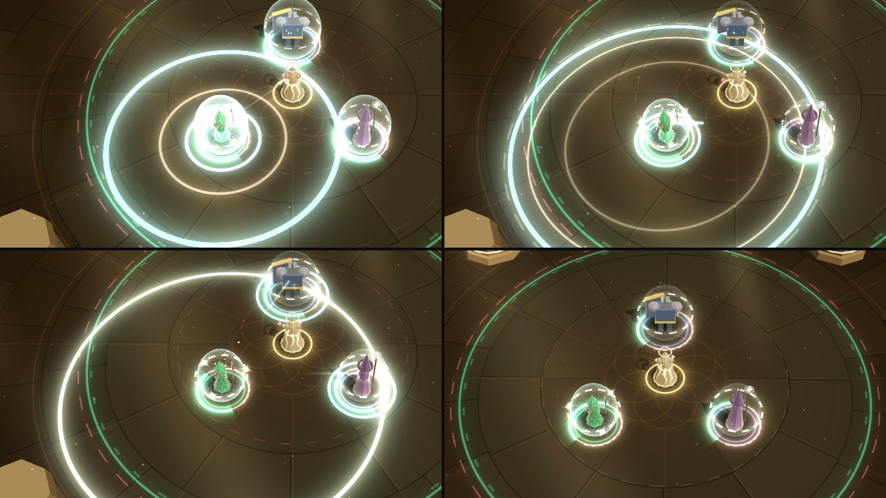

# Phase 4f: technique variants in the fight (VFX and audio)

Technique variants (see [Phase 4f](../phase-4f.md)) give each of the Weaver's four techniques two
other ways to save someone. This workstream shows and sounds each one, in her own technique
language: the Ward's shield, the Chime's lavender and gold notes, the Thread's colour for a Reel,
her gold for a Glide, and her voice (glass, handbell, pluck, choir and breath on the music's chord).

- **Ward**: Chorale and Aegis Link.
- **Chime**: Purge and Absolve.
- **Reel**: Swap and Anchor.
- **Glide**: Phase Step and Skate.

It also adds `variantPick`, a UI sound for choosing a variant in Prep.

**What it reads.** Render and audio read these events:

- `techniqueCast` and its `variant` (what was cast);
- `chorale` (`x`, `z`, `radius`, `targets`), `linked` (`a`, `b`, `weaver`, `until`), `purged`
  (`hero`, `x`, `z`, `radius`, `hit`), `swapped` (`hero`, `from`, `to`), `phaseStep` (`from`,
  `to`, `until`);
- `glided` (Skate's dashes), `statusApplied` (`absolved`, `anchored`);
- `perfectWard` (two of Chorale's Perfect barriers meeting one attack);
- `damageTaken` (a hit shared along a Link).

And these parts of the state: the Weaver's `variants`, `glideCharges`, `maxGlideCharges` and her
Glide cooldown; the `absolved` and `anchored` statuses (`remaining`, `duration`); Ward shields with
`chorale` and `plain`; `state.chimes` (a Chime in flight); an enemy's `tauntUntil` and
`tauntTarget` (the enemies Phase Step fooled).

Every number comes from the content (`CONTENT.techniqueVariants`): Chorale's reach and seconds,
the Link's seconds, Purge's reach, Absolve's and Anchor's seconds, Phase Step's metres and seconds,
Skate's charges and metres, and the Glide's own duration for a Skate dash. The variants were retuned
several times while this was built, with no change here. No sim constant is copied. Nothing is in
`src/sim`.

**What it leaves alone.** The auras (field bands, foot arcs, hero tints, the beam song's sheath,
hexes) and the default techniques look and sound as before (tested). No new draw calls, batches or
materials: one new style in the existing shell shader (Absolve's veil), Phase Step's decoy is one
more instance of the Weaver's own model, and a Chorale's plain barrier uses the existing barrier
shell style.

## What changed

| File | Phase 4f work |
| --- | --- |
| `variantsCues.ts` (new) | Pure helpers, no three.js, tested in Node. `VARIANT_IDS`: the eight ids the sim casts, in content order. `variantOf`, `variantSlot`, `variantName`, `variantValue`. `VARIANT_MOMENTS`: the eleven moments (each cast's, and the chord, the Weaver joining a Link, a shared hit). `CAST_MOMENT`, `MOMENT_LIFE`. `VARIANTS_HEX`: the choir's light, Absolve's veil, Anchor's stakes. Content readers: `choraleRadius`, `choraleSeconds`, `linkSeconds`, `purgeRadius`, `absolveSeconds`, `anchorSeconds`, `phaseMetres`, `phaseSeconds`, `skateMax`, `skateMetres`. State readers: `weaverVariants`, `statusLeft`, `statusTotal`, `choraleLeft`, `choraleLead`, `skateCharges`, `variantsLook(state)`. A state without variants reads as none. |
| `variants.ts` (new) | `VariantsView`: a moment for each cast and for what follows, and what lasts (a Link, a guard, a hold, a decoy, Chorale's barriers, Skate's charges, a Chime in flight) from the state. Moments are pooled (48); per-hero state is in typed arrays. It draws through the existing rings, sprites, beams, ribbons, shells and particles. Exposes `fired`, `started`, `drawn`, `drawnBy`, `lastHex`, `link`, `decoy` and `activeCount()`. |
| `entities.ts` | Phase Step's decoy: `phaseDecoy(x, z, yaw, until)` and `decoy` (the Weaver's model held where she was, until the sim time it ends). A Chorale barrier the sim marks `plain` (it only absorbs) is drawn with the barrier shell, not the Ward's hexes. |
| `fx/shells.ts` | `SHELL.veil` (10): Absolve's veil of falling light, a branch in the existing shell shader. |
| `feedback.ts` | A Skate dash skips the Glide's own afterimages and streak (Skate draws its own). |
| `combatView.ts` | Creates the `VariantsView` and passes it events and frames. |
| `lab/variantScenarios.ts` (new) | The lab's scenarios as data with a small `StageRuntime` (a sim, a clock, a command queue), so the lab plays them in the browser and the tests play them in Node. |
| `lab/VfxLab.tsx` | **Phase 4f · Variants** group (below) and the `window.__VFX__` hooks. The lab's sim takes `techniques` (and a scenario's motifs). The other groups' scenarios start with the defaults. |
| `audio/sfx.ts` | A cast sound for each variant (`VARIANT_SOUND_GROUPS`) in place of its default's, the moments after it (`VARIANT_MOMENT_GROUPS`), each group's gate and cap (`VARIANT_SOUND_LIMITS`). |
| `audio/ui.ts`, `audio/types.ts` | `variantPick`, `VARIANT_LIMITS`, `variantSlotOf`, and `UiSoundDetail.variant`. |
| `audio/lab/*` | A **Phase 4f · Variants** group, per-slot pick buttons, and `FakeWorld.setVariant` and `setGlideCharges`. |
| `tests/renderVariants.test.ts`, `tests/audioPhase4f.test.ts` (new) | Tests (below). |

## The visuals

Each variant is drawn in its slot's colour: the Ward's shield (`C.shield`) for Chorale and Aegis
Link, the Chime's lavender and the ailments' violet (`C.ailment`) for Purge, the Chime's lavender
and gold for Absolve, the Thread's colour in its mode for Swap and Anchor (as the Reel's trail is),
and the Weaver's gold for Phase Step and Skate. The semantic colours are live: they follow the
colour-vision setting as the defaults' do.

Every default look still plays where its event comes: a Chorale or Link cast still runs the Ward's
light from the Weaver to the hero, and a Purge or Absolve Chime still flies and lands as a Chime.
The variants add their own on top. Swap and Phase Step have no `reeled` or `glided`, so theirs is
the whole of it. A Skate dash is a `glided` too, but it is its own: the Glide's five afterimages and
its streak step aside for Skate's look (`feedback.ts`).

| Variant | When | What you see |
| --- | --- | --- |
| **Chorale** | `chorale` | Three waves of song run out from the hero you Ward to its reach (content): the first in the Ward's colour, two of the choir's pale light behind it, and a dashed ring of the Weaver's gold at the reach a beat later. A run of light reaches each hero in it as the wave does, and lands as a star, a ring closing on them and a few gold notes. The hero you Ward gets the Ward's own shell (it can turn Perfect, as a Ward does); the others' barriers only absorb, and have the barrier's plain shell (no hexes). |
| **Chorale: two at once** | Two Perfect-capable Chorale barriers meet one attack (two Chorales cast with Twin Aegis's second charge, the heroes apart) | Over the two Perfects, a chord: a lance of white-gold from each hero to the next, a ring of gold round them and a dashed choir ring beyond, a star over them and gold notes rising. **CHORALE** is called out (at most every 3 s). A single Perfect is the ordinary Perfect. |
| **Aegis Link** | `linked` | The link shoots from one hero to the other, a star and a closing ring at each end. |
| **A shared hit** | A run of `damageTaken` on the Link's members from one source in one tick | A bead of light runs along the strand from the member struck to each member who took a share, the strand flares and swells as it passes, and a ring opens at their feet. At most one bead per strand and direction every 0.12 s. |
| **The Weaver joins** | `linked` with `weaver` (a Link's Perfect) | A flash of her gold, a ring at her feet, and a run of gold to each member; her strands stay. |
| **Purge** | `purged` | A violet shockwave out of the hero to its reach (content), with the Chime's lavender ring behind it and the ailments' smoke thrown out. A violet dart (with a lavender lance at its heart) runs to each enemy it reached, and lands in a ring and a puff of smoke. Their silences, stuns and Dirge damage show as any would. |
| **Absolve** | `statusApplied` `absolved` | Light settles over the hero: a ring falling from above them to the floor, a glow and motes of light dropping. |
| **Swap** | `swapped` | The two run round each other on the circle between them: the hero's path in the Thread's colour, hers in gold, each arc brightest at its leading edge. They vanish in a glow where they were, and land in a ring where the other was. Her afterimage is left where she stood. Her barrier is the Ward's shell, drawn as any shield. |
| **Anchor** | `statusApplied` `anchored` | A pillar of the Thread's light drops on the hero from above, a ring of dust opens and three stakes punch into the floor round them. A light shake. |
| **Phase Step** | `phaseStep` | She folds away where she stood (a ring closing, a star, motes drawn in), a dashed seam of gold runs where she went, and she opens out where she lands (a ring, a star, sparks). A dashed gold ring closes over each enemy that lost her. |
| **Skate** | `glided`, Skate the Glide | Two blade marks of white-gold along the dash (they run out as she does, over the Glide's duration), a low streak of her speed, two afterimages of her (not the Glide's five), a kick ring where she pushed off with spray behind her, and a carve (a swipe arc) where she stops, with spray. |

**While they last** (read from the state every frame):

| Look | From | What you see |
| --- | --- | --- |
| **The Link** | `linked` until its `until` | A strand of the Ward's light between the two, rising as it crosses (the Thread sags; this doesn't), with four diamonds along it. Its seconds run as a ring over its middle. A ring marks each member's feet. With the Weaver in it, her gold strands run to both. A member who falls drops out of it (their strands fade). **A hero linked alone** (no other standing) has no strand, only their mark and their seconds over their head. |
| **Chorale's barriers** | Ward shields with `chorale` | A dashed band of the choir's light round each, all of them breathing together, and a ring at their feet. Three small voices circle the one you Warded, the barrier that can turn Perfect. |
| **Absolve's guard** | `absolved` (`remaining`, `duration`) | A veil of light over the hero (the new shell style): a bright hem at the floor, lanes of light drifting down it, thinning as the guard runs out. Its seconds run as an arc at their feet, over a soft glow. Motes fall round them. |
| **Anchor's hold** | `anchored` | Three chains of the Thread's light from the hero's waist to three stakes in the floor, the floor holding them (a filled ring), and its seconds round the stakes. |
| **Phase Step's decoy** | `phaseStep` until its `until` | Her own model where she was, a gold-rimmed shimmer of her, held still; a dashed gold ring at its feet and its seconds over its head. It dissolves in its last moment and vanishes in a puff of gold. |
| **Skate's charges** | `glideCharges`, `maxGlideCharges`, her Glide cooldown | A diamond for each at her feet, on her near side: lit while ready, dim when spent, the next one's refill as a ring round it. |
| **A Chime in flight** | `state.chimes`, Purge or Absolve | A Purge Chime carries two violet motes circling it; an Absolve Chime wears a halo of gold. |

**Settings.**

- **Flashes**: the moments' cores (stars, glows, the pillar) scale by `flareScale` (35% at 0). The
  same moments still draw (tested).
- **Colour vision**: the slot colours are the live semantic ones. The variants' own colours (the
  choir's light, the veil, the stakes) are pale and warm: ΔE ≥ 62 from lethal and ≥ 41 from
  threat in every vision (the closest, the stakes under tritanopia; the tests require 20 and 15).
  Each look also has its own shape: waves, strands, darts, a veil, chains, a circle, a decoy, blade
  marks.
- **Quality**: motes, sparks and smoke go through the particle density and caps.

## Seeing each one in the lab (`?lab=vfx`)

**Phase 4f · Variants** has one button per scenario and a **No variants** button. Each restarts the
real sim with the scenario's variants (`SimConfig.techniques`), in its encounter (the sandbox unless
named), with Guardian chords, and stages the scene with real commands and debug ops. Each button's
tooltip says what happens, with its numbers from content. The scenarios live in
`lab/variantScenarios.ts`, and the tests play every one in Node.

| Scenario | Variants | Staging |
| --- | --- | --- |
| Chorale | Chorale | The party together; you Ward Lyra |
| Chorale · Perfect | Chorale | The Hollow Cantor (debug, at low life: its Requiem); you Ward Lyra in the Requiem's Perfect window: her barrier turns Perfect, the plain barriers it gave the others absorb |
| Chorale · two at once | Chorale, Twin Aegis, one song | The same Requiem; you Ward Kael, then Lyra, apart, both in its window: both Perfect, joined in a chord |
| Aegis Link | Aegis Link | A Bell Brute on Kael; you Thread Lyra and Ward Kael: each blow on him is shared with her |
| Aegis Link · Perfect | Aegis Link | The same; you Ward Kael in the Toll Cleave's Perfect window: you join the link |
| Purge | Purge | A Lamenter Dirges a hero; choristers close in on them; you Chime the hero |
| Absolve | Absolve | A Bell Brute on Kael; you Chime him |
| Swap | Swap | A Bell Brute on Kael; you Thread him and Swap as its Toll Cleave winds up (then Glide out of it) |
| Anchor | Anchor | A Bell Brute on Kael; you Thread him and Anchor him as its Toll Cleave winds up |
| Phase Step | Phase Step | You step away from the party; choristers come for you; you Phase Step |
| Skate | Skate | Two dashes one after the other, a third refused; the charges come back |
| Every variant · I | Chorale, Purge, Swap, Phase Step | First Light, Autonomy, Kael threaded, each cast in turn (the clutter check) |
| Every variant · II | Aegis Link, Absolve, Anchor, Skate | First Light, Autonomy, Lyra threaded, each cast in turn (the clutter check) |

`window.__VFX__` offers:

- `variantScenarios()` and `variantScenario(name)`;
- `setVariants(techniques | null)`;
- `variantStats()`: the Weaver's variants; `fired`, `started`, `drawn`, `drawnBy` and `lastHex`; the
  Link as render keeps it (members, the Weaver in it, seconds left); the decoy (drawn, where,
  seconds left); each hero (place, def, life, `absolved`, `anchored` and Chorale seconds left, the
  shields); each enemy (place, def, seconds still fooled); the Weaver (place, Skate charges, life);
  the time;
- `screenOf(x, y, z)`, for screenshot crops (Phase 4e's).

## Verification against the real sim

`tests/renderVariants.test.ts` (21 tests) drives real sims with variants
(`SimConfig.techniques`). It feeds the real `EntityLayer` and `VariantsView` over a real `FxKit`
(headless, in Node), with a recording overlay, and checks the colours each look pushes, batch by
batch.

- **Cues.**
  - A look for every variant the sim knows (`KNOWN_VARIANTS`), in the content's order, each with its
    slot and its cast's moment.
  - Every number is the content's.
  - A state without variants reads as none.
  - Its own colours stay apart from danger in every colour vision.
- **Ward.**
  - Chorale: the burst to the content's reach, in the Ward's colour; a band round each barrier for as
    long as the state keeps it; one Ward shell (the hero you Ward) and plain barrier shells for the
    rest.
  - Chorale in a cleave: only the hero you Ward turns Perfect, no chord. Two Perfect-capable
    barriers meeting it: the chord, named.
  - Aegis Link: one strand while it holds, a bead for a hit shared (none for a hit from no enemy), gone
    at its seconds. A Perfect brings the Weaver in: three strands. A hero alone: no strand, one mark.
- **Chime.**
  - Purge: violet in flight; its burst and a dart to the enemy it reached; the silence sent there.
  - Absolve: the halo in flight; a veil (the new shell style) for exactly as long as `absolved`.
- **Reel.** Swap in the Thread's colour and her gold; Anchor's hold for exactly as long as
  `anchored`.
- **Glide.** Phase Step's blink and the decoy (its model and its ring) until `until`, not after.
  Skate's dashes; its charges drawn and lit as the state has them, coming back with the cooldown.
- **Every look.**
  - Without variants, none of these draw.
  - Each is drawn at Flashes 1 and at 0, in its slot's colour.
  - An event before its hero is drawn waits for them; an unknown variant is ignored.
  - A busy First Light with every variant (both sets) draws under 140 of these instances a frame,
    with the same meshes (batches) as with none.
- **The lab.** Every scenario plays in Node through the same staging code, and every moment it
  lists is started and drawn; between them they show every variant's cast.

In the browser every lab scenario was run through `window.__VFX__` with fixed frames
(`manual(n, 16.67, true)`), polling `variantStats()` until its moment started.

## Performance

- **Draw calls.** No new draw calls, batches or materials:
  - the moments use rings, sprites, beams, ribbons, shells and particles;
  - Absolve's veil is a shell: a new style is a branch in the existing shader, not a material;
  - the decoy is one more instance in the Weaver's model batch (it holds 16; a Glide's afterimages
    take five);
  - plain barriers use the existing barrier shell style.
- **Instances.** A busy fight draws under 140 of the variants' instances a frame (tested; 42
  at most in the lab's busy scenarios), well inside the shared batches (rings 384, sprites 256,
  beams 160, shells 64). A Link's strands are six ribbon strips of 15 points.
- **CPU.** Measured in Node, warm: 40 s of First Light with Autonomy, Kael threaded every 5 s, each
  technique cast on a timer. The machine was shared, so p95 is noisy.

| `VariantsView.handle` + `sync` | Median | p95 |
| --- | --- | --- |
| No variants | 0.5–1.0 µs | 2.1–2.4 µs |
| Chorale, Purge, Swap, Phase Step | 1.1–1.4 µs | 12.6–13.5 µs |
| Aegis Link, Absolve, Anchor, Skate | 3.4–3.6 µs | 12.8–13.8 µs |

Two runs each. The second set costs more every frame: a Link's strands, veils, holds and Skate's
charges are drawn from the state each frame while they last. Single frames of 2–7 ms showed up in
every run, the one without variants too: the shared machine's scheduling and GC. For scale,
`EntityLayer.sync` took 17–30 µs.

- **Allocation.** Moments are pooled, per-hero state and a batch's Perfects and link hits live in
  typed arrays, and the per-frame loops use no array literals, so nothing is allocated per frame by
  construction. This was not profiled.

## Audio

All synthesised, in D dorian, in `src/audio`, in the Weaver's voice: as her Ward, Chime and Perfect
do, each sound is pitched on the music's current chord (its root, fifth and the tones above), so it
sits in whatever the music is playing and never sounds like a hero (their sounds are fixed notes in
their own instruments).

### The casts (`techniqueCast.variant`, `sfx.ts`)

On the sfx bus, panned to where it was cast, each in its own group with its own gate and cap
(`VARIANT_SOUND_LIMITS`). A variant's sound **replaces** its default's: no Ward glass under a
Chorale or a Link, no Chime launch under a Purge or Absolve cast, no Glide breath under a Skate
dash (Swap and Phase Step have no default event to sound).

| Variant | Group | Gate (s) / cap | What it is |
| --- | --- | --- | --- |
| Chorale | `variant:chorale` | 0.1 / 2 | The Ward's glass on the chord's root, sung: a short choir on the chord, a glass voice rising through the chord for each hero it reached (up to four, counted from the batch's `chorale`), and a breath outward. |
| Aegis Link | `variant:link` | 0.1 / 2 | Two plucks a fifth apart (the two heroes; one for a hero linked alone), a cord drawn taut, the two humming as one an octave down for 0.8 s, and a glass knot on the fifth above. |
| Purge | `variant:purge` | 0.1 / 2 | The Chime's launch (a lighter breath, its pluck), with what it will cleanse drawn up into it: a glass an octave down played in reverse, and a dark breath. |
| Absolve | `variant:absolve` | 0.1 / 2 | The Chime's launch on a warm handbell (the root) and its glass octave. |
| Swap | `variant:swap` | 0.2 / 2 | Two cords crossing (one rising, one falling), the fifth and then the root plucked (two places traded), a soft landing knock and a glass ping. |
| Anchor | `variant:anchor` | 0.2 / 2 | A deep drop (the root two octaves down), a low handbell held 1.8 s, a chain's rattle (four ticks) and a glass fifth. |
| Phase Step | `variant:phaseStep` | 0.15 / 2 | Glass folding away in reverse, a ping an octave up where she opens out with a puff of air, and her decoy's quiet shimmer: a glass fifth ringing for the decoy's seconds (content) and 0.3 s more. |
| Skate | `variant:skate` | 0.08 / 2 | A quick high breath, a blade's hiss, and a pluck on the chord that climbs with each charge spent (the first lower, the next higher). |

### The moments after a cast

Each in its own group (`VARIANT_MOMENT_GROUPS`), with its gate and cap:

| Moment | Group | Gate (s) / cap | What it is |
| --- | --- | --- | --- |
| Two Chorale barriers Perfect against one attack | `variant:chord` | 0.3 / 1 | Over the Perfect's strike, a glass voice for each (up to four) rising through the chord, a choir swelling under them and a handbell an octave up. Only with Chorale the Ward (read from the state): two default Wards Perfect at once are the Perfect alone. It bypasses the Perfect's duck, as the moment it crowns. |
| A Link's Perfect (the Weaver joins) | `variant:linkJoin` | 0.3 / 1 | A beat (0.1 s) after the strike: a clasp, the chord's next tone in glass (the third voice joining the Link's fifth) and a handbell above. It bypasses the duck. |
| A hit shared along a Link | `variant:linkShare` | 0.15 / 2 | The fifth plucked low and a muffled knock: four quiet sources, under 0.6 s. |
| Purge's burst | `variant:purgeBurst` | 0.2 / 2 | What it cleansed thrown out (a band of noise falling, a low knock), and a glass falling through the chord for each enemy it reached (up to four; one soft glass if none). |
| Absolve's guard | `variant:absolveGuard` | 0.3 / 1 | Once per Chime, however many it reached: a soft choir on the chord and a high glass fifth. |

Swap's and Anchor's casts are their moments. The Link's shares are read as render reads them (a
run of hits on its members from one source in one tick).

### `variantPick` (`ui.ts`)

On the UI bus, in group `ui:variantPick`, gate 0.06 s and cap 3 (`VARIANT_LIMITS`), as a talent's
pick. About 0.7 s and as quiet as a pick, in D dorian: the Weaver's own pick (D5 then A5 plucked, a
glass D6 over them; the plain `pick` is an E), then its slot's touch:

- **Ward**: a glass A6;
- **Chime**: a handbell on F5;
- **Reel**: a string pulled from A4 to D5;
- **Glide**: a breath and a glass E6.

Pass `{ variant }` (its content id) as `detail`: its slot voices it, so both of a slot's variants
sound alike. Without it, the shared voicing (the pick alone). Back to a slot's default is the
existing `back`.

### Mix notes

Offline renders, isolated, after the limiter at default volumes, with the mixer settled first
(peak / RMS in dB, from `__audioLab.auditIds`). A button plays the sim's events for it: a Purge
or Absolve cast includes its Chime's landing 0.25 s later.

| Sound | Peak / RMS | Compare |
| --- | --- | --- |
| Chorale; Aegis Link | −13.8 / −35.3; −17.3 / −39.5 | `ward` −14.4 / −36.8 |
| Purge (cast, landing, cleanse and burst); its burst alone at three enemies, at none | −9.2 / −33.9; −18.5 / −43.7, −18.4 / −44.7 | `chime-land` −14.2 / −38.4; `chime-clutch` −10.5 / −33.5 |
| Absolve (cast, landing and guard) | −12.2 / −33.3 | `chime-land` |
| Swap; Anchor | −14.5 / −40.6; −13.9 / −39.7 | `reel` −14.4 / −40.8 |
| Phase Step; Skate; both Skate charges | −23.2 / −51.5; −23.9 / −52.8; −23.1 / −49.7 | `glide` −25.0 / −51.9 |
| Three Chorale Perfects (the chord); one alone | −4.6 / −21.7; −5.2 / −22.2 | `perfect` −5.2 / −22.4 |
| A Link's Perfect (the Weaver joins) | −5.2 / −22.3 | `perfect` |
| A shared hit (with the two hits' own sounds); 20 in a second | −16.4 / −38.0; −14.4 / −34.1 | |
| `variantPick`: no detail; Ward; Chime; Reel; Glide | −23.5 / −47.5; −23.4 / −46.9; −22.9 / −45.7; −23.5 / −46.2; −23.5 / −47.1 | `pick` −22.0 / −48.6; `talentPick` −22.8 / −48.3; `back` −24.7 / −49.6 |

How they sit:

- **Each cast sits where its default does**: the Ward's variants with the Ward (the Link a little
  under it: two plucks and a hum rather than a strike), Swap and Anchor with the Reel, Phase Step
  and Skate with the Glide.
- **Purge** as it lands is about a clutch Chime's level: a cleanse that turns into an attack. Its
  burst alone is light.
- **The Perfect stays the moment**: the chord adds about 0.6 dB of peak and RMS to the Perfect
  (three Perfects in a tick sound one Perfect), the Link's join next to nothing; both bypass the
  Perfect's duck, so they are heard over it.
- **A shared hit** is mostly its hits' own sounds; the share alone is four quiet sources (tested
  lighter than a Ward), and a second of them stays near a Ward's peak.
- **`variantPick`** sits with `pick` and `talentPick`.

These were tuned once: the first renders had the Link cast 6 dB under the Ward, Purge as it lands
2 dB over a clutch Chime, and Anchor and Chorale 1.5–2.5 dB over their defaults.

**Key** (the lab's pitch report, share of pitched energy in D dorian):

- The casts: 95–100%, but Swap (83%) and Anchor (94%): their cords, rattle and knock are noise and a
  falling thump.
- The moments: the chord and the join 99.7%, a shared hit 98%, Purge's burst alone 72% (its throw
  is noise; with no enemy, 52%).
- For comparison, `reel` is 67% and `glide` 62%.
- Every note starts on the music's chord, in D dorian (tested). Only noise, a knock's fall and the
  partials of glass and handbell leave it.

### Hearing it in the lab (`?lab=audio`)

- **Phase 4f · Variants** group:
  - `variant-<id>`: each variant's cast as the sim sends it (a Purge or Absolve Chime lands 0.25 s
    later: its burst or its guard);
  - `variant-chorale-perfect` (three Perfects against one attack) and `variant-chorale-lone` (one:
    no chord);
  - `variant-link-perfect`, `variant-link-share`, `variant-share-burst` (20 shared hits in a
    second);
  - `variant-purge-burst`, `variant-purge-none`, `variant-skate-twice`;
  - `variant-every`: each variant in turn, 0.7 s apart.
- **UI group:** `ui-variantPick` and `variant-pick-<slot>` for each slot.

### Tests (`tests/audioPhase4f.test.ts`, 24 tests)

The tests use a recording fake AudioContext, whose sources end on time (as Phase 4e's).

- **Casts.**
  - Every variant the sim knows has a sound, and every group its gate and cap.
  - Each plays on the sfx bus in its own group only (not its default's), and nothing on the UI bus.
  - Each is distinct from its default and from the others.
  - Each is on the music's chord and in D dorian to the cent (glass's and the handbell's partials
    aside).
  - None is louder than the Perfect.
  - Chorale has a voice for each hero it reached; a Link on a hero alone is one voice; Skate's pluck
    climbs with the charge spent; Phase Step's shimmer rings for the content's seconds.
- **Moments.**
  - Two Chorale Perfects against one attack: the chord over the Perfect, once, on the chord; one
    alone, or the default Ward: none.
  - A Link's Perfect: the Weaver joins a beat after the strike, gated.
  - A shared hit: a light sound (four sources at most, under a Ward, under 0.6 s); a lone hit, or
    after the Link ends, none.
  - Purge's burst: a glass per enemy, up to four.
  - Absolve's guard: once per Chime.
  - Every group's burst stays within its cap and gate.
- **A real fight.** First Light with each set of variants, 40 s: every variant cast is heard, every
  group within its cap, nothing throws.
- **`variantPick`.** An agreed name with its gate and cap; on the UI bus in its own group, for each
  slot and with no detail; voiced by its slot (both of a slot's variants alike), distinct from
  `pick`, `talentPick` and the rest; in D dorian; within its cap when mashed; a safe no-op without
  an AudioContext.
- **The lab.** Every button exists and makes its sound; the bursts stay within their caps.

## Screenshots

All in `docs/phase-4f/vfx/`, from the lab scenarios above (1280×720 frames, cropped; Chromium
headless with SwiftShader).

- `chorale.jpg`: Chorale on Lyra, its waves at 0.15 s, 0.3 s and 0.6 s, then its barriers: hers
  the Ward's shell with its three voices, Kael's and Vexis's plain shells, the choir's band round
  each.
- `chorale-perfect.jpg`: **Chorale · Perfect** (Lyra's barrier Perfect against the Requiem; Vexis's
  plain barrier absorbs and she takes 470; Kael, out of its reach, takes 599), then **Chorale · two
  at once** over 0.6 s (Kael's and Lyra's Perfect together: the chord, **CHORALE**, the gold ring
  round them, the lance between them).
- `aegis-link.jpg`: a shared hit (the strand flaring, each takes 188 of the brute's blow) and the
  Weaver in the Link after its Perfect (her gold strands).
- `purge-absolve.jpg`: Purge's burst at the choristers round Lyra as the Chime lands; an Absolve
  Chime in flight (its halo); the veil on Kael.
- `swap-anchor.jpg`: Swap (the arcs between them, her barrier in the cleave, Kael out of it);
  Anchor's pillar dropping; its chains holding Kael in the cleave.
- `phase-step.jpg`: the blink (the seam from her decoy to where she opened out) and the decoy a
  second on, the choristers turned on Kael.
- `skate.jpg`: a dash over 0.4 s (blade marks, two afterimages, the kick, the carve) and her charges
  refilling.
- `every-variant.jpg`: the clutter checks in First Light (I: Chorale on Vexis as Phase Step leaves
  the decoy; II: Anchor's pillar on Lyra under Absolve's veil, the Link to Kael, the Weaver carving
  the end of a Skate dash).

## For the UI workstream

`variantPick` is ready: `playUi('variantPick', { variant: id })` (in `src/ui/kit/sound.ts`), where
`id` is the variant chosen. Its slot voices it. Without a detail it plays a shared voicing. Going
back to a slot's default is the existing `back`. `kit/variantLook.ts`'s `VARIANT_SOUNDS.choose` can
become `'variantPick'`, with the variant passed as the detail.

## For the sim workstream (what render mirrors)

Render reads only the state and events, so where the sim keeps something to itself, render infers
it, and tests watch the inference:

- **The Link** is sim-internal (`world.internal.link`). Render keeps it from the `linked` events
  (members, the Weaver in it, `until`), and drops a member's strands while they are down. A
  read-only `link` in `WorldState` would let render read it instead.
- **A shared hit** has no event. Render (and audio) read a run of `damageTaken` on the Link's members
  from one source and attack in one tick as one shared hit: the last member hit was struck, the
  others took its shares (this follows `linkShare` in `health.ts`). An event for it (who was
  struck, who took a share) would make that exact.
- **The enemies Phase Step fooled** are those whose `tauntUntil` is the event's `until` and whose
  `tauntTarget` isn't the Weaver. A list on `phaseStep` would make that exact.
- **A Chorale's Perfect-capable barrier** is the one without `plain`.

## Known gaps

- **The Link and its shares are inferred.** Render keeps the Link from its events and reads a shared
  hit from a run of hits. A view created during a Link draws it from the next `linked` only.
- **The chord is rare.** Only the barrier on the hero you Ward can turn Perfect, so two Perfects at
  once need two Chorales (Twin Aegis's second charge) on heroes far enough apart, and one attack
  that reaches both. One Chorale's Perfect is the ordinary Perfect.
- **Phase Step's fooled enemies** are marked only as she blinks (a ring closing over each); whom they
  turned on shows through their own behaviour.
- **Swap's afterimage** is the Weaver's only (the heroes have no generic afterimage model; their
  path is the arc).
- **Swap's barrier** on the Weaver is drawn as any Ward on her (the Ward's shell, as Martyr's Aegis
  has), though only a hero's Ward can turn Perfect.
- **Skate's charges** are small diamonds at her feet; the HUD carries them too.
- **Layers.** A hero with a Ward, an aura barrier and Absolve's veil wears three shells.
- **`variantPick`** sounds once the UI passes it (`VARIANT_SOUNDS.choose`); until then choosing
  plays `pick`.
- **No soak.** The real-fight tests are 30–40 s fights, not a run of fights.
- Real FPS still isn't measurable here (SwiftShader).
