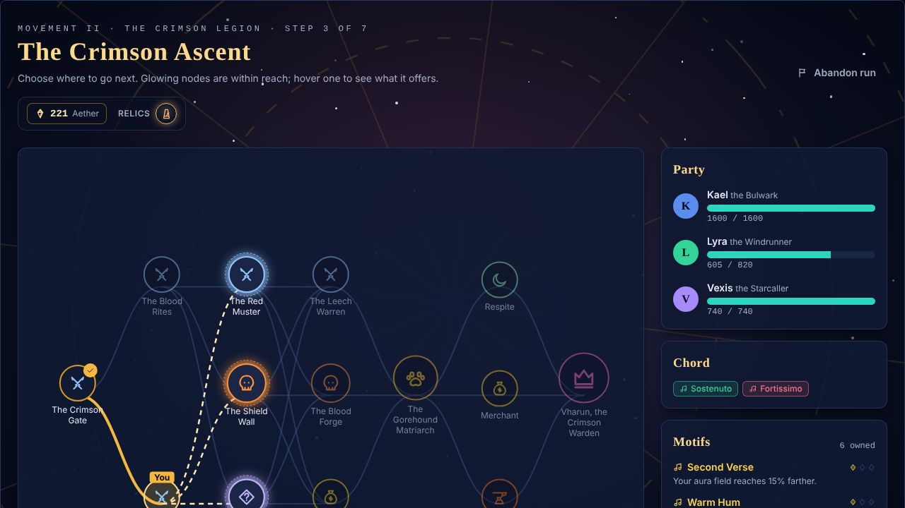
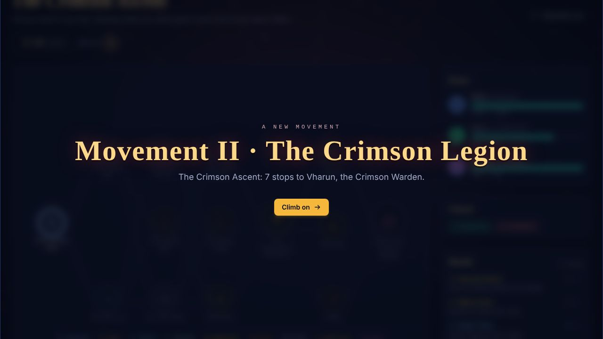
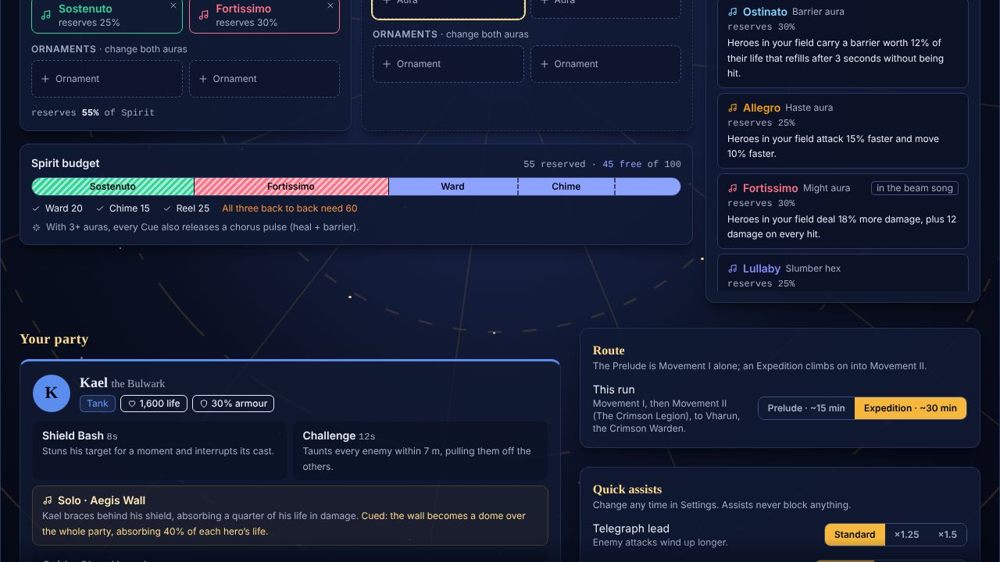
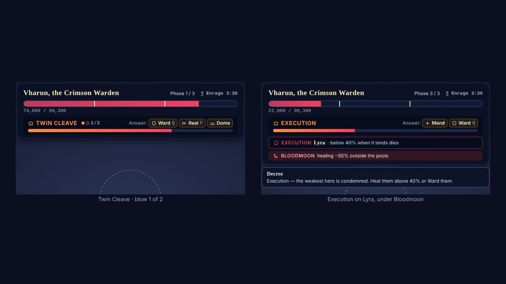
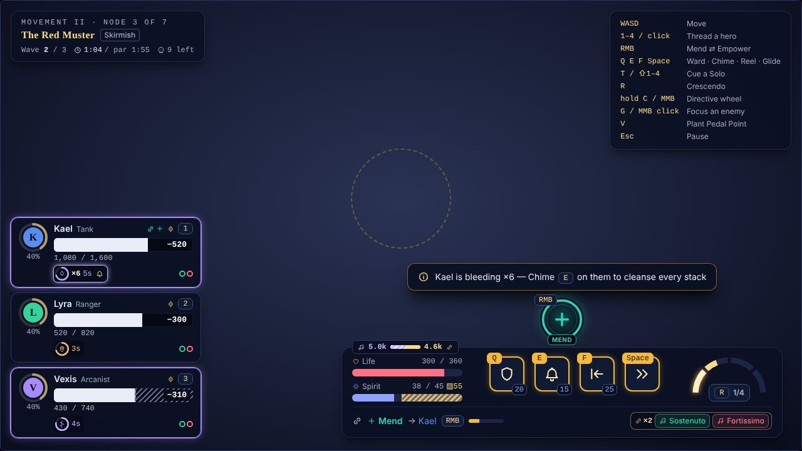

# Phase 5a UI: Movement II, the Crimson Legion

*Workstream W8 of [Phase 5a](../phase-5a.md). Every Prelude string is unchanged; everything new
derives from content (`movements`, encounters, attacks, statuses) and the run.*

## HUD

| Piece | What it shows | Where |
|---|---|---|
| Stacks | `StatusHud.stacks` passes through the bridge (only from 2 up). The badge shows ×N; from 5 it glows and adds the Chime glyph (unless Blind Score). | `hudBridge.ts`, `hud/StatusBadge.tsx` |
| Healing cut | `HeroHud.healCut`: the sim's own `healReceivedMult` (Wound ×0.5; Bloodmoon ×0.5 on a hero whose centre is outside every Sanctuary pool; both ×0.25), so the hatch never disagrees with the heals. The frame hatches the life still to heal in ailment violet. | `hudBridge.ts`, `hud/PartyFrames.tsx` |
| Execution | `HeroHud.execute` while Execution is cast on them: a lethal tick at 40% on their bar. The boss bar names the target ("below 40% when it lands dies"). | same, `hud/BossBar.tsx` |
| Phase ticks | `BossHud.phaseAt` from the sim's `bossPhaseTable`, which has every boss (the Cantor at 70/40, its coded thresholds, a deliberate Movement I UI fix; the Matriarch at 50; Vharun at 66/33). `BOSS_PHASES` is the last fallback (a phase count only). | `hudBridge.ts` `bossPhasesOf` |
| Boss cast | A per-boss glyph (the Bellwarden and the Cantor keep the bell; the Matriarch's paw, Vharun's crown). A `followUp` chain draws pips: Twin Cleave 1/2, 2/2. | `BossBar.tsx`, `hudBridge.ts` `blowsOf` |
| Bloodmoon | "Bloodmoon: healing −50% outside the pools", a crimson badge with the moon glyph. | `BossBar.tsx` |
| Hints | bleed ≥5 → Chime; pinned → Reel frees; Blood Pact → Scatter (Chime can't); latched → Reel or Chime; Wound → Chime before Mend; a Sentinel's shield blocking a blow (the sim's `guardBlocked`: the runtime notes its time, the bridge sets `HudSnapshot.guardBlocked` for 4 s) and no Focus → Focus it; Bloodmoon → stand in a pool and Rally (Reel frees into your pool); Execution → lift above 40% or Ward. All are answer hints (Blind Score hides them). The silenced hint names hymn circles only while they stand (`HudSnapshot.hymnCircles`). | `hud/hints.ts` |
| First sighting | `HudSnapshot.foes` lists the live enemy defs. The combat screen checks them against `profile.seen`: each new one pushes a "New foe" card (name, one-line lesson, answer glyphs) and is recorded (the profile store's `see`: once each, saved). The Prelude never shows one: every Movement I enemy is seen from the start. | `hud/sighting.ts`, `hud/Callouts.tsx`, `screens/CombatScreen.tsx` |

## Screens

| Screen | Prelude (unchanged) | Expedition |
|---|---|---|
| Title | "Movement I · The Prelude" | "Movements I–II · The Expedition" once it's the route |
| Prep | "The Prelude · Movement I" | "The Expedition · Movements I–II"; the Route toggle (Prelude ~15 min / Expedition ~30 min) once Expeditions open (`expeditionOpen()`: Rank 2, or Skip the unlocks). It calls the run store's `setRunMode`, which switches the run in Prep and keeps its Calling and Chords; the profile remembers the choice (`screens/prepRoute.ts`) |
| Map | "The Prelude · Movement I · step k of 10", The Reliquary Road; voiced in the Sunlit Reliquary, even right after an Expedition | Only the current Movement's rows (the meta's `rowsOfMovement`), laid out by row within it. The Movement is the **next reachable stop's** (the meta's `mapMovement`: after the Cantor it is already II, though `movementOf` still says I), and the map voices its biome on every visit (`screens/mapBiome.ts`, `setBiome`, idempotent). "Movement II · The Crimson Legion · step k of 7", The Crimson Ascent; crimson Backdrop; paw and crown nodes; the one-time "Movement II · The Crimson Legion" card (once a run, before its first stop) |
| Combat | "The Prelude · node k of 10" | "Movement II · node k of 7" |
| Pause, Map abandon | "The Prelude ends here…" | "The Expedition ends here…" |
| Summary | "The Prelude · summary"; "The Hollow Cantor falls and the Reliquary sings again." | "The Expedition · summary"; "Vharun falls, and the Spire's banners burn."; a defeat names the Movement reached |
| Relic / draft spoils | Without a source: the Bellwarden's ("The Bellwarden falls", "The Warden's hoard", "The Warden's gift") | From `sourceEncounter`: the Cantor's, the Matriarch's |
| Result's Continue | The Cantor: "Continue" | A non-final Cantor leads to its relic (`isFinalNode`); its XP and Starlight carry no run-win line (`endsRun`) |
| Result's XP | As it was | A Movement II fight's ×1.25 is its own line ("Movement II · ×1.25"), not folded into Dissonance's |
| Result's death recap | As it was | A hero killed by a bleed, pin or latch names the answer (`DeathRecap.answers`): "Answer: Chime", "Answers: Reel or Chime" |
| Reliquary | "Win a run to enshrine…" | `enshrineEligible`: an Expedition that reached Movement II enshrines even after a defeat; "Reach Movement II to enshrine…" |
| Codex | — | Enemies grouped by Movement; unseen ones are locked silhouettes (`profile.seen`). A later Movement's events wait until its enemies are met |
| Loom, Codex Deeds | Gate "Continue · step k of 10"; Deeds "N of 20 earned" on the Loom and the Codex alike, Crimson Crowned and Pack Leader hidden | Gate names the Movement; Movement II's two badge Deeds show and count, on both, once its enemies are met (`deedsTally`, `deedsInSight(profile.seen)`) |

`wonTheRun` is now `endsRun` (rankText, the meta's `runEnd.endsRun` with no cast): only the final
node's `wonRun` wins the run; an old result's won boss stands for it. Starlight's win bonus line follows it. Calling tiers count their
step within Movement I. Event glyphs `altar` (the Tithe Altar) and `cell` (the Bloodsworn's Cell)
are in `RelicGlyph`.

## Screenshots

From the UI lab at 1280×720.

## UI lab: "Movement II"

| View | Shows |
|---|---|
| `m2-hud-legion` | Kael bleeding ×6 (glow, Chime glyph), Lyra pinned, Vexis Wounded (hatched), the hints |
| `m2-hud-legion-sighting` | The "New foe" card for the Crimson Sentinel |
| `m2-hud-matriarch` | Blood Frenzy, Pounce cast with the paw glyph, a tick at 50% |
| `m2-hud-vharun-cleave` | Twin Cleave pips 1/2, a Blood Pact, ticks at 66/33 |
| `m2-hud-vharun-bloodmoon` | The Bloodmoon badge, heal cut ×0.5 and ×0.25 |
| `m2-hud-vharun-execution` | Execution on Lyra: the 40% tick, the boss bar's line |
| `m2-map-arrive` | The Movement II card over the Crimson Ascent |
| `m2-map-climb` | Two stops in: 7 rows, crimson backdrop, paw and crown |
| `m2-prep` | The Route toggle on an Expedition |
| `m2-summary-win` / `m2-summary-loss` | Vharun falls; fallen in Movement II, with the enshrine stage |
| `m2-codex-locked` / `m2-codex` | The Legion as locked silhouettes; the Enemies tab by Movement |

The lab's Movement II map (`withMovementTwo`) appends the Movement's rows to a Prelude map as the
run layer does, so the views stand on their own; with the run layer's own Expedition maps they
read those instead.

## Tests

`tests/uiPhase5.test.ts`: stacks through the bridge (and no new keys in a Movement I fight); heal
cut and Execution; phase ticks (the Cantor 0.7/0.4, Vharun 0.66/0.33); Twin Cleave pips; the map
in Movement II (7 rows, the header, the next stop's Movement, the card); the Prelude strings as
they were; an Expedition's copy and spoils; the enshrine stage after a Movement II defeat; the
first-sighting flow; the hints; the Codex and Loom by sightings; the event glyphs.
`tests/uiPhase5Fixes.test.ts` (after integration): the heal-cut hatch against the sim's
`healReceivedMult` (a hero over a pool's rim by less than their radius is cut); the Loom badge and
the Codex's Deeds count alike; Prep's Route keeps the Calling and Chords; `recordSeen` through
`see()`; the map's Movement and rows are the meta's; the enshrine stage reaches 'choose'; an
Expedition's Cantor leads on and pays no run-win line, a Prelude's ends the run; Movement II's
XP line; a Movement II defeat enshrines through the store; the recap's answer line (and the save
keeps it); the Map's biome (a Prelude after an Expedition is the Reliquary's); the Sentinel hint
keyed on `guardBlocked`.
`tests/uiPhase3.test.ts` (`endsRun`) and `tests/uiPhase4c.test.ts` (the materials' bosses) are
updated.
