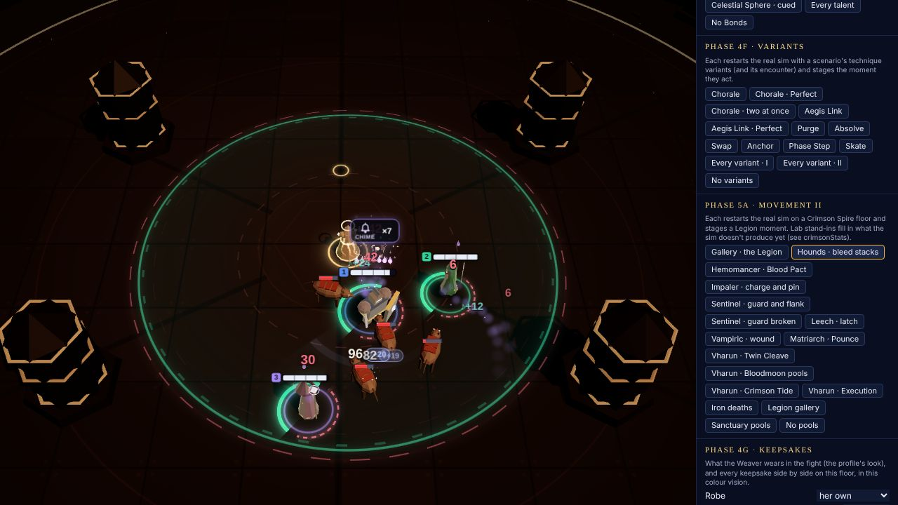
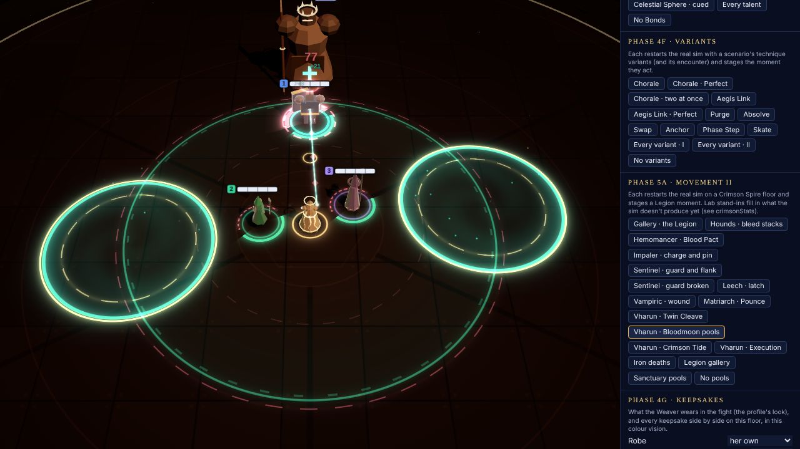
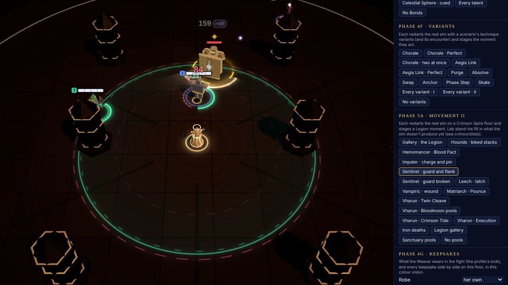
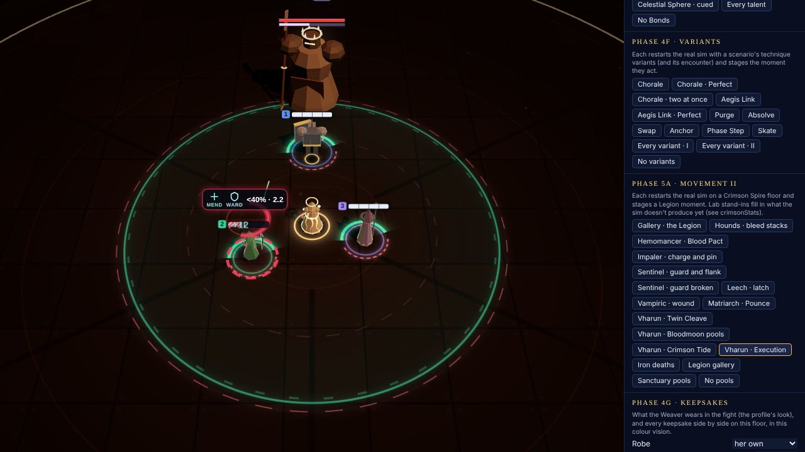
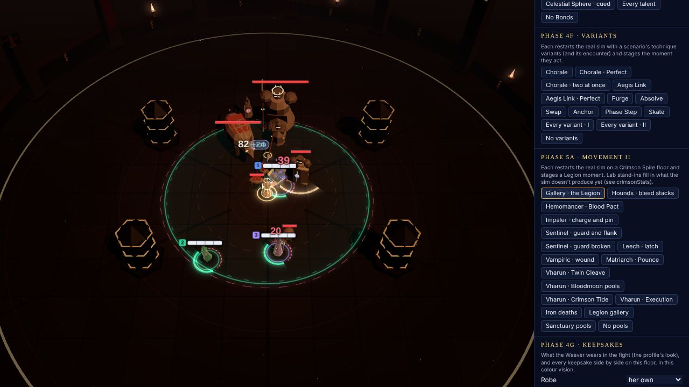

# Phase 5a: Movement II, the Crimson Legion (VFX and audio)

Movement II (see [Phase 5a](../phase-5a.md)) takes the run up the **Crimson Spire**. This page
covers how it looks: the Spire's arenas, the Legion's bodies and how they move, and every Legion
status, guard, pool and boss cue. The audio half (the crimson voicing, Vharun's stems, the
Legion's sounds) follows it, under [Audio](#audio).

**What it reads.** Render reads only the contract's state and events (docs/phase-5a.md,
CONTRACTS): `ArenaDef.biome`; `EnemyDef.material` and `guard`; `AttackDef.move`, `linkStatus`
and `executeBelow` (through the telegraph's `attackId` when the telegraph doesn't carry them);
the statuses `bleed` (its `stacks`), `wound`, `latched` (its `source`), `pinned`, `pact` and
`condemned`; `enemy.guard {fx, fz, brokenUntil}`; `field.sanctuary.pools`; `enemy.cast`; and the
events `attackFired` 'charge' / 'leap', `guardBlocked` and `guardBroken`. Nothing is in
`src/sim`.

**What it leaves alone.** Every key it reads is absent in Movement I, so a Prelude fight is drawn
exactly as before. `tests/renderMovement2.test.ts` pins it:

- every Movement I arena's `setMood` arguments, mesh count, geometry, uniforms and shaders;
- every Movement I enemy model;
- a First Light fight drawing none of the new cues and keeping no new state.

No new FX batches, draw calls or materials: the kit keeps its 12 batches, and the Spire swaps its
torch cards and embers in for the god rays and dust (one mesh each).

## What changed

| File | Phase 5a work |
| --- | --- |
| `crimsonCues.ts` (new) | Pure helpers, tested in Node. `CRIMSON_HEX` (the new semantic colours) and `SPIRE_HEX` (ambient: sky, torch, rim, Bloodmoon, iron, banner). `arenaLook` / `arenaMood`: the per-biome mood table that replaces `warm = def.id !== 'sandbox'`. `isQuadruped`, `materialOf`, `moveOf`, `guardHalf`, `guardArc` (from the *sim's* guard direction), `guardBrokenAt`. `crimsonStatuses` (one read of a hero's Legion statuses), `pipOffset`, `statusAnswers`. `isPact`, `executeBelowOf`, `TIDE_HALF`, `PACT_LABEL`. `inSanctuary`, `bloodmoonOn`, `CUT_HEAL_SIZE` / `CUT_HEAL_ALPHA`, `healCut` (the sim's own `healReceivedMult`). The over-head layout: `PIP_LIFT`, `WOUND_LIFT` / `WOUND_SIZE`, `STATUS_BADGE_LIFT`. |
| `arena.ts` | The mood comes from `arenaMood(def)`. The Spire builds its own floor (iron plates, blood-channel grooves, brass inlay), ramparts (obsidian towers, banners, brass braziers, chains; tall pieces only on the far side, one draw call), spire pillars, torch cards and rising embers. A Movement I arena takes the old code path unchanged. `ArenaView.look` says which. |
| `models/library.ts` | `buildEnemy` builds the seven Legion bodies by id before any role (`buildLegion`): two quadrupeds (the Matriarch with a mane of spines), the robed Hemomancer with a caged blood orb, the Impaler's long forward pike, the Sentinel's tower shield, the ribbed Leech, and Vharun with a twin-bladed glaive and a brass crown. `buildSpirePillar` for the Spire's obstacles. Primitives only. |
| `entities.ts` | `AILMENTS` gains bleed, latched and wound (the sim's set). The quadruped gait, the Pounce crouch, the charge lean, and the leap arc and charge rush (`travel()`, from `attackFired`). The statuses: bleed pips and drips, Wound's heart, a latch's tether, a pin's stake and ring. The guard arc and its broken flash (`guardBreak()`). `drawnM2` counters. |
| `telegraphs.ts` | Blood Pact: the link in its plum tint, `+20%` on its badge. The Crimson Tide: its badge near Vharun. Execution: `<40%` on the mark's badge. Answer badges over a hero a Legion status holds. `drawnM2` counters. |
| `field.ts` | Sanctuary pools (teal ring, gold rim, dashed inner ring, rising motes), after the hymn circles. `sanctuaryOverride` (lab) and `pools(state)` (the override, else the sim's). `drawnM2.pools`. |
| `feedback.ts` | Iron deaths. The charge's streak and the leap's landing ring. `guardBlocked` ('Blocked', rate-limited) and `guardBroken`. The Bloodmoon sky lerp on the light handles. Heal numbers the sim cut (Mend, aura and self heals; a revive never), smaller and dimmer. `firedM2` counters and `bloodmoon`. |
| `overlay.ts`, `partyBars.ts` | The Execution notch on the bar over the marked hero (`AllyBarView.notch?`, absent otherwise; `executionOn`). `LABELS.mend` reads **Mend**, as the HUD's `ANSWER.mend` does (`glyphLabel`). |
| `fx/sprites.ts` | `SPRITE.drop` (a stack pip), `SPRITE.wound` (a cracked heart), `SPRITE.stake`. |
| `fx/rings.ts` | `RING.guard`: a ribbed arc over a faintly filled sector, cracked by `param`. |
| `lab/VfxLab.tsx` | **Phase 5a · Movement II** group, the `gallery2` preset, Movement II encounters in the encounter list, the Sanctuary pools toggle and the `window.__VFX__` hooks (below). |
| `tests/renderMovement2.test.ts` (new), `tests/colorVision.test.ts` | Tests (below). |

## The Crimson Spire

| | Reliquary (Movement I) | Crimson Spire |
| --- | --- | --- |
| Sky (hemisphere) | `#ffe7c2` at 0.6 | `#3a1416` at 0.55 |
| Key light | `#ffd9a0` at 1.85 | torch `#ffb27a` at 1.6 |
| Rim light | the theme's accent at 0.55 | crimson `#9e2a33` at 0.6 |
| Fog | the theme's, 46 to 96 m | `#1c0f10`, 38 to 84 m |
| Floor | flagstone courses, a rosette | iron plates with rivets, six blood-channel grooves, brass inlay rings and a hexagonal seal |
| Perimeter | ivory columns, low walls, candles, rubble | obsidian rampart towers (crenellated on the far side), long banners, brass braziers, hanging chains, iron debris |
| Pillars | broken ivory drums | obsidian spires, brass-banded, a crimson inlay, a spiked cap |
| Air | 7 god rays, 420 dust motes | a flickering torch card and halo over every brazier, 320 rising embers (thicker toward the rim) |

Both floors are darkened ×0.78 and kept low in contrast, so lethal and threat telegraphs pop.
Crimson stays in the sky, the rim light and the perimeter (banners): never on the combat disc.
On **Low** quality the torch cards and embers hide, as the god rays and dust do.

## The Legion

| Body | Silhouette | Motion |
| --- | --- | --- |
| Sanguine Hound | a low quadruped: a long barrel, lowered head and snout, ember eyes, ears, iron plates down its back in its accent, a tail | **a dog's gait**: a quicker, deeper bob and a pitch rock, no side sway |
| Gorehound Matriarch | the same body at 1.5 m, with a mane of brass spines raked back over the neck | the gait; **the crouch** (squashed 26%, pitched forward, a shudder) through Pounce's 1 s windup, then **the leap**: an arc 1.4 m + her radius high, 0.42 s, from where she crouched to where the sim put her, and a ring where she lands |
| Hemomancer | robed and hooded, ember eyes in the dark, a blood orb held out in a brass cage | the cast glow round the orb |
| Impaler | a plated charger, a helm, a long pike held low and level with a steel point well past its body | **the lean** into the pike through the windup (a shudder at the end), then **the rush** to the line's end (0.22 s) with a streak in its accent and dust along the line |
| Crimson Sentinel | wide and squat behind a tower shield of three plates, brass-rimmed, the boss in its accent | its guard arc (below) |
| Leech | a ribbed bulb on stubby legs, a ringed sucker for a mouth | the tether to the hero it latches (below) |
| Vharun, the Crimson Warden | an armoured warden: pauldrons, a slit helm, a brass crown with six points, a twin-bladed glaive across the body | the boss's breath; Impale's lean and rush |

Every body is steel-bone (`#b9b1aa`) with its accent from content and brass trim. **Iron deaths**
(`material: 'iron'`): dark iron shards, pale ember sparks and a little smoke where it fell, its
accent's ring and an ember flash. Never a red mist. Porcelain enemies still break into
porcelain.

## Statuses, guards and boss cues

| Visual | When | What you see |
| --- | --- | --- |
| **Bleed** | `bleed` on a hero or the Weaver | A **violet drop pip per stack** over the head (8 at most), centred and spreading as they grow, plus violet drips falling off them, more with more stacks. From **5 stacks** the pips glow and pulse and a **Chime** badge shows over the head with the count (`×6`), above the pips. Bleed is an ailment: violet, never red. |
| **Wound** | `wound` | A **cracked heart** over the shoulder in the ailment violet, bobbing, above the hero's bar (not behind its slot chip). |
| **Latched** | `latched` (its `source` is the Leech) | A **violet tether**, dashed and flowing, from the Leech to the hero, in a soft glow. **Reel · Chime** badge, labelled *Latched*. |
| **Pinned** | `pinned` | A **steel stake** standing beside the hero, an **amber ring** at the feet and a dashed one outside it. **Reel** badge, labelled *Pinned*, with an amber border. |
| **Guard arc** | `enemy.guard` | A **brass arc** at the Sentinel's feet across its 120°, ribbed like shield plates, the sector it guards faintly filled. It points along the **sim's** guard direction (`guard.fx, guard.fz`), not the body's smoothed yaw, so it never lies about which side is guarded. **Broken** (`brokenUntil` ahead): it cracks into shards, the fill drains, a white ring and a brass flash on the frame it breaks; a brass shatter and *GUARD BROKEN* on `guardBroken`. A blocked hit (`guardBlocked`) throws back a brass swipe on that side of the arc and a grey *Blocked*, at most every 0.6 s per enemy. |
| **Blood Pact** | a link whose status is `pact` | The link renderer, in its own **plum tint** (`#9d4f8a`) while the pair stand apart; **lethal red**, pulsing, within 6 m, as every link. Its badge reads **`+20% · 4.2`**. |
| **Crimson Tide** | a cone 180° wide | The cone telegraph over half the arena, front then back. Its badge sits **near Vharun** (6 m out), not at the cone's far edge, which is off the arena. |
| **Execution** | a mark with `executeBelow` | The mark over the head, its badge reading **`<40% · 3.1`**, and a bright **notch at 40%** on the bar over the marked hero: lift them past it, or Ward. |
| **Sanctuary pools** | `field.sanctuary.pools` (Bloodmoon) | Each pool a **teal heal ring** with a **gold rim**, a slow dashed gold ring inside it, and teal and gold motes rising, as the hymn circles. |
| **Bloodmoon** | while the pools are up | The hemisphere light lerps toward **crimson** (`#8a1c24`, 55%) and dims 15% over about 2 s, and back when they go. A heal on a hero **outside every pool** shows its number **28% smaller and dimmer**. |
| **Cut heals** | the sim cut the heal (`healReceivedMult` < 1) | Mend's `+N`, an aura's `♪+N` and the Martyr's own `+N` all draw 28% smaller and dimmer whenever the sim cut them: a **Wound** on whoever carries it, the **Bloodmoon** on a hero outside the pools. Render asks the sim's own `healReceivedMult`, so it never disagrees with it. A **revive** is exempt, as in the sim: full size, full colour. (The lab's pools, with no sim Bloodmoon, cut a hero outside them the same way.) |

**Colour.** Every new semantic colour is ΔE ≥ 20 from lethal, threat, the Martyr's Bear, Mend
and Empower under every colour-vision palette (tested):

| Colour | Hex | Used for |
| --- | --- | --- |
| `pact` | `#9d4f8a` | Blood Pact's link and `+20%` |
| `guard` | `#c9b28a` | the guard arc, its swipe and shatter |
| `pin` | `#e2c78f` | the pinned ring and badge border |
| `stake` | `#cbd5e1` | the pin's stake |
| `notch` | `#f1f5f9` | Execution's notch |
| `ember` | `#ffd2a6` | iron deaths' sparks, the Spire's embers |
| `blocked` | `#cbd5e1` | the 'Blocked' floater |
| Vampiric (content's affix colour) | `#a01a8a` | a Vampiric elite's rim |

**Vampiric.** The first pick, `#9f7aea`, was a lavender that read as an ailment: ΔE 6.5 from
ailment violet with normal vision, 10.9 with tritanopia, and 16.1 from Mend under deuteranopia.
`#a01a8a` is a deep **crimson-magenta**: blood seen through a bruise, so it still reads as
vampiric, and darker and far more saturated than the lavender ailment violet. It is also the one
direction a blood colour can go: true crimson is taken by lethal (`#f43f5e`) and the Bear
(`#a3123a`). It keeps ΔE ≥ 27 from ailment violet, lethal, threat, the Bear, Mend/heal and Empower
under every palette `simulateVision` checks (its closest call is Empower under tritanopia; tested
at ≥ 20 in `tests/colorVision.test.ts`), and measures ≥ 27 from the other three affixes' colours. It
is not a `CRIMSON_HEX` colour; it lives on the affix in content, as every affix colour does.

Bleed, Wound and Latched draw in the live **ailment violet**, and the pools in the live **heal teal
and gold**: neither is a new colour. The Spire's ambient colours (sky, torch, rim, Bloodmoon,
banners, iron) are not semantic and stay off the combat disc.

## The VFX lab

`?lab=vfx` → **Phase 5a · Movement II**. Each scenario restarts the real sim on a Crimson Spire
floor and stages it with real spawns and commands. Until the sim produces a Legion mechanic itself
(the workstreams land in parallel), a **lab stand-in** puts it in place a moment later, only if the
sim hasn't: a status on a hero, a guard, the pools, a scripted attack begun with the sim's own
`beginAttack`, or a charge or leap. `crimsonStats().standIns` names each one used; once the sim has
it, the stand-ins stand aside on their own.

| Scenario | Floor | Staging |
| --- | --- | --- |
| Gallery · the Legion | Spire Gate | `gallery2`: every Legion body side by side |
| Hounds · bleed stacks | Spire Gate | five hounds on Kael; bleed climbs to 7 (pips, then the glow and Chime from 5) |
| Hemomancer · Blood Pact | Blood Forge | a Hemomancer's Blood Pact; you Scatter at 3 s (lethal red, then plum) |
| Impaler · charge and pin | Spire Gate | an Impaler's charge at Lyra: the lean, the rush and streak, the pin |
| Sentinel · guard and flank | Barracks | a Sentinel, Focused: its arc, the party flanking, a 'Blocked' |
| Sentinel · guard broken | Barracks | Lyra Empowered; at 2 s the guard breaks (flash, cracks) |
| Leech · latch | Blood Forge | two Leeches on Lyra; the tether, Reel · Chime |
| Vampiric · wound | Spire Gate | an elite hound on Kael; the cracked heart |
| Matriarch · Pounce | Kennels | the Matriarch's Pounce at Lyra: the crouch, the leap, the landing ring |
| Vharun · Twin Cleave | Warden's Throne | Twin Cleave on Kael |
| Vharun · Bloodmoon pools | Warden's Throne | two drifting pools, the crimson sky; Kael threaded (his Mend numbers dim outside) |
| Vharun · Crimson Tide | Warden's Throne | the front cone, then the back cone |
| Vharun · Execution | Warden's Throne | Lyra at 32%: the mark, `<40%`, the notch on her bar |
| Iron deaths | Spire Gate | three hounds and a chorister struck down: iron beside porcelain |

**Presets and toggles.** *Legion gallery* (`preset('gallery2')`), *Sanctuary pools* / *No pools*
(`setSanctuary`), and the Movement II encounters in the encounter list (`crimson_gate`,
`red_muster`, `blood_forge`, `gorehound_matriarch`, `vharun`). The Theme select lists the Spire's
five arenas (it lists every arena in content).

**Screenshots** (the lab at 1280x720, headless Chromium; the right-hand panel is the lab's own):

*Hounds · bleed stacks.* Kael at 7 stacks: the pips glow, and the Chime ×7 badge sits above them.

*Vharun · Bloodmoon pools.* Two drifting pools on the Warden's Throne. Kael is threaded and outside
both, so his Mend numbers draw small and dim.

*Sentinel · guard and flank.* The brass arc at the Sentinel's feet faces Kael; Lyra and Vexis flank it.

*Vharun · Execution.* Lyra at 32%: the badge reads `<40% · 2.2`, and her bar carries the notch.

*Gallery · the Legion,* zoomed out. The torch cards burn on the far ramparts, and the four obsidian
spires stand on the disc.

**What the screenshots showed, and what changed.**

- **Fixed: the Chime/Reel badge hid the pips.** At 1.5 m over the head its 34 px chip covered the
  row of pips. It now sits at `STATUS_BADGE_LIFT` (2.6 m), above them.
- **Fixed: Wound's heart sat behind the bar's slot chip.** It now sits at `WOUND_LIFT`, above the
  bar. The pips moved up a little (`PIP_LIFT` 1.15 m), so that at 720p bar, pips/heart and badge
  stack clear of each other from the default zoom out to the farthest. A test projects them through
  the game camera.
- **Fixed (lab): the Theme select said `reliquary_hall`** on a Spire scenario. It now follows the
  scenario's floor.
- **Looked at, left as is.** The torch cards are fixed +z-facing quads. The game camera never yaws,
  so they always face it, and from its 52° pitch they read as flames. The Spire floor is very dark
  by design (×0.78, low contrast): its plates and grooves are faint, and telegraphs and pools stand
  out against it. The obsidian spires read as near-black hexagons with brass bands, darker than
  the floor, and can briefly hide a hero who walks behind them; this is the content layout.
  Execution's badge sits at Movement I's mark height (1.9 m), close to the marked hero's bar. That
  is shared with every Movement I mark, so it is unchanged here.

**`window.__VFX__`.**

- `crimsonScenarios()`: the scenario names.
- `crimsonScenario(name)`: restarts and stages one.
- `crimsonStats()`: the floor and its biome; `drawn` (last frame: quadrupeds, crouch, lean, leaps,
  charges, pips, pipsHot, wounds, tethers, stakes, guardArcs, guardBroken, pacts, tides,
  executions, statusBadges, pools); `fired` (so far: leaps, charges, blocked, guardBroken,
  ironDeaths, cutHeals); `bloodmoon` (0..1); the pools; the `standIns` used; every hero (position,
  life, statuses with stacks) and enemy (def, cast, guard).
- `setSanctuary(on)`: the lab's drifting pools.

## Tests

`tests/renderMovement2.test.ts` drives a real sandbox sim (and a real First Light fight) through
the real `EntityLayer`, `FieldView`, `TelegraphLayer`, `PartyBarsView` and `Feedback` over a real
`FxKit`. Where a mechanic is the sim's to produce, the test stages it on the real world the way the
sim keeps it (a status with its stacks, `enemy.guard`, `field.sanctuary`, an `attackFired`
'leap'), and Legion attacks are begun with the sim's own `beginAttack`.

- **Movement I is drawn as before**: each Movement I arena's `setMood` arguments (a snapshot), mesh
  count and a fingerprint of its geometry, uniforms and shaders; each Movement I enemy model's
  geometry; twelve seconds of First Light draw no Movement II cue and keep no `field.sanctuary` or
  `notch`; the overlay labels the Mend glyph *Mend*, as the HUD does.
- **The Spire**: its mood for each of the five arenas; the same mesh budget as a Reliquary arena;
  torch cards and embers hide on Low; every Legion body differs from its role's porcelain one, and
  from each other.
- **Statuses**: pips per stack (capped at 8), the glow and the Chime badge with `×N` from 5; the
  Wound heart; the latch tether to its Leech with Reel · Chime; the pin's stake with Reel.
- **The guard**: the arc's middle points along the sim's guard direction, whichever way the body
  faces; broken, it cracks (`param` 1) and flashes; 'Blocked' is rate-limited; *GUARD BROKEN*.
- **The pools**: drawn per pool, the lab override, the sky lerping toward the Bloodmoon and back;
  a heal outside every pool smaller and dimmer than one inside.
- **Cut heals**: a revive outside the pools is not cut; an aura heal outside them is; a Wound
  cuts Mend, aura and the Weaver's own heals inside a pool; the Weaver's heals under the
  Bloodmoon render cut exactly when the sim's `healReceivedMult` cuts them.
- **Over-head layout**: projected through the game camera at 720p, at the default zoom and the
  farthest, the pips and Wound's heart clear the bar and the answer badge clears the pips.
- **Telegraphs**: the Tide's two 180° cones with the badge near Vharun; a Blood Pact's `+20%` (and
  a Bellwarden's Resound without it); Execution's `<40%` and the notch on the marked hero's bar
  only.
- **Motion**: the hound's gait; the Matriarch's crouch through Pounce's windup, then the leap (in
  the air mid-arc, landed where the sim put her); the Impaler's lean, rush and streak; iron deaths
  for iron, porcelain for porcelain. A real Impaler charge, stepped through the sim, confirms the
  order render assumes: `completeCast` moves the caster first and then emits `attackFired`
  'charge' (from where it stood, to where it now is). Render draws it on that frame near where it
  stood, rushes it there over 0.22 s, and ends where the sim put it. No render change was needed.
- **The budget**: through a busy Legion scene (every cue at once) the kit keeps its 12 batches and
  stays inside every batch's capacity.
- **Colour**: every `CRIMSON_HEX` colour ΔE ≥ 20 from lethal, threat, Bear, Mend and Empower under
  every palette (also in `tests/colorVision.test.ts`), and the Vampiric affix colour ΔE ≥ 20 from
  ailment violet, lethal, threat, Bear, Mend/heal and Empower (`tests/colorVision.test.ts`).

## Audio

Audio now has a **biome axis**. The Sunlit Reliquary sounds exactly as before. The Crimson Spire
keeps the game's key and tempo, **D dorian at 88 BPM**, and changes:

- its chords;
- its drums, horn and choir;
- its pad cutoff;
- its ambience;
- stems for Vharun's phases.

Every Movement II status, event and attack has a voice. Audio reads the following and never
writes to the sim:

- `ArenaDef.biome`;
- the events `statusApplied` (with `stacks`), `statusRemoved` (with 'freed'), `guardBlocked`,
  `guardBroken`, `attackFired` ('charge', 'leap'), `telegraphStarted`, `telegraphResolved`,
  `allyDowned` and `enemyKilled`;
- `EnemyDef.material`;
- each telegraph's `attackId`;
- `enemy.tier` and `enemy.phase`.

### What changed

| File | Phase 5a work |
| --- | --- |
| `audio/director.ts` | `setBiome(biome)` and `getBiome()`. The biome is kept for a MusicEngine created later. `stopCombat` resets the new `apex` input. |
| `audio/music.ts` | `setBiome`. The biome takes effect on the next bar line, as a mood does. The Crimson Spire voices `map`, `calm`, `combat` and `boss`; the title, the Loom, victory and defeat are the same in every biome. Its progressions, `crimsonPulse`, `crimsonMelody`, a low choir drone, `CRIMSON_CUT` and `crimsonAmbience`. `MusicInputs.apex`: the fight's boss is a final boss. `MusicSnapshot.biome/activeBiome`. |
| `audio/theory.ts` | Chords `Dm`, `C` and `Bø7`. `PROGRESSION_CRIMSON`, `PROGRESSION_CRIMSON_BOSS`, `MELODY_CRIMSON` and `MELODY_CRIMSON_BOSS`. |
| `audio/sfx.ts` | The Legion's sounds below. `LEGION_SOUND_GROUPS`, `LEGION_SOUND_LIMITS`, `LEGION_ATTACK_SOUNDS` and `BLEED_CHIME_AT`. Iron kills by `material`. `windStyle`: a `mend` answer gives a swell. `update()` also returns `apex`. |
| `app/runtime.ts` | `getAudio().setBiome?.(arena.biome ?? 'reliquary')`, called before the mood is set. |
| `audio/lab/*` | AudioLab gains a biome switcher, a Vharun phase selector, the **Phase 5a · The Crimson Legion** group, the Crimson Spire moods in the mood audit, and `__audioLab.setBiome` and `pitchCrimson`. `FakeWorld.addEnemy` accepts content def ids, and `addTelegraph` accepts `attackId` and `name`. `renderMood` and `auditMood` accept a biome and a boss phase. |
| `tests/audioPhase5.test.ts` (new) | See Tests below. |

### The Crimson Spire's music

| Stem | Sunlit Reliquary (unchanged) | Crimson Spire |
| --- | --- | --- |
| Chords | Bright loop; Dark loop for bosses | **Dm–C–Bø7–C** ×2; boss: Dm Dm Bø7 C Dm Bø7 Em7 Am7 |
| Pulse | Kick, rim, hats, bass on root and fifth | **War drums**: low toms tuned to D2 and A1 (A2 for pickups), an anvil on the backbeat when busy, a chain rattle on off-beats, and a saw bass on the root and its octave only |
| Melody | Flute; horn for bosses | **Low horn ostinato** an octave down; sparse on the map |
| Choir | The chord's upper tones | **A low male drone**: A2, D3 and A3 whatever the chord, plus D4 at the top tier |
| Pad cutoff (Hz) | map 1300, calm 1300, combat 1700, boss 800 | map 900, calm 1000, combat 1250, boss 650 |
| Ambience bus | (nothing in the music) | **Bed**: distant drums every other bar, brazier crackle (a fixed xorshift sequence, no `Math.random`), and a fire's breath every 4 bars |

**Why Bø7 rather than B♭.** The plan asks for Dm–C–B♭–C. B♭ is outside D dorian, and every
pitched sound is quantised to that key. The test requires 94-100% of the stems in key, and a
B♭ bar would put about a tenth of the notes out of key. Bø7 (B D F A) is the dorian mode's own
chord on that degree. It keeps the D and F of the B♭ chord, and its B♮ gives the dark modal
colour. For the same reason the Spire's bass never plays the chord's fifth, because on B that
would be F♯.

**Vharun's stems.** These are keyed on `bossPhase`, and only when the boss is a final boss
(`apex`: an enemy of tier 'boss').

- **Phase 2, Bloodmoon:** the pad drops out. A slow double heartbeat on D2 beats on the
  ambience bus.
- **Phase 3, judgement:** Bloodmoon persists, so the pad stays out and the heartbeat continues.
  The toms double to every eighth note, and brass stabs (horns on the chord) land on beats 1
  and 2&.
- **The Matriarch's Blood Frenzy:** her phase 2 keeps the pad and adds a high-tom pickup.

A Fermata or Stasis holds the drums and the heartbeat. Only the fire keeps crackling.

### The Legion's sounds

Each sound has its own voice group, rate gate and cap (`LEGION_SOUND_LIMITS`). Every pitched
note is in D dorian.

| Sound | Trigger | Recipe | Gate / cap |
| --- | --- | --- | --- |
| Bleed | `statusApplied` bleed | A wet pluck that climbs one scale step per stack (E5 at ×1 to E6 at ×8) with a wet band of noise. At **5+** stacks a glass glint rings: the cue to Chime. | 0.15 s / 2 |
| Pinned | `statusApplied` pinned | A stake's thunk on A2, then four chain links, each a faint high glint | 0.12 s / 2 |
| Latched | `statusApplied` latched | A suck: air drawn through a rising band, with D3 sinking to A2 under it | 0.2 s / 2 |
| Wound | `statusApplied` wound | A muffled thud on D2, with a dull F3 | 0.2 s / 2 |
| Blood Pact | `statusApplied` pact | Two hearts (D2 and A1) beating slightly out of step. The pair's two events make one sound. | 0.4 s / 1 |
| Condemned | `statusApplied` condemned | A low horn sentence (D2 and A2) under the drum roll | 1 s / 1 |
| Freed | `statusRemoved` 'freed' | The chain snaps: a hiss, an anvil ping on A5, and three links ringing down | 0.1 s / 2 |
| Chime release | `statusRemoved` 'cleansed' of bleed, latched or wound | A rising glass arpeggio of 1 to 5 chord tones plus a whoosh. It scales with what was cleared: bleed counts its stacks, latched and wound count 1 each. It plays once per batch. | 0.1 s / 2 |
| Guard blocked | `guardBlocked` | A dull clank: an anvil on A3, a thump and a band of noise. Gated, so a volley sounds as one clank. | 0.25 s / 2 |
| Guard broken | `guardBroken` | A shatter: an iron hiss, an anvil on D4, a low thump, and three glass shards falling | 0.3 s / 1 |
| Charge | `attackFired` 'charge' | A low whoosh (300 to 1600 Hz) with three heavy footfalls | 0.15 s / 2 |
| Pounce | `attackFired` 'leap' | A rising whoosh, then a landing thump after `travel` (0.25 to 0.8 s) | 0.15 s / 2 |
| Crimson Tide | the first non-cancelled `telegraphResolved` of a Tide telegraph | A wave's rush and its crash. It plays for each sweep, front and then back. | 0.4 s / 2 |
| Pack Call | `telegraphStarted` of `gorehound_pack_call` | A **howl stinger**: the Matriarch's A3→D4, then the pack answering further off (E4→A4 and D4→F4). The music ducks for it. | 1 s / 1 |
| Execution | `telegraphStarted` of `vharun_execution` | A **drum roll** for the whole windup, quickening and swelling. It is the telegraph's windup, so a cancelled cast cuts it and Stasis holds it. | 0.3 s / 1 |
| Executed / spared | that telegraph's `telegraphResolved` | **Gong** (a brass bell on D2, a thump and a cymbal) if the target went down in that batch or is down. **Bell** (handbells on D5 and A5 with a glass D6) if they were spared. A cancelled cast makes neither. | 0.5 s / 1 each |
| Iron kills | `enemyKilled` of an `material: 'iron'` def | Iron, not porcelain, by role. Swarm (hound, leech): a small clatter that cycles 3 tones. Caster: an anvil on D4 with a wet pop. Brute (Impaler, Sentinel): an anvil on D3 with a chain. Mini-boss and boss: a cascade of three anvils, a cymbal, and for Vharun a brass bell and a low choir. | swarm 0.035 s / 4; others cap 2-3 |
| Execution windup style | `windStyle` | A `mend` answer winds up as a swell, not brass | — |

**Execution's outcome.** No event field records it (stage-A `check.problems`). Audio infers it:
the target was executed if an `allyDowned` or `allyOut` for them is in the same batch as the
`telegraphResolved`, or if their state is downed or dead. Otherwise they were spared, which
covers a lift above 40%, a Ward, Fermata, Martyr's Vow, and so on.

**Bleed stacks at a cleanse.** `statusRemoved` carries no stack count, so audio keeps each hero's
last `statusApplied.stacks` and reads that.

### Movement I is unchanged

`tests/audioPhase5.test.ts` keeps a snapshot of every source scheduled. For each source it
records the kind, the frequencies set, and the start and stop times, then takes an FNV hash and
a count. The snapshot was captured from `main` before any change, with `Math.random` seeded the
same way for each score. It covers:

- 11 mood cases: title, map, Loom, calm, combat at Resonance 0 and 100, boss at phases 1-3,
  victory and defeat;
- three real Movement I fights through the director: `first_light`, `bellwarden` and
  `hollow_cantor`, 30 s each, with the lab's auto-support bot.

All 14 are identical both with the default biome and after `setBiome('reliquary')`. In the
Crimson Spire, the title, the Loom and the two stingers also match the Reliquary snapshot. The
ambience bus stays silent in the Reliquary.

On a Movement I path:

- no Legion code adds a source or a `Math.random` call;
- the new `kill()` material check finds no material on Movement I defs and falls through;
- the new branches in `windStyle`, `telegraph()` and `telegraphResolved` require a `mend`
  answer, a Legion attack id or a tracked telegraph.

### Measurements (`tests/audioPhase5.test.ts`)

**In key.** These figures are the share of oscillator frequencies whose note is in D dorian,
counting a recipe's own partials as partials of an in-key note: glass, handbell, brass bell, the
horn's sub-octave and the anvil's ring.

| Case | In key |
| --- | --- |
| Crimson map; calm (Resonance 40); combat (0, 100); boss phases 1, 2 and 3; Matriarch phase 2 | 100% each (test: ≥ 94%) |
| Every crimson lab button and every iron kill | 100% each (test: ≥ 94%) |

**The Crimson Spire's music:**

- Its progressions are heard bar by bar: Dm C Bø7 C… in combat and Dm Dm Bø7 C Dm Bø7 Em7 Am7
  for a boss.
- The key is D dorian at 88 BPM.
- Its notes differ from the Reliquary's in combat, on the map and for a boss.
- In phase 2 the pad target is 0 for Vharun but not for the Matriarch, and D2 sources rise by
  more than 8 over 12 s (the heartbeat).
- In phase 3 the toms rise by more than 20% over phase 2, and the total source count rises.
- A biome change takes effect on the next bar line, and can be switched back.

**The bleed tick.** A test sends 120 bleed applications in 2 s (three every 50 ms on two
heroes). They produce between 6 and 15 ticks (⌈2 / 0.15⌉ + 1) and at most 2 voices. The tick
climbs with stacks, and it gains its glint at `BLEED_CHIME_AT` (5).

**Other checks:**

- Every `LEGION_SOUND_GROUPS` group is heard from a lab button, within its cap.
- The Chime release grows with the stacks cleared and stays silent on 'expired'.
- Execution: gong on a down; bell on a hit while still standing and on a Ward; nothing on a
  cancel.
- Iron kills by role; `hollow_chorister` and `bell_brute` keep `kill:swarm` and `kill:brute`.
- Movement I statuses (dirge, silence, a dirge cleansed) make no Legion sound.
- The runtime calls `setBiome` before `setMood`.

### Lab (`?lab=audio`)

**Music panel:**

- A **Biome** switcher (`biome-reliquary`, `biome-crimson_spire`).
- A **Vharun phase** selector (`warden-phase`: none, 1, 2 Bloodmoon, 3 judgement). It replaces
  the enemy count with a final boss at that phase.

Pick the boss mood to hear the stems.

**The Phase 5a · The Crimson Legion group:**

| Button | What it plays |
| --- | --- |
| `crimson-bleed-1`, `-5`, `-8` | One bleed tick at that stack count |
| `crimson-bleed-pack` | Stacks 1 to 8 in 0.4 s, to hear the gate |
| `crimson-pinned`, `crimson-latched`, `crimson-wound`, `crimson-pact` | Each status |
| `crimson-freed` | A pin, then a Reel freeing it |
| `crimson-release-2`, `-8` | A bleed at 2 or 8 stacks Chimed away 0.4 s later |
| `crimson-guard-block`, `crimson-guard-break` | A Sentinel's guard |
| `crimson-charge`, `crimson-pounce` | The moving attacks |
| `crimson-tide` | Both sweeps' windups and their breaks |
| `crimson-pack-call` | The howl |
| `crimson-execution-gong`, `crimson-execution-spared` | The roll for 4 s, then each outcome |
| `kill-iron-<def>` | One for each iron Legion enemy |

**Hooks and audits:**

- `window.__audioLab.setBiome(biome)`.
- `window.__audioLab.pitchCrimson()`: Goertzel in-key shares of the Spire's moods (map, calm,
  combat, boss p1-p3).
- **Audit moods** also renders the Crimson Spire's moods.

### Known gaps

- The Map calling `setBiome` with the Movement's biome belongs to the UI workstream (MapScreen).
  Until then the map keeps the last fight's biome. After a Crimson fight, the next Prelude map
  stays Crimson-voiced until its first fight resets it to the Reliquary.
- Decrees still share one horn. Twin Cleave has no stinger of its own (optional in the plan).
- The low male choir uses the shared choir formants, pitched low.
