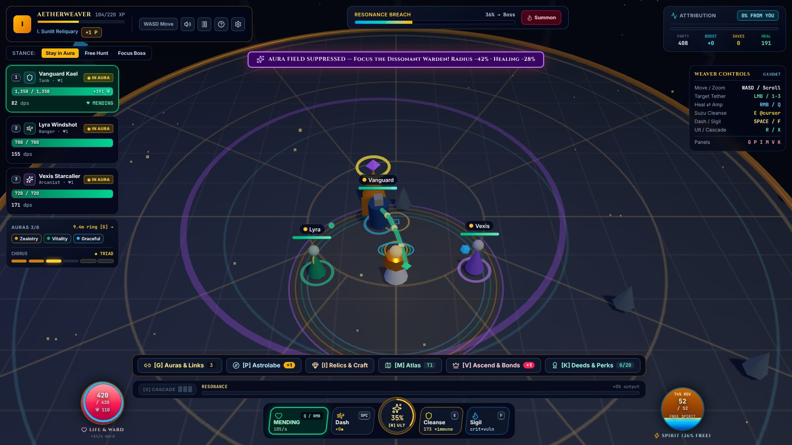
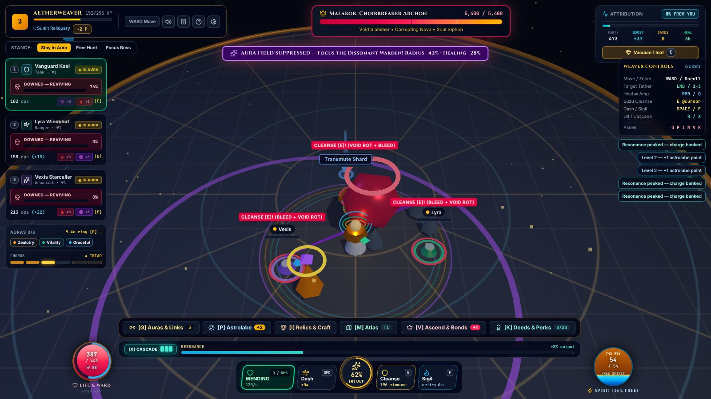
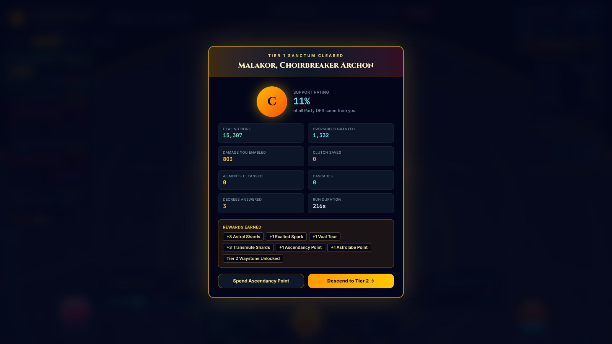

# 01 — Findings: What the Original Is, and What It Teaches

> Evidence for every design decision in this plan.
>
> **Method.** Four parallel analyses: combat/arena code, build and progression systems, the app shell/UX/audio, and a hands-on Playwright playtest of the running game. I then spot-checked the load-bearing claims against the source myself (marked ✔). The full reports, with file:line references, are in [`appendix/`](appendix/).

## 1. What the original is

**AETHERWEAVER: "3D Tactical Support & Aurabot ARPG".**
- **Stack:** React 19, Three.js 0.186, Tailwind 4 and Vite; about 14,700 lines of TypeScript.
- **Size:** it type-checks cleanly. The two largest files are `Arena3D.tsx` (3,261 lines, the entire combat simulation and renderer) and `App.tsx` (2,317 lines, all game state and the HUD).
- **Concept:** you are a pure support who deals no damage. Three AI heroes fight: Kael (tank), Lyra (ranger) and Vexis (arcanist).

**What you do:**
- Keep up to 6 auras running by reserving Spirit (or Life).
- Tether a Mercy-style heal/amp beam to one hero.
- Throw an aimed **Chime** to cleanse, heal and revive.
- Drop a healing **Sigil**, Dash, fire an 8-second ultimate, and spend Aether Charges on a **Cascade**.

**The meta layer is borrowed heavily from Path of Exile:**
- 8 aura gems and 6 support runes in 3 "conduit clusters"
- a 64-node passive tree, the *Astrolabe*, with 10 keystones
- 6-slot relic gear with affixes, tiers, sockets, sets, quality, 6 uniques, 6 crafting currencies and corruption
- 3 ascendancies
- Hero Bonds with talents
- map tiers with modifiers, 20 achievements ("Deeds") and 3 build loadouts

**The session loop:** waves spawn continuously → about 11 kills (or the *Summon* button) → a boss with "Decrees" → report screen → repeat at the same or a higher tier.

## 2. What is wrong, ranked by impact on fun

### 2.1 There are no stakes: you cannot lose ✔
- When the player dies, they respawn in place at 75% Life and Ward, losing 20 ult charge (`Arena3D.tsx:2926-2939`).
- When every hero is down, enemies simply stop moving: they only target *living* heroes (`2763-2778`).
- Downed heroes are revived by standing near them for 2.4 s, or instantly by the Chime or the ultimate.
- Only killing the boss ends a run, and a no-input run still gets there. In a seeded playtest, idling cleared **every tier tried (T1–T8) under every stance** (§7).
- **Consequence:** every support action is optional. Map modifiers are pure upside, defensive stats are pointless, and pressure is cosmetic.

### 2.2 The game largely plays itself
- **A leash.** The default stance keeps heroes within 0.78× the aura radius (about 6.4 m) of the player, so they are always in range, always covered, and always caught by one Chime cast at your own feet. A Chime that includes yourself also counts as "heroic" and pays bonus resources.
- **Automatic help.** A secondary beam triages on its own. Optional auto-move walks you to the party and dodges slams for you. The C key vacuums all loot, and Summon skips the waves.
- **Heroes have no abilities.** They attack the nearest enemy 1.15 times a second, so there is nothing to amplify *at the right moment*.
- **The economy is rote.** Healing the tank earns about 11.2 Resonance/s, while amping earns 0.5–2.5/s, so "heal the tank forever" is the correct play. Cascade spends every charge, and charges have no other use, so the play is always "press X at 3".

### 2.3 Threats aren't readable or answerable
- **Invisible damage.** The Crimson Lancer's hits are instant and invisible from 9 m away.
- **Ailments do most of the damage.** They tick a percentage of max HP per second and bypass damage reduction and overshield. A single bleed proc deals 27% of max HP, and a Soulbinder sustains 25.5% max HP/s of Void Rot, about 3.6× what the T1 beam heals. Defensive auras only reduce direct hits, so **Grace, Discipline, Martyr and Undying are mostly fake choices**, and Purity plus the Chime are mandatory.
- **Indistinguishable enemies.** All three normal enemy types are the same grey cone ✔ (`1252-1271`). Nothing shows an HP bar.
- **Unanswerable prompts.** "Focus the Dissonant Warden!" has no focus command. "Break the siphon with [E]" doesn't break it; it reappears the next frame.

### 2.4 Position barely matters ✔
The tether, Chime and Sigil have no range limit (the beam is drawn and applied at any distance, `2306`). Enemies never target the player; only 35% of slams aim at the player's position. Player Life and Ward pools exist, but almost nothing tests them.

### 2.5 Build math collapses into one number ✔
- **One multiplier.** About 12 sources multiply a single per-aura `effectMultiplier`, which reaches ×22–33 by the endgame. Every capped stat saturates at ×2.7–5.2, and beyond that only uncapped attack speed and "more damage" inflate (+500–1,280% AS). Players perceive two states: "bigger" and "capped".
- **Low-life is a free ×2.18.** It is a static check on *reserved* Life that never reads current HP ✔ (`statsEngine.ts:282-285`), with no real risk because nothing attacks the player.
- **Options cost nothing.**
  - Gems socket into every relic, and runes and sigils can be reused in every slot.
  - Every respec is free, except hero talents.
  - Six auras plus the top chorus tier are available after the **first** boss.
- **Text disagrees with code.** Unbroken Chorus says "+7% *increased*" but multiplies ✔ (`data.ts:379` vs `statsEngine.ts:307-312`). About 15 texts disagree with the code, and one Deed is impossible to complete.

### 2.6 Progression floods, then ends
- **Early flood:** about 10 runs reach level 24 with 37 of 44 passive points and a maxed ascendancy.
- **Hard stop:** everything is capped by about run 25. There is no prestige ("Legacy" was cut but its UI remains), and tiers 11+ add only HP and damage.
- **Converged crafting:** Annul is deterministic, Exalts land T1 55% of the time, and Divines take the best of two rolls. After that, corruption is the only sink, and on a finished item it has no upside.
- **Inverted scarcity:** Exalted currency (26% of drops) out-drops Chaos (14%).

### 2.7 Boss Decrees are partly fake ✔
Of the four Decrees:
- **Spirit Void** always passes: progress depends only on time (`2087-2091`), and its "cast from Ward & Charges" rule doesn't exist.
- **Shatter Halo** always fails: progress tops out at 90, half the summoned elites aren't Wardens, and kills don't count.
- **Convergence** passes on its own in the default stance.
- **Single Thread** is the only genuine test, and it completes *faster* if the marked hero is dead.

### 2.8 Feedback is thin
- **No game-feel effects.** No hit-stop, screen shake, hit flash, hit reactions or death animation; enemies just vanish. There is no bloom or tone mapping, so emissive glow looks flat.
- **Numbers and nameplates misbehave.** Damage numbers are DOM elements placed once at spawn, so they drift as the camera moves, and only amped hits show numbers. Nameplates step at about 11 Hz.
- **Audio is sparse.** It is all oscillator synthesis, about 12 voices shared across about 30 events, with no music and no master bus. Hero-down, player-hit, telegraph start and boss arrival have no sound. Decrees reuse the ultimate's sound.
- **"Attribution %" misleads.** It is a 2.5 s rolling sample at the moment the boss dies. Attack speed is never credited, and talent chains count 100% as yours. The HUD shows "0% FROM YOU" while auras are running.
- **The report is wrong.** It lists rewards that weren't paid (for example "+1 Ascendancy Point" on every first clear) and omits ones that were.

### 2.9 HUD overload and accessibility gaps
- **Overload:** about 25 widgets and 70 numbers, plus a permanent controls panel and six management menus (Auras, Astrolabe, Relics, Atlas, Ascend, Deeds), all open from minute one.
- **Small, low-contrast text:** 8–10 px text appears 69 times, and some labels have 2.7:1 contrast.
- **Brittle keybinds:** bindings are hard-coded in four places and read `e.key`, so AZERTY layouts break.
- **Missing options:** no UI scale, colour-blind mode, gamepad or remapping. "Reduced flash" never reaches the 3D scene.
- **Onboarding:** a 6-page text primer, while the arena runs live behind it.

### 2.10 Architecture makes all of this hard to fix
- **The game loop:** one `useEffect` closure about 2,900 lines long. State lives in local variables and Three.js objects (`playerGroup.position` *is* the player's position). `Math.random` is unseeded and the timestep is variable, with slow motion below 20 fps. There is nothing to unit-test.
- **App.tsx:** 37 `useState` hooks, no store, context or memoisation, and a 766-line inline HUD.
- **Constant re-rendering:** HUD sync runs at about 12 Hz *outside* the pause check ✔ (`3004-3054`). Every tick re-renders the whole App, open menus included. During the ultimate, the build math recomputes 10 times a second.
- **The save is rewritten in combat** about 10 times a second, because bond XP changes every HUD tick ✔ (the save effect depends on `heroBonds`).
- **Allocation and leaks:** the tether beam rebuilds a 207-vertex tube geometry every frame. Enemies, telegraphs and loot are removed from the scene but never disposed.
- **Bugs:** about **70 across the three code analyses**, including:
  - items silently deleted when the stash passes 40 (the forge allows 60 ✔)
  - the ultimate's bonuses applied twice ✔, and it refills itself
  - locked items salvaged anyway
  - lifetime stats under-counting
  - a failed load overwriting the save

## 3. What the original gets right

These are worth keeping, and the remake does.

| Idea | Why it works | Where it lives in the remake |
|---|---|---|
| **"You are the support — your party is the weapon"** | a clear, underserved fantasy | the whole game ([02 §1](02-game-design.md#1-vision)) |
| **The aimed Chime** | the most skilful verb in the original: aim, travel time, multi-purpose | the default Cleanse, **Chime** ([03 §1](03-content-bible.md#1-the-weavers-techniques)) |
| **The Mercy-style beam with heal ⇄ amp** | readable, constant, satisfying | the **Thread**, with range, tension and geometry |
| **Heal-tick pitch follows the target's HP** | the original's best feedback | Mend ticks rise in pitch, quantised to the music's scale ([04 §4.2](04-presentation.md#42-pitched-support-sfx)) |
| **The aura ring as a visible positional contract**, with in-aura markers | spatial, legible | Chord fields at their true radius, and rim-lit heroes |
| **Cluster puzzle**: 2 auras + 2 supports with a legible reservation formula | real pairing decisions | **Chords** of 2 auras + 2 single-copy ornaments |
| **Keystones as trade-offs** | build identity | Astrolabe keystones and Calling capstones whose drawbacks have teeth (§4) |
| **Ascendancy identities**: aura-stacker, blood-martyr, tempo | strong fantasies | **Callings** (Luminary, Martyr, Chronomancer) plus the new Conductor |
| **Hero Bonds earned by supporting that hero** | the most on-theme system in the game | Bonds with rank 3/6/9 talents that reshape quirks, story scenes, and an alternate Solo |
| **Anti-support enemies** (Warden suppression, siphon) | they attack *your* role | Mutes, Leeches, Shears and Null Priests, each with a real answer |
| **Single-Thread-style boss checks** | skill tests for the support | boss **Decrees** with answer glyphs, every one tested to be passable and failable |
| **Deeds that grant passive points** | mastery feeds progression | kept |
| **Corruption as a gamble** | drama | *Dissonate*, with real boons |
| **Loadouts and the per-aura ledger in the Conduit UI** | theorycrafting support | loadout presets plus delta previews |
| **The visual identity**: navy, gold, Cinzel/Inter/JetBrains Mono | distinctive | kept as design-system tokens |

## 4. What the remake keeps

The original's names and systems carry over, reinterpreted so each one *changes play*.

| Original | Remake | Change |
|---|---|---|
| 8 auras | 10 auras ([03 §3](03-content-bible.md#3-auras)) | mapped one-to-one where possible; Grace's invisible flat DR folded into barrier and Fermata; 3 new auras create active-play hooks |
| 6 support runes, reusable everywhere | 10 single-copy **Ornaments** | Enlighten → Grace Note, Generosity → Descant, Arrogance → Martyr's Tithe, Magnify → Reverb, Empower → Sforzando; 5 behaviour-changing additions |
| 3 conduit clusters | **Chords** | same shape (2 + 2), plus single copies and a real Spirit budget |
| Astrolabe (64 nodes, 10 keystones) | Astrolabe (about 64 nodes, 6 keystones) plus 4 capstones moved to Callings | free respec in the hub; points from Weaver Rank and Deeds |
| Luminary / Martyr / Chronomancer | the same three **Callings** plus the Conductor | chosen per run; paths with 1-of-2 choices per tier |
| Tether heal/amp | **Thread**: Mend / Empower (+ Bear for Martyr) | range, tension, snap, revive channel, motif geometry |
| Chime (E) | **Chime** | no longer revives; Clutch timing rewarded |
| Guardian's Fall (dash) | **Glide** | no free Resonance |
| Sanctuary Apotheosis (ult; `transcendence` in code) | **Crescendo**, one per Calling | costs Resonance; can't refill itself |
| Resonance (decaying combo meter) | **Resonance**, a skill meter | earned only by skilful support; spent on Cues and Crescendo |
| Hero Bonds (ranks; talents at 3/6) | Bonds with talents at 3/6/9 plus an alternate Solo at 10 | the rank-9 talents the original promised but never shipped now exist |
| Dissonant Warden | **Mute** (plus Silencing elites) | answered with the Focus Directive |
| Boss Decrees | Decrees | all passable and failable, verified by bots |
| Party stances | **Directives** (Focus / Rally / Hold / Scatter) | timed commands, not a persistent leash |
| Relics, affixes, 6 currencies, corruption | the **Reliquary**: enshrined relics, Inscriptions, Instability crafting, Dissonate | four crafting verbs and two crafting materials instead of six |
| Map tiers and modifiers | Expedition node modifiers, **Dissonance**, the **Atlas of Echoes** | modifiers now trade real risk for reward, because runs can fail |
| Deeds | Deeds | skill-based, some grant Astrolabe points |
| Attribution % and report | the **contribution ledger**, highlights and a run timeline | counterfactual saves and correct multiplicative attribution |

**Astrolabe keystones** use the original's names; the drawbacks now have teeth.

| Keystone | Remake effect |
|---|---|
| **Eldritch Conduit** | techniques cost **Life** instead of Spirit; reservation efficiency +40%. Powerful, and dangerous now that healing draws aggro |
| **Prism Covenant** | while you are below 50% Life, aura effect +30% and Thread potency +20%; you cannot be healed above 50%. This is real low-life, based on current HP |
| **Unbroken Chorus** | your auras cannot be suppressed; each aura beyond the second gives +5% aura effect; Thread potency −20% |
| **Overflowing Grace** | overheal from Mend becomes overshield (cap 30% max HP, decaying); your Ward barrier is −40% |
| **Shatterproof Halo** | a single hit can remove at most 50% of a Ward's barrier; Ward duration −40% |
| **Sanguine Font** | Life reservation efficiency +50%; Spirit reservation efficiency −20%; 20% of Mend also heals you |

**Calling capstones** carry the other original names: *Sovereign Symphony* (from Sovereign Conductor and the "Sovereign Symphony" chorus tier), *Martyr's Aegis*, *Temporal Mastery*, *Triad Bond* and *Undying Devotion* ([03 §2](03-content-bible.md#2-callings-choose-one-per-run)).

## 5. What the remake cuts, and why

| Cut | Why |
|---|---|
| Aether Charges and Cascade | a third meter with one rote use ("press X at 3") |
| Consecrated Ground sigil (F) | its job (a planted zone) moves to **Pedal Point** Chords, where it becomes a build choice |
| The leash stance, auto-move, Summon, C-vacuum | they play the game for you |
| Gem sockets in relics | a false choice: one gem fits every relic, so you always fill every socket |
| Item level, quality, set bonuses, 6-slot gear | about 19 stats feeding the same multiplier; the Reliquary's inscriptions do the job with fewer, sharper choices |
| Player level as a hero-power ladder (×4.5 hero damage) | a hidden second ladder that dwarfed Bonds (+36%) |
| PoE item and currency names | an IP risk if the game is ever shared; the musical names reinforce the theme |
| The permanent controls panel and six in-combat menu tabs | combat HUD only; meta lives in the hub |

## 6. Bug census

Across the three code analyses, about 70 bugs were found: 26 in combat, 22 in systems and 21 in the shell, with some overlap. The remake is a rebuild, so these aren't fixed in place. They become **test cases and lint rules**:

- **Rewards** shown must equal rewards paid → reward text is generated from the same data as the payout ([02 §12](02-game-design.md#12-power-math-rules) rule 7).
- **Decrees** that ignore the player → the Idle-fails/Expert-passes mechanic tests ([05 §10](05-technical-architecture.md#10-testing-strategy)).
- **Items silently deleted, locked items salvaged** → Reliquary invariants tested: nothing is destroyed without explicit confirmation, and locks are honoured by every bulk action.
- **Side effects inside React state updaters**, and a **failed load overwriting the save** → `meta/` services outside React; validate before overwrite; backup.
- **Frame-rate-dependent logic** → a fixed-step sim, plus Decree tests at 30/60/144 Hz.

## 7. What it's like to play (hands-on playtest)

*The playtest agent's notes are summarised here; the full report and screenshots are in [`appendix/analysis-playtest.md`](appendix/analysis-playtest.md).*

**Method.** The unmodified game ran in Playwright Chromium. Because software rendering only manages about 3.4 FPS, the game's own loop was stepped at a fixed 50 ms, which is exactly what a 20 FPS machine simulates. `Math.random` was seeded so idle and active runs share spawns and gear. The "active" player was a bot that reads only what a player sees (HUD values, positions, telegraph rings) and reacts within 0.2–0.4 s.

### 7.1 Does the player matter? Not for winning.

| Seeds 101 / 202 / 303 | Idle (no input) | Active (bot) |
|---|---|---|
| T1 boss fight | 78 / 46 / 23 s | 8.6 / 6.8 / 9.4 s |
| T4–T8 boss fights (seed 101) | 86 / 77 / 98 / 205 / 88 s | 4.6 / 9.8 / 8.2 / 11.2 / 16.6 s |
| Hero downs per tier | median 12 | 0–2 |
| Attribution | 3–9% | 20–56% |
| Grade | C in 14 of 14 | A ×5, B ×7, C ×5 |

- **Idle wins everything tried.** Every no-input variant cleared, including auto-move, Focus Boss, Free Hunt, and pressing Summon at 1 s then idling.
- **Good play only changes the speed.** It makes boss kills 2–19× faster (median about 7×) and raises the grade. It never decides the outcome.
- **The biggest lever is a one-time setup.** In 3 of 8 tiers the bot pressed **no ability keys at all**. It just kept the beam amping a carry and walked with the party, and it still killed the boss 10–20× faster than idle.
- **Outcomes swing wildly on the RNG.** The same no-input T1 fight lasted anywhere from 18 to 156 s across 7 seeds.

### 7.2 What a new player experiences

- **The tutorial plays the first expedition for you.** The arena runs behind the 6-step primer. Read at a normal pace, closing it lands you on *"Tier 1 Sanctum Cleared — C — 11%"* after a 216 s run you never saw.
- **Fights are over in seconds.** Active boss fights take 4–17 s, and bosses usually die before their Decrees appear: an engaged player saw 2 Decrees in 17 clears. Meanwhile heroes often go down in the opening wave before the player can react.
- **The meta floods you.** After about a minute you have 14 unspent skill points and unequipped uniques, and the Auras panel alone shows 871 words, 183 numbers and 89 buttons.

### 7.3 Readability

- **Shapes don't separate roles.** Heroes and enemies are the same cones on floor rings, and enemy types are indistinguishable. The Warden you're told to focus can't be picked out.
- **Telegraphs get lost.** Boss telegraphs drown among about 8 other ring types in near-identical reds. Enemies have no HP bars.
- **The HUD covers itself.** The suppression banner sits exactly on the Decree's instruction text. Up to 28 loot labels bury hero nameplates and cleanse warnings. The currency strip sits permanently under the party frames.

### 7.4 What was genuinely promising

- the attribution meter and per-hero "boost" numbers
- the ult moment
- cleanse-reviving a downed hero
- the Decree concepts
- the Bond talents
- the raid-style party frames

### 7.5 Tech observations

- **React, not WebGL, is the hotspot.** One 50 ms sim step costs about 5.5 ms, including three.js submission at about 90 draw calls. Meanwhile, HUD sync re-renders the whole app 10–15 times per game-second at 43–58 ms per commit (dev build).
- **Below 20 FPS the game slows down** instead of skipping.
- **The console is clean** apart from one three.js deprecation warning. StrictMode doubles level-up toasts.

### 7.6 What the playtest changed in this plan

1. **The difficulty contract becomes a CI gate.** The Idle bot must lose ([02 §4.12](02-game-design.md#412-the-difficulty-contract)).
2. **Boss pacing guarantees Decrees.** Boss fights target 3–5 minutes for the Skilled bot, and every Decree appears at least twice per fight. Decrees are scheduled per phase, so fast kills can't skip them ([02 §7](02-game-design.md#7-encounters)).
3. **Every encounter opens with a grace window.** No lethal telegraphs in the first 4 s, and heroes engage only after the Weaver's first action or a 3 s count-in.
4. **A variance limit in the harness.** Clear-time variability for a fixed bot and build is capped ([05 §11](05-technical-architecture.md#11-balance-harness-the-secret-weapon)).
5. **The simulation never runs behind tutorial text.** The Prelude pauses for every prompt.
6. **The playtest bot's method is the harness's ancestor:** seeded RNG, fixed-step stepping, and policy bots that see only what a player sees. The remake does this natively and headless, without patching a browser loop.
