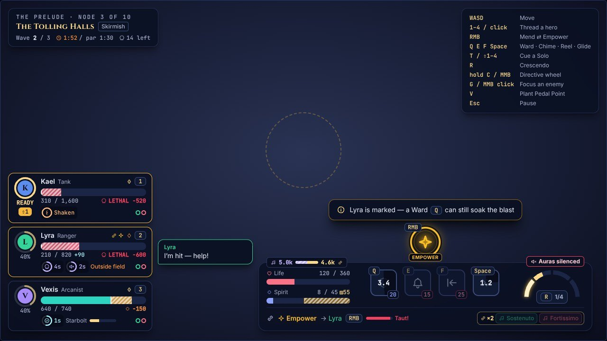
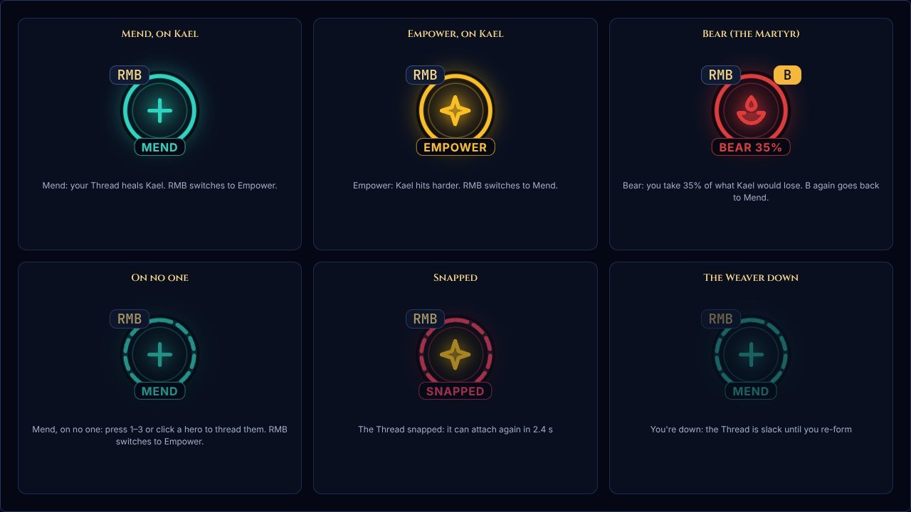
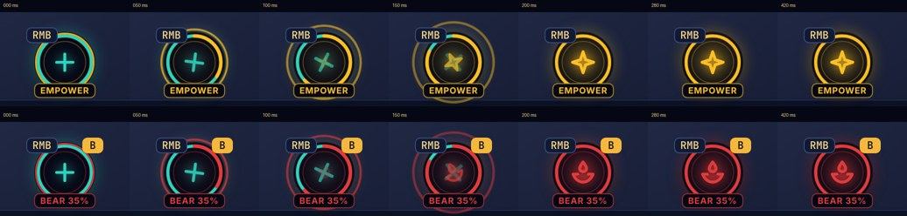
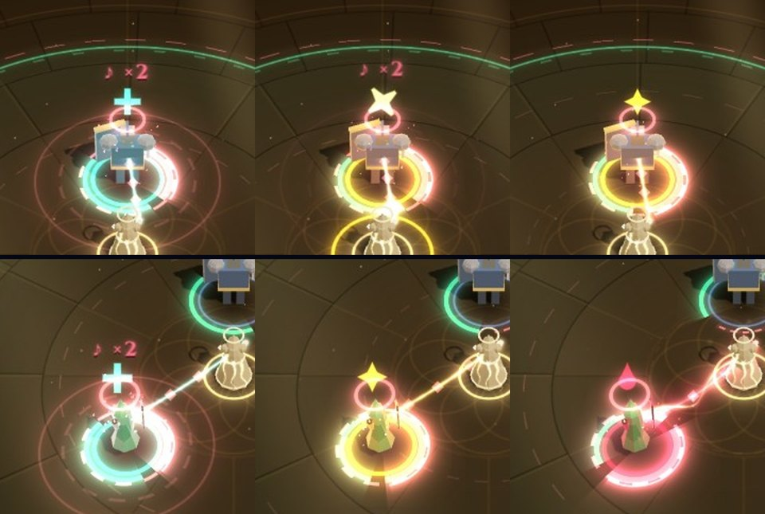
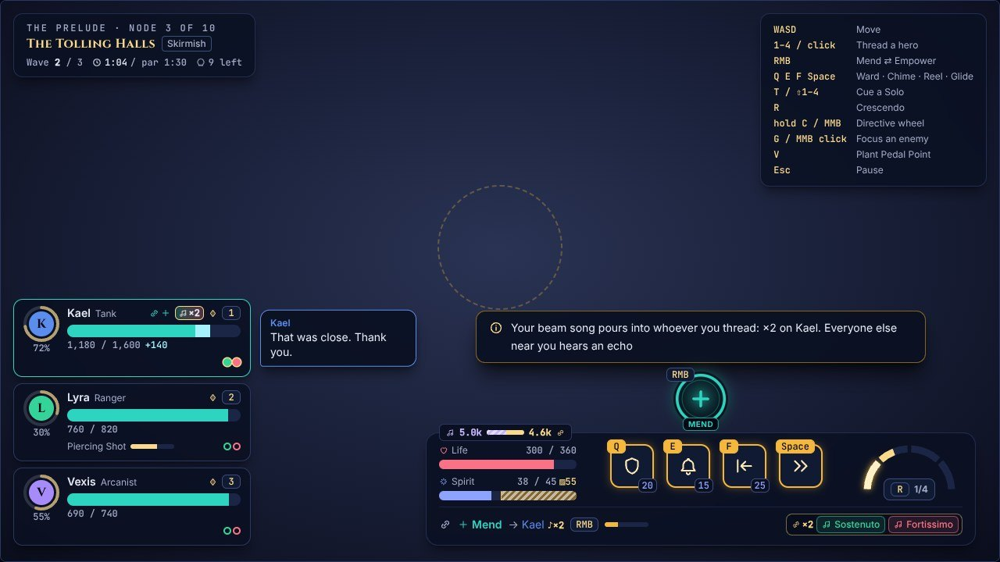
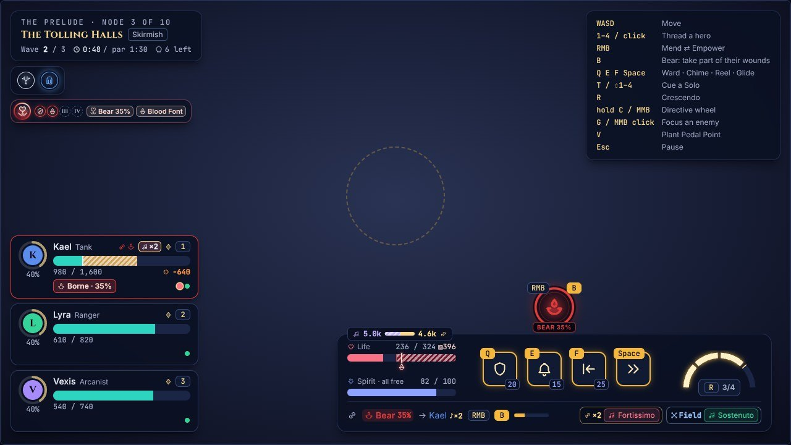

# The Thread dial

*2026-10-31 · plan: [04 §5.2](plan/04-presentation.md#52-layout-combat) · follows [the playtest demo](demo.md)*

Asked for after playing: make it easier to see whether the Thread is Mending or Empowering, in the spirit of Lúcio's crossfade indicator in Overwatch. This takes the idea, not the art: a round mode indicator under your eye that changes with a flourish when you switch. It uses the game's own glyphs and colours. It has two parts: a dial on the HUD and a glyph over the hero you've threaded.

## The dial

It sits over the middle of the Weaver bar, just above the techniques, at the bottom centre of the screen on a wide display.

- **The mode as one glyph** in a ring of its colour:
  - Mend: a plus, in Mend's teal.
  - Empower: a four-point star, in Empower's gold.
  - Bear: a drop, in the Martyr's crimson (on her runs only).
- **Its plate** names the mode: "Mend", "Empower" or "Bear 35%".
- **Its keys** sit on it as they do on the technique buttons:
  - At the top left, the key that switches: RMB, or the key bound to Mend ⇄ Empower in Settings. The right mouse button always works too.
  - At the top right, on the Martyr's runs, Bear's key. It's lit while she Bears.
- **Its states.** It is dimmed, with a dashed ring, while the Thread is on no one. While a snapped Thread can't reattach, its ring turns red and its plate says "Snapped". While the Weaver is down, it fades. The glyph still names the mode in each.
- **It is out of the way.** It takes no pointer events, so a right-click over it still switches. It is labelled for screen readers: "Mend: your Thread heals Kael. RMB switches to Empower."

**The crossfade.** On a switch:
- the new colour sweeps round the ring from the top;
- the old glyph turns away as the new one turns in;
- a ripple of the new colour spreads.

It's over in under half a second. With reduced motion, the stylesheet cuts the animations short, so the dial simply changes.

**Colour and shape both say which mode.** The glyphs differ in shape, so the dial reads under any colour vision. Its colours are the Thread's own Mend and Empower, which the colour-vision palettes rewrite. Two other HUD elements now use the same colours (`threadModeLook`, src/ui/hud/threadMode.ts):
- the bar's Thread row;
- the threaded hero's frame.

Empower there was the HUD's "amp" gold before. That's the same gold in the standard palette, but it differs from the Thread's Empower under the red-green and blue-yellow ones.

## Over the hero

A glyph floats over the threaded hero's head: the same plus, star and drop, in the mode's colour.
- Switching Mend ⇄ Empower morphs the plus into the star (its arms taper to points).
- Bear's drop fades in over it.
- It pops and turns as it changes.

It floats under a call's bubble, so a hero's call covers it while it lasts.

The Thread itself is unchanged: its colour, beads and pulses, the ring at the hero's feet, the motes, and the ring round the Weaver on a switch.

## The bar's crest

The coach hint and the rejections ("Ward: not enough Spirit") used to sit at fixed heights over the bar, and a taller bar could reach them. The bar grows taller with two rows of song chips or the Martyr's marks. Now they rise with it, in a crest over its middle:
- the dial;
- the rejections, to the dial's right;
- the coach hint, above both, centred on the bar.

None of them can cover another, however tall the bar grows. At 1280 px wide, the coach hint now sits over the bar rather than the middle of the screen.

## Cost

The dial is static between switches: over a busy fight's four seconds, nothing in it changed. It sits beside the bar's panel rather than inside it, so the panel's backdrop blur covers no more than it did, and it uses no CSS filters. The glyph over the hero is two sprites in the overhead sprite batch: at most one more draw call.

Measured in the browser under SwiftShader (this container's 4 CPUs), against the commit before. The busy fight is the perf test's: 120 dummies, a dozen enemies, the Skilled bot.

| | Before | With the dial |
|---|---|---|
| Frames per second | 4.24 | 4.28 |
| Sim and bot per tick | 0.63 ms | 0.65 ms |

The perf e2e test's frame budget (95th percentile under 25 ms) can fail in this container with or without the dial. Its frames sometimes jump from about 10 ms to about 100 ms while the software GPU is saturated: the commit before did so in 3 of 4 rounds. That comes from the software GPU, so a real GPU shouldn't see it. `npm run sim:bench -- --check` holds the sim's real budget headless: on average 0.19 ms a tick in its busiest scenario, against 1.5.

## Checks

- **tests/uiThreadDial.test.ts:** the dial's words and states, the bound key, the shared look and the stylesheet's colours, the rejections it shows.
- **tests/renderThreadGlyph.test.ts:** the glyph over the hero:
  - none without a Thread;
  - the plus;
  - the morph to the star and its pop;
  - Bear's drop;
  - each in the mode's colour under every colour vision.
- **e2e:** the real-input test sees the dial turn to Empower on a right-click. The Martyr's test sees it turn to Bear.
- **The UI lab:**
  - `?lab=ui&view=hud-dial` switches every 1.6 s;
  - `hud-dial-martyr` adds Bear;
  - `hud-dial-states` is the gallery above.

## Known gaps

- **No gamepad yet.** Fights don't take a gamepad yet ([docs/demo.md](demo.md)), so the dial names the mouse button or the bound key only.
- **No setting to hide it.**
